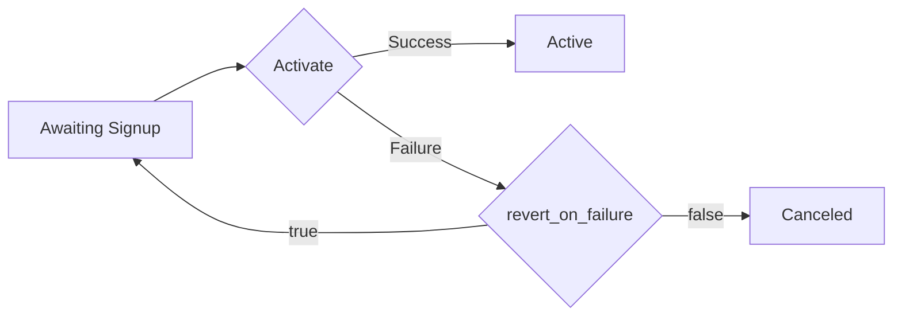

# Reference

Every operation below is shown in its throwing form. On an error status it throws `ApiException<TError>` — the status code, headers, content type and the operation's error type, `RawError` (the raw body) when the spec declares none — and where an operation offers an `…AsResult` sibling, that sibling returns `ApiResult<TResponse, TError>` instead. A request that produces no usable response surfaces as `SdkConnectionException` or `SdkTimeoutException`, a body that does not match the documented response type as `ResponseDeserializationException`, and a required credential that is not configured, or one that cannot be applied, as `AuthSchemeException`; all of them derive from `SdkException` and name the failed call. See [README → Error Handling](README.md#error-handling).

> Source: [MaxioAdvancedBillingClient](src/MaxioAdvancedBilling/MaxioAdvancedBillingClient.cs)

## ApiExports

> Source: [ApiExports](src/MaxioAdvancedBilling/Api/ApiExports.cs)

<details>
<summary><code>Task&lt;BatchJobResponse&gt; ExportInvoices(RequestOptions? requestOptions = null, CancellationToken cancellationToken = default);</code></summary>

<dl>
<dd>

### Description

<dl>
<dd>

Creates an invoices export and returns a batch job object.

**Business rules**

- An export is created → The export runs as an asynchronous batch job: the create call returns a batch job, whose status is read with the Read endpoint before the rows are listed. Poll the export's batch job with the Read endpoint and list rows only after it completes.

</dd>
</dl>

### Usage

<dl>
<dd>

```csharp
try
{
    var response = await client.ApiExports.ExportInvoices();
    // TODO: Handle 'response' of type BatchJobResponse
}
catch (ApiException<ExportInvoicesError> ex)
{
    if (ex.Error.TryGetNoContent(out var error))
    {
        // TODO: Handle 'error' of type RawError
    }
}
```

</dd>
</dl>

### Response

<dl>
<dd>

**OnSuccess**: <code>[BatchJobResponse](src/MaxioAdvancedBilling/Models/BatchJobResponse.cs)</code>

**OnError**: <code>[ApiException](src/MaxioAdvancedBilling/Core/Exceptions/ApiException.cs)&lt;[ExportInvoicesError](src/MaxioAdvancedBilling/Errors/ExportInvoicesError.cs)&gt;</code>

</dd>
</dl>

</dd>
</dl>

</details>

<details>
<summary><code>Task&lt;BatchJobResponse&gt; ExportProformaInvoices(RequestOptions? requestOptions = null, CancellationToken cancellationToken = default);</code></summary>

<dl>
<dd>

### Description

<dl>
<dd>

Creates a proforma invoices export and returns a batch job object. Proforma invoices are only available on Relationship Invoicing sites.

**Business rules**

- A proforma invoices export is created or read on a site without Relationship Invoicing → the outcome is not stated. Use proforma invoice exports only on Relationship Invoicing sites.
- An export is created → The export runs as an asynchronous batch job: the create call returns a batch job, whose status is read with the Read endpoint before the rows are listed. Poll the export's batch job with the Read endpoint and list rows only after it completes.

</dd>
</dl>

### Usage

<dl>
<dd>

```csharp
try
{
    var response = await client.ApiExports.ExportProformaInvoices();
    // TODO: Handle 'response' of type BatchJobResponse
}
catch (ApiException<ExportProformaInvoicesError> ex)
{
    if (ex.Error.TryGetNoContent(out var error))
    {
        // TODO: Handle 'error' of type RawError
    }
}
```

</dd>
</dl>

### Response

<dl>
<dd>

**OnSuccess**: <code>[BatchJobResponse](src/MaxioAdvancedBilling/Models/BatchJobResponse.cs)</code>

**OnError**: <code>[ApiException](src/MaxioAdvancedBilling/Core/Exceptions/ApiException.cs)&lt;[ExportProformaInvoicesError](src/MaxioAdvancedBilling/Errors/ExportProformaInvoicesError.cs)&gt;</code>

</dd>
</dl>

</dd>
</dl>

</details>

<details>
<summary><code>Task&lt;BatchJobResponse&gt; ExportSubscriptions(RequestOptions? requestOptions = null, CancellationToken cancellationToken = default);</code></summary>

<dl>
<dd>

### Description

<dl>
<dd>

Creates a subscriptions export and returns a batch job object.

**Business rules**

- An export is created → The export runs as an asynchronous batch job: the create call returns a batch job, whose status is read with the Read endpoint before the rows are listed. Poll the export's batch job with the Read endpoint and list rows only after it completes.

</dd>
</dl>

### Usage

<dl>
<dd>

```csharp
try
{
    var response = await client.ApiExports.ExportSubscriptions();
    // TODO: Handle 'response' of type BatchJobResponse
}
catch (ApiException<ExportSubscriptionsError> ex)
{
    if (ex.Error.TryGetSingleErrorResponse1(out var error))
    {
        // TODO: Handle 'error' of type SingleErrorResponse1
    }
}
```

</dd>
</dl>

### Response

<dl>
<dd>

**OnSuccess**: <code>[BatchJobResponse](src/MaxioAdvancedBilling/Models/BatchJobResponse.cs)</code>

**OnError**: <code>[ApiException](src/MaxioAdvancedBilling/Core/Exceptions/ApiException.cs)&lt;[ExportSubscriptionsError](src/MaxioAdvancedBilling/Errors/ExportSubscriptionsError.cs)&gt;</code>

</dd>
</dl>

</dd>
</dl>

</details>

<details>
<summary><code>Task&lt;IReadOnlyList&lt;Invoice&gt;&gt; ListExportedInvoices(ListExportedInvoicesRequest request, RequestOptions? requestOptions = null, CancellationToken cancellationToken = default);</code></summary>

<dl>
<dd>

### Description

<dl>
<dd>

Lists exported invoices for a provided `batch_id`. Use pagination to control responses returned from the server.

Example: `GET https://{subdomain}.chargify.com/api_exports/invoices/123/rows?per_page=10000&page=1`.

**Business rules**

- An export is created → The export runs as an asynchronous batch job: the create call returns a batch job, whose status is read with the Read endpoint before the rows are listed. Poll the export's batch job with the Read endpoint and list rows only after it completes.
- Exported rows are listed with per_page above 10000 → per_page is changed to 10000 (the default is 100). Page through exported rows with per_page of at most 10000.
- A list request asks for a page past the last page of results → An empty result set is returned, not an error. Stop paging when a page comes back empty or shorter than per_page.

</dd>
</dl>

### Usage

<dl>
<dd>

```csharp
try
{
    var response = await client.ApiExports.ListExportedInvoices(new ListExportedInvoicesRequest
    {
        BatchId = "some example string",
        Page = 1,
    });
    // TODO: Handle 'response' of type IReadOnlyList<Invoice>
}
catch (ApiException<ListExportedInvoicesError> ex)
{
    if (ex.Error.TryGetNoContent(out var error))
    {
        // TODO: Handle 'error' of type RawError
    }
}
```

</dd>
</dl>

### Request

<dl>
<dd>

<code>[ListExportedInvoicesRequest](src/MaxioAdvancedBilling/Requests/ApiExports/ListExportedInvoicesRequest.cs)</code>

</dd>
</dl>

### Response

<dl>
<dd>

**OnSuccess**: <code>IReadOnlyList&lt;[Invoice](src/MaxioAdvancedBilling/Models/Invoice.cs)&gt;</code>

**OnError**: <code>[ApiException](src/MaxioAdvancedBilling/Core/Exceptions/ApiException.cs)&lt;[ListExportedInvoicesError](src/MaxioAdvancedBilling/Errors/ListExportedInvoicesError.cs)&gt;</code>

</dd>
</dl>

</dd>
</dl>

</details>

<details>
<summary><code>Task&lt;IReadOnlyList&lt;ProformaInvoice&gt;&gt; ListExportedProformaInvoices(ListExportedProformaInvoicesRequest request, RequestOptions? requestOptions = null, CancellationToken cancellationToken = default);</code></summary>

<dl>
<dd>

### Description

<dl>
<dd>

Lists exported proforma invoices for a provided `batch_id`. Use pagination to control responses returned from the server.

Example: `GET https://{subdomain}.chargify.com/api_exports/proforma_invoices/123/rows?per_page=10000&page=1`.

**Business rules**

- An export is created → The export runs as an asynchronous batch job: the create call returns a batch job, whose status is read with the Read endpoint before the rows are listed. Poll the export's batch job with the Read endpoint and list rows only after it completes.
- Exported rows are listed with per_page above 10000 → per_page is changed to 10000 (the default is 100). Page through exported rows with per_page of at most 10000.
- A list request asks for a page past the last page of results → An empty result set is returned, not an error. Stop paging when a page comes back empty or shorter than per_page.

</dd>
</dl>

### Usage

<dl>
<dd>

```csharp
try
{
    var response = await client.ApiExports.ListExportedProformaInvoices(new ListExportedProformaInvoicesRequest
    {
        BatchId = "some example string",
        Page = 1,
    });
    // TODO: Handle 'response' of type IReadOnlyList<ProformaInvoice>
}
catch (ApiException<ListExportedProformaInvoicesError> ex)
{
    if (ex.Error.TryGetNoContent(out var error))
    {
        // TODO: Handle 'error' of type RawError
    }
}
```

</dd>
</dl>

### Request

<dl>
<dd>

<code>[ListExportedProformaInvoicesRequest](src/MaxioAdvancedBilling/Requests/ApiExports/ListExportedProformaInvoicesRequest.cs)</code>

</dd>
</dl>

### Response

<dl>
<dd>

**OnSuccess**: <code>IReadOnlyList&lt;[ProformaInvoice](src/MaxioAdvancedBilling/Models/ProformaInvoice.cs)&gt;</code>

**OnError**: <code>[ApiException](src/MaxioAdvancedBilling/Core/Exceptions/ApiException.cs)&lt;[ListExportedProformaInvoicesError](src/MaxioAdvancedBilling/Errors/ListExportedProformaInvoicesError.cs)&gt;</code>

</dd>
</dl>

</dd>
</dl>

</details>

<details>
<summary><code>Task&lt;IReadOnlyList&lt;Subscription&gt;&gt; ListExportedSubscriptions(ListExportedSubscriptionsRequest request, RequestOptions? requestOptions = null, CancellationToken cancellationToken = default);</code></summary>

<dl>
<dd>

### Description

<dl>
<dd>

Lists exported subscriptions for a provided `batch_id`. Use pagination to control responses returned from the server.

Example: `GET https://{subdomain}.chargify.com/api_exports/subscriptions/123/rows?per_page=200&page=1`.

**Business rules**

- An export is created → The export runs as an asynchronous batch job: the create call returns a batch job, whose status is read with the Read endpoint before the rows are listed. Poll the export's batch job with the Read endpoint and list rows only after it completes.
- Exported rows are listed with per_page above 10000 → per_page is changed to 10000 (the default is 100). Page through exported rows with per_page of at most 10000.
- A list request asks for a page past the last page of results → An empty result set is returned, not an error. Stop paging when a page comes back empty or shorter than per_page.

</dd>
</dl>

### Usage

<dl>
<dd>

```csharp
try
{
    var response = await client.ApiExports.ListExportedSubscriptions(new ListExportedSubscriptionsRequest
    {
        BatchId = "some example string",
        Page = 1,
    });
    // TODO: Handle 'response' of type IReadOnlyList<Subscription>
}
catch (ApiException<ListExportedSubscriptionsError> ex)
{
    if (ex.Error.TryGetNoContent(out var error))
    {
        // TODO: Handle 'error' of type RawError
    }
}
```

</dd>
</dl>

### Request

<dl>
<dd>

<code>[ListExportedSubscriptionsRequest](src/MaxioAdvancedBilling/Requests/ApiExports/ListExportedSubscriptionsRequest.cs)</code>

</dd>
</dl>

### Response

<dl>
<dd>

**OnSuccess**: <code>IReadOnlyList&lt;[Subscription](src/MaxioAdvancedBilling/Models/Subscription.cs)&gt;</code>

**OnError**: <code>[ApiException](src/MaxioAdvancedBilling/Core/Exceptions/ApiException.cs)&lt;[ListExportedSubscriptionsError](src/MaxioAdvancedBilling/Errors/ListExportedSubscriptionsError.cs)&gt;</code>

</dd>
</dl>

</dd>
</dl>

</details>

<details>
<summary><code>Task&lt;BatchJobResponse&gt; ReadInvoicesExport(ReadInvoicesExportRequest request, RequestOptions? requestOptions = null, CancellationToken cancellationToken = default);</code></summary>

<dl>
<dd>

### Description

<dl>
<dd>

Returns a batch job object for an invoices export.

**Business rules**

- An export is created → The export runs as an asynchronous batch job: the create call returns a batch job, whose status is read with the Read endpoint before the rows are listed. Poll the export's batch job with the Read endpoint and list rows only after it completes.

</dd>
</dl>

### Usage

<dl>
<dd>

```csharp
try
{
    var response = await client.ApiExports.ReadInvoicesExport(new ReadInvoicesExportRequest
    {
        BatchId = "some example string",
    });
    // TODO: Handle 'response' of type BatchJobResponse
}
catch (ApiException<ReadInvoicesExportError> ex)
{
    if (ex.Error.TryGetNoContent(out var error))
    {
        // TODO: Handle 'error' of type RawError
    }
}
```

</dd>
</dl>

### Request

<dl>
<dd>

<code>[ReadInvoicesExportRequest](src/MaxioAdvancedBilling/Requests/ApiExports/ReadInvoicesExportRequest.cs)</code>

</dd>
</dl>

### Response

<dl>
<dd>

**OnSuccess**: <code>[BatchJobResponse](src/MaxioAdvancedBilling/Models/BatchJobResponse.cs)</code>

**OnError**: <code>[ApiException](src/MaxioAdvancedBilling/Core/Exceptions/ApiException.cs)&lt;[ReadInvoicesExportError](src/MaxioAdvancedBilling/Errors/ReadInvoicesExportError.cs)&gt;</code>

</dd>
</dl>

</dd>
</dl>

</details>

<details>
<summary><code>Task&lt;BatchJobResponse&gt; ReadProformaInvoicesExport(ReadProformaInvoicesExportRequest request, RequestOptions? requestOptions = null, CancellationToken cancellationToken = default);</code></summary>

<dl>
<dd>

### Description

<dl>
<dd>

Returns a batch job object for a proforma invoices export. Proforma invoices are only available on Relationship Invoicing sites.

**Business rules**

- A proforma invoices export is created or read on a site without Relationship Invoicing → the outcome is not stated. Use proforma invoice exports only on Relationship Invoicing sites.
- An export is created → The export runs as an asynchronous batch job: the create call returns a batch job, whose status is read with the Read endpoint before the rows are listed. Poll the export's batch job with the Read endpoint and list rows only after it completes.

</dd>
</dl>

### Usage

<dl>
<dd>

```csharp
try
{
    var response = await client.ApiExports.ReadProformaInvoicesExport(new ReadProformaInvoicesExportRequest
    {
        BatchId = "some example string",
    });
    // TODO: Handle 'response' of type BatchJobResponse
}
catch (ApiException<ReadProformaInvoicesExportError> ex)
{
    if (ex.Error.TryGetNoContent(out var error))
    {
        // TODO: Handle 'error' of type RawError
    }
}
```

</dd>
</dl>

### Request

<dl>
<dd>

<code>[ReadProformaInvoicesExportRequest](src/MaxioAdvancedBilling/Requests/ApiExports/ReadProformaInvoicesExportRequest.cs)</code>

</dd>
</dl>

### Response

<dl>
<dd>

**OnSuccess**: <code>[BatchJobResponse](src/MaxioAdvancedBilling/Models/BatchJobResponse.cs)</code>

**OnError**: <code>[ApiException](src/MaxioAdvancedBilling/Core/Exceptions/ApiException.cs)&lt;[ReadProformaInvoicesExportError](src/MaxioAdvancedBilling/Errors/ReadProformaInvoicesExportError.cs)&gt;</code>

</dd>
</dl>

</dd>
</dl>

</details>

<details>
<summary><code>Task&lt;BatchJobResponse&gt; ReadSubscriptionsExport(ReadSubscriptionsExportRequest request, RequestOptions? requestOptions = null, CancellationToken cancellationToken = default);</code></summary>

<dl>
<dd>

### Description

<dl>
<dd>

Returns a batch job object for a subscriptions export.

**Business rules**

- An export is created → The export runs as an asynchronous batch job: the create call returns a batch job, whose status is read with the Read endpoint before the rows are listed. Poll the export's batch job with the Read endpoint and list rows only after it completes.

</dd>
</dl>

### Usage

<dl>
<dd>

```csharp
try
{
    var response = await client.ApiExports.ReadSubscriptionsExport(new ReadSubscriptionsExportRequest
    {
        BatchId = "some example string",
    });
    // TODO: Handle 'response' of type BatchJobResponse
}
catch (ApiException<ReadSubscriptionsExportError> ex)
{
    if (ex.Error.TryGetNoContent(out var error))
    {
        // TODO: Handle 'error' of type RawError
    }
}
```

</dd>
</dl>

### Request

<dl>
<dd>

<code>[ReadSubscriptionsExportRequest](src/MaxioAdvancedBilling/Requests/ApiExports/ReadSubscriptionsExportRequest.cs)</code>

</dd>
</dl>

### Response

<dl>
<dd>

**OnSuccess**: <code>[BatchJobResponse](src/MaxioAdvancedBilling/Models/BatchJobResponse.cs)</code>

**OnError**: <code>[ApiException](src/MaxioAdvancedBilling/Core/Exceptions/ApiException.cs)&lt;[ReadSubscriptionsExportError](src/MaxioAdvancedBilling/Errors/ReadSubscriptionsExportError.cs)&gt;</code>

</dd>
</dl>

</dd>
</dl>

</details>

## AdvanceInvoice

> Source: [AdvanceInvoice](src/MaxioAdvancedBilling/Api/AdvanceInvoice.cs)

<details>
<summary><code>Task&lt;Invoice&gt; IssueAdvanceInvoice(IssueAdvanceInvoiceOperationRequest request, RequestOptions? requestOptions = null, CancellationToken cancellationToken = default);</code></summary>

<dl>
<dd>

### Description

<dl>
<dd>

Issues an invoice in advance for a subscription's next renewal date. For the most part, advance invoices function like any other invoice, except they are issued early and have special behavior upon being voided. For more information on advance invoices, including eligibility for generating one, see [Issue Invoice In Advance](https://maxio.zendesk.com/hc/en-us/articles/24252026404749-Issue-Invoice-In-Advance).

A subscription can only have one advance invoice per billing period. Attempting to issue an advance invoice when one already exists returns an error.

Regeneration of the invoice can be forced with the params `force: true`, which voids an advance invoice if one exists and generates a new one. If no advance invoice exists, a new one is generated.

Consider using either the create or preview endpoints for proforma invoices to preview this advance invoice before using this endpoint to generate it.

**Business rules**

- An advance invoice is requested for a subscription that has nothing due → Maxio answers 422 with "Cannot generate an invoice in advance when nothing is due". Check that the subscription has an amount due at its next renewal before issuing an advance invoice.
- An advance invoice is requested for a subscription that uses prepaid components → Maxio answers 422 with "Cannot generate an invoice in advance when a subscription uses prepaid components". Do not offer advance invoices for subscriptions with prepaid components.
- An advance invoice is requested while the subscription already has one for the billing period (and force is not true) → Maxio answers 422 with "Advance invoice already exists". Read the existing advance invoice first, or send force: true to replace it on purpose.
- An advance invoice is requested for a subscription that belongs to a subscription group → Maxio answers 422 with "Cannot generate an invoice in advance for subscription in the group". Do not offer advance invoices for grouped subscriptions.
- An advance invoice is requested for an inactive (end-of-life) subscription → Maxio answers 422 with "Cannot generate an invoice in advance for inactive subscription". Issue advance invoices only for live subscriptions.
- An advance invoice is requested for a subscription on calendar billing → Maxio answers 422 with "Cannot generate an invoice in advance for a calendar billing subscription". Do not offer advance invoices for calendar-billing subscriptions.
- An advance invoice is requested for a prepaid subscription → Maxio answers 422 with "Cannot generate an invoice in advance for a prepaid subscription". Do not offer advance invoices for prepaid subscriptions.
- An advance invoice is requested within an hour of the subscription's renewal → Maxio answers 422 with "Cannot generate an invoice in advance within an hour of renewal". Compare the time to the next renewal and do not request an advance invoice in the last hour before it.
- An advance invoice is requested for a subscription that uses the site-level exchange rate → Maxio answers 422 with "Cannot generate an invoice in advance for a subscription using the site level exchange rate". Do not offer advance invoices for subscriptions priced with the site-level exchange rate.
- An advance invoice is issued with force: true → Any existing advance invoice is voided and a new one is generated; if none exists a new one is generated. Send force: true only when voiding the current advance invoice is intended, and treat the old invoice as voided.
- An invoice is issued for a subscription on a Relationship Invoicing site → An invoice_issued webhook is sent. Listen for invoice_issued to learn about issued invoices.
- An invoice is issued while the subscription has prepayments, with the site's prepayment setting (Config > Settings > Prepayments) in force → Prepayments are applied on issue, on the due date, or not at all per the setting; defaults are on the due date for automatic and on issue for remittance. Check the site's prepayment setting before assuming prepayments reduce an invoice when it is issued.
- An invoice with net terms is issued while the subscription has prepayments → Prepayments are not applied automatically on issue; they are applied automatically only when the invoice has no net terms. Apply prepayments yourself (record a prepayment-type payment) to invoices that have net terms.
- A line item's period_range_start and period_range_end are set → Charges in advance run from the billing date to the next billing date; charges in arrears (metered) run from the previous billing to the current one; one-off charges have equal dates. Read the period range according to whether the charge is billed in advance, in arrears or once.
- A line item bills a component → product_id may be set even for component charges; only a nil component_id marks a product-only charge. Use component_id, not product_id, to tell component charges from product charges.
- A consolidated (parent) invoice is returned → The parent invoice has no line items of its own; its totals aggregate the segments. Read a consolidated invoice's lines from its segments, not from the parent.
- Branding Themes are not enabled for the site → branding_theme_id is not available on invoices. Treat branding_theme_id as optional and only rely on it when Branding Themes are enabled.
- An invoice is returned → total_amount is computed as subtotal_amount - discount_amount + tax_amount. Use the returned total_amount rather than recomputing it from line items.
- An invoice is returned → due_amount is computed as total_amount - credit_amount - paid_amount. Use due_amount as the amount still owed; it already nets out credits and payments.
- An invoice has received only partial payment → paid_date stays empty until the invoice is paid in full. Do not treat an empty paid_date as no payment; check paid_amount for partial payments.
- An invoice or credit note returns issue_date, due_date or paid_date → The date is the site's local calendar date, not a UTC date. Interpret invoice and credit-note dates in the site's time zone.
- Line-item amounts are summed or recomputed by the client → subtotal_amount is the canonical line amount; the sum of line total_amounts may not equal the invoice total_amount because of rounding. Reconcile against the invoice totals, not the sum of line total_amount values.
- A line item shows discount_amount or tax_amount → The per-line discount and tax are approximations of the invoice-level amounts apportioned across lines. Use the invoice-level discount_amount and tax_amount for accounting, not the sum of per-line values.
- A line item is returned with tax_included → tax_included is inherited from the source price point; custom or ad hoc lines always return false. Do not expect tax-inclusive pricing on custom ad hoc lines.
- A line item was priced with a tiered scheme → unit_price is the blended average per unit and tiered_unit_price is true. Do not multiply unit_price by quantity to re-derive tiered charges; use subtotal_amount.
- The subscription's advance invoice for the period has been voided → A new advance invoice can be issued for the same period. Allow issuing a new advance invoice after voiding the old one.

</dd>
</dl>

### Usage

<dl>
<dd>

```csharp
try
{
    var response = await client.AdvanceInvoice.IssueAdvanceInvoice(new IssueAdvanceInvoiceOperationRequest
    {
        SubscriptionId = 1,
        Body = new IssueAdvanceInvoiceRequest { Force = true },
    });
    // TODO: Handle 'response' of type Invoice
}
catch (ApiException<IssueAdvanceInvoiceError> ex)
{
    if (ex.Error.TryGetNoContent(out var error))
    {
        // TODO: Handle 'error' of type RawError
    }
}
```

</dd>
</dl>

### Request

<dl>
<dd>

<code>[IssueAdvanceInvoiceOperationRequest](src/MaxioAdvancedBilling/Requests/AdvanceInvoice/IssueAdvanceInvoiceOperationRequest.cs)</code>

</dd>
</dl>

### Response

<dl>
<dd>

**OnSuccess**: <code>[Invoice](src/MaxioAdvancedBilling/Models/Invoice.cs)</code>

**OnError**: <code>[ApiException](src/MaxioAdvancedBilling/Core/Exceptions/ApiException.cs)&lt;[IssueAdvanceInvoiceError](src/MaxioAdvancedBilling/Errors/IssueAdvanceInvoiceError.cs)&gt;</code>

</dd>
</dl>

</dd>
</dl>

</details>

<details>
<summary><code>Task&lt;Invoice&gt; ReadAdvanceInvoice(ReadAdvanceInvoiceRequest request, RequestOptions? requestOptions = null, CancellationToken cancellationToken = default);</code></summary>

<dl>
<dd>

### Description

<dl>
<dd>

Returns the advance invoice generated for a subscription's upcoming renewal. There can only be one advance invoice per subscription per billing cycle.

**Business rules**

- A line item's period_range_start and period_range_end are set → Charges in advance run from the billing date to the next billing date; charges in arrears (metered) run from the previous billing to the current one; one-off charges have equal dates. Read the period range according to whether the charge is billed in advance, in arrears or once.
- A line item bills a component → product_id may be set even for component charges; only a nil component_id marks a product-only charge. Use component_id, not product_id, to tell component charges from product charges.
- A consolidated (parent) invoice is returned → The parent invoice has no line items of its own; its totals aggregate the segments. Read a consolidated invoice's lines from its segments, not from the parent.
- Branding Themes are not enabled for the site → branding_theme_id is not available on invoices. Treat branding_theme_id as optional and only rely on it when Branding Themes are enabled.
- An invoice is returned → total_amount is computed as subtotal_amount - discount_amount + tax_amount. Use the returned total_amount rather than recomputing it from line items.
- An invoice is returned → due_amount is computed as total_amount - credit_amount - paid_amount. Use due_amount as the amount still owed; it already nets out credits and payments.
- An invoice has received only partial payment → paid_date stays empty until the invoice is paid in full. Do not treat an empty paid_date as no payment; check paid_amount for partial payments.
- An invoice or credit note returns issue_date, due_date or paid_date → The date is the site's local calendar date, not a UTC date. Interpret invoice and credit-note dates in the site's time zone.
- Line-item amounts are summed or recomputed by the client → subtotal_amount is the canonical line amount; the sum of line total_amounts may not equal the invoice total_amount because of rounding. Reconcile against the invoice totals, not the sum of line total_amount values.
- A line item shows discount_amount or tax_amount → The per-line discount and tax are approximations of the invoice-level amounts apportioned across lines. Use the invoice-level discount_amount and tax_amount for accounting, not the sum of per-line values.
- A line item is returned with tax_included → tax_included is inherited from the source price point; custom or ad hoc lines always return false. Do not expect tax-inclusive pricing on custom ad hoc lines.
- A line item was priced with a tiered scheme → unit_price is the blended average per unit and tiered_unit_price is true. Do not multiply unit_price by quantity to re-derive tiered charges; use subtotal_amount.

</dd>
</dl>

### Usage

<dl>
<dd>

```csharp
try
{
    var response = await client.AdvanceInvoice.ReadAdvanceInvoice(new ReadAdvanceInvoiceRequest { SubscriptionId = 1 });
    // TODO: Handle 'response' of type Invoice
}
catch (ApiException<ReadAdvanceInvoiceError> ex)
{
    if (ex.Error.TryGetNoContent(out var error))
    {
        // TODO: Handle 'error' of type RawError
    }
}
```

</dd>
</dl>

### Request

<dl>
<dd>

<code>[ReadAdvanceInvoiceRequest](src/MaxioAdvancedBilling/Requests/AdvanceInvoice/ReadAdvanceInvoiceRequest.cs)</code>

</dd>
</dl>

### Response

<dl>
<dd>

**OnSuccess**: <code>[Invoice](src/MaxioAdvancedBilling/Models/Invoice.cs)</code>

**OnError**: <code>[ApiException](src/MaxioAdvancedBilling/Core/Exceptions/ApiException.cs)&lt;[ReadAdvanceInvoiceError](src/MaxioAdvancedBilling/Errors/ReadAdvanceInvoiceError.cs)&gt;</code>

</dd>
</dl>

</dd>
</dl>

</details>

<details>
<summary><code>Task&lt;Invoice&gt; VoidAdvanceInvoice(VoidAdvanceInvoiceRequest request, RequestOptions? requestOptions = null, CancellationToken cancellationToken = default);</code></summary>

<dl>
<dd>

### Description

<dl>
<dd>

Voids a subscription's existing advance invoice. Once voided, it can later be regenerated if desired.

A `reason` is required to void, and the invoice must have an open status. Voiding causes any prepayments and credits that were applied to the invoice to be returned to the subscription.

For a full overview of the impact of voiding, see [Invoice]($m/Invoice).

**Business rules**

- The subscription's advance invoice is not in open status when a void is requested → the outcome is not stated. Void an advance invoice only while its status is open.
- A line item's period_range_start and period_range_end are set → Charges in advance run from the billing date to the next billing date; charges in arrears (metered) run from the previous billing to the current one; one-off charges have equal dates. Read the period range according to whether the charge is billed in advance, in arrears or once.
- A line item bills a component → product_id may be set even for component charges; only a nil component_id marks a product-only charge. Use component_id, not product_id, to tell component charges from product charges.
- A consolidated (parent) invoice is returned → The parent invoice has no line items of its own; its totals aggregate the segments. Read a consolidated invoice's lines from its segments, not from the parent.
- Branding Themes are not enabled for the site → branding_theme_id is not available on invoices. Treat branding_theme_id as optional and only rely on it when Branding Themes are enabled.
- An invoice is returned → total_amount is computed as subtotal_amount - discount_amount + tax_amount. Use the returned total_amount rather than recomputing it from line items.
- An invoice is returned → due_amount is computed as total_amount - credit_amount - paid_amount. Use due_amount as the amount still owed; it already nets out credits and payments.
- An invoice has received only partial payment → paid_date stays empty until the invoice is paid in full. Do not treat an empty paid_date as no payment; check paid_amount for partial payments.
- An invoice or credit note returns issue_date, due_date or paid_date → The date is the site's local calendar date, not a UTC date. Interpret invoice and credit-note dates in the site's time zone.
- Line-item amounts are summed or recomputed by the client → subtotal_amount is the canonical line amount; the sum of line total_amounts may not equal the invoice total_amount because of rounding. Reconcile against the invoice totals, not the sum of line total_amount values.
- A line item shows discount_amount or tax_amount → The per-line discount and tax are approximations of the invoice-level amounts apportioned across lines. Use the invoice-level discount_amount and tax_amount for accounting, not the sum of per-line values.
- A line item is returned with tax_included → tax_included is inherited from the source price point; custom or ad hoc lines always return false. Do not expect tax-inclusive pricing on custom ad hoc lines.
- A line item was priced with a tiered scheme → unit_price is the blended average per unit and tiered_unit_price is true. Do not multiply unit_price by quantity to re-derive tiered charges; use subtotal_amount.
- An advance invoice is voided → Prepayments and credits that were applied to the invoice are returned to the subscription. Expect the subscription's prepayment and service credit balances to rise again after voiding an advance invoice.
- The subscription's advance invoice for the period has been voided → A new advance invoice can be issued for the same period. Allow issuing a new advance invoice after voiding the old one.

</dd>
</dl>

### Usage

<dl>
<dd>

```csharp
try
{
    var response = await client.AdvanceInvoice.VoidAdvanceInvoice(new VoidAdvanceInvoiceRequest { SubscriptionId = 1 });
    // TODO: Handle 'response' of type Invoice
}
catch (ApiException<VoidAdvanceInvoiceError> ex)
{
    if (ex.Error.TryGetNoContent(out var error))
    {
        // TODO: Handle 'error' of type RawError
    }
}
```

</dd>
</dl>

### Request

<dl>
<dd>

<code>[VoidAdvanceInvoiceRequest](src/MaxioAdvancedBilling/Requests/AdvanceInvoice/VoidAdvanceInvoiceRequest.cs)</code>

</dd>
</dl>

### Response

<dl>
<dd>

**OnSuccess**: <code>[Invoice](src/MaxioAdvancedBilling/Models/Invoice.cs)</code>

**OnError**: <code>[ApiException](src/MaxioAdvancedBilling/Core/Exceptions/ApiException.cs)&lt;[VoidAdvanceInvoiceError](src/MaxioAdvancedBilling/Errors/VoidAdvanceInvoiceError.cs)&gt;</code>

</dd>
</dl>

</dd>
</dl>

</details>

## BillingPortal

> Source: [BillingPortal](src/MaxioAdvancedBilling/Api/BillingPortal.cs)

<details>
<summary><code>Task&lt;CustomerResponse&gt; EnableBillingPortalForCustomer(EnableBillingPortalForCustomerRequest request, RequestOptions? requestOptions = null, CancellationToken cancellationToken = default);</code></summary>

<dl>
<dd>

### Description

<dl>
<dd>

Enables Billing Portal access for a customer, with an option to send an invitation email at the same time.

## Billing Portal Security

If your customer has been invited to the Billing Portal, they receive a link to manage their subscription (the “Management URL”) automatically at the bottom of their statements, invoices, and receipts. **This link changes periodically for security and is only valid for 65 days.**

If you need to provide your customer their Management URL through other means, you can retrieve it [via the API]($e/Billing%20Portal/readBillingPortalLink). Because the URL is cryptographically signed with a timestamp, merchants cannot generate the URL without requesting it through the API.

To prevent abuse and overuse, request a new URL only when absolutely necessary. Management URLs are good for 65 days, so you should re-use a previously generated one as much as possible. If you use the URL frequently (such as to display on your website), **do not** make an API request every time.

For more information configuring the Billing Portal, see [Billing Portal Overview](https://maxio.zendesk.com/hc/en-us/articles/24252412965133-Billing-Portal-Overview).

**Business rules**

- Billing Portal access is enabled for a customer who already has it enabled → Maxio answers 422 with "Portal is already enabled for this customer.". Check portal_customer_created_at or handle the 422 as already enabled instead of retrying.
- auto_invite=1 is sent in the query when enabling the Billing Portal → An invitation email is sent to the customer; with auto_invite=0 or no auto_invite, no email is sent. Send auto_invite=1 only when the customer should receive the portal invitation email now.
- The customer has been invited to the Billing Portal → The customer's statements, invoices and receipts automatically carry the Management URL at the bottom. Expect invited customers' documents to include a portal link; do not invite customers who must not see one.
- A Management URL is issued for a customer → The URL changes periodically for security and is valid for only 65 days. Store the URL with its expires_at and fetch a new one before it expires rather than keeping it indefinitely.

</dd>
</dl>

### Usage

<dl>
<dd>

```csharp
try
{
    var response = await client.BillingPortal.EnableBillingPortalForCustomer(new EnableBillingPortalForCustomerRequest
    {
        CustomerId = 1,
    });
    // TODO: Handle 'response' of type CustomerResponse
}
catch (ApiException<EnableBillingPortalForCustomerError> ex)
{
    if (ex.Error.TryGetErrorListResponse1(out var error))
    {
        // TODO: Handle 'error' of type ErrorListResponse1
    }
}
```

</dd>
</dl>

### Request

<dl>
<dd>

<code>[EnableBillingPortalForCustomerRequest](src/MaxioAdvancedBilling/Requests/BillingPortal/EnableBillingPortalForCustomerRequest.cs)</code>

</dd>
</dl>

### Response

<dl>
<dd>

**OnSuccess**: <code>[CustomerResponse](src/MaxioAdvancedBilling/Models/CustomerResponse.cs)</code>

**OnError**: <code>[ApiException](src/MaxioAdvancedBilling/Core/Exceptions/ApiException.cs)&lt;[EnableBillingPortalForCustomerError](src/MaxioAdvancedBilling/Errors/EnableBillingPortalForCustomerError.cs)&gt;</code>

</dd>
</dl>

</dd>
</dl>

</details>

<details>
<summary><code>Task&lt;PortalManagementLink&gt; ReadBillingPortalLink(ReadBillingPortalLinkRequest request, RequestOptions? requestOptions = null, CancellationToken cancellationToken = default);</code></summary>

<dl>
<dd>

### Description

<dl>
<dd>

Returns the exact URL required for a subscriber to access the Billing Portal.

## Management Link Request Rules

+ When retrieving a management URL, multiple requests for the same customer in a short period return the **same** URL
+ A new URL is not generated for 15 days
+ You must cache and remember this URL if you are going to need it again within 15 days
+ Only request a new URL after the `new_link_available_at` date
+ You are limited to 15 requests for the same URL. If you make more than 15 requests before `new_link_available_at`, you are blocked from further Management URL requests (with a response code `429`).

**Business rules**

- The management link is requested for a customer whose Billing Portal is not enabled → Maxio answers 422 with "Billing Portal is not enabled for this customer.". Enable the Billing Portal for the customer before requesting the management link.
- More than 15 management link requests are made for the same customer before new_link_available_at → Maxio answers 429 with "Too many requests for this customer's management link". Count link requests per customer and wait until the returned new_link_available_at after a 429.
- A Management URL is issued for a customer → The URL changes periodically for security and is valid for only 65 days. Store the URL with its expires_at and fetch a new one before it expires rather than keeping it indefinitely.
- The management link is requested again for the same customer before new_link_available_at → The same URL is returned; a new URL is not generated for 15 days. Cache the URL and request a new one only after new_link_available_at.
- A merchant needs a customer's Management URL outside the statements, invoices and receipts that carry it → The URL is cryptographically signed with a timestamp, so it can only be obtained by requesting it through the API. Fetch the Management URL from the API; never build it yourself.

</dd>
</dl>

### Usage

<dl>
<dd>

```csharp
try
{
    var response = await client.BillingPortal.ReadBillingPortalLink(new ReadBillingPortalLinkRequest
    {
        CustomerId = 1,
    });
    // TODO: Handle 'response' of type PortalManagementLink
}
catch (ApiException<ReadBillingPortalLinkError> ex)
{
    if (ex.Error.TryGetErrorListResponse1(out var error))
    {
        // TODO: Handle 'error' of type ErrorListResponse1
    }
}
```

</dd>
</dl>

### Request

<dl>
<dd>

<code>[ReadBillingPortalLinkRequest](src/MaxioAdvancedBilling/Requests/BillingPortal/ReadBillingPortalLinkRequest.cs)</code>

</dd>
</dl>

### Response

<dl>
<dd>

**OnSuccess**: <code>[PortalManagementLink](src/MaxioAdvancedBilling/Models/PortalManagementLink.cs)</code>

**OnError**: <code>[ApiException](src/MaxioAdvancedBilling/Core/Exceptions/ApiException.cs)&lt;[ReadBillingPortalLinkError](src/MaxioAdvancedBilling/Errors/ReadBillingPortalLinkError.cs)&gt;</code>

</dd>
</dl>

</dd>
</dl>

</details>

<details>
<summary><code>Task&lt;ResentInvitation&gt; ResendBillingPortalInvitation(ResendBillingPortalInvitationRequest request, RequestOptions? requestOptions = null, CancellationToken cancellationToken = default);</code></summary>

<dl>
<dd>

### Description

<dl>
<dd>

Resends a customer's Billing Portal invitation.

If you attempt to resend an invitation 5 times within 30 minutes, you will receive a `422` response with an `error` message in the body.

If you attempt to resend an invitation when the Billing Portal is already disabled for a Customer, you will receive a `422` error response.

If you attempt to resend an invitation when the Customer does not exist, you will receive a `404` error response.

## Limitations

This endpoint will only return a JSON response.

**Business rules**

- A customer's Billing Portal invitation is resent 5 times within 30 minutes → Maxio answers 422 with "Too many requests for this customer. You can perform 5 requests within 00:30:00.". Keep invitation resends for one customer below 5 in any 30 minutes and back off on this 422.
- An invitation is resent for a customer whose Billing Portal is already disabled → Maxio answers 422. Enable the Billing Portal for the customer before resending the invitation.
- An invitation is resent for a customer that does not exist → Maxio answers 404. Treat a 404 as a missing customer, not a transient failure.
- The invitation resend or revoke endpoint is called with a non-JSON format → The endpoint only returns a JSON response. Call these endpoints with the .json format and parse JSON.

</dd>
</dl>

### Usage

<dl>
<dd>

```csharp
try
{
    var response = await client.BillingPortal.ResendBillingPortalInvitation(new ResendBillingPortalInvitationRequest
    {
        CustomerId = 1,
    });
    // TODO: Handle 'response' of type ResentInvitation
}
catch (ApiException<ResendBillingPortalInvitationError> ex)
{
    if (ex.Error.TryGetNoContent(out var error))
    {
        // TODO: Handle 'error' of type RawError
    }
}
```

</dd>
</dl>

### Request

<dl>
<dd>

<code>[ResendBillingPortalInvitationRequest](src/MaxioAdvancedBilling/Requests/BillingPortal/ResendBillingPortalInvitationRequest.cs)</code>

</dd>
</dl>

### Response

<dl>
<dd>

**OnSuccess**: <code>[ResentInvitation](src/MaxioAdvancedBilling/Models/ResentInvitation.cs)</code>

**OnError**: <code>[ApiException](src/MaxioAdvancedBilling/Core/Exceptions/ApiException.cs)&lt;[ResendBillingPortalInvitationError](src/MaxioAdvancedBilling/Errors/ResendBillingPortalInvitationError.cs)&gt;</code>

</dd>
</dl>

</dd>
</dl>

</details>

<details>
<summary><code>Task&lt;RevokedInvitation&gt; RevokeBillingPortalAccess(RevokeBillingPortalAccessRequest request, RequestOptions? requestOptions = null, CancellationToken cancellationToken = default);</code></summary>

<dl>
<dd>

### Description

<dl>
<dd>

Revokes a customer's Billing Portal invitation.

If you attempt to revoke an invitation when the Billing Portal is already disabled for a Customer, you will receive a 422 error response.

## Limitations

This endpoint will only return a JSON response.

**Business rules**

- An invitation is revoked for a customer whose Billing Portal is already disabled → Maxio answers 422. Treat a 422 on revoke as already disabled rather than retrying.
- The invitation resend or revoke endpoint is called with a non-JSON format → The endpoint only returns a JSON response. Call these endpoints with the .json format and parse JSON.

</dd>
</dl>

### Usage

<dl>
<dd>

```csharp
try
{
    var response = await client.BillingPortal.RevokeBillingPortalAccess(new RevokeBillingPortalAccessRequest
    {
        CustomerId = 1,
    });
    // TODO: Handle 'response' of type RevokedInvitation
}
catch (ApiException<RevokeBillingPortalAccessError> ex)
{
    if (ex.Error.TryGetNoContent(out var error))
    {
        // TODO: Handle 'error' of type RawError
    }
}
```

</dd>
</dl>

### Request

<dl>
<dd>

<code>[RevokeBillingPortalAccessRequest](src/MaxioAdvancedBilling/Requests/BillingPortal/RevokeBillingPortalAccessRequest.cs)</code>

</dd>
</dl>

### Response

<dl>
<dd>

**OnSuccess**: <code>[RevokedInvitation](src/MaxioAdvancedBilling/Models/RevokedInvitation.cs)</code>

**OnError**: <code>[ApiException](src/MaxioAdvancedBilling/Core/Exceptions/ApiException.cs)&lt;[RevokeBillingPortalAccessError](src/MaxioAdvancedBilling/Errors/RevokeBillingPortalAccessError.cs)&gt;</code>

</dd>
</dl>

</dd>
</dl>

</details>

## ComponentFeatures

> Source: [ComponentFeatures](src/MaxioAdvancedBilling/Api/ComponentFeatures.cs)

<details>
<summary><code>Task&lt;FeatureCatalogItemResponse&gt; CreateComponentFeature(CreateComponentFeatureRequest request, RequestOptions? requestOptions = null, CancellationToken cancellationToken = default);</code></summary>

<dl>
<dd>

### Description

<dl>
<dd>

Attaches a feature template to this component with a concrete value. Pass `price_point_type: "PricePoint"` and `price_point_id` to create an override scoped to a single component price point instead of the whole component.

**Business rules**

- The create request body names the owning product or component → the outcome is not stated. Leave the owning component out of the body; the server takes it from the URL.
- Only one of price_point_type and price_point_id is sent → the outcome is not stated. Send price_point_type and price_point_id together, or neither.
- A component feature override is scoped to a price point with a price_point_type other than PricePoint → the outcome is not stated. Use price_point_type "PricePoint" (a component price point) for component overrides; ProductPricePoint is for products.
- The feature value does not fit the feature template's kind ("true"/"false" for access_right, a numeric string for usage_limit) → the outcome is not stated. Send value as "true"/"false" for access_right, a numeric string for usage_limit, and a string shaped by value_type for service_right.
- The request body of a feature catalog item create names the owning product or component → Maxio answers 422. Leave the owning product or component out of the body; it comes from the URL.
- Only one of price_point_type and price_point_id is sent when creating a feature catalog item → Maxio answers 422. Send price_point_type and price_point_id together to scope an override, or neither.
- A feature is attached to a product or component that subscribers already have → Subscribers are provisioned the entitlement automatically only the next time their subscription changes (for example signup, plan change or component allocation). Do not expect existing subscribers to get a new feature until their subscription next changes.
- A component feature catalog item is created without price_point_type (and price_point_id) → The item applies to every price point of the component. Send price_point_type and price_point_id only when the feature must be scoped to one component price point.
- A feature is attached to a component without propagate_to_subscriptions (default false) → Existing subscriptions on the component get the entitlement only at their next subscription change (signup, plan change or component allocation), not immediately. Send propagate_to_subscriptions=true when existing subscribers must get the feature now.
- The feature template's kind is not usage_limit → periodicity_interval and periodicity_unit are null on the feature catalog item. Send a periodicity only for usage_limit features and expect null periodicity for the other kinds.
- A feature catalog item is created without price_point_type → The item applies to every price point of the product or component. Omit price_point_type and price_point_id for a product-wide feature.
- A feature catalog item is created without propagate_to_subscriptions=true → Existing subscribers on the product or component get the entitlement only at their next subscription change (signup, plan change, component allocation). Send propagate_to_subscriptions=true when existing subscribers must get the feature now.
- A feature catalog item is created with propagate_to_subscriptions=true → Existing subscriptions on the product or component are granted the entitlement immediately. Check subscriptions_count on the list response before propagating to many subscriptions.

</dd>
</dl>

### Usage

<dl>
<dd>

```csharp
try
{
    var response = await client.ComponentFeatures.CreateComponentFeature(new CreateComponentFeatureRequest
    {
        ComponentId = 1,
    });
    // TODO: Handle 'response' of type FeatureCatalogItemResponse
}
catch (ApiException<CreateComponentFeatureError> ex)
{
    if (ex.Error.TryGetErrorListResponse1(out var error))
    {
        // TODO: Handle 'error' of type ErrorListResponse1
    }
}
```

</dd>
</dl>

### Request

<dl>
<dd>

<code>[CreateComponentFeatureRequest](src/MaxioAdvancedBilling/Requests/ComponentFeatures/CreateComponentFeatureRequest.cs)</code>

</dd>
</dl>

### Response

<dl>
<dd>

**OnSuccess**: <code>[FeatureCatalogItemResponse](src/MaxioAdvancedBilling/Models/FeatureCatalogItemResponse.cs)</code>

**OnError**: <code>[ApiException](src/MaxioAdvancedBilling/Core/Exceptions/ApiException.cs)&lt;[CreateComponentFeatureError](src/MaxioAdvancedBilling/Errors/CreateComponentFeatureError.cs)&gt;</code>

</dd>
</dl>

</dd>
</dl>

</details>

<details>
<summary><code>Task&lt;FeatureCatalogItemsListResponse&gt; ListComponentFeatures(ListComponentFeaturesRequest request, RequestOptions? requestOptions = null, CancellationToken cancellationToken = default);</code></summary>

<dl>
<dd>

### Description

<dl>
<dd>

Lists the feature catalog items attached to this component, including price-point-specific overrides.

**Business rules**

- The feature template's kind is not usage_limit → periodicity_interval and periodicity_unit are null on the feature catalog item. Send a periodicity only for usage_limit features and expect null periodicity for the other kinds.
- The component has price-point-specific feature overrides → The list returns the overrides together with the component-wide items. Read price_point_type/price_point_id on each item to tell overrides from component-wide items.
- The component's feature catalog items are listed → subscriptions_count is the number of subscriptions on the component that a change propagated with propagate_to_subscriptions=true would affect. Use subscriptions_count to judge the impact before propagating a feature change.

</dd>
</dl>

### Usage

<dl>
<dd>

```csharp
try
{
    var response = await client.ComponentFeatures.ListComponentFeatures(new ListComponentFeaturesRequest
    {
        ComponentId = 1,
    });
    // TODO: Handle 'response' of type FeatureCatalogItemsListResponse
}
catch (ApiException<ListComponentFeaturesError> ex)
{
    if (ex.Error.TryGetErrorListResponse1(out var error))
    {
        // TODO: Handle 'error' of type ErrorListResponse1
    }
}
```

</dd>
</dl>

### Request

<dl>
<dd>

<code>[ListComponentFeaturesRequest](src/MaxioAdvancedBilling/Requests/ComponentFeatures/ListComponentFeaturesRequest.cs)</code>

</dd>
</dl>

### Response

<dl>
<dd>

**OnSuccess**: <code>[FeatureCatalogItemsListResponse](src/MaxioAdvancedBilling/Models/FeatureCatalogItemsListResponse.cs)</code>

**OnError**: <code>[ApiException](src/MaxioAdvancedBilling/Core/Exceptions/ApiException.cs)&lt;[ListComponentFeaturesError](src/MaxioAdvancedBilling/Errors/ListComponentFeaturesError.cs)&gt;</code>

</dd>
</dl>

</dd>
</dl>

</details>

<details>
<summary><code>Task&lt;FeatureCatalogItemResponse&gt; ReadComponentFeature(ReadComponentFeatureRequest request, RequestOptions? requestOptions = null, CancellationToken cancellationToken = default);</code></summary>

<dl>
<dd>

### Description

<dl>
<dd>

Returns a single feature catalog item attached to this component.

**Business rules**

- The feature template's kind is not usage_limit → periodicity_interval and periodicity_unit are null on the feature catalog item. Send a periodicity only for usage_limit features and expect null periodicity for the other kinds.

</dd>
</dl>

### Usage

<dl>
<dd>

```csharp
try
{
    var response = await client.ComponentFeatures.ReadComponentFeature(new ReadComponentFeatureRequest
    {
        ComponentId = 1,
        Id = 1,
    });
    // TODO: Handle 'response' of type FeatureCatalogItemResponse
}
catch (ApiException<ReadComponentFeatureError> ex)
{
    if (ex.Error.TryGetErrorListResponse1(out var error))
    {
        // TODO: Handle 'error' of type ErrorListResponse1
    }
}
```

</dd>
</dl>

### Request

<dl>
<dd>

<code>[ReadComponentFeatureRequest](src/MaxioAdvancedBilling/Requests/ComponentFeatures/ReadComponentFeatureRequest.cs)</code>

</dd>
</dl>

### Response

<dl>
<dd>

**OnSuccess**: <code>[FeatureCatalogItemResponse](src/MaxioAdvancedBilling/Models/FeatureCatalogItemResponse.cs)</code>

**OnError**: <code>[ApiException](src/MaxioAdvancedBilling/Core/Exceptions/ApiException.cs)&lt;[ReadComponentFeatureError](src/MaxioAdvancedBilling/Errors/ReadComponentFeatureError.cs)&gt;</code>

</dd>
</dl>

</dd>
</dl>

</details>

<details>
<summary><code>Task RemoveComponentFeature(RemoveComponentFeatureRequest request, RequestOptions? requestOptions = null, CancellationToken cancellationToken = default);</code></summary>

<dl>
<dd>

### Description

<dl>
<dd>

Removes a feature catalog item from this component.

**Business rules**

- A component feature catalog item is removed without destroy_entitlements (default false) → The item is archived and existing subscribers keep their entitlement (grandfathered). Send destroy_entitlements=true if subscribers must lose the feature; otherwise expect existing entitlements to remain.
- A component feature catalog item is removed with destroy_entitlements=true → The item and every entitlement it created are permanently deleted and subscriber access is revoked immediately. Use destroy_entitlements=true only when immediate, permanent revocation is intended.
- A feature catalog item is removed without destroy_entitlements=true → Removal is soft: the feature leaves the catalog but subscribers who already have it keep their entitlement. Pass destroy_entitlements=true when access must be revoked immediately.
- A feature catalog item is removed without destroy_entitlements (or with false) → The item is archived and subscribers who already have the entitlement keep it. Expect existing subscribers to keep the feature after a default removal.

</dd>
</dl>

### Usage

<dl>
<dd>

```csharp
try
{
    await client.ComponentFeatures.RemoveComponentFeature(new RemoveComponentFeatureRequest
    {
        ComponentId = 1,
        Id = 1,
    });
}
catch (ApiException<RemoveComponentFeatureError> ex)
{
    if (ex.Error.TryGetErrorListResponse1(out var error))
    {
        // TODO: Handle 'error' of type ErrorListResponse1
    }
}
```

</dd>
</dl>

### Request

<dl>
<dd>

<code>[RemoveComponentFeatureRequest](src/MaxioAdvancedBilling/Requests/ComponentFeatures/RemoveComponentFeatureRequest.cs)</code>

</dd>
</dl>

### Response

<dl>
<dd>

**OnSuccess**: No content

**OnError**: <code>[ApiException](src/MaxioAdvancedBilling/Core/Exceptions/ApiException.cs)&lt;[RemoveComponentFeatureError](src/MaxioAdvancedBilling/Errors/RemoveComponentFeatureError.cs)&gt;</code>

</dd>
</dl>

</dd>
</dl>

</details>

<details>
<summary><code>Task&lt;FeatureCatalogItemResponse&gt; RestoreComponentFeature(RestoreComponentFeatureRequest request, RequestOptions? requestOptions = null, CancellationToken cancellationToken = default);</code></summary>

<dl>
<dd>

### Description

<dl>
<dd>

Clears the archived state of a feature catalog item attached to this component. Returns `422` if the parent feature template is still archived. Restore the feature template first.

**Business rules**

- The parent feature template of the archived component feature catalog item is still archived → Maxio answers 422. Restore the feature template before restoring the component feature catalog item.
- An archived component feature catalog item is restored → The item's archived state is cleared. Call restore on an archived item to make it active again.

</dd>
</dl>

### Usage

<dl>
<dd>

```csharp
try
{
    var response = await client.ComponentFeatures.RestoreComponentFeature(new RestoreComponentFeatureRequest
    {
        ComponentId = 1,
        Id = 1,
    });
    // TODO: Handle 'response' of type FeatureCatalogItemResponse
}
catch (ApiException<RestoreComponentFeatureError> ex)
{
    if (ex.Error.TryGetErrorListResponse1(out var error))
    {
        // TODO: Handle 'error' of type ErrorListResponse1
    }
}
```

</dd>
</dl>

### Request

<dl>
<dd>

<code>[RestoreComponentFeatureRequest](src/MaxioAdvancedBilling/Requests/ComponentFeatures/RestoreComponentFeatureRequest.cs)</code>

</dd>
</dl>

### Response

<dl>
<dd>

**OnSuccess**: <code>[FeatureCatalogItemResponse](src/MaxioAdvancedBilling/Models/FeatureCatalogItemResponse.cs)</code>

**OnError**: <code>[ApiException](src/MaxioAdvancedBilling/Core/Exceptions/ApiException.cs)&lt;[RestoreComponentFeatureError](src/MaxioAdvancedBilling/Errors/RestoreComponentFeatureError.cs)&gt;</code>

</dd>
</dl>

</dd>
</dl>

</details>

<details>
<summary><code>Task&lt;FeatureCatalogItemResponse&gt; UpdateComponentFeature(UpdateComponentFeatureRequest request, RequestOptions? requestOptions = null, CancellationToken cancellationToken = default);</code></summary>

<dl>
<dd>

### Description

<dl>
<dd>

Updates the value or periodicity of a feature catalog item attached to this component.

**Business rules**

- The feature value does not fit the feature template's kind ("true"/"false" for access_right, a numeric string for usage_limit) → the outcome is not stated. Send value as "true"/"false" for access_right, a numeric string for usage_limit, and a string shaped by value_type for service_right.
- The feature template's kind is not usage_limit → periodicity_interval and periodicity_unit are null on the feature catalog item. Send a periodicity only for usage_limit features and expect null periodicity for the other kinds.
- A component or product feature catalog item is updated with propagate_to_subscriptions true → The new value/periodicity is applied immediately to every existing entitlement created from the item. Send propagate_to_subscriptions=true only when existing entitlements must change now; check subscriptions_count first to see how many subscriptions it touches.

</dd>
</dl>

### Usage

<dl>
<dd>

```csharp
try
{
    var response = await client.ComponentFeatures.UpdateComponentFeature(new UpdateComponentFeatureRequest
    {
        ComponentId = 1,
        Id = 1,
    });
    // TODO: Handle 'response' of type FeatureCatalogItemResponse
}
catch (ApiException<UpdateComponentFeatureError> ex)
{
    if (ex.Error.TryGetErrorListResponse1(out var error))
    {
        // TODO: Handle 'error' of type ErrorListResponse1
    }
}
```

</dd>
</dl>

### Request

<dl>
<dd>

<code>[UpdateComponentFeatureRequest](src/MaxioAdvancedBilling/Requests/ComponentFeatures/UpdateComponentFeatureRequest.cs)</code>

</dd>
</dl>

### Response

<dl>
<dd>

**OnSuccess**: <code>[FeatureCatalogItemResponse](src/MaxioAdvancedBilling/Models/FeatureCatalogItemResponse.cs)</code>

**OnError**: <code>[ApiException](src/MaxioAdvancedBilling/Core/Exceptions/ApiException.cs)&lt;[UpdateComponentFeatureError](src/MaxioAdvancedBilling/Errors/UpdateComponentFeatureError.cs)&gt;</code>

</dd>
</dl>

</dd>
</dl>

</details>

## ComponentPricePoints

> Source: [ComponentPricePoints](src/MaxioAdvancedBilling/Api/ComponentPricePoints.cs)

<details>
<summary><code>Task&lt;ComponentPricePointResponse&gt; ArchiveComponentPricePoint(ArchiveComponentPricePointRequest request, RequestOptions? requestOptions = null, CancellationToken cancellationToken = default);</code></summary>

<dl>
<dd>

### Description

<dl>
<dd>

Archives a component price point. Subscriptions using a price point that has been archived will continue using it until they're moved to another price point.

**Business rules**

- The price point is already archived → Maxio answers 422 with "Price point is already archived.". Check archived_at before archiving a price point.
- A component, product family, product or price point is identified in the path by its handle without the handle: prefix → the outcome is not stated. Prefix handles in path parameters with handle: (for example handle:gold); send bare values only for numeric ids.
- A component price point is archived → Subscriptions using it keep using it until they are moved to another price point. Move subscriptions off the price point yourself if archiving should change what they pay.

</dd>
</dl>

### Usage

<dl>
<dd>

```csharp
try
{
    var response = await client.ComponentPricePoints.ArchiveComponentPricePoint(new ArchiveComponentPricePointRequest
    {
        ComponentId = 1,
        PricePointId = 1,
    });
    // TODO: Handle 'response' of type ComponentPricePointResponse
}
catch (ApiException<ArchiveComponentPricePointError> ex)
{
    if (ex.Error.TryGetErrorListResponse1(out var error))
    {
        // TODO: Handle 'error' of type ErrorListResponse1
    }
}
```

</dd>
</dl>

### Request

<dl>
<dd>

<code>[ArchiveComponentPricePointRequest](src/MaxioAdvancedBilling/Requests/ComponentPricePoints/ArchiveComponentPricePointRequest.cs)</code>

</dd>
</dl>

### Response

<dl>
<dd>

**OnSuccess**: <code>[ComponentPricePointResponse](src/MaxioAdvancedBilling/Models/ComponentPricePointResponse.cs)</code>

**OnError**: <code>[ApiException](src/MaxioAdvancedBilling/Core/Exceptions/ApiException.cs)&lt;[ArchiveComponentPricePointError](src/MaxioAdvancedBilling/Errors/ArchiveComponentPricePointError.cs)&gt;</code>

</dd>
</dl>

</dd>
</dl>

</details>

<details>
<summary><code>Task&lt;ComponentPricePointsResponse&gt; BulkCreateComponentPricePoints(BulkCreateComponentPricePointsRequest request, RequestOptions? requestOptions = null, CancellationToken cancellationToken = default);</code></summary>

<dl>
<dd>

### Description

<dl>
<dd>

Creates multiple component price points in one request.

**Business rules**

- A bracket's ending_quantity is not greater than its starting quantity → Maxio answers 422 with "Ending quantity: must be greater than the low end bracket quantity, if given". Make each bracket's ending_quantity greater than its starting_quantity, or leave it empty for an open top bracket.
- A price point handle does not start with a letter or number, has no letter, or contains characters other than lowercase letters, numbers, dashes and underscores → Maxio answers 422 with "Handle: must begin with a letter or a number, have at least one letter in it, and contain only lowercase letters, numbers, dashes and underscores.". Use price point handles of lowercase letters, numbers, dashes and underscores that start with a letter or number and contain a letter.
- A unit price below zero is sent → Maxio answers 422 with "Unit price: must be greater than or equal to $0.00.". Send unit prices of zero or more.
- use_site_exchange_rate or tax_included is sent when creating component price points in bulk → The setting is not supported in bulk creation. Create price points one at a time when you need to set use_site_exchange_rate or tax_included.
- rollover_prepaid_remainder, renew_prepaid_allocation or the expiration settings are sent for a price point of a component that is not a prepaid usage component → These settings apply only to prepaid usage components. Send rollover_prepaid_remainder, renew_prepaid_allocation and the expiration settings only on price points of prepaid usage components.
- A unit price is sent with more than 8 decimal places → the outcome is not stated. Send unit prices with at most 8 decimal places.
- interval or interval_unit is sent for a component or component price point on a site without Multifrequency enabled → the outcome is not stated. Send interval and interval_unit only when the site has Multifrequency enabled.
- expiration_interval or expiration_interval_unit is sent while rollover_prepaid_remainder is not true → The expiration settings apply only to prepaid usage components that roll over remaining units. Send expiration_interval and expiration_interval_unit only together with rollover_prepaid_remainder: true.

</dd>
</dl>

### Usage

<dl>
<dd>

```csharp
try
{
    var response = await client.ComponentPricePoints.BulkCreateComponentPricePoints(
        new BulkCreateComponentPricePointsRequest
        {
            ComponentId = "some example string",
            Body = new CreateComponentPricePointsRequest
            {
                PricePoints = [
                    new CreateComponentPricePoint
                    {
                        Name = "Wholesale",
                        Handle = "wholesale",
                        PricingScheme = PricingScheme.PerUnit,
                        Prices = [new Price { StartingQuantity = 1, UnitPrice = 5d }],
                    },
                    new CreateComponentPricePoint
                    {
                        Name = "MSRP",
                        Handle = "msrp",
                        PricingScheme = PricingScheme.PerUnit,
                        Prices = [new Price { StartingQuantity = 1, UnitPrice = 4d }],
                    },
                    new CreateComponentPricePoint
                    {
                        Name = "Special Pricing",
                        Handle = "special",
                        PricingScheme = PricingScheme.PerUnit,
                        Prices = [new Price { StartingQuantity = 1, UnitPrice = 5d }],
                    },
                ],
            },
        });
    // TODO: Handle 'response' of type ComponentPricePointsResponse
}
catch (ApiException<BulkCreateComponentPricePointsError> ex)
{
    if (ex.Error.TryGetErrorListResponse1(out var error))
    {
        // TODO: Handle 'error' of type ErrorListResponse1
    }
}
```

</dd>
</dl>

### Request

<dl>
<dd>

<code>[BulkCreateComponentPricePointsRequest](src/MaxioAdvancedBilling/Requests/ComponentPricePoints/BulkCreateComponentPricePointsRequest.cs)</code>

</dd>
</dl>

### Response

<dl>
<dd>

**OnSuccess**: <code>[ComponentPricePointsResponse](src/MaxioAdvancedBilling/Models/ComponentPricePointsResponse.cs)</code>

**OnError**: <code>[ApiException](src/MaxioAdvancedBilling/Core/Exceptions/ApiException.cs)&lt;[BulkCreateComponentPricePointsError](src/MaxioAdvancedBilling/Errors/BulkCreateComponentPricePointsError.cs)&gt;</code>

</dd>
</dl>

</dd>
</dl>

</details>

<details>
<summary><code>Task&lt;ComponentPricePointCurrencyOverageResponse&gt; CloneComponentPricePoint(CloneComponentPricePointOperationRequest request, RequestOptions? requestOptions = null, CancellationToken cancellationToken = default);</code></summary>

<dl>
<dd>

### Description

<dl>
<dd>

Clones a component price point. Custom price points (tied to a specific subscription) cannot be cloned. The following attributes are copied from the source price point:
- Pricing scheme
- All price tiers (with starting/ending quantities and unit prices)
- Tax included setting
- Currency prices (if definitive pricing is set)
- Overage pricing (for prepaid usage components)
- Interval settings (if multi-frequency is enabled)
- Event-based billing segments (if applicable)

**Business rules**

- The source price point is a custom price point (tied to a subscription) → Maxio answers 422 with "Cannot clone a custom price point". Clone only catalog or default price points.
- The source price point is archived → Maxio answers 422 with "Cannot clone an archived price point". Unarchive the price point before cloning it.
- The cloned price point fails validation → Maxio answers 422 with "Cloning failed due to validation errors.". Check the clone's name and handle are valid and unused before cloning.
- A component, product family, product or price point is identified in the path by its handle without the handle: prefix → the outcome is not stated. Prefix handles in path parameters with handle: (for example handle:gold); send bare values only for numeric ids.
- A component price point is cloned → The clone copies the pricing scheme, all price tiers (quantities and unit prices) and the tax included setting. Rely on the clone for these settings and update the clone afterwards for any changes.
- A component price point is cloned → Currency prices are copied only if definitive pricing is set on the source. Create currency prices on the clone yourself when the source has no definitive pricing.
- A price point of a prepaid usage component is cloned → Its overage pricing is copied too. Expect overage pricing on clones of prepaid usage price points.
- A component price point is cloned → Interval settings are copied only if multi-frequency is enabled on the site. Do not expect interval settings on the clone unless the site has multi-frequency enabled.
- A price point that has event-based billing segments is cloned → The event-based billing segments are copied. Expect segment pricing to carry over to the clone.
- A cloned price point has currency prices → The clone response always includes them, with no query parameter needed. Read currency prices from the clone response directly.

</dd>
</dl>

### Usage

<dl>
<dd>

```csharp
try
{
    var response = await client.ComponentPricePoints.CloneComponentPricePoint(
        new CloneComponentPricePointOperationRequest
        {
            ComponentId = 1,
            PricePointId = 1,
            Body = new CloneComponentPricePointRequest
            {
                PricePoint = new CloneComponentPricePoint { Name = "Pro Usage Tiered Clone" },
            },
        });
    // TODO: Handle 'response' of type ComponentPricePointCurrencyOverageResponse
}
catch (ApiException<CloneComponentPricePointError> ex)
{
    if (ex.Error.TryGetNoContent(out var error))
    {
        // TODO: Handle 'error' of type RawError
    }
}
```

</dd>
</dl>

### Request

<dl>
<dd>

<code>[CloneComponentPricePointOperationRequest](src/MaxioAdvancedBilling/Requests/ComponentPricePoints/CloneComponentPricePointOperationRequest.cs)</code>

</dd>
</dl>

### Response

<dl>
<dd>

**OnSuccess**: <code>[ComponentPricePointCurrencyOverageResponse](src/MaxioAdvancedBilling/Models/ComponentPricePointCurrencyOverageResponse.cs)</code>

**OnError**: <code>[ApiException](src/MaxioAdvancedBilling/Core/Exceptions/ApiException.cs)&lt;[CloneComponentPricePointError](src/MaxioAdvancedBilling/Errors/CloneComponentPricePointError.cs)&gt;</code>

</dd>
</dl>

</dd>
</dl>

</details>

<details>
<summary><code>Task&lt;ComponentPricePointResponse&gt; CreateComponentPricePoint(CreateComponentPricePointOperationRequest request, RequestOptions? requestOptions = null, CancellationToken cancellationToken = default);</code></summary>

<dl>
<dd>

### Description

<dl>
<dd>

Creates a price point for an existing component.

**Business rules**

- Price brackets overlap → Maxio answers 422 with "There cannot be any overlapping bracket ranges". Make price bracket ranges non-overlapping.
- There is a quantity gap between successive price brackets → Maxio answers 422 with "Successive brackets may not have gaps in quantity (i.e. if one bracket ends at quantity 10, the next must begin at quantity 11)". Start each bracket at the previous bracket's ending_quantity plus 1.
- A price point handle does not start with a letter or number, has no letter, or contains characters other than lowercase letters, numbers, dashes and underscores → Maxio answers 422 with "Handle: must begin with a letter or a number, have at least one letter in it, and contain only lowercase letters, numbers, dashes and underscores.". Use price point handles of lowercase letters, numbers, dashes and underscores that start with a letter or number and contain a letter.
- A unit price below zero is sent → Maxio answers 422 with "Unit price: must be greater than or equal to $0.00.". Send unit prices of zero or more.
- The primary pricing_scheme is per_unit while a secondary pricing model is configured on a hybrid-eligible component → Maxio refuses it with "Pricing scheme cannot be per_unit for hybrid pricing". Use volume, tiered or stairstep as the primary scheme when sending secondary pricing.
- Secondary pricing is configured and the primary model's highest bracket has no ending_quantity → Maxio refuses it with "Prices primary pricing must have a finite included threshold for hybrid pricing". Give the primary model's top bracket a finite ending_quantity (the included threshold).
- The primary model's highest bracket has no ending_quantity on a hybrid price point → Maxio refuses it with "Prices primary pricing must have a finite included threshold for hybrid pricing". Give the primary model's top bracket a finite ending_quantity.
- A hybrid price point is billed → The customer sees one invoice line item per billing period for the component, combining primary and secondary charges. Expect one combined line item, not separate primary and overage lines, for hybrid price points.
- overage_pricing is sent without overage_pricing_scheme → The whole overage_pricing block is silently ignored and a normal, non-hybrid price point is created with the primary pricing only. Always send overage_pricing_scheme together with overage_pricing when the price point should be hybrid.
- rollover_prepaid_remainder, renew_prepaid_allocation or the expiration settings are sent for a price point of a component that is not a prepaid usage component → These settings apply only to prepaid usage components. Send rollover_prepaid_remainder, renew_prepaid_allocation and the expiration settings only on price points of prepaid usage components.
- A price point is sent with overage_pricing but without overage_pricing_scheme → The whole overage_pricing block is silently ignored and the price point is saved as a normal, non-hybrid price point. Always send overage_pricing_scheme with overage_pricing when the price point should be hybrid.
- A price point meets every Hybrid Pricing requirement (site feature, eligible component, bracketed primary scheme with a finite top bracket, secondary pricing configured) → It becomes a hybrid price point automatically (there is no hybrid flag) and bills primary and secondary pricing as one invoice line item. Treat a price point as hybrid from its configuration; do not look for or send a hybrid flag.
- A component or price point is configured with secondary pricing on a site without the Hybrid Pricing feature or without Invoice-Centric Billing → The price point falls back to billing primary and secondary pricing as separate invoice line items. Confirm with Maxio that Hybrid Pricing and Invoice-Centric Billing are both enabled before relying on single-line hybrid billing.
- Secondary pricing is configured on a component that is not quantity-based or metered, or on a metered component configured for event-based billing (metric, meter or formula) → The price point is not eligible for Hybrid Pricing. Use Hybrid Pricing only on quantity-based or non-event-based metered components.
- Secondary (overage_pricing) brackets are sent for a hybrid price point → overage_pricing.prices is a separate bracket set starting at quantity 1; it only takes effect once usage passes the primary model's included threshold. Start overage_pricing brackets at 1, not at the primary model's ending_quantity.
- A unit price is sent with more than 8 decimal places → the outcome is not stated. Send unit prices with at most 8 decimal places.
- interval or interval_unit is sent for a component or component price point on a site without Multifrequency enabled → the outcome is not stated. Send interval and interval_unit only when the site has Multifrequency enabled.
- expiration_interval or expiration_interval_unit is sent while rollover_prepaid_remainder is not true → The expiration settings apply only to prepaid usage components that roll over remaining units. Send expiration_interval and expiration_interval_unit only together with rollover_prepaid_remainder: true.
- A price point is configured with a secondary (overage) pricing model on a site without both the Hybrid Pricing feature and Invoice-Centric Billing enabled → The price point is not hybrid: primary and secondary pricing bill as separate invoice line items. Have the Maxio account team enable Hybrid Pricing and Invoice-Centric Billing before configuring hybrid price points.
- Secondary pricing is configured on a component other than a quantity-based or non-event-based metered component → The component is not eligible for Hybrid Pricing. Use hybrid pricing only on quantity-based components or metered components not configured for event-based billing.
- All hybrid requirements are met for a price point → The price point becomes hybrid automatically; there is no hybrid flag in the API. Check the requirements, not a flag, to know whether a price point is hybrid.
- overage_pricing.prices brackets are defined for a hybrid price point → The secondary brackets are self-contained and start at 1, and they apply only to usage above the primary model's included threshold. Start overage_pricing.prices at starting_quantity 1, not at the primary ending_quantity.

</dd>
</dl>

### Usage

<dl>
<dd>

```csharp
try
{
    var response = await client.ComponentPricePoints.CreateComponentPricePoint(
        new CreateComponentPricePointOperationRequest
        {
            ComponentId = 1,
            Body = new CreateComponentPricePointRequest
            {
                PricePoint = new CreateComponentPricePoint
                {
                    Name = "Wholesale",
                    Handle = "wholesale-handle",
                    PricingScheme = PricingScheme.Stairstep,
                    Prices = [
                        new Price { StartingQuantity = "1", EndingQuantity = "100", UnitPrice = "5.00" },
                        new Price { StartingQuantity = "101", EndingQuantity = "200", UnitPrice = "4.00" },
                    ],
                    UseSiteExchangeRate = false,
                },
            },
        });
    // TODO: Handle 'response' of type ComponentPricePointResponse
}
catch (ApiException<CreateComponentPricePointError> ex)
{
    if (ex.Error.TryGetErrorArrayMapResponse1(out var error))
    {
        // TODO: Handle 'error' of type ErrorArrayMapResponse1
    }
}
```

</dd>
</dl>

### Request

<dl>
<dd>

<code>[CreateComponentPricePointOperationRequest](src/MaxioAdvancedBilling/Requests/ComponentPricePoints/CreateComponentPricePointOperationRequest.cs)</code>

</dd>
</dl>

### Response

<dl>
<dd>

**OnSuccess**: <code>[ComponentPricePointResponse](src/MaxioAdvancedBilling/Models/ComponentPricePointResponse.cs)</code>

**OnError**: <code>[ApiException](src/MaxioAdvancedBilling/Core/Exceptions/ApiException.cs)&lt;[CreateComponentPricePointError](src/MaxioAdvancedBilling/Errors/CreateComponentPricePointError.cs)&gt;</code>

</dd>
</dl>

</dd>
</dl>

</details>

<details>
<summary><code>Task&lt;ComponentCurrencyPricesResponse&gt; CreateCurrencyPrices(CreateCurrencyPricesOperationRequest request, RequestOptions? requestOptions = null, CancellationToken cancellationToken = default);</code></summary>

<dl>
<dd>

### Description

<dl>
<dd>

Creates currency prices for a given currency defined at the site level.

When creating currency prices, they need to mirror the structure of your primary pricing. For each price level defined on the component price point, there should be a matching price level created in the given currency.

Note: Currency Prices are not able to be created for custom price points.

**Business rules**

- A currency price is sent for a currency that is not defined at the site level → Maxio answers 422 with "Currency: is not one of the allowed values.". Define the currency in the site settings before creating prices in it.
- A currency price is sent without a currency → Maxio answers 422 with "Currency: cannot be blank.". Send currency on every currency price.
- The currency prices do not mirror the price point's primary pricing (one price per price level) → the outcome is not stated. Send one currency price for each price level (price_id) of the component price point.
- The price point is a custom price point → the outcome is not stated. Create currency prices only on non-custom price points.

</dd>
</dl>

### Usage

<dl>
<dd>

```csharp
try
{
    var response = await client.ComponentPricePoints.CreateCurrencyPrices(new CreateCurrencyPricesOperationRequest
    {
        PricePointId = 1,
        Body = new CreateCurrencyPricesRequest
        {
            CurrencyPrices = [
                new CreateCurrencyPrice { Currency = "EUR", Price = 50d, PriceId = 20 },
                new CreateCurrencyPrice { Currency = "EUR", Price = 40d, PriceId = 21 },
            ],
        },
    });
    // TODO: Handle 'response' of type ComponentCurrencyPricesResponse
}
catch (ApiException<CreateCurrencyPricesError> ex)
{
    if (ex.Error.TryGetErrorArrayMapResponse1(out var error))
    {
        // TODO: Handle 'error' of type ErrorArrayMapResponse1
    }
}
```

</dd>
</dl>

### Request

<dl>
<dd>

<code>[CreateCurrencyPricesOperationRequest](src/MaxioAdvancedBilling/Requests/ComponentPricePoints/CreateCurrencyPricesOperationRequest.cs)</code>

</dd>
</dl>

### Response

<dl>
<dd>

**OnSuccess**: <code>[ComponentCurrencyPricesResponse](src/MaxioAdvancedBilling/Models/ComponentCurrencyPricesResponse.cs)</code>

**OnError**: <code>[ApiException](src/MaxioAdvancedBilling/Core/Exceptions/ApiException.cs)&lt;[CreateCurrencyPricesError](src/MaxioAdvancedBilling/Errors/CreateCurrencyPricesError.cs)&gt;</code>

</dd>
</dl>

</dd>
</dl>

</details>

<details>
<summary><code>Task&lt;ListComponentsPricePointsResponse&gt; ListAllComponentPricePoints(ListAllComponentPricePointsRequest request, RequestOptions? requestOptions = null, CancellationToken cancellationToken = default);</code></summary>

<dl>
<dd>

### Description

<dl>
<dd>

Lists all component price points belonging to a site.

**Business rules**

- filter[start_date] (or another date filter) is not a valid ISO 8601 value → Maxio answers 422 with "start_date supplied value is invalid, expected ISO 8601 format". Send date filters in ISO 8601 format (YYYY-MM-DD, or a full timestamp for the datetime filters).
- filter[type] is not sent → Only catalog and default price points are returned; custom price points are left out. Pass filter[type] including custom when custom price points are needed.
- A price point is read or listed without the currency prices query parameter (currency_prices=true or include=currency_prices) → currency_prices is left out of the response; it appears only on read endpoints when requested. Pass the currency prices query parameter when you need currency pricing.
- Currency prices are requested for a price point → With use_site_exchange_rate true the prices are computed from the current exchange rate; with false the defined prices for each currency are returned. Expect converted prices to change with the exchange rate when use_site_exchange_rate is true.
- Currency prices are requested on a site without multiple currencies defined → Currency pricing data is available only when the site defines multiple currencies. Define extra currencies at the site level before relying on currency_prices.
- A list is filtered with start_date or end_date → start_date matches from midnight and end_date up to and including 11:59:59 PM, both in the site's time zone. Convert date filters to the site's time zone, or use start_datetime/end_datetime with an explicit offset.
- Both start_datetime and start_date (or end_datetime and end_date) are sent → The datetime parameter is used and the date parameter is ignored. Send either the date or the datetime form of each bound, not both.
- per_page is omitted or set above 200 → 20 records are returned by default; a per_page above 200 is changed to 200. Page through results with per_page of at most 200 and do not assume a larger page was honoured.
- A page number past the last page of results is requested → An empty result set is returned, not an error. Stop paging when a page comes back empty.
- A list request asks for a page past the last page of results → An empty result set is returned, not an error. Stop paging when a page comes back empty or shorter than per_page.
- A list request sends per_page above 200 → per_page is changed to 200 instead of being rejected. Page with per_page of 200 or less and never expect more than 200 records per page.
- start_datetime or end_datetime is sent without a time zone → The site's time zone is used. Include an explicit time zone in start_datetime and end_datetime.

</dd>
</dl>

### Usage

<dl>
<dd>

```csharp
try
{
    var response = await client.ComponentPricePoints.ListAllComponentPricePoints(new ListAllComponentPricePointsRequest
    {
        Include = ListComponentsPricePointsInclude.CurrencyPrices,
        Page = 1,
        PerPage = 50,
    });
    // TODO: Handle 'response' of type ListComponentsPricePointsResponse
}
catch (ApiException<ListAllComponentPricePointsError> ex)
{
    if (ex.Error.TryGetErrorListResponse1(out var error))
    {
        // TODO: Handle 'error' of type ErrorListResponse1
    }
}
```

</dd>
</dl>

### Request

<dl>
<dd>

<code>[ListAllComponentPricePointsRequest](src/MaxioAdvancedBilling/Requests/ComponentPricePoints/ListAllComponentPricePointsRequest.cs)</code>

</dd>
</dl>

### Response

<dl>
<dd>

**OnSuccess**: <code>[ListComponentsPricePointsResponse](src/MaxioAdvancedBilling/Models/ListComponentsPricePointsResponse.cs)</code>

**OnError**: <code>[ApiException](src/MaxioAdvancedBilling/Core/Exceptions/ApiException.cs)&lt;[ListAllComponentPricePointsError](src/MaxioAdvancedBilling/Errors/ListAllComponentPricePointsError.cs)&gt;</code>

</dd>
</dl>

</dd>
</dl>

</details>

<details>
<summary><code>Task&lt;ComponentPricePointsResponse&gt; ListComponentPricePoints(ListComponentPricePointsRequest request, RequestOptions? requestOptions = null, CancellationToken cancellationToken = default);</code></summary>

<dl>
<dd>

### Description

<dl>
<dd>

Lists the price points associated with a component.

You may specify the component by using either the numeric id or the `handle:gold` syntax.

If the price point is set to `use_site_exchange_rate: true`, it will return pricing based on the current exchange rate. If the flag is set to false, it will return all of the defined prices for each currency.

**Business rules**

- A price point is read or listed without the currency prices query parameter (currency_prices=true or include=currency_prices) → currency_prices is left out of the response; it appears only on read endpoints when requested. Pass the currency prices query parameter when you need currency pricing.
- Currency prices are requested for a price point → With use_site_exchange_rate true the prices are computed from the current exchange rate; with false the defined prices for each currency are returned. Expect converted prices to change with the exchange rate when use_site_exchange_rate is true.
- Currency prices are requested on a site without multiple currencies defined → Currency pricing data is available only when the site defines multiple currencies. Define extra currencies at the site level before relying on currency_prices.
- The component is given in the path as handle:<handle> instead of a numeric id → The component is looked up by handle. Use either the numeric component id or handle:<handle> in the path.
- per_page is omitted or set above 200 → 20 records are returned by default; a per_page above 200 is changed to 200. Page through results with per_page of at most 200 and do not assume a larger page was honoured.
- A page number past the last page of results is requested → An empty result set is returned, not an error. Stop paging when a page comes back empty.
- A list request asks for a page past the last page of results → An empty result set is returned, not an error. Stop paging when a page comes back empty or shorter than per_page.
- A list request sends per_page above 200 → per_page is changed to 200 instead of being rejected. Page with per_page of 200 or less and never expect more than 200 records per page.

</dd>
</dl>

### Usage

<dl>
<dd>

```csharp
try
{
    var response = await client.ComponentPricePoints.ListComponentPricePoints(new ListComponentPricePointsRequest
    {
        ComponentId = 1,
        Page = 1,
        PerPage = 50,
        FilterType = [PricePointType.Catalog, PricePointType.Default],
    });
    // TODO: Handle 'response' of type ComponentPricePointsResponse
}
catch (ApiException<RawError> ex)
{
    // TODO: Handle 'ex.Error' of type RawError
}
```

</dd>
</dl>

### Request

<dl>
<dd>

<code>[ListComponentPricePointsRequest](src/MaxioAdvancedBilling/Requests/ComponentPricePoints/ListComponentPricePointsRequest.cs)</code>

</dd>
</dl>

### Response

<dl>
<dd>

**OnSuccess**: <code>[ComponentPricePointsResponse](src/MaxioAdvancedBilling/Models/ComponentPricePointsResponse.cs)</code>

**OnError**: <code>[ApiException](src/MaxioAdvancedBilling/Core/Exceptions/ApiException.cs)&lt;[RawError](src/MaxioAdvancedBilling/Core/ErrorResponse/RawError.cs)&gt;</code>

</dd>
</dl>

</dd>
</dl>

</details>

<details>
<summary><code>Task&lt;ComponentResponse&gt; PromoteComponentPricePointToDefault(PromoteComponentPricePointToDefaultRequest request, RequestOptions? requestOptions = null, CancellationToken cancellationToken = default);</code></summary>

<dl>
<dd>

### Description

<dl>
<dd>

Sets a new default price point for the component. This new default will apply to all new subscriptions going forward - existing subscriptions will remain on their current price point.

See [Price Points Documentation](https://maxio.zendesk.com/hc/en-us/articles/24261191737101-Price-Points-Components) for more information on price points and moving subscriptions between price points.

Note: Custom price points are not able to be set as the default for a component.

**Business rules**

- The price point to promote is a custom price point → the outcome is not stated. Promote only catalog price points to default, never custom ones.
- A component price point is promoted to default → The new default applies only to new subscriptions; existing subscriptions stay on their current price point. Migrate existing subscriptions separately if they should move to the new default price point.
- A returned component uses the per_unit pricing scheme → Its prices array is empty; the price is carried in unit_price. Read unit_price, not prices, for per_unit components.
- A returned component uses a pricing scheme other than per_unit → unit_price may be null; the pricing is in the prices brackets. Handle a null unit_price on bracketed components and read prices instead.

</dd>
</dl>

### Usage

<dl>
<dd>

```csharp
try
{
    var response = await client.ComponentPricePoints.PromoteComponentPricePointToDefault(
        new PromoteComponentPricePointToDefaultRequest { ComponentId = 1, PricePointId = 1 });
    // TODO: Handle 'response' of type ComponentResponse
}
catch (ApiException<RawError> ex)
{
    // TODO: Handle 'ex.Error' of type RawError
}
```

</dd>
</dl>

### Request

<dl>
<dd>

<code>[PromoteComponentPricePointToDefaultRequest](src/MaxioAdvancedBilling/Requests/ComponentPricePoints/PromoteComponentPricePointToDefaultRequest.cs)</code>

</dd>
</dl>

### Response

<dl>
<dd>

**OnSuccess**: <code>[ComponentResponse](src/MaxioAdvancedBilling/Models/ComponentResponse.cs)</code>

**OnError**: <code>[ApiException](src/MaxioAdvancedBilling/Core/Exceptions/ApiException.cs)&lt;[RawError](src/MaxioAdvancedBilling/Core/ErrorResponse/RawError.cs)&gt;</code>

</dd>
</dl>

</dd>
</dl>

</details>

<details>
<summary><code>Task&lt;ComponentPricePointCurrencyOverageResponse&gt; ReadComponentPricePoint(ReadComponentPricePointRequest request, RequestOptions? requestOptions = null, CancellationToken cancellationToken = default);</code></summary>

<dl>
<dd>

### Description

<dl>
<dd>

Returns details for a specific component price point. You can achieve this by using either the component price point ID or handle.

**Business rules**

- A component, product family, product or price point is identified in the path by its handle without the handle: prefix → the outcome is not stated. Prefix handles in path parameters with handle: (for example handle:gold); send bare values only for numeric ids.
- A price point is read or listed without the currency prices query parameter (currency_prices=true or include=currency_prices) → currency_prices is left out of the response; it appears only on read endpoints when requested. Pass the currency prices query parameter when you need currency pricing.
- Currency prices are requested for a price point → With use_site_exchange_rate true the prices are computed from the current exchange rate; with false the defined prices for each currency are returned. Expect converted prices to change with the exchange rate when use_site_exchange_rate is true.
- Currency prices are requested on a site without multiple currencies defined → Currency pricing data is available only when the site defines multiple currencies. Define extra currencies at the site level before relying on currency_prices.

</dd>
</dl>

### Usage

<dl>
<dd>

```csharp
try
{
    var response = await client.ComponentPricePoints.ReadComponentPricePoint(new ReadComponentPricePointRequest
    {
        ComponentId = 1,
        PricePointId = 1,
    });
    // TODO: Handle 'response' of type ComponentPricePointCurrencyOverageResponse
}
catch (ApiException<RawError> ex)
{
    // TODO: Handle 'ex.Error' of type RawError
}
```

</dd>
</dl>

### Request

<dl>
<dd>

<code>[ReadComponentPricePointRequest](src/MaxioAdvancedBilling/Requests/ComponentPricePoints/ReadComponentPricePointRequest.cs)</code>

</dd>
</dl>

### Response

<dl>
<dd>

**OnSuccess**: <code>[ComponentPricePointCurrencyOverageResponse](src/MaxioAdvancedBilling/Models/ComponentPricePointCurrencyOverageResponse.cs)</code>

**OnError**: <code>[ApiException](src/MaxioAdvancedBilling/Core/Exceptions/ApiException.cs)&lt;[RawError](src/MaxioAdvancedBilling/Core/ErrorResponse/RawError.cs)&gt;</code>

</dd>
</dl>

</dd>
</dl>

</details>

<details>
<summary><code>Task&lt;ComponentPricePointResponse&gt; UnarchiveComponentPricePoint(UnarchiveComponentPricePointRequest request, RequestOptions? requestOptions = null, CancellationToken cancellationToken = default);</code></summary>

<dl>
<dd>

### Description

<dl>
<dd>

Unarchives a component price point.

</dd>
</dl>

### Usage

<dl>
<dd>

```csharp
try
{
    var response = await client.ComponentPricePoints.UnarchiveComponentPricePoint(
        new UnarchiveComponentPricePointRequest { ComponentId = 1, PricePointId = 1 });
    // TODO: Handle 'response' of type ComponentPricePointResponse
}
catch (ApiException<RawError> ex)
{
    // TODO: Handle 'ex.Error' of type RawError
}
```

</dd>
</dl>

### Request

<dl>
<dd>

<code>[UnarchiveComponentPricePointRequest](src/MaxioAdvancedBilling/Requests/ComponentPricePoints/UnarchiveComponentPricePointRequest.cs)</code>

</dd>
</dl>

### Response

<dl>
<dd>

**OnSuccess**: <code>[ComponentPricePointResponse](src/MaxioAdvancedBilling/Models/ComponentPricePointResponse.cs)</code>

**OnError**: <code>[ApiException](src/MaxioAdvancedBilling/Core/Exceptions/ApiException.cs)&lt;[RawError](src/MaxioAdvancedBilling/Core/ErrorResponse/RawError.cs)&gt;</code>

</dd>
</dl>

</dd>
</dl>

</details>

<details>
<summary><code>Task&lt;ComponentPricePointResponse&gt; UpdateComponentPricePoint(UpdateComponentPricePointOperationRequest request, RequestOptions? requestOptions = null, CancellationToken cancellationToken = default);</code></summary>

<dl>
<dd>

### Description

<dl>
<dd>

Updates a component price point and its associated prices.

Passing in a price bracket without an `id` will attempt to create a new price.

Including an `id` will update the corresponding price, and including the `_destroy` flag set to true along with the `id` will remove that price.

Note: Custom price points cannot be updated directly. They must be edited through the Subscription.

**Business rules**

- A bracket's ending_quantity is not greater than its starting quantity → Maxio answers 422 with "Ending quantity: must be greater than the low end bracket quantity, if given". Make each bracket's ending_quantity greater than its starting_quantity, or leave it empty for an open top bracket.
- Price brackets overlap → Maxio answers 422 with "There cannot be any overlapping bracket ranges". Make price bracket ranges non-overlapping.
- There is a quantity gap between successive price brackets → Maxio answers 422 with "Successive brackets may not have gaps in quantity (i.e. if one bracket ends at quantity 10, the next must begin at quantity 11)". Start each bracket at the previous bracket's ending_quantity plus 1.
- The primary pricing_scheme is per_unit while a secondary pricing model is configured on a hybrid-eligible component → Maxio refuses it with "Pricing scheme cannot be per_unit for hybrid pricing". Use volume, tiered or stairstep as the primary scheme when sending secondary pricing.
- Secondary pricing is configured and the primary model's highest bracket has no ending_quantity → Maxio refuses it with "Prices primary pricing must have a finite included threshold for hybrid pricing". Give the primary model's top bracket a finite ending_quantity (the included threshold).
- The primary model's highest bracket has no ending_quantity on a hybrid price point → Maxio refuses it with "Prices primary pricing must have a finite included threshold for hybrid pricing". Give the primary model's top bracket a finite ending_quantity.
- A component, product family, product or price point is identified in the path by its handle without the handle: prefix → the outcome is not stated. Prefix handles in path parameters with handle: (for example handle:gold); send bare values only for numeric ids.
- A price id in the update does not belong to the price point being updated → Maxio answers 422 with "all prices must belong to the price point". Send only price ids read from this price point; handle 422 (not 404) for a foreign price id.
- The price point being updated is a custom price point → the outcome is not stated. Edit custom price points through the subscription, not this endpoint.
- The update leaves the price point with no price brackets → Maxio answers 422 with "At least 1 price bracket must be defined". Keep at least one price bracket on the price point.
- The new price point handle is already used → Maxio answers 422 with "Handle: This handle is already in use.". Use a price point handle that is not already in use.
- A hybrid price point is billed → The customer sees one invoice line item per billing period for the component, combining primary and secondary charges. Expect one combined line item, not separate primary and overage lines, for hybrid price points.
- overage_pricing is sent without overage_pricing_scheme → The whole overage_pricing block is silently ignored and a normal, non-hybrid price point is created with the primary pricing only. Always send overage_pricing_scheme together with overage_pricing when the price point should be hybrid.
- A price point is sent with overage_pricing but without overage_pricing_scheme → The whole overage_pricing block is silently ignored and the price point is saved as a normal, non-hybrid price point. Always send overage_pricing_scheme with overage_pricing when the price point should be hybrid.
- A price point meets every Hybrid Pricing requirement (site feature, eligible component, bracketed primary scheme with a finite top bracket, secondary pricing configured) → It becomes a hybrid price point automatically (there is no hybrid flag) and bills primary and secondary pricing as one invoice line item. Treat a price point as hybrid from its configuration; do not look for or send a hybrid flag.
- A component or price point is configured with secondary pricing on a site without the Hybrid Pricing feature or without Invoice-Centric Billing → The price point falls back to billing primary and secondary pricing as separate invoice line items. Confirm with Maxio that Hybrid Pricing and Invoice-Centric Billing are both enabled before relying on single-line hybrid billing.
- Secondary pricing is configured on a component that is not quantity-based or metered, or on a metered component configured for event-based billing (metric, meter or formula) → The price point is not eligible for Hybrid Pricing. Use Hybrid Pricing only on quantity-based or non-event-based metered components.
- Secondary (overage_pricing) brackets are sent for a hybrid price point → overage_pricing.prices is a separate bracket set starting at quantity 1; it only takes effect once usage passes the primary model's included threshold. Start overage_pricing brackets at 1, not at the primary model's ending_quantity.
- A unit price is sent with more than 8 decimal places → the outcome is not stated. Send unit prices with at most 8 decimal places.
- interval or interval_unit is sent for a component or component price point on a site without Multifrequency enabled → the outcome is not stated. Send interval and interval_unit only when the site has Multifrequency enabled.
- A price point is configured with a secondary (overage) pricing model on a site without both the Hybrid Pricing feature and Invoice-Centric Billing enabled → The price point is not hybrid: primary and secondary pricing bill as separate invoice line items. Have the Maxio account team enable Hybrid Pricing and Invoice-Centric Billing before configuring hybrid price points.
- Secondary pricing is configured on a component other than a quantity-based or non-event-based metered component → The component is not eligible for Hybrid Pricing. Use hybrid pricing only on quantity-based components or metered components not configured for event-based billing.
- All hybrid requirements are met for a price point → The price point becomes hybrid automatically; there is no hybrid flag in the API. Check the requirements, not a flag, to know whether a price point is hybrid.
- overage_pricing.prices brackets are defined for a hybrid price point → The secondary brackets are self-contained and start at 1, and they apply only to usage above the primary model's included threshold. Start overage_pricing.prices at starting_quantity 1, not at the primary ending_quantity.
- A price bracket is sent without an id → The server tries to create a new price on the price point. Include the id of each existing bracket you mean to change, or it is added as a new price.
- A price bracket is sent with its id and _destroy set to true → That price is removed from the price point. Send the price's id with _destroy: true to remove that price bracket.

</dd>
</dl>

### Usage

<dl>
<dd>

```csharp
try
{
    var response = await client.ComponentPricePoints.UpdateComponentPricePoint(
        new UpdateComponentPricePointOperationRequest
        {
            ComponentId = 1,
            PricePointId = 1,
            Body = new UpdateComponentPricePointRequest
            {
                PricePoint = new UpdateComponentPricePoint
                {
                    Name = "Default",
                    Prices = [
                        new UpdatePrice { Id = 1, EndingQuantity = 100, UnitPrice = 5d },
                        new UpdatePrice { Id = 2, Destroy = true },
                        new UpdatePrice { UnitPrice = 4d, StartingQuantity = 101 },
                    ],
                },
            },
        });
    // TODO: Handle 'response' of type ComponentPricePointResponse
}
catch (ApiException<UpdateComponentPricePointError> ex)
{
    if (ex.Error.TryGetErrorArrayMapResponse1(out var error))
    {
        // TODO: Handle 'error' of type ErrorArrayMapResponse1
    }
}
```

</dd>
</dl>

### Request

<dl>
<dd>

<code>[UpdateComponentPricePointOperationRequest](src/MaxioAdvancedBilling/Requests/ComponentPricePoints/UpdateComponentPricePointOperationRequest.cs)</code>

</dd>
</dl>

### Response

<dl>
<dd>

**OnSuccess**: <code>[ComponentPricePointResponse](src/MaxioAdvancedBilling/Models/ComponentPricePointResponse.cs)</code>

**OnError**: <code>[ApiException](src/MaxioAdvancedBilling/Core/Exceptions/ApiException.cs)&lt;[UpdateComponentPricePointError](src/MaxioAdvancedBilling/Errors/UpdateComponentPricePointError.cs)&gt;</code>

</dd>
</dl>

</dd>
</dl>

</details>

<details>
<summary><code>Task&lt;ComponentCurrencyPricesResponse&gt; UpdateCurrencyPrices(UpdateCurrencyPricesOperationRequest request, RequestOptions? requestOptions = null, CancellationToken cancellationToken = default);</code></summary>

<dl>
<dd>

### Description

<dl>
<dd>

Updates currency prices for a given currency defined at the site level.

Note: Currency Prices are not able to be updated for custom price points.

**Business rules**

- The price point is a custom price point → the outcome is not stated. Update currency prices only on non-custom price points.
- Pricing already exists on the price point for the currency in the request → Maxio answers 422 with "Pricing already exists for this currency.". Update existing currency prices by their id instead of sending a new set for the same currency.

</dd>
</dl>

### Usage

<dl>
<dd>

```csharp
try
{
    var response = await client.ComponentPricePoints.UpdateCurrencyPrices(new UpdateCurrencyPricesOperationRequest
    {
        PricePointId = 1,
        Body = new UpdateCurrencyPricesRequest
        {
            CurrencyPrices = [
                new UpdateCurrencyPrice { Id = 100, Price = 51d },
                new UpdateCurrencyPrice { Id = 101, Price = 41d },
            ],
        },
    });
    // TODO: Handle 'response' of type ComponentCurrencyPricesResponse
}
catch (ApiException<UpdateCurrencyPricesError> ex)
{
    if (ex.Error.TryGetErrorArrayMapResponse1(out var error))
    {
        // TODO: Handle 'error' of type ErrorArrayMapResponse1
    }
}
```

</dd>
</dl>

### Request

<dl>
<dd>

<code>[UpdateCurrencyPricesOperationRequest](src/MaxioAdvancedBilling/Requests/ComponentPricePoints/UpdateCurrencyPricesOperationRequest.cs)</code>

</dd>
</dl>

### Response

<dl>
<dd>

**OnSuccess**: <code>[ComponentCurrencyPricesResponse](src/MaxioAdvancedBilling/Models/ComponentCurrencyPricesResponse.cs)</code>

**OnError**: <code>[ApiException](src/MaxioAdvancedBilling/Core/Exceptions/ApiException.cs)&lt;[UpdateCurrencyPricesError](src/MaxioAdvancedBilling/Errors/UpdateCurrencyPricesError.cs)&gt;</code>

</dd>
</dl>

</dd>
</dl>

</details>

## Components

> Source: [Components](src/MaxioAdvancedBilling/Api/Components.cs)

<details>
<summary><code>Task&lt;Component&gt; ArchiveComponent(ArchiveComponentRequest request, RequestOptions? requestOptions = null, CancellationToken cancellationToken = default);</code></summary>

<dl>
<dd>

### Description

<dl>
<dd>

Archives the component; all current subscribers will continue to be charged as usual.

**Business rules**

- The component is already archived → Maxio answers 422 with "Component cannot be archived. Please make sure it hasn't already been archived.". Check the component's archived flag before archiving it.
- A component is archived → All current subscribers keep being charged for it as usual. Move or remove the component from existing subscriptions yourself if archiving should stop their charges.
- A returned component uses the per_unit pricing scheme → Its prices array is empty; the price is carried in unit_price. Read unit_price, not prices, for per_unit components.
- A returned component uses a pricing scheme other than per_unit → unit_price may be null; the pricing is in the prices brackets. Handle a null unit_price on bracketed components and read prices instead.

</dd>
</dl>

### Usage

<dl>
<dd>

```csharp
try
{
    var response = await client.Components.ArchiveComponent(new ArchiveComponentRequest
    {
        ProductFamilyId = 1,
        ComponentId = "some example string",
    });
    // TODO: Handle 'response' of type Component
}
catch (ApiException<ArchiveComponentError> ex)
{
    if (ex.Error.TryGetErrorListResponse1(out var error))
    {
        // TODO: Handle 'error' of type ErrorListResponse1
    }
}
```

</dd>
</dl>

### Request

<dl>
<dd>

<code>[ArchiveComponentRequest](src/MaxioAdvancedBilling/Requests/Components/ArchiveComponentRequest.cs)</code>

</dd>
</dl>

### Response

<dl>
<dd>

**OnSuccess**: <code>[Component](src/MaxioAdvancedBilling/Models/Component.cs)</code>

**OnError**: <code>[ApiException](src/MaxioAdvancedBilling/Core/Exceptions/ApiException.cs)&lt;[ArchiveComponentError](src/MaxioAdvancedBilling/Errors/ArchiveComponentError.cs)&gt;</code>

</dd>
</dl>

</dd>
</dl>

</details>

<details>
<summary><code>Task&lt;ComponentResponse&gt; CreateEventBasedComponent(CreateEventBasedComponentRequest request, RequestOptions? requestOptions = null, CancellationToken cancellationToken = default);</code></summary>

<dl>
<dd>

### Description

<dl>
<dd>

Creates an event-based component definition under the specified product family. An event-based component can then be added and “allocated” for a subscription.

Event-based components are similar to other component types, in that you define the component parameters (such as name and taxability) and the pricing. A key difference for the event-based component is that it must be attached to a metric. This is because the metric provides the component with the actual quantity used in computing what and how much will be billed each period for each subscription.

So, instead of reporting usage directly for each component (as you would with metered components), the usage is derived from analysis of your events.

For more information, see [Components Overview](https://maxio.zendesk.com/hc/en-us/articles/24261141522189-Components-Overview).

If you have the new [Catalog experience](page:help/announcements/2026-announcements#new-catalog-experience-and-terminology) enabled, taxable components must include a non-blank `tax_code`; sending a blank value results in a validation error.

**Business rules**

- The site has the new Catalog experience enabled and a taxable component is created or updated with a blank tax_code → Maxio answers 422. On Catalog-experience sites, send a non-blank tax_code for every taxable component.
- A component is created under a product family that does not exist → the outcome is not stated. Create (or look up) the product family first and create components under its id or handle.
- Taxes are enabled on the site and the component is saved without a tax type → Maxio answers 422 with "Must set tax type if taxes enabled". When the site has taxes enabled, set the component's tax settings before creating or updating it.
- The component uses a pricing scheme other than per_unit and the request has no price brackets → Maxio answers 422 with "At least 1 price bracket must be defined". Send at least one price bracket in prices for stairstep, volume and tiered schemes; use unit_price for per_unit.
- A component is created with a handle already used by another component on the site → Maxio answers 422 with "Handle must be unique within a Site.". Use a component handle that is unique within the site.
- A component, product family, product or price point is identified in the path by its handle without the handle: prefix → the outcome is not stated. Prefix handles in path parameters with handle: (for example handle:gold); send bare values only for numeric ids.
- An event-based component is attached to a metric → The billed quantity each period comes from the metric's analysis of events, not from usage reported directly for the component. Send events for the metric instead of reporting usage directly for event-based components.
- Secondary pricing is configured on a component that is not quantity-based or metered, or on a metered component configured for event-based billing (metric, meter or formula) → The price point is not eligible for Hybrid Pricing. Use Hybrid Pricing only on quantity-based or non-event-based metered components.
- A unit price is sent with more than 8 decimal places → the outcome is not stated. Send unit prices with at most 8 decimal places.
- A tax_code longer than 25 characters is sent for a component or product → the outcome is not stated. Keep tax_code to 25 characters or fewer.
- hide_date_range_on_invoice is sent on a site that does not use Relationship Invoicing → the outcome is not stated. Only rely on hide_date_range_on_invoice on Relationship Invoicing sites.
- interval or interval_unit is sent for a component or component price point on a site without Multifrequency enabled → the outcome is not stated. Send interval and interval_unit only when the site has Multifrequency enabled.
- A component or product is saved with unspsc_code set (or without it) → The unspsc_code is sent as the commodity code on invoice line items instead of the default derived from item_category. Set unspsc_code when the commodity code derived from item_category is not the one you want on invoice line items.
- A component is created with a unit_name → The unit name is pluralized automatically where needed, e.g. on line items. Send unit_name in the singular.
- A returned component uses the per_unit pricing scheme → Its prices array is empty; the price is carried in unit_price. Read unit_price, not prices, for per_unit components.
- A returned component uses a pricing scheme other than per_unit → unit_price may be null; the pricing is in the prices brackets. Handle a null unit_price on bracketed components and read prices instead.

</dd>
</dl>

### Usage

<dl>
<dd>

```csharp
try
{
    var response = await client.Components.CreateEventBasedComponent(new CreateEventBasedComponentRequest
    {
        ProductFamilyId = "some example string",
        Body = new CreateEbbComponent
        {
            EventBasedComponent = new EbbComponent
            {
                Name = "Component Name",
                UnitName = "string",
                Description = "string",
                Handle = "some_handle",
                Taxable = true,
                PricingScheme = PricingScheme.PerUnit,
                Prices = [new Price { StartingQuantity = 1, UnitPrice = "0.49" }],
                EventBasedBillingMetricId = 123,
            },
        },
    });
    // TODO: Handle 'response' of type ComponentResponse
}
catch (ApiException<CreateEventBasedComponentError> ex)
{
    if (ex.Error.TryGetNoContent(out var error))
    {
        // TODO: Handle 'error' of type RawError
    }
}
```

</dd>
</dl>

### Request

<dl>
<dd>

<code>[CreateEventBasedComponentRequest](src/MaxioAdvancedBilling/Requests/Components/CreateEventBasedComponentRequest.cs)</code>

</dd>
</dl>

### Response

<dl>
<dd>

**OnSuccess**: <code>[ComponentResponse](src/MaxioAdvancedBilling/Models/ComponentResponse.cs)</code>

**OnError**: <code>[ApiException](src/MaxioAdvancedBilling/Core/Exceptions/ApiException.cs)&lt;[CreateEventBasedComponentError](src/MaxioAdvancedBilling/Errors/CreateEventBasedComponentError.cs)&gt;</code>

</dd>
</dl>

</dd>
</dl>

</details>

<details>
<summary><code>Task&lt;ComponentResponse&gt; CreateMeteredComponent(CreateMeteredComponentRequest request, RequestOptions? requestOptions = null, CancellationToken cancellationToken = default);</code></summary>

<dl>
<dd>

### Description

<dl>
<dd>

Creates a metered component definition under the specified product family. A metered component can then be added and “allocated” for a subscription.

Metered components are used to bill for any type of unit that resets to 0 at the end of the billing period (think daily Google Ads clicks or monthly cell phone minutes). This is most commonly associated with usage-based billing and many other pricing schemes.

Note that this is different from recurring quantity-based components, which DO NOT reset to zero at the start of every billing period. If you want to bill for a quantity of something that does not change unless you change it, then you want quantity components, instead.

#### Hybrid Pricing
A `volume`, `tiered`, or `stairstep` metered component can combine its primary pricing with a secondary pricing model (the `overage_pricing` parameter) so both bill as a single invoice line item instead of two. This does not apply to metered components configured for event-based billing (metric, meter, or formula). See [Hybrid Pricing](page:introduction/basic-concepts/hybrid-pricing) for requirements and configuration details.

For more information on components, see our documentation [here](https://maxio.zendesk.com/hc/en-us/articles/24261141522189-Components-Overview).

If you have the new [Catalog experience](page:help/announcements/2026-announcements#new-catalog-experience-and-terminology) enabled, taxable components must include a non-blank `tax_code`. Sending `"tax_code": ""` returns `422`.

**Business rules**

- The site has the new Catalog experience enabled and a taxable component is created or updated with a blank tax_code → Maxio answers 422. On Catalog-experience sites, send a non-blank tax_code for every taxable component.
- Usage or allocations are to be recorded for a component → The component's ID returned at creation is needed in all later usage requests. Create the component first and keep the returned ID for usage and allocation calls.
- The primary pricing_scheme is per_unit while a secondary pricing model is configured on a hybrid-eligible component → Maxio refuses it with "Pricing scheme cannot be per_unit for hybrid pricing". Use volume, tiered or stairstep as the primary scheme when sending secondary pricing.
- Secondary pricing is configured and the primary model's highest bracket has no ending_quantity → Maxio refuses it with "Prices primary pricing must have a finite included threshold for hybrid pricing". Give the primary model's top bracket a finite ending_quantity (the included threshold).
- A component is created under a product family that does not exist → the outcome is not stated. Create (or look up) the product family first and create components under its id or handle.
- Taxes are enabled on the site and the component is saved without a tax type → Maxio answers 422 with "Must set tax type if taxes enabled". When the site has taxes enabled, set the component's tax settings before creating or updating it.
- The component uses a pricing scheme other than per_unit and the request has no price brackets → Maxio answers 422 with "At least 1 price bracket must be defined". Send at least one price bracket in prices for stairstep, volume and tiered schemes; use unit_price for per_unit.
- A component is created with a handle already used by another component on the site → Maxio answers 422 with "Handle must be unique within a Site.". Use a component handle that is unique within the site.
- The primary model's highest bracket has no ending_quantity on a hybrid price point → Maxio refuses it with "Prices primary pricing must have a finite included threshold for hybrid pricing". Give the primary model's top bracket a finite ending_quantity.
- A component, product family, product or price point is identified in the path by its handle without the handle: prefix → the outcome is not stated. Prefix handles in path parameters with handle: (for example handle:gold); send bare values only for numeric ids.
- A billing period ends for a subscription with metered and quantity-based components → Metered component usage resets to 0; quantity-based allocations do not reset. Report metered usage per period and do not re-allocate quantity components each period.
- A metered component is used on a subscription → Its unit count resets to 0 at the end of each billing period, unlike recurring quantity-based components. Use a quantity-based component, not a metered one, for quantities that must persist across billing periods.
- A price point meets every Hybrid Pricing requirement (site feature, eligible component, bracketed primary scheme with a finite top bracket, secondary pricing configured) → It becomes a hybrid price point automatically (there is no hybrid flag) and bills primary and secondary pricing as one invoice line item. Treat a price point as hybrid from its configuration; do not look for or send a hybrid flag.
- A component or price point is configured with secondary pricing on a site without the Hybrid Pricing feature or without Invoice-Centric Billing → The price point falls back to billing primary and secondary pricing as separate invoice line items. Confirm with Maxio that Hybrid Pricing and Invoice-Centric Billing are both enabled before relying on single-line hybrid billing.
- Secondary pricing is configured on a component that is not quantity-based or metered, or on a metered component configured for event-based billing (metric, meter or formula) → The price point is not eligible for Hybrid Pricing. Use Hybrid Pricing only on quantity-based or non-event-based metered components.
- Secondary (overage_pricing) brackets are sent for a hybrid price point → overage_pricing.prices is a separate bracket set starting at quantity 1; it only takes effect once usage passes the primary model's included threshold. Start overage_pricing brackets at 1, not at the primary model's ending_quantity.
- A unit price is sent with more than 8 decimal places → the outcome is not stated. Send unit prices with at most 8 decimal places.
- A tax_code longer than 25 characters is sent for a component or product → the outcome is not stated. Keep tax_code to 25 characters or fewer.
- hide_date_range_on_invoice is sent on a site that does not use Relationship Invoicing → the outcome is not stated. Only rely on hide_date_range_on_invoice on Relationship Invoicing sites.
- interval or interval_unit is sent for a component or component price point on a site without Multifrequency enabled → the outcome is not stated. Send interval and interval_unit only when the site has Multifrequency enabled.
- A component or product is saved with unspsc_code set (or without it) → The unspsc_code is sent as the commodity code on invoice line items instead of the default derived from item_category. Set unspsc_code when the commodity code derived from item_category is not the one you want on invoice line items.
- A component is created with a unit_name → The unit name is pluralized automatically where needed, e.g. on line items. Send unit_name in the singular.
- A price point is configured with a secondary (overage) pricing model on a site without both the Hybrid Pricing feature and Invoice-Centric Billing enabled → The price point is not hybrid: primary and secondary pricing bill as separate invoice line items. Have the Maxio account team enable Hybrid Pricing and Invoice-Centric Billing before configuring hybrid price points.
- Secondary pricing is configured on a component other than a quantity-based or non-event-based metered component → The component is not eligible for Hybrid Pricing. Use hybrid pricing only on quantity-based components or metered components not configured for event-based billing.
- All hybrid requirements are met for a price point → The price point becomes hybrid automatically; there is no hybrid flag in the API. Check the requirements, not a flag, to know whether a price point is hybrid.
- overage_pricing.prices brackets are defined for a hybrid price point → The secondary brackets are self-contained and start at 1, and they apply only to usage above the primary model's included threshold. Start overage_pricing.prices at starting_quantity 1, not at the primary ending_quantity.
- A returned component uses the per_unit pricing scheme → Its prices array is empty; the price is carried in unit_price. Read unit_price, not prices, for per_unit components.
- A returned component uses a pricing scheme other than per_unit → unit_price may be null; the pricing is in the prices brackets. Handle a null unit_price on bracketed components and read prices instead.

</dd>
</dl>

### Usage

<dl>
<dd>

```csharp
try
{
    var response = await client.Components.CreateMeteredComponent(new CreateMeteredComponentRequest
    {
        ProductFamilyId = "some example string",
        Body = new CreateMeteredComponent
        {
            MeteredComponent = new MeteredComponent
            {
                Name = "Text messages",
                UnitName = "text message",
                Taxable = false,
                PricingScheme = PricingScheme.PerUnit,
                Prices = [new Price { StartingQuantity = 1, UnitPrice = 1d }],
            },
        },
    });
    // TODO: Handle 'response' of type ComponentResponse
}
catch (ApiException<CreateMeteredComponentError> ex)
{
    if (ex.Error.TryGetNoContent(out var error))
    {
        // TODO: Handle 'error' of type RawError
    }
}
```

</dd>
</dl>

### Request

<dl>
<dd>

<code>[CreateMeteredComponentRequest](src/MaxioAdvancedBilling/Requests/Components/CreateMeteredComponentRequest.cs)</code>

</dd>
</dl>

### Response

<dl>
<dd>

**OnSuccess**: <code>[ComponentResponse](src/MaxioAdvancedBilling/Models/ComponentResponse.cs)</code>

**OnError**: <code>[ApiException](src/MaxioAdvancedBilling/Core/Exceptions/ApiException.cs)&lt;[CreateMeteredComponentError](src/MaxioAdvancedBilling/Errors/CreateMeteredComponentError.cs)&gt;</code>

</dd>
</dl>

</dd>
</dl>

</details>

<details>
<summary><code>Task&lt;ComponentResponse&gt; CreateOnOffComponent(CreateOnOffComponentRequest request, RequestOptions? requestOptions = null, CancellationToken cancellationToken = default);</code></summary>

<dl>
<dd>

### Description

<dl>
<dd>

Creates an On/Off component definition under the specified product family. An On/Off component can then be added and “allocated” for a subscription.

On/off components are used for any flat fee, recurring add on (think $99/month for tech support or a flat add on shipping fee).

For more information on components, see our documentation [here](https://maxio.zendesk.com/hc/en-us/articles/24261141522189-Components-Overview).

If you have the new [Catalog experience](page:help/announcements/2026-announcements#new-catalog-experience-and-terminology) enabled, taxable components must include a non-blank `tax_code`. Sending `"tax_code": ""` returns `422`.

**Business rules**

- The site has the new Catalog experience enabled and a taxable component is created or updated with a blank tax_code → Maxio answers 422. On Catalog-experience sites, send a non-blank tax_code for every taxable component.
- A component is created under a product family that does not exist → the outcome is not stated. Create (or look up) the product family first and create components under its id or handle.
- Taxes are enabled on the site and the component is saved without a tax type → Maxio answers 422 with "Must set tax type if taxes enabled". When the site has taxes enabled, set the component's tax settings before creating or updating it.
- A component is created with a handle already used by another component on the site → Maxio answers 422 with "Handle must be unique within a Site.". Use a component handle that is unique within the site.
- A component, product family, product or price point is identified in the path by its handle without the handle: prefix → the outcome is not stated. Prefix handles in path parameters with handle: (for example handle:gold); send bare values only for numeric ids.
- Secondary pricing is configured on a component that is not quantity-based or metered, or on a metered component configured for event-based billing (metric, meter or formula) → The price point is not eligible for Hybrid Pricing. Use Hybrid Pricing only on quantity-based or non-event-based metered components.
- A unit price is sent with more than 8 decimal places → the outcome is not stated. Send unit prices with at most 8 decimal places.
- A tax_code longer than 25 characters is sent for a component or product → the outcome is not stated. Keep tax_code to 25 characters or fewer.
- hide_date_range_on_invoice is sent on a site that does not use Relationship Invoicing → the outcome is not stated. Only rely on hide_date_range_on_invoice on Relationship Invoicing sites.
- interval or interval_unit is sent for a component or component price point on a site without Multifrequency enabled → the outcome is not stated. Send interval and interval_unit only when the site has Multifrequency enabled.
- A component or product is saved with unspsc_code set (or without it) → The unspsc_code is sent as the commodity code on invoice line items instead of the default derived from item_category. Set unspsc_code when the commodity code derived from item_category is not the one you want on invoice line items.
- upgrade_charge or downgrade_credit is not provided → The credit type falls back to the component's setting and then the site setting. Send upgrade_charge and downgrade_credit explicitly when the site default proration is not what you want.
- A returned component uses the per_unit pricing scheme → Its prices array is empty; the price is carried in unit_price. Read unit_price, not prices, for per_unit components.
- A returned component uses a pricing scheme other than per_unit → unit_price may be null; the pricing is in the prices brackets. Handle a null unit_price on bracketed components and read prices instead.

</dd>
</dl>

### Usage

<dl>
<dd>

```csharp
try
{
    var response = await client.Components.CreateOnOffComponent(new CreateOnOffComponentRequest
    {
        ProductFamilyId = "some example string",
        Body = new CreateOnOffComponent
        {
            OnOffComponent = new OnOffComponent
            {
                Name = "Annual Support Services",
                Description = "Prepay for support services",
                Taxable = true,
                UnitPrice = "100.00",
                DisplayOnHostedPage = true,
                PublicSignupPageIds = [320495],
            },
        },
    });
    // TODO: Handle 'response' of type ComponentResponse
}
catch (ApiException<CreateOnOffComponentError> ex)
{
    if (ex.Error.TryGetNoContent(out var error))
    {
        // TODO: Handle 'error' of type RawError
    }
}
```

</dd>
</dl>

### Request

<dl>
<dd>

<code>[CreateOnOffComponentRequest](src/MaxioAdvancedBilling/Requests/Components/CreateOnOffComponentRequest.cs)</code>

</dd>
</dl>

### Response

<dl>
<dd>

**OnSuccess**: <code>[ComponentResponse](src/MaxioAdvancedBilling/Models/ComponentResponse.cs)</code>

**OnError**: <code>[ApiException](src/MaxioAdvancedBilling/Core/Exceptions/ApiException.cs)&lt;[CreateOnOffComponentError](src/MaxioAdvancedBilling/Errors/CreateOnOffComponentError.cs)&gt;</code>

</dd>
</dl>

</dd>
</dl>

</details>

<details>
<summary><code>Task&lt;ComponentResponse&gt; CreatePrepaidUsageComponent(CreatePrepaidUsageComponentRequest request, RequestOptions? requestOptions = null, CancellationToken cancellationToken = default);</code></summary>

<dl>
<dd>

### Description

<dl>
<dd>

Creates a prepaid usage component definition under the specified product family. A prepaid component can then be added and “allocated” for a subscription.

Prepaid components allow customers to pre-purchase units that can be used up over time on their subscription. In a sense, they are the mirror image of metered components; while metered components charge at the end of the period for the amount of units used, prepaid components are charged for at the time of purchase, and usage is subsequently tracked against the amount purchased.

For more information, see [Components Overview](https://maxio.zendesk.com/hc/en-us/articles/24261141522189-Components-Overview).

If you have the new [Catalog experience](page:help/announcements/2026-announcements#new-catalog-experience-and-terminology) enabled, taxable components must include a non-blank `tax_code`; sending a blank value results in a validation error.

**Business rules**

- The site has the new Catalog experience enabled and a taxable component is created or updated with a blank tax_code → Maxio answers 422. On Catalog-experience sites, send a non-blank tax_code for every taxable component.
- A component is created under a product family that does not exist → the outcome is not stated. Create (or look up) the product family first and create components under its id or handle.
- Taxes are enabled on the site and the component is saved without a tax type → Maxio answers 422 with "Must set tax type if taxes enabled". When the site has taxes enabled, set the component's tax settings before creating or updating it.
- The component uses a pricing scheme other than per_unit and the request has no price brackets → Maxio answers 422 with "At least 1 price bracket must be defined". Send at least one price bracket in prices for stairstep, volume and tiered schemes; use unit_price for per_unit.
- A component is created with a handle already used by another component on the site → Maxio answers 422 with "Handle must be unique within a Site.". Use a component handle that is unique within the site.
- A prepaid usage component is created with a name that is already taken → Maxio answers 422 with "Name: must be unique - that value has been taken.". Use a component name that is not already taken.
- A component, product family, product or price point is identified in the path by its handle without the handle: prefix → the outcome is not stated. Prefix handles in path parameters with handle: (for example handle:gold); send bare values only for numeric ids.
- Secondary pricing is configured on a component that is not quantity-based or metered, or on a metered component configured for event-based billing (metric, meter or formula) → The price point is not eligible for Hybrid Pricing. Use Hybrid Pricing only on quantity-based or non-event-based metered components.
- A unit price is sent with more than 8 decimal places → the outcome is not stated. Send unit prices with at most 8 decimal places.
- A tax_code longer than 25 characters is sent for a component or product → the outcome is not stated. Keep tax_code to 25 characters or fewer.
- hide_date_range_on_invoice is sent on a site that does not use Relationship Invoicing → the outcome is not stated. Only rely on hide_date_range_on_invoice on Relationship Invoicing sites.
- A component or product is saved with unspsc_code set (or without it) → The unspsc_code is sent as the commodity code on invoice line items instead of the default derived from item_category. Set unspsc_code when the commodity code derived from item_category is not the one you want on invoice line items.
- A component is created with a unit_name → The unit name is pluralized automatically where needed, e.g. on line items. Send unit_name in the singular.
- Units of a prepaid usage component are purchased on a subscription → The units are charged at the time of purchase and later usage is tracked against the purchased amount. Expect prepaid components to charge at purchase, not at the end of the period like metered components.
- expiration_interval or expiration_interval_unit is sent while rollover_prepaid_remainder is not true → The expiration settings apply only to prepaid usage components that roll over remaining units. Send expiration_interval and expiration_interval_unit only together with rollover_prepaid_remainder: true.
- upgrade_charge or downgrade_credit is not provided → The credit type falls back to the component's setting and then the site setting. Send upgrade_charge and downgrade_credit explicitly when the site default proration is not what you want.
- A returned component uses the per_unit pricing scheme → Its prices array is empty; the price is carried in unit_price. Read unit_price, not prices, for per_unit components.
- A returned component uses a pricing scheme other than per_unit → unit_price may be null; the pricing is in the prices brackets. Handle a null unit_price on bracketed components and read prices instead.

</dd>
</dl>

### Usage

<dl>
<dd>

```csharp
try
{
    var response = await client.Components.CreatePrepaidUsageComponent(new CreatePrepaidUsageComponentRequest
    {
        ProductFamilyId = "some example string",
        Body = new CreatePrepaidComponent
        {
            PrepaidUsageComponent = new PrepaidUsageComponent
            {
                Name = "Minutes",
                UnitName = "minutes",
                PricingScheme = PricingScheme.PerUnit,
                UnitPrice = 2d,
                OveragePricing = new OveragePricing
                {
                    PricingScheme = PricingScheme.Stairstep,
                    Prices = [
                        new Price { StartingQuantity = startingQuantity, UnitPrice = unitPrice },
                        new Price { StartingQuantity = startingQuantity, UnitPrice = unitPrice },
                    ],
                },
                RolloverPrepaidRemainder = true,
                RenewPrepaidAllocation = true,
                ExpirationInterval = 15d,
                ExpirationIntervalUnit = ExpirationIntervalUnit.Day,
            },
        },
    });
    // TODO: Handle 'response' of type ComponentResponse
}
catch (ApiException<CreatePrepaidUsageComponentError> ex)
{
    if (ex.Error.TryGetNoContent(out var error))
    {
        // TODO: Handle 'error' of type RawError
    }
}
```

</dd>
</dl>

### Request

<dl>
<dd>

<code>[CreatePrepaidUsageComponentRequest](src/MaxioAdvancedBilling/Requests/Components/CreatePrepaidUsageComponentRequest.cs)</code>

</dd>
</dl>

### Response

<dl>
<dd>

**OnSuccess**: <code>[ComponentResponse](src/MaxioAdvancedBilling/Models/ComponentResponse.cs)</code>

**OnError**: <code>[ApiException](src/MaxioAdvancedBilling/Core/Exceptions/ApiException.cs)&lt;[CreatePrepaidUsageComponentError](src/MaxioAdvancedBilling/Errors/CreatePrepaidUsageComponentError.cs)&gt;</code>

</dd>
</dl>

</dd>
</dl>

</details>

<details>
<summary><code>Task&lt;ComponentResponse&gt; CreateQuantityBasedComponent(CreateQuantityBasedComponentRequest request, RequestOptions? requestOptions = null, CancellationToken cancellationToken = default);</code></summary>

<dl>
<dd>

### Description

<dl>
<dd>

Creates a Quantity Based component definition under the specified product family. A Quantity Based component can then be added and “allocated” for a subscription.

When defining a Quantity Based component, you can choose one of two types:
#### Recurring
Recurring quantity-based components are used to bill for the number of some unit (think monthly software user licenses or the number of pairs of socks in a box-a-month club). This is most commonly associated with billing for user licenses, number of users, number of employees, etc.

#### One-time
One-time quantity-based components are used to create ad hoc usage charges that do not recur. For example, at the time of signup, you might want to charge your customer a one-time fee for onboarding or other services.

The allocated quantity for one-time quantity-based components immediately gets reset back to zero after the allocation is made.

For more information, see [Components Overview](https://maxio.zendesk.com/hc/en-us/articles/24261141522189-Components-Overview).
#### Hybrid Pricing
A `volume`, `tiered`, or `stairstep` component can combine its primary pricing with a secondary pricing model (the `overage_pricing` parameter) so both bill as a single invoice line item instead of two. See [Hybrid Pricing](page:introduction/basic-concepts/hybrid-pricing) for requirements and configuration details.

For more information on components, see our documentation [here](https://maxio.zendesk.com/hc/en-us/articles/24261141522189-Components-Overview).

If you have the new [Catalog experience](page:help/announcements/2026-announcements#new-catalog-experience-and-terminology) enabled, taxable components must include a non-blank `tax_code`. Sending `"tax_code": ""` returns `422`.

**Business rules**

- The site has the new Catalog experience enabled and a taxable component is created or updated with a blank tax_code → Maxio answers 422. On Catalog-experience sites, send a non-blank tax_code for every taxable component.
- The primary pricing_scheme is per_unit while a secondary pricing model is configured on a hybrid-eligible component → Maxio refuses it with "Pricing scheme cannot be per_unit for hybrid pricing". Use volume, tiered or stairstep as the primary scheme when sending secondary pricing.
- Secondary pricing is configured and the primary model's highest bracket has no ending_quantity → Maxio refuses it with "Prices primary pricing must have a finite included threshold for hybrid pricing". Give the primary model's top bracket a finite ending_quantity (the included threshold).
- A component is created under a product family that does not exist → the outcome is not stated. Create (or look up) the product family first and create components under its id or handle.
- Taxes are enabled on the site and the component is saved without a tax type → Maxio answers 422 with "Must set tax type if taxes enabled". When the site has taxes enabled, set the component's tax settings before creating or updating it.
- The component uses a pricing scheme other than per_unit and the request has no price brackets → Maxio answers 422 with "At least 1 price bracket must be defined". Send at least one price bracket in prices for stairstep, volume and tiered schemes; use unit_price for per_unit.
- A component is created with a handle already used by another component on the site → Maxio answers 422 with "Handle must be unique within a Site.". Use a component handle that is unique within the site.
- The primary model's highest bracket has no ending_quantity on a hybrid price point → Maxio refuses it with "Prices primary pricing must have a finite included threshold for hybrid pricing". Give the primary model's top bracket a finite ending_quantity.
- A component, product family, product or price point is identified in the path by its handle without the handle: prefix → the outcome is not stated. Prefix handles in path parameters with handle: (for example handle:gold); send bare values only for numeric ids.
- A billing period ends for a subscription with metered and quantity-based components → Metered component usage resets to 0; quantity-based allocations do not reset. Report metered usage per period and do not re-allocate quantity components each period.
- A hybrid price point is billed → The customer sees one invoice line item per billing period for the component, combining primary and secondary charges. Expect one combined line item, not separate primary and overage lines, for hybrid price points.
- A price point meets every Hybrid Pricing requirement (site feature, eligible component, bracketed primary scheme with a finite top bracket, secondary pricing configured) → It becomes a hybrid price point automatically (there is no hybrid flag) and bills primary and secondary pricing as one invoice line item. Treat a price point as hybrid from its configuration; do not look for or send a hybrid flag.
- A component or price point is configured with secondary pricing on a site without the Hybrid Pricing feature or without Invoice-Centric Billing → The price point falls back to billing primary and secondary pricing as separate invoice line items. Confirm with Maxio that Hybrid Pricing and Invoice-Centric Billing are both enabled before relying on single-line hybrid billing.
- Secondary pricing is configured on a component that is not quantity-based or metered, or on a metered component configured for event-based billing (metric, meter or formula) → The price point is not eligible for Hybrid Pricing. Use Hybrid Pricing only on quantity-based or non-event-based metered components.
- Secondary (overage_pricing) brackets are sent for a hybrid price point → overage_pricing.prices is a separate bracket set starting at quantity 1; it only takes effect once usage passes the primary model's included threshold. Start overage_pricing brackets at 1, not at the primary model's ending_quantity.
- A unit price is sent with more than 8 decimal places → the outcome is not stated. Send unit prices with at most 8 decimal places.
- A tax_code longer than 25 characters is sent for a component or product → the outcome is not stated. Keep tax_code to 25 characters or fewer.
- hide_date_range_on_invoice is sent on a site that does not use Relationship Invoicing → the outcome is not stated. Only rely on hide_date_range_on_invoice on Relationship Invoicing sites.
- interval or interval_unit is sent for a component or component price point on a site without Multifrequency enabled → the outcome is not stated. Send interval and interval_unit only when the site has Multifrequency enabled.
- A component or product is saved with unspsc_code set (or without it) → The unspsc_code is sent as the commodity code on invoice line items instead of the default derived from item_category. Set unspsc_code when the commodity code derived from item_category is not the one you want on invoice line items.
- A component is created with a unit_name → The unit name is pluralized automatically where needed, e.g. on line items. Send unit_name in the singular.
- A quantity-based component is created as one-time (not recurring) and later allocated → The allocated quantity is reset to zero immediately after each allocation. Create one-time quantity-based components only for ad hoc charges that should not recur.
- A price point is configured with a secondary (overage) pricing model on a site without both the Hybrid Pricing feature and Invoice-Centric Billing enabled → The price point is not hybrid: primary and secondary pricing bill as separate invoice line items. Have the Maxio account team enable Hybrid Pricing and Invoice-Centric Billing before configuring hybrid price points.
- Secondary pricing is configured on a component other than a quantity-based or non-event-based metered component → The component is not eligible for Hybrid Pricing. Use hybrid pricing only on quantity-based components or metered components not configured for event-based billing.
- All hybrid requirements are met for a price point → The price point becomes hybrid automatically; there is no hybrid flag in the API. Check the requirements, not a flag, to know whether a price point is hybrid.
- overage_pricing.prices brackets are defined for a hybrid price point → The secondary brackets are self-contained and start at 1, and they apply only to usage above the primary model's included threshold. Start overage_pricing.prices at starting_quantity 1, not at the primary ending_quantity.
- upgrade_charge or downgrade_credit is not provided → The credit type falls back to the component's setting and then the site setting. Send upgrade_charge and downgrade_credit explicitly when the site default proration is not what you want.
- A returned component uses the per_unit pricing scheme → Its prices array is empty; the price is carried in unit_price. Read unit_price, not prices, for per_unit components.
- A returned component uses a pricing scheme other than per_unit → unit_price may be null; the pricing is in the prices brackets. Handle a null unit_price on bracketed components and read prices instead.

</dd>
</dl>

### Usage

<dl>
<dd>

```csharp
try
{
    var response = await client.Components.CreateQuantityBasedComponent(new CreateQuantityBasedComponentRequest
    {
        ProductFamilyId = "some example string",
        Body = new CreateQuantityBasedComponent
        {
            QuantityBasedComponent = new QuantityBasedComponent
            {
                Name = "Quantity Based Component",
                UnitName = "Component",
                Description = "Example of JSON per-unit component example",
                Taxable = true,
                PricingScheme = PricingScheme.PerUnit,
                UnitPrice = "10",
                DisplayOnHostedPage = true,
                AllowFractionalQuantities = true,
                PublicSignupPageIds = [323397],
            },
        },
    });
    // TODO: Handle 'response' of type ComponentResponse
}
catch (ApiException<CreateQuantityBasedComponentError> ex)
{
    if (ex.Error.TryGetNoContent(out var error))
    {
        // TODO: Handle 'error' of type RawError
    }
}
```

</dd>
</dl>

### Request

<dl>
<dd>

<code>[CreateQuantityBasedComponentRequest](src/MaxioAdvancedBilling/Requests/Components/CreateQuantityBasedComponentRequest.cs)</code>

</dd>
</dl>

### Response

<dl>
<dd>

**OnSuccess**: <code>[ComponentResponse](src/MaxioAdvancedBilling/Models/ComponentResponse.cs)</code>

**OnError**: <code>[ApiException](src/MaxioAdvancedBilling/Core/Exceptions/ApiException.cs)&lt;[CreateQuantityBasedComponentError](src/MaxioAdvancedBilling/Errors/CreateQuantityBasedComponentError.cs)&gt;</code>

</dd>
</dl>

</dd>
</dl>

</details>

<details>
<summary><code>Task&lt;ComponentResponse&gt; FindComponent(FindComponentRequest request, RequestOptions? requestOptions = null, CancellationToken cancellationToken = default);</code></summary>

<dl>
<dd>

### Description

<dl>
<dd>

Returns information for a component matching the provided handle. You can identify your components with a handle so you don't have to save or reference the IDs we generate.

**Business rules**

- A returned component uses the per_unit pricing scheme → Its prices array is empty; the price is carried in unit_price. Read unit_price, not prices, for per_unit components.
- A returned component uses a pricing scheme other than per_unit → unit_price may be null; the pricing is in the prices brackets. Handle a null unit_price on bracketed components and read prices instead.

</dd>
</dl>

### Usage

<dl>
<dd>

```csharp
try
{
    var response = await client.Components.FindComponent(new FindComponentRequest { Handle = "some example string" });
    // TODO: Handle 'response' of type ComponentResponse
}
catch (ApiException<RawError> ex)
{
    // TODO: Handle 'ex.Error' of type RawError
}
```

</dd>
</dl>

### Request

<dl>
<dd>

<code>[FindComponentRequest](src/MaxioAdvancedBilling/Requests/Components/FindComponentRequest.cs)</code>

</dd>
</dl>

### Response

<dl>
<dd>

**OnSuccess**: <code>[ComponentResponse](src/MaxioAdvancedBilling/Models/ComponentResponse.cs)</code>

**OnError**: <code>[ApiException](src/MaxioAdvancedBilling/Core/Exceptions/ApiException.cs)&lt;[RawError](src/MaxioAdvancedBilling/Core/ErrorResponse/RawError.cs)&gt;</code>

</dd>
</dl>

</dd>
</dl>

</details>

<details>
<summary><code>Task&lt;IReadOnlyList&lt;ComponentResponse&gt;&gt; ListComponents(ListComponentsRequest request, RequestOptions? requestOptions = null, CancellationToken cancellationToken = default);</code></summary>

<dl>
<dd>

### Description

<dl>
<dd>

Lists components for a site.

**Business rules**

- An app wants component features embedded in List Components results → List Components does not support include_features, so features are not embedded. Read each component with include_features=true (Read Component) to get its features.
- A list is filtered with start_date or end_date → start_date matches from midnight and end_date up to and including 11:59:59 PM, both in the site's time zone. Convert date filters to the site's time zone, or use start_datetime/end_datetime with an explicit offset.
- Both start_datetime and start_date (or end_datetime and end_date) are sent → The datetime parameter is used and the date parameter is ignored. Send either the date or the datetime form of each bound, not both.
- date_field is given a value other than created_at or updated_at → The value is ignored and the date filters are not applied. Send date_field as created_at or updated_at only, and check that date-filtered results really are filtered.
- include_archived is not set to true → Archived components or products are left out of the list. Pass include_archived=true when archived items must be listed.
- filter[use_site_exchange_rate] is used → The filter matches the setting of each item's default price point, not of its other price points. Remember filter[use_site_exchange_rate] tests only the default price point.
- per_page is omitted or set above 200 → 20 records are returned by default; a per_page above 200 is changed to 200. Page through results with per_page of at most 200 and do not assume a larger page was honoured.
- A page number past the last page of results is requested → An empty result set is returned, not an error. Stop paging when a page comes back empty.
- A list request asks for a page past the last page of results → An empty result set is returned, not an error. Stop paging when a page comes back empty or shorter than per_page.
- include_features=true is passed to read features embedded in product or component responses → List Products, Read Product and Read Component embed features; List Components does not support include_features. Read component features one by one or with the features endpoints instead of List Components.
- A list request sends per_page above 200 → per_page is changed to 200 instead of being rejected. Page with per_page of 200 or less and never expect more than 200 records per page.
- start_datetime or end_datetime is sent without a time zone → The site's time zone is used. Include an explicit time zone in start_datetime and end_datetime.
- A returned component uses the per_unit pricing scheme → Its prices array is empty; the price is carried in unit_price. Read unit_price, not prices, for per_unit components.
- A returned component uses a pricing scheme other than per_unit → unit_price may be null; the pricing is in the prices brackets. Handle a null unit_price on bracketed components and read prices instead.

</dd>
</dl>

### Usage

<dl>
<dd>

```csharp
try
{
    var response = await client.Components.ListComponents(new ListComponentsRequest
    {
        DateField = BasicDateField.UpdatedAt,
        Page = 1,
        PerPage = 50,
    });
    // TODO: Handle 'response' of type IReadOnlyList<ComponentResponse>
}
catch (ApiException<RawError> ex)
{
    // TODO: Handle 'ex.Error' of type RawError
}
```

</dd>
</dl>

### Request

<dl>
<dd>

<code>[ListComponentsRequest](src/MaxioAdvancedBilling/Requests/Components/ListComponentsRequest.cs)</code>

</dd>
</dl>

### Response

<dl>
<dd>

**OnSuccess**: <code>IReadOnlyList&lt;[ComponentResponse](src/MaxioAdvancedBilling/Models/ComponentResponse.cs)&gt;</code>

**OnError**: <code>[ApiException](src/MaxioAdvancedBilling/Core/Exceptions/ApiException.cs)&lt;[RawError](src/MaxioAdvancedBilling/Core/ErrorResponse/RawError.cs)&gt;</code>

</dd>
</dl>

</dd>
</dl>

</details>

<details>
<summary><code>Task&lt;IReadOnlyList&lt;ComponentResponse&gt;&gt; ListComponentsForProductFamily(ListComponentsForProductFamilyRequest request, RequestOptions? requestOptions = null, CancellationToken cancellationToken = default);</code></summary>

<dl>
<dd>

### Description

<dl>
<dd>

Lists components for a particular product family.

**Business rules**

- A list is filtered with start_date or end_date → start_date matches from midnight and end_date up to and including 11:59:59 PM, both in the site's time zone. Convert date filters to the site's time zone, or use start_datetime/end_datetime with an explicit offset.
- Both start_datetime and start_date (or end_datetime and end_date) are sent → The datetime parameter is used and the date parameter is ignored. Send either the date or the datetime form of each bound, not both.
- date_field is given a value other than created_at or updated_at → The value is ignored and the date filters are not applied. Send date_field as created_at or updated_at only, and check that date-filtered results really are filtered.
- include_archived is not set to true → Archived components or products are left out of the list. Pass include_archived=true when archived items must be listed.
- filter[use_site_exchange_rate] is used → The filter matches the setting of each item's default price point, not of its other price points. Remember filter[use_site_exchange_rate] tests only the default price point.
- per_page is omitted or set above 200 → 20 records are returned by default; a per_page above 200 is changed to 200. Page through results with per_page of at most 200 and do not assume a larger page was honoured.
- A page number past the last page of results is requested → An empty result set is returned, not an error. Stop paging when a page comes back empty.
- A list request asks for a page past the last page of results → An empty result set is returned, not an error. Stop paging when a page comes back empty or shorter than per_page.
- A list request sends per_page above 200 → per_page is changed to 200 instead of being rejected. Page with per_page of 200 or less and never expect more than 200 records per page.
- start_datetime or end_datetime is sent without a time zone → The site's time zone is used. Include an explicit time zone in start_datetime and end_datetime.
- A returned component uses the per_unit pricing scheme → Its prices array is empty; the price is carried in unit_price. Read unit_price, not prices, for per_unit components.
- A returned component uses a pricing scheme other than per_unit → unit_price may be null; the pricing is in the prices brackets. Handle a null unit_price on bracketed components and read prices instead.

</dd>
</dl>

### Usage

<dl>
<dd>

```csharp
try
{
    var response = await client.Components.ListComponentsForProductFamily(new ListComponentsForProductFamilyRequest
    {
        ProductFamilyId = 1,
        Page = 1,
        PerPage = 50,
        DateField = BasicDateField.UpdatedAt,
    });
    // TODO: Handle 'response' of type IReadOnlyList<ComponentResponse>
}
catch (ApiException<RawError> ex)
{
    // TODO: Handle 'ex.Error' of type RawError
}
```

</dd>
</dl>

### Request

<dl>
<dd>

<code>[ListComponentsForProductFamilyRequest](src/MaxioAdvancedBilling/Requests/Components/ListComponentsForProductFamilyRequest.cs)</code>

</dd>
</dl>

### Response

<dl>
<dd>

**OnSuccess**: <code>IReadOnlyList&lt;[ComponentResponse](src/MaxioAdvancedBilling/Models/ComponentResponse.cs)&gt;</code>

**OnError**: <code>[ApiException](src/MaxioAdvancedBilling/Core/Exceptions/ApiException.cs)&lt;[RawError](src/MaxioAdvancedBilling/Core/ErrorResponse/RawError.cs)&gt;</code>

</dd>
</dl>

</dd>
</dl>

</details>

<details>
<summary><code>Task&lt;ComponentResponse&gt; ReadComponent(ReadComponentRequest request, RequestOptions? requestOptions = null, CancellationToken cancellationToken = default);</code></summary>

<dl>
<dd>

### Description

<dl>
<dd>

Returns information regarding a component from a specific product family.

You can read the component by either the component's id or handle. When using the handle, it must be prefixed with `handle:`.

**Business rules**

- include_features=true is passed to read features embedded in product or component responses → List Products, Read Product and Read Component embed features; List Components does not support include_features. Read component features one by one or with the features endpoints instead of List Components.
- A product or component is read without include_features=true → The response has no features array; with include_features=true it embeds only the active feature catalog items. Pass include_features=true when you need the features attached to a product or component.
- A returned component uses the per_unit pricing scheme → Its prices array is empty; the price is carried in unit_price. Read unit_price, not prices, for per_unit components.
- A returned component uses a pricing scheme other than per_unit → unit_price may be null; the pricing is in the prices brackets. Handle a null unit_price on bracketed components and read prices instead.

</dd>
</dl>

### Usage

<dl>
<dd>

```csharp
try
{
    var response = await client.Components.ReadComponent(new ReadComponentRequest
    {
        ProductFamilyId = 1,
        ComponentId = "some example string",
    });
    // TODO: Handle 'response' of type ComponentResponse
}
catch (ApiException<RawError> ex)
{
    // TODO: Handle 'ex.Error' of type RawError
}
```

</dd>
</dl>

### Request

<dl>
<dd>

<code>[ReadComponentRequest](src/MaxioAdvancedBilling/Requests/Components/ReadComponentRequest.cs)</code>

</dd>
</dl>

### Response

<dl>
<dd>

**OnSuccess**: <code>[ComponentResponse](src/MaxioAdvancedBilling/Models/ComponentResponse.cs)</code>

**OnError**: <code>[ApiException](src/MaxioAdvancedBilling/Core/Exceptions/ApiException.cs)&lt;[RawError](src/MaxioAdvancedBilling/Core/ErrorResponse/RawError.cs)&gt;</code>

</dd>
</dl>

</dd>
</dl>

</details>

<details>
<summary><code>Task&lt;ComponentResponse&gt; UpdateComponent(UpdateComponentOperationRequest request, RequestOptions? requestOptions = null, CancellationToken cancellationToken = default);</code></summary>

<dl>
<dd>

### Description

<dl>
<dd>

Updates a component.

You may read the component by either the component's id or handle. When using the handle, it must be prefixed with `handle:`.

If you have the new [Catalog experience](page:help/announcements/2026-announcements#new-catalog-experience-and-terminology) enabled, taxable components must include a non-blank `tax_code`. Sending `"tax_code": ""` returns `422`.

**Business rules**

- The site has the new Catalog experience enabled and a taxable component is created or updated with a blank tax_code → Maxio answers 422. On Catalog-experience sites, send a non-blank tax_code for every taxable component.
- Taxes are enabled on the site and the component is saved without a tax type → Maxio answers 422 with "Must set tax type if taxes enabled". When the site has taxes enabled, set the component's tax settings before creating or updating it.
- A component, product family, product or price point is identified in the path by its handle without the handle: prefix → the outcome is not stated. Prefix handles in path parameters with handle: (for example handle:gold); send bare values only for numeric ids.
- A tax_code longer than 25 characters is sent for a component or product → the outcome is not stated. Keep tax_code to 25 characters or fewer.
- A component or product is saved with unspsc_code set (or without it) → The unspsc_code is sent as the commodity code on invoice line items instead of the default derived from item_category. Set unspsc_code when the commodity code derived from item_category is not the one you want on invoice line items.
- upgrade_charge or downgrade_credit is not provided → The credit type falls back to the component's setting and then the site setting. Send upgrade_charge and downgrade_credit explicitly when the site default proration is not what you want.
- A returned component uses the per_unit pricing scheme → Its prices array is empty; the price is carried in unit_price. Read unit_price, not prices, for per_unit components.
- A returned component uses a pricing scheme other than per_unit → unit_price may be null; the pricing is in the prices brackets. Handle a null unit_price on bracketed components and read prices instead.

</dd>
</dl>

### Usage

<dl>
<dd>

```csharp
try
{
    var response = await client.Components.UpdateComponent(new UpdateComponentOperationRequest
    {
        ComponentId = "some example string",
    });
    // TODO: Handle 'response' of type ComponentResponse
}
catch (ApiException<UpdateComponentError> ex)
{
    if (ex.Error.TryGetErrorListResponse1(out var error))
    {
        // TODO: Handle 'error' of type ErrorListResponse1
    }
}
```

</dd>
</dl>

### Request

<dl>
<dd>

<code>[UpdateComponentOperationRequest](src/MaxioAdvancedBilling/Requests/Components/UpdateComponentOperationRequest.cs)</code>

</dd>
</dl>

### Response

<dl>
<dd>

**OnSuccess**: <code>[ComponentResponse](src/MaxioAdvancedBilling/Models/ComponentResponse.cs)</code>

**OnError**: <code>[ApiException](src/MaxioAdvancedBilling/Core/Exceptions/ApiException.cs)&lt;[UpdateComponentError](src/MaxioAdvancedBilling/Errors/UpdateComponentError.cs)&gt;</code>

</dd>
</dl>

</dd>
</dl>

</details>

<details>
<summary><code>Task&lt;ComponentResponse&gt; UpdateProductFamilyComponent(UpdateProductFamilyComponentRequest request, RequestOptions? requestOptions = null, CancellationToken cancellationToken = default);</code></summary>

<dl>
<dd>

### Description

<dl>
<dd>

Updates a component from a specific product family.

You may read the component by either the component's id or handle. When using the handle, it must be prefixed with `handle:`.

If you have the new [Catalog experience](page:help/announcements/2026-announcements#new-catalog-experience-and-terminology) enabled, taxable components must include a non-blank `tax_code`. Sending `"tax_code": ""` returns `422`.

**Business rules**

- The site has the new Catalog experience enabled and a taxable component is created or updated with a blank tax_code → Maxio answers 422. On Catalog-experience sites, send a non-blank tax_code for every taxable component.
- Taxes are enabled on the site and the component is saved without a tax type → Maxio answers 422 with "Must set tax type if taxes enabled". When the site has taxes enabled, set the component's tax settings before creating or updating it.
- A tax_code longer than 25 characters is sent for a component or product → the outcome is not stated. Keep tax_code to 25 characters or fewer.
- A component or product is saved with unspsc_code set (or without it) → The unspsc_code is sent as the commodity code on invoice line items instead of the default derived from item_category. Set unspsc_code when the commodity code derived from item_category is not the one you want on invoice line items.
- upgrade_charge or downgrade_credit is not provided → The credit type falls back to the component's setting and then the site setting. Send upgrade_charge and downgrade_credit explicitly when the site default proration is not what you want.
- A returned component uses the per_unit pricing scheme → Its prices array is empty; the price is carried in unit_price. Read unit_price, not prices, for per_unit components.
- A returned component uses a pricing scheme other than per_unit → unit_price may be null; the pricing is in the prices brackets. Handle a null unit_price on bracketed components and read prices instead.

</dd>
</dl>

### Usage

<dl>
<dd>

```csharp
try
{
    var response = await client.Components.UpdateProductFamilyComponent(new UpdateProductFamilyComponentRequest
    {
        ProductFamilyId = 1,
        ComponentId = "some example string",
    });
    // TODO: Handle 'response' of type ComponentResponse
}
catch (ApiException<UpdateProductFamilyComponentError> ex)
{
    if (ex.Error.TryGetErrorListResponse1(out var error))
    {
        // TODO: Handle 'error' of type ErrorListResponse1
    }
}
```

</dd>
</dl>

### Request

<dl>
<dd>

<code>[UpdateProductFamilyComponentRequest](src/MaxioAdvancedBilling/Requests/Components/UpdateProductFamilyComponentRequest.cs)</code>

</dd>
</dl>

### Response

<dl>
<dd>

**OnSuccess**: <code>[ComponentResponse](src/MaxioAdvancedBilling/Models/ComponentResponse.cs)</code>

**OnError**: <code>[ApiException](src/MaxioAdvancedBilling/Core/Exceptions/ApiException.cs)&lt;[UpdateProductFamilyComponentError](src/MaxioAdvancedBilling/Errors/UpdateProductFamilyComponentError.cs)&gt;</code>

</dd>
</dl>

</dd>
</dl>

</details>

## Coupons

> Source: [Coupons](src/MaxioAdvancedBilling/Api/Coupons.cs)

<details>
<summary><code>Task&lt;CouponResponse&gt; ArchiveCoupon(ArchiveCouponRequest request, RequestOptions? requestOptions = null, CancellationToken cancellationToken = default);</code></summary>

<dl>
<dd>

### Description

<dl>
<dd>

Archives a coupon, making it unavailable for future use while remaining active on existing subscriptions.
Archiving makes that Coupon unavailable for future use, but allows it to remain attached and functional on existing Subscriptions that are using it.
The `archived_at` date and time will be assigned.

**Business rules**

- A coupon is archived → The coupon becomes unavailable for future use but stays attached and working on existing subscriptions; archived_at is set. Remove the coupon from existing subscriptions separately if its discount must stop.

</dd>
</dl>

### Usage

<dl>
<dd>

```csharp
try
{
    var response = await client.Coupons.ArchiveCoupon(new ArchiveCouponRequest { ProductFamilyId = 1, CouponId = 1 });
    // TODO: Handle 'response' of type CouponResponse
}
catch (ApiException<RawError> ex)
{
    // TODO: Handle 'ex.Error' of type RawError
}
```

</dd>
</dl>

### Request

<dl>
<dd>

<code>[ArchiveCouponRequest](src/MaxioAdvancedBilling/Requests/Coupons/ArchiveCouponRequest.cs)</code>

</dd>
</dl>

### Response

<dl>
<dd>

**OnSuccess**: <code>[CouponResponse](src/MaxioAdvancedBilling/Models/CouponResponse.cs)</code>

**OnError**: <code>[ApiException](src/MaxioAdvancedBilling/Core/Exceptions/ApiException.cs)&lt;[RawError](src/MaxioAdvancedBilling/Core/ErrorResponse/RawError.cs)&gt;</code>

</dd>
</dl>

</dd>
</dl>

</details>

<details>
<summary><code>Task&lt;CouponResponse&gt; CreateCoupon(CreateCouponRequest request, RequestOptions? requestOptions = null, CancellationToken cancellationToken = default);</code></summary>

<dl>
<dd>

### Description

<dl>
<dd>

Creates a coupon under the specified product family.

You can create either a flat amount coupon, by specifying `amount_in_cents`, or percentage coupon by specifying `percentage`.

See [Apply Coupons to Subscriptions](https://maxio.zendesk.com/hc/en-us/articles/24261259337101-Coupons-and-Subscriptions) for information on applying a coupon to a subscription in the Advanced Billing UI.

**Business rules**

- A new coupon is created without name, code or description → the outcome is not stated. Send name, code and description when creating a coupon.
- The coupon code contains characters other than uppercase letters, digits and % @ + - _  → the outcome is not stated. Build coupon codes from uppercase letters, digits and the allowed special characters only.
- A new coupon is created with neither percentage nor amount_in_cents → the outcome is not stated. Send percentage for a percentage coupon or amount_in_cents for a flat amount coupon.
- percentage and amount_in_cents are both sent → the outcome is not stated. Send only one of percentage and amount_in_cents.
- allow_negative_balance is set to true together with restricted_products or restricted_components → the outcome is not stated. Do not combine allow_negative_balance with product or component restrictions.
- end_date is in the past → Maxio answers 422 with "Expiration Date cannot be in the past". Send an end_date of today or later, or none.
- The coupon amount is negative → Maxio answers 422 with "Amount: must be greater than or equal to $0.00.". Send a coupon amount of zero or more.
- name, code or description is longer than 255 characters → the outcome is not stated. Keep coupon name, code and description to 255 characters or fewer.
- compounding_strategy is set on a coupon that is not stackable → compounding_strategy applies only to stackable coupons. Set stackable true when the compounding strategy matters.
- A stackable percentage coupon is combined with other discounts → With compound the percentage is taken from the price remaining after prior discounts; with full-price it is taken from the original item price. Choose compound or full-price deliberately and compute expected totals the same way.
- allow_negative_balance is true and the discount exceeds the amount billed → The discount is not limited; the excess becomes credit that carries forward to the next billing. Set allow_negative_balance only when unused discount should carry forward as credit.
- A coupon has an end_date → After the end of that day the code is invalid for new signups; recurring discounts started before the date keep recurring after it. Do not use end_date to stop discounts already running; it only blocks new signups.

</dd>
</dl>

### Usage

<dl>
<dd>

```csharp
try
{
    var response = await client.Coupons.CreateCoupon(new CreateCouponRequest
    {
        ProductFamilyId = 1,
        Body = new CouponRequest
        {
            Coupon = new CouponPayload
            {
                Name = "15% off",
                Code = "15OFF",
                Description = "15% off for life",
                Percentage = 15d,
                AllowNegativeBalance = false,
                Recurring = false,
                EndDate = DateTimeOffset.Parse("2012-08-29T00:00:00Z"),
                ProductFamilyId = "2",
                Stackable = true,
                CompoundingStrategy = CompoundingStrategy.Compound,
                ExcludeMidPeriodAllocations = true,
                ApplyOnCancelAtEndOfPeriod = true,
            },
            RestrictedProducts = new Dictionary<string, bool> { ["1"] = true },
            RestrictedComponents = new Dictionary<string, bool> { ["1"] = true, ["2"] = false },
        },
    });
    // TODO: Handle 'response' of type CouponResponse
}
catch (ApiException<CreateCouponError> ex)
{
    if (ex.Error.TryGetErrorListResponse1(out var error))
    {
        // TODO: Handle 'error' of type ErrorListResponse1
    }
}
```

</dd>
</dl>

### Request

<dl>
<dd>

<code>[CreateCouponRequest](src/MaxioAdvancedBilling/Requests/Coupons/CreateCouponRequest.cs)</code>

</dd>
</dl>

### Response

<dl>
<dd>

**OnSuccess**: <code>[CouponResponse](src/MaxioAdvancedBilling/Models/CouponResponse.cs)</code>

**OnError**: <code>[ApiException](src/MaxioAdvancedBilling/Core/Exceptions/ApiException.cs)&lt;[CreateCouponError](src/MaxioAdvancedBilling/Errors/CreateCouponError.cs)&gt;</code>

</dd>
</dl>

</dd>
</dl>

</details>

<details>
<summary><code>Task&lt;CouponSubcodesResponse&gt; CreateCouponSubcodes(CreateCouponSubcodesRequest request, RequestOptions? requestOptions = null, CancellationToken cancellationToken = default);</code></summary>

<dl>
<dd>

### Description

<dl>
<dd>

Creates subcodes for an existing coupon.

Coupon Subcodes allow you to create a set of unique codes that allow you to expand the use of one coupon.

For example:

Master Coupon Code:

+ SPRING2020

Coupon Subcodes:

+ SPRING90210
+ DP80302
+ SPRINGBALTIMORE

When creating a coupon subcode, you must specify a coupon to attach it to using the coupon_id. Valid coupon subcodes are all capital letters, contain only letters and numbers, and do not have any spaces. Lowercase letters are capitalized before the subcode is created.

Note: If you are using any of the allowed special characters ("%", "@", "+", "-", "_", and "."), you must encode them for use in the URL.

    % to %25
    @ to %40
    + to %2B
    - to %2D
    _ to %5F
    . to %2E

So, if the coupon subcode is `20%OFF`, the URL to delete this coupon subcode would be: `https://<subdomain>.chargify.com/coupons/567/codes/20%25OFF.<format>`.

For more information on coupon codes and applying coupons to subscriptions, see [Coupon Codes](https://maxio.zendesk.com/hc/en-us/articles/24261208729229-Coupon-Codes) and [Coupons and Subscriptions](https://maxio.zendesk.com/hc/en-us/articles/24261259337101-Coupons-and-Subscriptions).

**Business rules**

- A subcode is sent with lowercase letters → The lowercase letters are capitalized before the subcode is created. Store and compare subcodes in uppercase.
- A subcode in the list is not valid (contains spaces or disallowed characters) → That subcode is not created and is reported among the invalid codes in the response; the rest are processed. Check invalid_codes in the response instead of assuming every subcode was created.

</dd>
</dl>

### Usage

<dl>
<dd>

```csharp
try
{
    var response = await client.Coupons.CreateCouponSubcodes(new CreateCouponSubcodesRequest
    {
        CouponId = 1,
        Body = new CouponSubcodes { Codes = ["BALTIMOREFALL", "ORLANDOFALL", "DETROITFALL"] },
    });
    // TODO: Handle 'response' of type CouponSubcodesResponse
}
catch (ApiException<RawError> ex)
{
    // TODO: Handle 'ex.Error' of type RawError
}
```

</dd>
</dl>

### Request

<dl>
<dd>

<code>[CreateCouponSubcodesRequest](src/MaxioAdvancedBilling/Requests/Coupons/CreateCouponSubcodesRequest.cs)</code>

</dd>
</dl>

### Response

<dl>
<dd>

**OnSuccess**: <code>[CouponSubcodesResponse](src/MaxioAdvancedBilling/Models/CouponSubcodesResponse.cs)</code>

**OnError**: <code>[ApiException](src/MaxioAdvancedBilling/Core/Exceptions/ApiException.cs)&lt;[RawError](src/MaxioAdvancedBilling/Core/ErrorResponse/RawError.cs)&gt;</code>

</dd>
</dl>

</dd>
</dl>

</details>

<details>
<summary><code>Task&lt;CouponCurrencyResponse&gt; CreateOrUpdateCouponCurrencyPrices(CreateOrUpdateCouponCurrencyPricesRequest request, RequestOptions? requestOptions = null, CancellationToken cancellationToken = default);</code></summary>

<dl>
<dd>

### Description

<dl>
<dd>

Creates and/or updates currency prices for an existing coupon. Multiple prices can be created or updated in a single request but each of the currencies must be defined on the site level already and the coupon must be an amount-based coupon, not percentage.

Currency pricing for coupons must mirror the setup of the primary coupon pricing - if the primary coupon is percentage based, you will not be able to define pricing in non-primary currencies.

**Business rules**

- Currency prices are sent for a percentage-based coupon → Maxio answers 422 with "Cannot create prices for a percentage-based coupon.". Set currency prices only on amount-based coupons.
- A currency price is sent for a currency not defined at the site level → Maxio answers 422 with "Currency must be defined on the site level.". Define the currency on the site before setting coupon prices in it.

</dd>
</dl>

### Usage

<dl>
<dd>

```csharp
try
{
    var response = await client.Coupons.CreateOrUpdateCouponCurrencyPrices(new CreateOrUpdateCouponCurrencyPricesRequest
    {
        CouponId = 1,
        Body = new CouponCurrencyRequest
        {
            CurrencyPrices = [
                new UpdateCouponCurrency { Currency = "EUR", Price = 10 },
                new UpdateCouponCurrency { Currency = "GBP", Price = 9 },
            ],
        },
    });
    // TODO: Handle 'response' of type CouponCurrencyResponse
}
catch (ApiException<CreateOrUpdateCouponCurrencyPricesError> ex)
{
    if (ex.Error.TryGetErrorStringMapResponse1(out var error))
    {
        // TODO: Handle 'error' of type ErrorStringMapResponse1
    }
}
```

</dd>
</dl>

### Request

<dl>
<dd>

<code>[CreateOrUpdateCouponCurrencyPricesRequest](src/MaxioAdvancedBilling/Requests/Coupons/CreateOrUpdateCouponCurrencyPricesRequest.cs)</code>

</dd>
</dl>

### Response

<dl>
<dd>

**OnSuccess**: <code>[CouponCurrencyResponse](src/MaxioAdvancedBilling/Models/CouponCurrencyResponse.cs)</code>

**OnError**: <code>[ApiException](src/MaxioAdvancedBilling/Core/Exceptions/ApiException.cs)&lt;[CreateOrUpdateCouponCurrencyPricesError](src/MaxioAdvancedBilling/Errors/CreateOrUpdateCouponCurrencyPricesError.cs)&gt;</code>

</dd>
</dl>

</dd>
</dl>

</details>

<details>
<summary><code>Task DeleteCouponSubcode(DeleteCouponSubcodeRequest request, RequestOptions? requestOptions = null, CancellationToken cancellationToken = default);</code></summary>

<dl>
<dd>

### Description

<dl>
<dd>

Deletes a specific subcode from a coupon.

## Example

Given a coupon with an ID of 567, and a coupon subcode of 20OFF, the URL to `DELETE` this coupon subcode would be:

```
http://subdomain.chargify.com/coupons/567/codes/20OFF.<format>
```

Note: If you are using any of the allowed special characters (“%”, “@”, “+”, “-”, “_”, and “.”), you must encode them for use in the URL.

| Special character | Encoding |
|-------------------|----------|
| %                 | %25      |
| @                 | %40      |
| +                 | %2B      |
| –                 | %2D      |
| _                 | %5F      |
| .                 | %2E      |

## Percent Encoding Example

Or if the coupon subcode is 20%OFF, the URL to delete this coupon subcode would be: @https://<subdomain>.chargify.com/coupons/567/codes/20%25OFF.<format>.

**Business rules**

- The subcode in the URL path contains one of the special characters % @ + - _ or . without percent-encoding → the outcome is not stated. Percent-encode % @ + - _ and . in the subcode path segment (for example 20%OFF as 20%25OFF).

</dd>
</dl>

### Usage

<dl>
<dd>

```csharp
try
{
    await client.Coupons.DeleteCouponSubcode(new DeleteCouponSubcodeRequest
    {
        CouponId = 1,
        Subcode = "some example string",
    });
}
catch (ApiException<DeleteCouponSubcodeError> ex)
{
    if (ex.Error.TryGetNoContent(out var error))
    {
        // TODO: Handle 'error' of type RawError
    }
}
```

</dd>
</dl>

### Request

<dl>
<dd>

<code>[DeleteCouponSubcodeRequest](src/MaxioAdvancedBilling/Requests/Coupons/DeleteCouponSubcodeRequest.cs)</code>

</dd>
</dl>

### Response

<dl>
<dd>

**OnSuccess**: No content

**OnError**: <code>[ApiException](src/MaxioAdvancedBilling/Core/Exceptions/ApiException.cs)&lt;[DeleteCouponSubcodeError](src/MaxioAdvancedBilling/Errors/DeleteCouponSubcodeError.cs)&gt;</code>

</dd>
</dl>

</dd>
</dl>

</details>

<details>
<summary><code>Task&lt;CouponResponse&gt; FindCoupon(FindCouponRequest request, RequestOptions? requestOptions = null, CancellationToken cancellationToken = default);</code></summary>

<dl>
<dd>

### Description

<dl>
<dd>

Searches for a coupon by code.

If you have more than one product family and if the coupon you are trying to find does not belong to the default product family in your site, you need to specify (either in the URL or as a query string param) the `product_family_id`.

**Business rules**

- The site has more than one product family and the coupon is not in the default (first-created, unarchived) product family, and no product family is given → the outcome is not stated. Pass product_family_id (or the product family in the URL, by id or handle:<handle>) when the coupon may be outside the default family.
- currency_prices=true is sent on a site with multiple currencies defined → Each coupon includes an array of currency price data; without the parameter it is not returned. Send currency_prices=true when you need per-currency coupon amounts.

</dd>
</dl>

### Usage

<dl>
<dd>

```csharp
try
{
    var response = await client.Coupons.FindCoupon(new FindCouponRequest { CurrencyPrices = true });
    // TODO: Handle 'response' of type CouponResponse
}
catch (ApiException<RawError> ex)
{
    // TODO: Handle 'ex.Error' of type RawError
}
```

</dd>
</dl>

### Request

<dl>
<dd>

<code>[FindCouponRequest](src/MaxioAdvancedBilling/Requests/Coupons/FindCouponRequest.cs)</code>

</dd>
</dl>

### Response

<dl>
<dd>

**OnSuccess**: <code>[CouponResponse](src/MaxioAdvancedBilling/Models/CouponResponse.cs)</code>

**OnError**: <code>[ApiException](src/MaxioAdvancedBilling/Core/Exceptions/ApiException.cs)&lt;[RawError](src/MaxioAdvancedBilling/Core/ErrorResponse/RawError.cs)&gt;</code>

</dd>
</dl>

</dd>
</dl>

</details>

<details>
<summary><code>Task&lt;CouponSubcodes&gt; ListCouponSubcodes(ListCouponSubcodesRequest request, RequestOptions? requestOptions = null, CancellationToken cancellationToken = default);</code></summary>

<dl>
<dd>

### Description

<dl>
<dd>

Lists the subcodes attached to a coupon.

**Business rules**

- per_page is sent above 200 → per_page is changed to 200. Page with per_page of at most 200 and expect no more than 200 records per page.
- page asks for a page past the last page of results → An empty result set is returned. Stop paging when a page comes back empty.
- A list request asks for a page past the last page of results → An empty result set is returned, not an error. Stop paging when a page comes back empty or shorter than per_page.
- A list request sends per_page above 200 → per_page is changed to 200 instead of being rejected. Page with per_page of 200 or less and never expect more than 200 records per page.

</dd>
</dl>

### Usage

<dl>
<dd>

```csharp
try
{
    var response = await client.Coupons.ListCouponSubcodes(new ListCouponSubcodesRequest
    {
        CouponId = 1,
        Page = 1,
        PerPage = 50,
    });
    // TODO: Handle 'response' of type CouponSubcodes
}
catch (ApiException<RawError> ex)
{
    // TODO: Handle 'ex.Error' of type RawError
}
```

</dd>
</dl>

### Request

<dl>
<dd>

<code>[ListCouponSubcodesRequest](src/MaxioAdvancedBilling/Requests/Coupons/ListCouponSubcodesRequest.cs)</code>

</dd>
</dl>

### Response

<dl>
<dd>

**OnSuccess**: <code>[CouponSubcodes](src/MaxioAdvancedBilling/Models/CouponSubcodes.cs)</code>

**OnError**: <code>[ApiException](src/MaxioAdvancedBilling/Core/Exceptions/ApiException.cs)&lt;[RawError](src/MaxioAdvancedBilling/Core/ErrorResponse/RawError.cs)&gt;</code>

</dd>
</dl>

</dd>
</dl>

</details>

<details>
<summary><code>Task&lt;IReadOnlyList&lt;CouponResponse&gt;&gt; ListCoupons(ListCouponsRequest request, RequestOptions? requestOptions = null, CancellationToken cancellationToken = default);</code></summary>

<dl>
<dd>

### Description

<dl>
<dd>

Lists coupons for a site.

**Business rules**

- Coupons are listed for the site → Coupons from all product families are returned, not only the default product family. Page through the results, and use the product-family coupon list when you need one family only.
- currency_prices=true is sent on a site with multiple currencies defined → Each coupon includes an array of currency price data; without the parameter it is not returned. Send currency_prices=true when you need per-currency coupon amounts.
- filter[use_site_exchange_rate] is sent → true returns only coupons priced from the site's current exchange rates (on-the-fly currency_prices); false returns only coupons with manually defined amounts per currency (stored currency_prices). Omit the filter to get both kinds of coupons.
- start_date or end_date (date only) is sent to filter by date_field → start_date matches records at or after midnight and end_date matches records up to and including 11:59:59 PM, both in the site's time zone. Convert date filters to the site's time zone, or use start_datetime/end_datetime with an explicit offset.
- per_page is sent above 200 → per_page is changed to 200. Page with per_page of at most 200 and expect no more than 200 records per page.
- page asks for a page past the last page of results → An empty result set is returned. Stop paging when a page comes back empty.
- start_datetime or end_datetime is sent without a time zone → The site's time zone is used. Include a UTC offset in start_datetime/end_datetime when the site's time zone is not the one you mean.
- date_field is sent with a value other than created_at or updated_at → The value is ignored and the date filters are not applied; matching records are returned unfiltered by date. Send a supported date_field value and check that the date filter was applied.
- A list request asks for a page past the last page of results → An empty result set is returned, not an error. Stop paging when a page comes back empty or shorter than per_page.
- start_datetime is sent with start_date, or end_datetime with end_date → The datetime parameter is used instead of the date parameter. Send only one of each date/datetime pair.

</dd>
</dl>

### Usage

<dl>
<dd>

```csharp
try
{
    var response = await client.Coupons.ListCoupons(new ListCouponsRequest
    {
        Page = 1,
        PerPage = 50,
        CurrencyPrices = true,
    });
    // TODO: Handle 'response' of type IReadOnlyList<CouponResponse>
}
catch (ApiException<RawError> ex)
{
    // TODO: Handle 'ex.Error' of type RawError
}
```

</dd>
</dl>

### Request

<dl>
<dd>

<code>[ListCouponsRequest](src/MaxioAdvancedBilling/Requests/Coupons/ListCouponsRequest.cs)</code>

</dd>
</dl>

### Response

<dl>
<dd>

**OnSuccess**: <code>IReadOnlyList&lt;[CouponResponse](src/MaxioAdvancedBilling/Models/CouponResponse.cs)&gt;</code>

**OnError**: <code>[ApiException](src/MaxioAdvancedBilling/Core/Exceptions/ApiException.cs)&lt;[RawError](src/MaxioAdvancedBilling/Core/ErrorResponse/RawError.cs)&gt;</code>

</dd>
</dl>

</dd>
</dl>

</details>

<details>
<summary><code>Task&lt;IReadOnlyList&lt;CouponResponse&gt;&gt; ListCouponsForProductFamily(ListCouponsForProductFamilyRequest request, RequestOptions? requestOptions = null, CancellationToken cancellationToken = default);</code></summary>

<dl>
<dd>

### Description

<dl>
<dd>

Lists coupons for a specific product family in a site.

**Business rules**

- currency_prices=true is sent on a site with multiple currencies defined → Each coupon includes an array of currency price data; without the parameter it is not returned. Send currency_prices=true when you need per-currency coupon amounts.
- filter[use_site_exchange_rate] is sent → true returns only coupons priced from the site's current exchange rates (on-the-fly currency_prices); false returns only coupons with manually defined amounts per currency (stored currency_prices). Omit the filter to get both kinds of coupons.
- start_date or end_date (date only) is sent to filter by date_field → start_date matches records at or after midnight and end_date matches records up to and including 11:59:59 PM, both in the site's time zone. Convert date filters to the site's time zone, or use start_datetime/end_datetime with an explicit offset.
- per_page is sent above 200 → per_page is changed to 200. Page with per_page of at most 200 and expect no more than 200 records per page.
- page asks for a page past the last page of results → An empty result set is returned. Stop paging when a page comes back empty.
- start_datetime or end_datetime is sent without a time zone → The site's time zone is used. Include a UTC offset in start_datetime/end_datetime when the site's time zone is not the one you mean.
- date_field is sent with a value other than created_at or updated_at → The value is ignored and the date filters are not applied; matching records are returned unfiltered by date. Send a supported date_field value and check that the date filter was applied.
- A list request asks for a page past the last page of results → An empty result set is returned, not an error. Stop paging when a page comes back empty or shorter than per_page.
- start_datetime is sent with start_date, or end_datetime with end_date → The datetime parameter is used instead of the date parameter. Send only one of each date/datetime pair.

</dd>
</dl>

### Usage

<dl>
<dd>

```csharp
try
{
    var response = await client.Coupons.ListCouponsForProductFamily(new ListCouponsForProductFamilyRequest
    {
        ProductFamilyId = 1,
        Page = 1,
        PerPage = 50,
        CurrencyPrices = true,
    });
    // TODO: Handle 'response' of type IReadOnlyList<CouponResponse>
}
catch (ApiException<RawError> ex)
{
    // TODO: Handle 'ex.Error' of type RawError
}
```

</dd>
</dl>

### Request

<dl>
<dd>

<code>[ListCouponsForProductFamilyRequest](src/MaxioAdvancedBilling/Requests/Coupons/ListCouponsForProductFamilyRequest.cs)</code>

</dd>
</dl>

### Response

<dl>
<dd>

**OnSuccess**: <code>IReadOnlyList&lt;[CouponResponse](src/MaxioAdvancedBilling/Models/CouponResponse.cs)&gt;</code>

**OnError**: <code>[ApiException](src/MaxioAdvancedBilling/Core/Exceptions/ApiException.cs)&lt;[RawError](src/MaxioAdvancedBilling/Core/ErrorResponse/RawError.cs)&gt;</code>

</dd>
</dl>

</dd>
</dl>

</details>

<details>
<summary><code>Task&lt;CouponResponse&gt; ReadCoupon(ReadCouponRequest request, RequestOptions? requestOptions = null, CancellationToken cancellationToken = default);</code></summary>

<dl>
<dd>

### Description

<dl>
<dd>

Returns a coupon by its system-assigned ID. You must identify the Coupon in this call by the ID parameter assigned to it.

If instead you would like to find a Coupon using a Coupon code, use the [Find Coupon]($e/Coupons/findCoupon) endpoint.

If the coupon is set to `use_site_exchange_rate: true`, it returns pricing based on the current exchange rate. If the flag is set to false, it returns all of the defined prices for each currency.

**Business rules**

- currency_prices=true is sent on a site with multiple currencies defined → Each coupon includes an array of currency price data; without the parameter it is not returned. Send currency_prices=true when you need per-currency coupon amounts.
- A coupon is read → With use_site_exchange_rate true the pricing is based on the current exchange rate; with false all defined prices for each currency are returned. Expect exchange-rate coupon prices to change between reads.

</dd>
</dl>

### Usage

<dl>
<dd>

```csharp
try
{
    var response = await client.Coupons.ReadCoupon(new ReadCouponRequest
    {
        ProductFamilyId = 1,
        CouponId = 1,
        CurrencyPrices = true,
    });
    // TODO: Handle 'response' of type CouponResponse
}
catch (ApiException<RawError> ex)
{
    // TODO: Handle 'ex.Error' of type RawError
}
```

</dd>
</dl>

### Request

<dl>
<dd>

<code>[ReadCouponRequest](src/MaxioAdvancedBilling/Requests/Coupons/ReadCouponRequest.cs)</code>

</dd>
</dl>

### Response

<dl>
<dd>

**OnSuccess**: <code>[CouponResponse](src/MaxioAdvancedBilling/Models/CouponResponse.cs)</code>

**OnError**: <code>[ApiException](src/MaxioAdvancedBilling/Core/Exceptions/ApiException.cs)&lt;[RawError](src/MaxioAdvancedBilling/Core/ErrorResponse/RawError.cs)&gt;</code>

</dd>
</dl>

</dd>
</dl>

</details>

<details>
<summary><code>Task&lt;IReadOnlyList&lt;CouponUsage&gt;&gt; ReadCouponUsage(ReadCouponUsageRequest request, RequestOptions? requestOptions = null, CancellationToken cancellationToken = default);</code></summary>

<dl>
<dd>

### Description

<dl>
<dd>

Lists coupon usage details, one entry per product.

</dd>
</dl>

### Usage

<dl>
<dd>

```csharp
try
{
    var response = await client.Coupons.ReadCouponUsage(new ReadCouponUsageRequest
    {
        ProductFamilyId = 1,
        CouponId = 1,
    });
    // TODO: Handle 'response' of type IReadOnlyList<CouponUsage>
}
catch (ApiException<RawError> ex)
{
    // TODO: Handle 'ex.Error' of type RawError
}
```

</dd>
</dl>

### Request

<dl>
<dd>

<code>[ReadCouponUsageRequest](src/MaxioAdvancedBilling/Requests/Coupons/ReadCouponUsageRequest.cs)</code>

</dd>
</dl>

### Response

<dl>
<dd>

**OnSuccess**: <code>IReadOnlyList&lt;[CouponUsage](src/MaxioAdvancedBilling/Models/CouponUsage.cs)&gt;</code>

**OnError**: <code>[ApiException](src/MaxioAdvancedBilling/Core/Exceptions/ApiException.cs)&lt;[RawError](src/MaxioAdvancedBilling/Core/ErrorResponse/RawError.cs)&gt;</code>

</dd>
</dl>

</dd>
</dl>

</details>

<details>
<summary><code>Task&lt;CouponResponse&gt; UpdateCoupon(UpdateCouponRequest request, RequestOptions? requestOptions = null, CancellationToken cancellationToken = default);</code></summary>

<dl>
<dd>

### Description

<dl>
<dd>

Updates a coupon. 

You can restrict a coupon to only apply to specific products / components by optionally passing in hashes of `restricted_products` and/or `restricted_components` in the format:
`{ "<product/component_id>": boolean_value }`

**Business rules**

- The coupon code contains characters other than uppercase letters, digits and % @ + - _  → the outcome is not stated. Build coupon codes from uppercase letters, digits and the allowed special characters only.
- percentage and amount_in_cents are both sent → the outcome is not stated. Send only one of percentage and amount_in_cents.
- allow_negative_balance is set to true together with restricted_products or restricted_components → the outcome is not stated. Do not combine allow_negative_balance with product or component restrictions.
- end_date is in the past → Maxio answers 422 with "Expiration Date cannot be in the past". Send an end_date of today or later, or none.
- The coupon amount is negative → Maxio answers 422 with "Amount: must be greater than or equal to $0.00.". Send a coupon amount of zero or more.
- name, code or description is longer than 255 characters → the outcome is not stated. Keep coupon name, code and description to 255 characters or fewer.
- The coupon code is changed to a code another coupon already uses → Maxio answers 422 with "Code: must be unique - that value has been taken.". Use a coupon code no other coupon on the site has.
- The code is changed on a coupon that belongs to one or more active offers → Maxio answers 422 with "Code cannot be changed because coupon belongs to one or more active offers: offer-1". Archive or remove the coupon from active offers before changing its code, or leave the code unchanged.
- compounding_strategy is set on a coupon that is not stackable → compounding_strategy applies only to stackable coupons. Set stackable true when the compounding strategy matters.
- A stackable percentage coupon is combined with other discounts → With compound the percentage is taken from the price remaining after prior discounts; with full-price it is taken from the original item price. Choose compound or full-price deliberately and compute expected totals the same way.
- allow_negative_balance is true and the discount exceeds the amount billed → The discount is not limited; the excess becomes credit that carries forward to the next billing. Set allow_negative_balance only when unused discount should carry forward as credit.
- A coupon has an end_date → After the end of that day the code is invalid for new signups; recurring discounts started before the date keep recurring after it. Do not use end_date to stop discounts already running; it only blocks new signups.

</dd>
</dl>

### Usage

<dl>
<dd>

```csharp
try
{
    var response = await client.Coupons.UpdateCoupon(new UpdateCouponRequest
    {
        ProductFamilyId = 1,
        CouponId = 1,
        Body = new CouponRequest
        {
            Coupon = new CouponPayload
            {
                Name = "15% off",
                Code = "15OFF",
                Description = "15% off for life",
                Percentage = 15d,
                AllowNegativeBalance = false,
                Recurring = false,
                EndDate = DateTimeOffset.Parse("2012-08-29T00:00:00Z"),
                ProductFamilyId = "2",
                Stackable = true,
                CompoundingStrategy = CompoundingStrategy.Compound,
            },
            RestrictedProducts = new Dictionary<string, bool> { ["1"] = true },
            RestrictedComponents = new Dictionary<string, bool> { ["1"] = true, ["2"] = false },
        },
    });
    // TODO: Handle 'response' of type CouponResponse
}
catch (ApiException<UpdateCouponError> ex)
{
    if (ex.Error.TryGetErrorListResponse1(out var error))
    {
        // TODO: Handle 'error' of type ErrorListResponse1
    }
}
```

</dd>
</dl>

### Request

<dl>
<dd>

<code>[UpdateCouponRequest](src/MaxioAdvancedBilling/Requests/Coupons/UpdateCouponRequest.cs)</code>

</dd>
</dl>

### Response

<dl>
<dd>

**OnSuccess**: <code>[CouponResponse](src/MaxioAdvancedBilling/Models/CouponResponse.cs)</code>

**OnError**: <code>[ApiException](src/MaxioAdvancedBilling/Core/Exceptions/ApiException.cs)&lt;[UpdateCouponError](src/MaxioAdvancedBilling/Errors/UpdateCouponError.cs)&gt;</code>

</dd>
</dl>

</dd>
</dl>

</details>

<details>
<summary><code>Task&lt;CouponSubcodesResponse&gt; UpdateCouponSubcodes(UpdateCouponSubcodesRequest request, RequestOptions? requestOptions = null, CancellationToken cancellationToken = default);</code></summary>

<dl>
<dd>

### Description

<dl>
<dd>

Updates the subcodes for a coupon, replacing all existing subcodes with the new list.
Send an array of new coupon subcodes.

**Note**: All current subcodes for that Coupon will be deleted first, and replaced with the list of subcodes sent to this endpoint.
The response will contain:

+ The created subcodes,

+ Subcodes that were not created because they already exist,

+ Any subcodes not created because they are invalid.

**Business rules**

- A subcode in the list is not valid (contains spaces or disallowed characters) → That subcode is not created and is reported among the invalid codes in the response; the rest are processed. Check invalid_codes in the response instead of assuming every subcode was created.
- A list of subcodes is sent to update a coupon's subcodes → All current subcodes of the coupon are deleted first and replaced with the list sent. Send the complete list of subcodes to keep; use create to add subcodes without removing others.
- A subcode in the list already exists → That subcode is not created and is reported in the response as already existing. Read the duplicate list in the response to see which subcodes were not created.

</dd>
</dl>

### Usage

<dl>
<dd>

```csharp
try
{
    var response = await client.Coupons.UpdateCouponSubcodes(new UpdateCouponSubcodesRequest
    {
        CouponId = 1,
        Body = new CouponSubcodes { Codes = ["AAAA", "BBBB", "CCCC"] },
    });
    // TODO: Handle 'response' of type CouponSubcodesResponse
}
catch (ApiException<RawError> ex)
{
    // TODO: Handle 'ex.Error' of type RawError
}
```

</dd>
</dl>

### Request

<dl>
<dd>

<code>[UpdateCouponSubcodesRequest](src/MaxioAdvancedBilling/Requests/Coupons/UpdateCouponSubcodesRequest.cs)</code>

</dd>
</dl>

### Response

<dl>
<dd>

**OnSuccess**: <code>[CouponSubcodesResponse](src/MaxioAdvancedBilling/Models/CouponSubcodesResponse.cs)</code>

**OnError**: <code>[ApiException](src/MaxioAdvancedBilling/Core/Exceptions/ApiException.cs)&lt;[RawError](src/MaxioAdvancedBilling/Core/ErrorResponse/RawError.cs)&gt;</code>

</dd>
</dl>

</dd>
</dl>

</details>

<details>
<summary><code>Task&lt;CouponResponse&gt; ValidateCoupon(ValidateCouponRequest request, RequestOptions? requestOptions = null, CancellationToken cancellationToken = default);</code></summary>

<dl>
<dd>

### Description

<dl>
<dd>

Verifies whether a specific coupon code is valid. This method is useful for validating coupon codes that are entered by a customer.

If you have more than one product family and if the coupon you are validating does not belong to the first product family in your site, you need to specify the product family, either in the URL or as a query string param. This can be done by supplying the id or the handle in the `handle:my-family` format.

Supplying the `product_family_handle` in the URL:

```
https://<subdomain>.chargify.com/product_families/handle:<product_family_handle>/coupons/validate.<format>?code=<coupon_code>
```

Supplying the `product_family_id` as a query parameter:

```
https://<subdomain>.chargify.com/coupons/validate.<format>?code=<coupon_code>&product_family_id=<id>
```

**Business rules**

- The site has more than one product family and the coupon is not in the default (first-created, unarchived) product family, and no product family is given → the outcome is not stated. Pass product_family_id (or the product family in the URL, by id or handle:<handle>) when the coupon may be outside the default family.
- The coupon code being validated is not found → Maxio answers 404 with "Coupon code could not be found.". Show the customer an invalid-code message on 404 rather than treating it as a failure of the service.

</dd>
</dl>

### Usage

<dl>
<dd>

```csharp
try
{
    var response = await client.Coupons.ValidateCoupon(new ValidateCouponRequest { Code = "some example string" });
    // TODO: Handle 'response' of type CouponResponse
}
catch (ApiException<ValidateCouponError> ex)
{
    if (ex.Error.TryGetSingleStringErrorResponse1(out var error))
    {
        // TODO: Handle 'error' of type SingleStringErrorResponse1
    }
}
```

</dd>
</dl>

### Request

<dl>
<dd>

<code>[ValidateCouponRequest](src/MaxioAdvancedBilling/Requests/Coupons/ValidateCouponRequest.cs)</code>

</dd>
</dl>

### Response

<dl>
<dd>

**OnSuccess**: <code>[CouponResponse](src/MaxioAdvancedBilling/Models/CouponResponse.cs)</code>

**OnError**: <code>[ApiException](src/MaxioAdvancedBilling/Core/Exceptions/ApiException.cs)&lt;[ValidateCouponError](src/MaxioAdvancedBilling/Errors/ValidateCouponError.cs)&gt;</code>

</dd>
</dl>

</dd>
</dl>

</details>

## CustomFields

> Source: [CustomFields](src/MaxioAdvancedBilling/Api/CustomFields.cs)

<details>
<summary><code>Task&lt;IReadOnlyList&lt;Metadata&gt;&gt; CreateMetadata(CreateMetadataOperationRequest request, RequestOptions? requestOptions = null, CancellationToken cancellationToken = default);</code></summary>

<dl>
<dd>

### Description

<dl>
<dd>

Creates metadata and metafields for a specific subscription or customer, or updates metadata values of existing metafields for a subscription or customer. Metadata values are limited to 2 KB in size.

If you create metadata on a subscription or customer with a metafield that does not already exist, the metafield is created with the metadata you specify and it is always added as a text field. You can update the input_type for the metafield with the [Update Metafield]($e/Custom%20Fields/updateMetafield) endpoint. 

>Note: Each site is limited to 100 unique metafields per resource. This means you can have 100 metafields for Subscriptions and another 100 for Customers.

**Business rules**

- A metadata (custom field) value is larger than 2 KB / 2048 characters → the outcome is not stated. Keep custom field values within 2048 characters (2 KB).
- Creating a metafield (directly, by Update Metafield with a new current_name, or implicitly through metadata) would exceed 100 unique metafields for that resource type on the site → the outcome is not stated. Keep at most 100 metafields for subscriptions and 100 for customers per site, and reuse existing metafields.
- A metafield or metadata entry is sent without a name → Maxio answers 422 with "'name' must be present to create or update metafields". Always send name for every metafield and metadata entry.
- Metadata is created or updated on a subscription or customer with a metafield name that does not exist yet → The metafield is created on the site as a text field with the given value. Create metafields first (or change input_type afterwards with Update Metafield) when they should not be text fields.
- Create Metadata names a metafield that already has a value on the subscription or customer → The existing value is updated rather than rejected. Treat Create Metadata as an upsert and do not use it to detect existing values.
- A custom field value is added or changed on a subscription or customer (including at signup) → A custom_field_value_change webhook is fired. Expect custom_field_value_change webhooks for your own metadata writes and avoid loops.

</dd>
</dl>

### Usage

<dl>
<dd>

```csharp
try
{
    var response = await client.CustomFields.CreateMetadata(new CreateMetadataOperationRequest
    {
        ResourceType = ResourceType.Subscriptions,
        ResourceId = 1,
        Body = new CreateMetadataRequest
        {
            Metadata = [
                new CreateMetadata { Name = "Color", Value = "Blue" },
                new CreateMetadata { Name = "Something", Value = "Useful" },
            ],
        },
    });
    // TODO: Handle 'response' of type IReadOnlyList<Metadata>
}
catch (ApiException<CreateMetadataError> ex)
{
    if (ex.Error.TryGetSingleErrorResponse1(out var error))
    {
        // TODO: Handle 'error' of type SingleErrorResponse1
    }
}
```

</dd>
</dl>

### Request

<dl>
<dd>

<code>[CreateMetadataOperationRequest](src/MaxioAdvancedBilling/Requests/CustomFields/CreateMetadataOperationRequest.cs)</code>

</dd>
</dl>

### Response

<dl>
<dd>

**OnSuccess**: <code>IReadOnlyList&lt;[Metadata](src/MaxioAdvancedBilling/Models/Metadata.cs)&gt;</code>

**OnError**: <code>[ApiException](src/MaxioAdvancedBilling/Core/Exceptions/ApiException.cs)&lt;[CreateMetadataError](src/MaxioAdvancedBilling/Errors/CreateMetadataError.cs)&gt;</code>

</dd>
</dl>

</dd>
</dl>

</details>

<details>
<summary><code>Task&lt;IReadOnlyList&lt;Metafield&gt;&gt; CreateMetafields(CreateMetafieldsOperationRequest request, RequestOptions? requestOptions = null, CancellationToken cancellationToken = default);</code></summary>

<dl>
<dd>

### Description

<dl>
<dd>

Creates metafields on a Site for either the Subscriptions or Customers resource. 

Metafields and their metadata are created in the Custom Fields configuration page on your Site. Metafields can be populated with metadata when you create them or later with the [Update Metafield]($e/Custom%20Fields/updateMetafield), [Create Metadata]($e/Custom%20Fields/createMetadata), or [Update Metadata]($e/Custom%20Fields/updateMetadata) endpoints. The Create Metadata and Update Metadata endpoints allow you to add metafields and metadata values to a specific subscription or customer.

Each site is limited to 100 unique metafields per resource. This means you can have 100 metafields for Subscriptions and another 100 for Customers.

> Note: After creating a metafield, the resource type cannot be modified.

In the UI and product documentation, metafields and metadata are called Custom Fields. 

- Metafield is the custom field
- Metadata is the data populating the custom field.

See [Custom Fields Reference](https://docs.maxio.com/hc/en-us/articles/24266140850573-Custom-Fields-Reference) and [Custom Fields Tab](https://maxio.zendesk.com/hc/en-us/articles/24251701302925-Subscription-Summary-Custom-Fields-Tab) for information on using Custom Fields in the Advanced Billing UI.

**Business rules**

- Creating a metafield (directly, by Update Metafield with a new current_name, or implicitly through metadata) would exceed 100 unique metafields for that resource type on the site → the outcome is not stated. Keep at most 100 metafields for subscriptions and 100 for customers per site, and reuse existing metafields.
- A metafield already exists and its resource type (subscriptions or customers) would need to change → the outcome is not stated. Choose the resource type correctly when creating a metafield; create a new metafield on the other resource instead of moving it.
- A metafield or metadata entry is sent without a name → Maxio answers 422 with "'name' must be present to create or update metafields". Always send name for every metafield and metadata entry.
- enum values are sent for a metafield whose input_type is not radio or dropdown → enum applies only to radio and dropdown metafields. Send enum only with input_type radio or dropdown.
- The enum list of a new metafield contains empty strings → Empty strings are not submitted as enum values. Do not rely on empty strings being stored as dropdown or radio options.
- A metafield is created without input_type → The metafield defaults to a text field. Send input_type explicitly when the metafield should be radio, dropdown or balance_tracker.
- A metafield's scope flags (csv, invoices, statements, portal, public_show, public_edit) are set to 1 → The metafield and its metadata are shown or exported in those places: CSV export, invoices, statements, the portal/Public Signup Pages, and viewable or editable in Embeddable Components. Set each scope flag deliberately, since it controls where custom field data is shown to customers.

</dd>
</dl>

### Usage

<dl>
<dd>

```csharp
try
{
    var response = await client.CustomFields.CreateMetafields(new CreateMetafieldsOperationRequest
    {
        ResourceType = ResourceType.Subscriptions,
        Body = new CreateMetafieldsRequest
        {
            Metafields = new CreateMetafield
            {
                Name = "Dropdown field",
                Scope = new MetafieldScope
                {
                    Csv = IncludeOption._0,
                    Invoices = IncludeOption._0,
                    Statements = IncludeOption._0,
                    Portal = IncludeOption._1,
                },
                InputType = MetafieldInput.Dropdown,
                Enum = ["option 1", "option 2"],
            },
        },
    });
    // TODO: Handle 'response' of type IReadOnlyList<Metafield>
}
catch (ApiException<CreateMetafieldsError> ex)
{
    if (ex.Error.TryGetSingleErrorResponse1(out var error))
    {
        // TODO: Handle 'error' of type SingleErrorResponse1
    }
}
```

</dd>
</dl>

### Request

<dl>
<dd>

<code>[CreateMetafieldsOperationRequest](src/MaxioAdvancedBilling/Requests/CustomFields/CreateMetafieldsOperationRequest.cs)</code>

</dd>
</dl>

### Response

<dl>
<dd>

**OnSuccess**: <code>IReadOnlyList&lt;[Metafield](src/MaxioAdvancedBilling/Models/Metafield.cs)&gt;</code>

**OnError**: <code>[ApiException](src/MaxioAdvancedBilling/Core/Exceptions/ApiException.cs)&lt;[CreateMetafieldsError](src/MaxioAdvancedBilling/Errors/CreateMetafieldsError.cs)&gt;</code>

</dd>
</dl>

</dd>
</dl>

</details>

<details>
<summary><code>Task DeleteMetadata(DeleteMetadataRequest request, RequestOptions? requestOptions = null, CancellationToken cancellationToken = default);</code></summary>

<dl>
<dd>

### Description

<dl>
<dd>

Deletes one or more metafields (and associated metadata) from the specified subscription or customer.

</dd>
</dl>

### Usage

<dl>
<dd>

```csharp
try
{
    await client.CustomFields.DeleteMetadata(new DeleteMetadataRequest
    {
        ResourceType = ResourceType.Subscriptions,
        ResourceId = 1,
    });
}
catch (ApiException<DeleteMetadataError> ex)
{
    if (ex.Error.TryGetNoContent(out var error))
    {
        // TODO: Handle 'error' of type RawError
    }
}
```

</dd>
</dl>

### Request

<dl>
<dd>

<code>[DeleteMetadataRequest](src/MaxioAdvancedBilling/Requests/CustomFields/DeleteMetadataRequest.cs)</code>

</dd>
</dl>

### Response

<dl>
<dd>

**OnSuccess**: No content

**OnError**: <code>[ApiException](src/MaxioAdvancedBilling/Core/Exceptions/ApiException.cs)&lt;[DeleteMetadataError](src/MaxioAdvancedBilling/Errors/DeleteMetadataError.cs)&gt;</code>

</dd>
</dl>

</dd>
</dl>

</details>

<details>
<summary><code>Task DeleteMetafield(DeleteMetafieldRequest request, RequestOptions? requestOptions = null, CancellationToken cancellationToken = default);</code></summary>

<dl>
<dd>

### Description

<dl>
<dd>

Deletes a metafield from your Site. Removes the metafield and associated metadata from all Subscriptions or Customers resources on the Site.

**Business rules**

- A metafield is deleted → The metafield and its metadata are removed from every subscription or customer on the site. Delete a metafield only when its values are no longer needed on any record.

</dd>
</dl>

### Usage

<dl>
<dd>

```csharp
try
{
    await client.CustomFields.DeleteMetafield(new DeleteMetafieldRequest { ResourceType = ResourceType.Subscriptions });
}
catch (ApiException<DeleteMetafieldError> ex)
{
    if (ex.Error.TryGetNoContent(out var error))
    {
        // TODO: Handle 'error' of type RawError
    }
}
```

</dd>
</dl>

### Request

<dl>
<dd>

<code>[DeleteMetafieldRequest](src/MaxioAdvancedBilling/Requests/CustomFields/DeleteMetafieldRequest.cs)</code>

</dd>
</dl>

### Response

<dl>
<dd>

**OnSuccess**: No content

**OnError**: <code>[ApiException](src/MaxioAdvancedBilling/Core/Exceptions/ApiException.cs)&lt;[DeleteMetafieldError](src/MaxioAdvancedBilling/Errors/DeleteMetafieldError.cs)&gt;</code>

</dd>
</dl>

</dd>
</dl>

</details>

<details>
<summary><code>Task&lt;PaginatedMetadata&gt; ListMetadata(ListMetadataRequest request, RequestOptions? requestOptions = null, CancellationToken cancellationToken = default);</code></summary>

<dl>
<dd>

### Description

<dl>
<dd>

Lists metadata and metafields for a specific customer or subscription.

**Business rules**

- A list request asks for a page past the last page of results → An empty result set is returned, not an error. Stop paging when a page comes back empty or shorter than per_page.
- A list request sends per_page above 200 → per_page is changed to 200 instead of being rejected. Page with per_page of 200 or less and never expect more than 200 records per page.

</dd>
</dl>

### Usage

<dl>
<dd>

```csharp
try
{
    var response = await client.CustomFields.ListMetadata(new ListMetadataRequest
    {
        ResourceType = ResourceType.Subscriptions,
        ResourceId = 1,
        Page = 1,
        PerPage = 50,
    });
    // TODO: Handle 'response' of type PaginatedMetadata
}
catch (ApiException<RawError> ex)
{
    // TODO: Handle 'ex.Error' of type RawError
}
```

</dd>
</dl>

### Request

<dl>
<dd>

<code>[ListMetadataRequest](src/MaxioAdvancedBilling/Requests/CustomFields/ListMetadataRequest.cs)</code>

</dd>
</dl>

### Response

<dl>
<dd>

**OnSuccess**: <code>[PaginatedMetadata](src/MaxioAdvancedBilling/Models/PaginatedMetadata.cs)</code>

**OnError**: <code>[ApiException](src/MaxioAdvancedBilling/Core/Exceptions/ApiException.cs)&lt;[RawError](src/MaxioAdvancedBilling/Core/ErrorResponse/RawError.cs)&gt;</code>

</dd>
</dl>

</dd>
</dl>

</details>

<details>
<summary><code>Task&lt;PaginatedMetadata&gt; ListMetadataForResourceType(ListMetadataForResourceTypeRequest request, RequestOptions? requestOptions = null, CancellationToken cancellationToken = default);</code></summary>

<dl>
<dd>

### Description

<dl>
<dd>

Lists metadata for a specified array of subscriptions or customers.

**Business rules**

- date_field is given a value other than created_at or updated_at → The value is ignored and the date filters are not applied. Send date_field as created_at or updated_at only, and check that date-filtered results really are filtered.
- A list request asks for a page past the last page of results → An empty result set is returned, not an error. Stop paging when a page comes back empty or shorter than per_page.
- start_date or end_date is used to filter metadata → start_date matches from midnight and end_date up to and including 11:59:59 PM, both in the site's time zone. Interpret start_date and end_date as whole days in the site's time zone.
- start_datetime or end_datetime is sent without a time zone → The site's time zone is used. Include a time zone offset in start_datetime and end_datetime when you mean UTC or another zone.
- Both a date and a datetime bound are sent (start_date with start_datetime, or end_date with end_datetime) → The datetime parameter is used instead of the date parameter. Send either the date or the datetime form of each bound, not both.
- List Metafields or List Metadata for Resource Type is called without direction → Results are sorted by id ascending; direction=desc sorts descending. Pass direction explicitly when the order matters.
- A list request sends per_page above 200 → per_page is changed to 200 instead of being rejected. Page with per_page of 200 or less and never expect more than 200 records per page.

</dd>
</dl>

### Usage

<dl>
<dd>

```csharp
try
{
    var response = await client.CustomFields.ListMetadataForResourceType(new ListMetadataForResourceTypeRequest
    {
        ResourceType = ResourceType.Subscriptions,
        Page = 1,
        PerPage = 50,
        DateField = BasicDateField.UpdatedAt,
    });
    // TODO: Handle 'response' of type PaginatedMetadata
}
catch (ApiException<RawError> ex)
{
    // TODO: Handle 'ex.Error' of type RawError
}
```

</dd>
</dl>

### Request

<dl>
<dd>

<code>[ListMetadataForResourceTypeRequest](src/MaxioAdvancedBilling/Requests/CustomFields/ListMetadataForResourceTypeRequest.cs)</code>

</dd>
</dl>

### Response

<dl>
<dd>

**OnSuccess**: <code>[PaginatedMetadata](src/MaxioAdvancedBilling/Models/PaginatedMetadata.cs)</code>

**OnError**: <code>[ApiException](src/MaxioAdvancedBilling/Core/Exceptions/ApiException.cs)&lt;[RawError](src/MaxioAdvancedBilling/Core/ErrorResponse/RawError.cs)&gt;</code>

</dd>
</dl>

</dd>
</dl>

</details>

<details>
<summary><code>Task&lt;ListMetafieldsResponse&gt; ListMetafields(ListMetafieldsRequest request, RequestOptions? requestOptions = null, CancellationToken cancellationToken = default);</code></summary>

<dl>
<dd>

### Description

<dl>
<dd>

Lists the metafields and their associated details for a Site and resource type. You can filter the request to a specific metafield.

**Business rules**

- A list request asks for a page past the last page of results → An empty result set is returned, not an error. Stop paging when a page comes back empty or shorter than per_page.
- List Metafields or List Metadata for Resource Type is called without direction → Results are sorted by id ascending; direction=desc sorts descending. Pass direction explicitly when the order matters.
- A list request sends per_page above 200 → per_page is changed to 200 instead of being rejected. Page with per_page of 200 or less and never expect more than 200 records per page.

</dd>
</dl>

### Usage

<dl>
<dd>

```csharp
try
{
    var response = await client.CustomFields.ListMetafields(new ListMetafieldsRequest
    {
        ResourceType = ResourceType.Subscriptions,
        Page = 1,
        PerPage = 50,
    });
    // TODO: Handle 'response' of type ListMetafieldsResponse
}
catch (ApiException<RawError> ex)
{
    // TODO: Handle 'ex.Error' of type RawError
}
```

</dd>
</dl>

### Request

<dl>
<dd>

<code>[ListMetafieldsRequest](src/MaxioAdvancedBilling/Requests/CustomFields/ListMetafieldsRequest.cs)</code>

</dd>
</dl>

### Response

<dl>
<dd>

**OnSuccess**: <code>[ListMetafieldsResponse](src/MaxioAdvancedBilling/Models/ListMetafieldsResponse.cs)</code>

**OnError**: <code>[ApiException](src/MaxioAdvancedBilling/Core/Exceptions/ApiException.cs)&lt;[RawError](src/MaxioAdvancedBilling/Core/ErrorResponse/RawError.cs)&gt;</code>

</dd>
</dl>

</dd>
</dl>

</details>

<details>
<summary><code>Task&lt;IReadOnlyList&lt;Metadata&gt;&gt; UpdateMetadata(UpdateMetadataOperationRequest request, RequestOptions? requestOptions = null, CancellationToken cancellationToken = default);</code></summary>

<dl>
<dd>

### Description

<dl>
<dd>

Updates metadata and metafields on the Site and the customer or subscription specified, and updates the metadata value on a subscription or customer.

If you update metadata on a subscription or customer with a metafield that does not already exist, the metafield is created with the metadata you specify and it is always added as a text field to the Site and to the subscription or customer you specify. You can update the input_type for the metafield with the Update Metafield endpoint. 

Each site is limited to 100 unique metafields per resource. This means you can have 100 metafields for the Subscription resource and another 100 for the Customer resource.

**Business rules**

- A metadata (custom field) value is larger than 2 KB / 2048 characters → the outcome is not stated. Keep custom field values within 2048 characters (2 KB).
- Creating a metafield (directly, by Update Metafield with a new current_name, or implicitly through metadata) would exceed 100 unique metafields for that resource type on the site → the outcome is not stated. Keep at most 100 metafields for subscriptions and 100 for customers per site, and reuse existing metafields.
- A metafield or metadata entry is sent without a name → Maxio answers 422 with "'name' must be present to create or update metafields". Always send name for every metafield and metadata entry.
- Metadata is created or updated on a subscription or customer with a metafield name that does not exist yet → The metafield is created on the site as a text field with the given value. Create metafields first (or change input_type afterwards with Update Metafield) when they should not be text fields.
- A custom field value is added or changed on a subscription or customer (including at signup) → A custom_field_value_change webhook is fired. Expect custom_field_value_change webhooks for your own metadata writes and avoid loops.

</dd>
</dl>

### Usage

<dl>
<dd>

```csharp
try
{
    var response = await client.CustomFields.UpdateMetadata(new UpdateMetadataOperationRequest
    {
        ResourceType = ResourceType.Subscriptions,
        ResourceId = 1,
    });
    // TODO: Handle 'response' of type IReadOnlyList<Metadata>
}
catch (ApiException<UpdateMetadataError> ex)
{
    if (ex.Error.TryGetSingleErrorResponse1(out var error))
    {
        // TODO: Handle 'error' of type SingleErrorResponse1
    }
}
```

</dd>
</dl>

### Request

<dl>
<dd>

<code>[UpdateMetadataOperationRequest](src/MaxioAdvancedBilling/Requests/CustomFields/UpdateMetadataOperationRequest.cs)</code>

</dd>
</dl>

### Response

<dl>
<dd>

**OnSuccess**: <code>IReadOnlyList&lt;[Metadata](src/MaxioAdvancedBilling/Models/Metadata.cs)&gt;</code>

**OnError**: <code>[ApiException](src/MaxioAdvancedBilling/Core/Exceptions/ApiException.cs)&lt;[UpdateMetadataError](src/MaxioAdvancedBilling/Errors/UpdateMetadataError.cs)&gt;</code>

</dd>
</dl>

</dd>
</dl>

</details>

<details>
<summary><code>Task&lt;IReadOnlyList&lt;Metafield&gt;&gt; UpdateMetafield(UpdateMetafieldRequest request, RequestOptions? requestOptions = null, CancellationToken cancellationToken = default);</code></summary>

<dl>
<dd>

### Description

<dl>
<dd>

Updates metafields on your Site for a resource type.  Depending on the request structure, you can update or add metafields and metadata to the Subscriptions or Customers resource.

With this endpoint, you can: 

- Add metafields. If the metafield specified in current_name does not exist, a new metafield is added. 
  >Note: Each site is limited to 100 unique metafields per resource. This means you can have 100 metafields for Subscriptions and another 100 for Customers.

- Change the name of a metafield. 
  >Note: To keep the metafield name the same and only update the metadata for the metafield, you must use the current metafield name in both the `current_name` and `name` parameters.

- Change the input type for the metafield. For example, you can change a metafield input type from text to a dropdown. If you change the input type from text to a dropdown or radio, you must update the specific subscriptions or customers where the metafield was used to reflect the updated metafield and metadata. 

- Add metadata values to the existing metadata for a dropdown or radio metafield. 
  >Note: Updates to metadata overwrite. To add one or more values, you must specify all metadata values including the new value you want to add.

- Add new metadata to a dropdown or radio for a metafield that was created without metadata.

- Remove metadata for a dropdown or radio for a metafield.
  >Note: Updates to metadata overwrite existing values. To remove one or more values, specify all metadata values except those you want to remove.

- Add or update scope settings for a metafield.
  >Note: Scope changes overwrite existing settings. You must specify the complete scope, including the changes you want to make.

**Business rules**

- Creating a metafield (directly, by Update Metafield with a new current_name, or implicitly through metadata) would exceed 100 unique metafields for that resource type on the site → the outcome is not stated. Keep at most 100 metafields for subscriptions and 100 for customers per site, and reuse existing metafields.
- A metafield already exists and its resource type (subscriptions or customers) would need to change → the outcome is not stated. Choose the resource type correctly when creating a metafield; create a new metafield on the other resource instead of moving it.
- A metafield is given a name already used by another metafield of the same resource type → Maxio answers 422 with "Metafield name must be unique for the Attachment Type". Keep metafield names unique within subscriptions and within customers.
- enum values are sent for a metafield whose input_type is not radio or dropdown → enum applies only to radio and dropdown metafields. Send enum only with input_type radio or dropdown.
- A metafield's scope flags (csv, invoices, statements, portal, public_show, public_edit) are set to 1 → The metafield and its metadata are shown or exported in those places: CSV export, invoices, statements, the portal/Public Signup Pages, and viewable or editable in Embeddable Components. Set each scope flag deliberately, since it controls where custom field data is shown to customers.
- A metafield's scope is updated with only some of the scope attributes → The partial scope overwrites the existing scope settings; attributes left out are not kept. Send the complete scope object, including unchanged attributes, whenever you update scope.
- Update Metafield names a current_name that does not exist for the resource type → A new metafield is added instead of an error being returned. Check the current_name spelling, since a typo creates a new metafield.
- Update Metafield is used only to change a metafield's metadata (enum) while keeping its name → the outcome is not stated. Send the current metafield name in both current_name and name.
- A metafield's input type is changed from text to dropdown or radio → Existing values on subscriptions or customers are not adjusted to the new input type. Update each subscription or customer that used the metafield so its value matches the new metafield and metadata.
- The metadata values (enum) of a dropdown or radio metafield are updated → The sent list overwrites the existing values; values left out are removed. Send the full list of values: all existing ones plus additions, or all except those to remove.

</dd>
</dl>

### Usage

<dl>
<dd>

```csharp
try
{
    var response = await client.CustomFields.UpdateMetafield(new UpdateMetafieldRequest
    {
        ResourceType = ResourceType.Subscriptions,
    });
    // TODO: Handle 'response' of type IReadOnlyList<Metafield>
}
catch (ApiException<UpdateMetafieldError> ex)
{
    if (ex.Error.TryGetSingleErrorResponse1(out var error))
    {
        // TODO: Handle 'error' of type SingleErrorResponse1
    }
}
```

</dd>
</dl>

### Request

<dl>
<dd>

<code>[UpdateMetafieldRequest](src/MaxioAdvancedBilling/Requests/CustomFields/UpdateMetafieldRequest.cs)</code>

</dd>
</dl>

### Response

<dl>
<dd>

**OnSuccess**: <code>IReadOnlyList&lt;[Metafield](src/MaxioAdvancedBilling/Models/Metafield.cs)&gt;</code>

**OnError**: <code>[ApiException](src/MaxioAdvancedBilling/Core/Exceptions/ApiException.cs)&lt;[UpdateMetafieldError](src/MaxioAdvancedBilling/Errors/UpdateMetafieldError.cs)&gt;</code>

</dd>
</dl>

</dd>
</dl>

</details>

## Customers

> Source: [Customers](src/MaxioAdvancedBilling/Api/Customers.cs)

<details>
<summary><code>Task&lt;CustomerResponse&gt; CreateCustomer(CreateCustomerOperationRequest request, RequestOptions? requestOptions = null, CancellationToken cancellationToken = default);</code></summary>

<dl>
<dd>

### Description

<dl>
<dd>

Creates a new customer; can also be created alongside a new subscription. The only validation restriction is that you can only create one customer for a given reference value.

If provided, the `reference` value must be unique. It represents a unique identifier for the customer from your own app, i.e. the customer’s ID. This allows you to retrieve a given customer via a piece of shared information. Alternatively, you can choose to leave `reference` blank, and store the system-assigned unique ID for the customer, which is in the `id` attribute.

For more information, see [Customer Details](https://maxio.zendesk.com/hc/en-us/articles/24252190590093-Customer-Details).

## Required Country Format

Format the country attribute of the customer using the ISO Standard Country codes.

Countries should be formatted as two characters. For more information, see [ISO 3166-1](http://en.wikipedia.org/wiki/ISO_3166-1#Current_codes).

## Required State Format

Format the state attribute of the customer using the ISO Standard State codes.

+ US States (two characters): see [ISO 3166-2](https://en.wikipedia.org/wiki/ISO_3166-2:US).

+ States Outside the US (two to three characters): To find the correct state codes outside the US, go to [ISO 3166-1](http://en.wikipedia.org/wiki/ISO_3166-1#Current_codes) and click on the link in the “ISO 3166-2 codes” column next to the country you wish to populate.

## Locale

You can attribute a language/region to the customer to deliver invoices in any required language. For more information, see [Customer Locale](https://maxio.zendesk.com/hc/en-us/articles/24286672013709-Customer-Locale).

## Tax and Business Identifiers

Send `entity_identifier_kind` and `entity_identifier_value` together to store the customer's tax or business identifier, such as an EU VAT number, a French SIREN, or a LEI. A customer holds one identifier at a time.

The `vat_eu` and `national_tax` kinds also require `vat_country`. An unsupported kind, a missing or mismatched `vat_country`, or a `gln`, `duns`, or `lei` value in the wrong format returns `422`.

Always send the kind. `entity_identifier_value` on its own is stored as a `company_reg` when no `vat_country` is present, and returns `422` naming `entity_identifier_kind` when one is.

A blank pair is ignored rather than rejected, so a `vat_number` sent alongside it still takes effect.

The legacy `vat_number` and `vat_country` pair still works on its own. When neither entity identifier field is sent, Advanced Billing derives the kind from `vat_country`: an EU member state code or `GB` gives `vat_eu`, one of the national tax country codes gives `national_tax`, and a blank or unrecognized country gives `company_reg`.

The response reports the stored identifier in `entity_identifier_kind` and `entity_identifier_value`, and repeats its value in `vat_number`.

**Business rules**

- A customer is created with a reference value that another customer on the site already has → the outcome is not stated. Send a reference that no other customer on the site uses, or leave reference blank and store the returned id.
- entity_identifier_kind is vat_eu or national_tax and no vat_country is sent → Maxio answers 422. Send vat_country whenever entity_identifier_kind is vat_eu or national_tax.
- vat_country does not fit the identifier kind: vat_eu with a country that is not an EU member state or GB, or national_tax with a country outside AL, AM, AR, AU, BR, CA, CH, DZ, IN, MX, NO, NZ, ZA → Maxio answers 422. Check vat_country against the kind's allowed countries before sending the customer.
- entity_identifier_kind is gln, duns or lei and the value is not 13 digits, 9 digits, or 18 letters or digits followed by 2 digits respectively → Maxio answers 422. Validate the identifier value's length and characters for gln, duns and lei before sending it.
- entity_identifier_value is sent without entity_identifier_kind while a vat_country is present → Maxio answers 422 with "names entity_identifier_kind". Send entity_identifier_kind whenever entity_identifier_value is sent.
- entity_identifier_value is sent with surrounding whitespace or lowercase letters → The value is trimmed and stored in uppercase. Compare stored identifiers in trimmed uppercase form, not as originally entered.
- An identifier is stored through entity_identifier_kind with kind company_reg, gln, duns or lei → vat_country is set to null. Expect vat_country to be null after saving a company_reg, gln, duns or lei identifier, even if one was sent.
- organization is omitted, null or an empty string → organization is populated with the customer's first and last name separated by a space. Do not treat a returned organization as a real company name unless your app set it.
- surcharging is omitted when creating a customer on a site where surcharging control is enabled → surcharging defaults to true. Send surcharging false explicitly if the customer must not be surcharged.
- surcharging is sent on a site where surcharging control is not enabled → The value is not applied, and surcharging is not included in the customer response. Confirm surcharging control is enabled on the site before relying on the customer's surcharging setting.
- branding_theme_id is sent on a site where Branding Themes are not enabled → The field is available only when Branding Themes are enabled for the site. Send branding_theme_id only on sites with Branding Themes enabled.
- On a site with Branding Themes enabled, a customer has a branding_theme_id and one of its subscriptions has no subscription-level Branding Theme → The customer's Branding Theme is used for that subscription. Expect changing the customer's branding_theme_id to change the branding of every subscription without its own theme.
- A vat_number is added or updated on a customer → The number is not validated when saved; it is validated via VIES before taxes are calculated, and only a valid number allows VAT opt-out. Validate VAT numbers yourself if you need to catch bad ones at entry; a saved number does not mean VAT opt-out will apply.
- tax_exempt is sent as 1 or 0 → 1 is accepted as true and 0 as false. Send tax_exempt as true/false or 1/0 only.
- A subscriber is to be taxed but neither the customer nor the payment profile has a full valid address with an ISO 2-3 character state and ISO 2 character country → The subscriber is not eligible to be taxed. Send a complete billing or shipping address with ISO state and country codes for every customer who must be taxed.
- A new customer is created → A customer_create webhook is sent. Subscribe to customer_create if other systems must learn of new customers.
- entity_identifier_value is sent without entity_identifier_kind and no vat_country is present → The value is stored as a company_reg identifier. Always send entity_identifier_kind with entity_identifier_value so the kind is not chosen for you.
- entity_identifier_kind and entity_identifier_value are both sent blank → The blank pair is ignored rather than rejected or read as a clear; a vat_number sent alongside it still takes effect. Do not send a blank pair to clear an identifier; send a supported kind with a blank value instead.
- Only the legacy vat_number (and vat_country) is sent, with neither entity identifier field → The kind is derived from vat_country: an EU member state code or GB gives vat_eu, a national tax country code gives national_tax, and a blank or unrecognized country gives company_reg. Send vat_country with a legacy vat_number, or send entity_identifier_kind explicitly, so the derived kind is the one you intend.
- The customer holds an entity identifier of any kind → The response reports the identifier in entity_identifier_kind and entity_identifier_value and repeats its value in vat_number, whatever its kind. Read the identifier's kind from entity_identifier_kind; do not treat vat_number as a VAT number when the kind is not vat_eu.

</dd>
</dl>

### Usage

<dl>
<dd>

```csharp
try
{
    var response = await client.Customers.CreateCustomer(new CreateCustomerOperationRequest
    {
        Body = new CreateCustomerRequest
        {
            Customer = new CreateCustomer
            {
                FirstName = "Martha",
                LastName = "Washington",
                Email = "martha@example.com",
                CcEmails = "george@example.com",
                Organization = "ABC, Inc.",
                Reference = "1234567890",
                Address = "123 Main Street",
                Address2 = "Unit 10",
                City = "Anytown",
                State = "MA",
                Zip = "02120",
                Country = "US",
                Phone = "555-555-1212",
                Locale = "es-MX",
            },
        },
    });
    // TODO: Handle 'response' of type CustomerResponse
}
catch (ApiException<CreateCustomerError> ex)
{
    if (ex.Error.TryGetCustomerErrorResponse1(out var error))
    {
        // TODO: Handle 'error' of type CustomerErrorResponse1
    }
}
```

</dd>
</dl>

### Request

<dl>
<dd>

<code>[CreateCustomerOperationRequest](src/MaxioAdvancedBilling/Requests/Customers/CreateCustomerOperationRequest.cs)</code>

</dd>
</dl>

### Response

<dl>
<dd>

**OnSuccess**: <code>[CustomerResponse](src/MaxioAdvancedBilling/Models/CustomerResponse.cs)</code>

**OnError**: <code>[ApiException](src/MaxioAdvancedBilling/Core/Exceptions/ApiException.cs)&lt;[CreateCustomerError](src/MaxioAdvancedBilling/Errors/CreateCustomerError.cs)&gt;</code>

</dd>
</dl>

</dd>
</dl>

</details>

<details>
<summary><code>Task DeleteCustomer(DeleteCustomerRequest request, RequestOptions? requestOptions = null, CancellationToken cancellationToken = default);</code></summary>

<dl>
<dd>

### Description

<dl>
<dd>

Deletes the customer.

**Business rules**

- A customer is deleted explicitly as a single action → A customer_delete webhook is sent; it is not sent when a subscription and its customer are deleted together. Do not expect customer_delete when the customer is removed together with a subscription; reconcile those deletions separately.

</dd>
</dl>

### Usage

<dl>
<dd>

```csharp
try
{
    await client.Customers.DeleteCustomer(new DeleteCustomerRequest { Id = 1 });
}
catch (ApiException<RawError> ex)
{
    // TODO: Handle 'ex.Error' of type RawError
}
```

</dd>
</dl>

### Request

<dl>
<dd>

<code>[DeleteCustomerRequest](src/MaxioAdvancedBilling/Requests/Customers/DeleteCustomerRequest.cs)</code>

</dd>
</dl>

### Response

<dl>
<dd>

**OnSuccess**: No content

**OnError**: <code>[ApiException](src/MaxioAdvancedBilling/Core/Exceptions/ApiException.cs)&lt;[RawError](src/MaxioAdvancedBilling/Core/ErrorResponse/RawError.cs)&gt;</code>

</dd>
</dl>

</dd>
</dl>

</details>

<details>
<summary><code>Task&lt;IReadOnlyList&lt;SubscriptionResponse&gt;&gt; ListCustomerSubscriptions(ListCustomerSubscriptionsRequest request, RequestOptions? requestOptions = null, CancellationToken cancellationToken = default);</code></summary>

<dl>
<dd>

### Description

<dl>
<dd>

Lists all subscriptions that belong to a customer.

 If you have the new [Catalog experience](page:help/announcements/2026-announcements#new-catalog-experience-and-terminology) enabled, subscriptions no longer require an associated product. For subscriptions without an associated product, 'product', 'product_price_point_id', and 'product_price_point_type' are returned as 'null'.

**Business rules**

- The site has the new Catalog experience enabled and a customer's subscription has no associated product → product, product_price_point_id and product_price_point_type are returned as null for that subscription. Handle null product and price point fields on listed subscriptions.

</dd>
</dl>

### Usage

<dl>
<dd>

```csharp
try
{
    var response = await client.Customers.ListCustomerSubscriptions(new ListCustomerSubscriptionsRequest
    {
        CustomerId = 1,
    });
    // TODO: Handle 'response' of type IReadOnlyList<SubscriptionResponse>
}
catch (ApiException<RawError> ex)
{
    // TODO: Handle 'ex.Error' of type RawError
}
```

</dd>
</dl>

### Request

<dl>
<dd>

<code>[ListCustomerSubscriptionsRequest](src/MaxioAdvancedBilling/Requests/Customers/ListCustomerSubscriptionsRequest.cs)</code>

</dd>
</dl>

### Response

<dl>
<dd>

**OnSuccess**: <code>IReadOnlyList&lt;[SubscriptionResponse](src/MaxioAdvancedBilling/Models/SubscriptionResponse.cs)&gt;</code>

**OnError**: <code>[ApiException](src/MaxioAdvancedBilling/Core/Exceptions/ApiException.cs)&lt;[RawError](src/MaxioAdvancedBilling/Core/ErrorResponse/RawError.cs)&gt;</code>

</dd>
</dl>

</dd>
</dl>

</details>

<details>
<summary><code>Task&lt;IReadOnlyList&lt;CustomerResponse&gt;&gt; ListCustomers(ListCustomersRequest request, RequestOptions? requestOptions = null, CancellationToken cancellationToken = default);</code></summary>

<dl>
<dd>

### Description

<dl>
<dd>

Lists all customers associated with your site, or filters results using the search parameter.

## Find Customer

Use the search feature with the `q` query parameter to retrieve an array of customers that matches the search query.

Common use cases are:

+ Search by an email
+ Search by an Advanced Billing ID
+ Search by an organization
+ Search by a reference value from your application
+ Search by a first or last name

To retrieve a single, exact match by reference, use the [lookup endpoint](https://developers.chargify.com/docs/api-docs/b710d8fbef104-read-customer-by-reference).

**Business rules**

- date_field is given a value other than created_at or updated_at → The value is ignored and the date filters are not applied. Send date_field as created_at or updated_at only, and check that date-filtered results really are filtered.
- The q query parameter is sent → Customers whose email, Advanced Billing ID, organization, reference, or first or last name match the query are returned. Expect q to match across several fields; filter the results yourself if you need one field.
- Customers are listed → Results are sorted by time of creation, in the order set by direction. Use direction to control creation-time order when paging through customers.
- start_date or end_date (date only) is sent to filter by date_field → start_date matches records at or after midnight and end_date matches records up to and including 11:59:59 PM, both in the site's time zone. Convert date filters to the site's time zone, or use start_datetime/end_datetime with an explicit offset.
- per_page is sent above 200 → per_page is changed to 200. Page with per_page of at most 200 and expect no more than 200 records per page.
- page asks for a page past the last page of results → An empty result set is returned. Stop paging when a page comes back empty.
- start_datetime or end_datetime is sent without a time zone → The site's time zone is used. Include a UTC offset in start_datetime/end_datetime when the site's time zone is not the one you mean.
- date_field is sent with a value other than created_at or updated_at → The value is ignored and the date filters are not applied; matching records are returned unfiltered by date. Send a supported date_field value and check that the date filter was applied.
- A list request asks for a page past the last page of results → An empty result set is returned, not an error. Stop paging when a page comes back empty or shorter than per_page.
- start_datetime is sent with start_date, or end_datetime with end_date → The datetime parameter is used instead of the date parameter. Send only one of each date/datetime pair.
- A customer is looked up by its reference → The lookup endpoint returns a single exact match, while the list search with q returns an array of customers matching the query. Use the lookup endpoint, not the q search, when you need the one customer with an exact reference.

</dd>
</dl>

### Usage

<dl>
<dd>

```csharp
try
{
    var response = await client.Customers.ListCustomers(new ListCustomersRequest
    {
        Page = 1,
        PerPage = 30,
        DateField = BasicDateField.UpdatedAt,
    });
    // TODO: Handle 'response' of type IReadOnlyList<CustomerResponse>
}
catch (ApiException<RawError> ex)
{
    // TODO: Handle 'ex.Error' of type RawError
}
```

</dd>
</dl>

### Request

<dl>
<dd>

<code>[ListCustomersRequest](src/MaxioAdvancedBilling/Requests/Customers/ListCustomersRequest.cs)</code>

</dd>
</dl>

### Response

<dl>
<dd>

**OnSuccess**: <code>IReadOnlyList&lt;[CustomerResponse](src/MaxioAdvancedBilling/Models/CustomerResponse.cs)&gt;</code>

**OnError**: <code>[ApiException](src/MaxioAdvancedBilling/Core/Exceptions/ApiException.cs)&lt;[RawError](src/MaxioAdvancedBilling/Core/ErrorResponse/RawError.cs)&gt;</code>

</dd>
</dl>

</dd>
</dl>

</details>

<details>
<summary><code>Task&lt;CustomerResponse&gt; ReadCustomer(ReadCustomerRequest request, RequestOptions? requestOptions = null, CancellationToken cancellationToken = default);</code></summary>

<dl>
<dd>

### Description

<dl>
<dd>

Retrieves the Customer properties by Advanced Billing-generated Customer ID.

</dd>
</dl>

### Usage

<dl>
<dd>

```csharp
try
{
    var response = await client.Customers.ReadCustomer(new ReadCustomerRequest { Id = 1 });
    // TODO: Handle 'response' of type CustomerResponse
}
catch (ApiException<RawError> ex)
{
    // TODO: Handle 'ex.Error' of type RawError
}
```

</dd>
</dl>

### Request

<dl>
<dd>

<code>[ReadCustomerRequest](src/MaxioAdvancedBilling/Requests/Customers/ReadCustomerRequest.cs)</code>

</dd>
</dl>

### Response

<dl>
<dd>

**OnSuccess**: <code>[CustomerResponse](src/MaxioAdvancedBilling/Models/CustomerResponse.cs)</code>

**OnError**: <code>[ApiException](src/MaxioAdvancedBilling/Core/Exceptions/ApiException.cs)&lt;[RawError](src/MaxioAdvancedBilling/Core/ErrorResponse/RawError.cs)&gt;</code>

</dd>
</dl>

</dd>
</dl>

</details>

<details>
<summary><code>Task&lt;CustomerResponse&gt; ReadCustomerByReference(ReadCustomerByReferenceRequest request, RequestOptions? requestOptions = null, CancellationToken cancellationToken = default);</code></summary>

<dl>
<dd>

### Description

<dl>
<dd>

Returns a customer by their unique reference ID. It will return a single match.

**Business rules**

- A customer is looked up by its reference → The lookup endpoint returns a single exact match, while the list search with q returns an array of customers matching the query. Use the lookup endpoint, not the q search, when you need the one customer with an exact reference.

</dd>
</dl>

### Usage

<dl>
<dd>

```csharp
try
{
    var response = await client.Customers.ReadCustomerByReference(new ReadCustomerByReferenceRequest
    {
        Reference = "some example string",
    });
    // TODO: Handle 'response' of type CustomerResponse
}
catch (ApiException<RawError> ex)
{
    // TODO: Handle 'ex.Error' of type RawError
}
```

</dd>
</dl>

### Request

<dl>
<dd>

<code>[ReadCustomerByReferenceRequest](src/MaxioAdvancedBilling/Requests/Customers/ReadCustomerByReferenceRequest.cs)</code>

</dd>
</dl>

### Response

<dl>
<dd>

**OnSuccess**: <code>[CustomerResponse](src/MaxioAdvancedBilling/Models/CustomerResponse.cs)</code>

**OnError**: <code>[ApiException](src/MaxioAdvancedBilling/Core/Exceptions/ApiException.cs)&lt;[RawError](src/MaxioAdvancedBilling/Core/ErrorResponse/RawError.cs)&gt;</code>

</dd>
</dl>

</dd>
</dl>

</details>

<details>
<summary><code>Task&lt;CustomerResponse&gt; UpdateCustomer(UpdateCustomerOperationRequest request, RequestOptions? requestOptions = null, CancellationToken cancellationToken = default);</code></summary>

<dl>
<dd>

### Description

<dl>
<dd>

Updates the customer.

## Tax and Business Identifiers

Send `entity_identifier_kind` and `entity_identifier_value` together to store the customer's tax or business identifier, such as an EU VAT number, a French SIREN, or a LEI. A customer holds one identifier at a time, so saving an identifier of a different kind replaces the existing one.

The `vat_eu` and `national_tax` kinds also require `vat_country`. An unsupported kind, a missing or mismatched `vat_country`, or a `gln`, `duns`, or `lei` value in the wrong format returns `422`.

Always send the kind. `entity_identifier_value` on its own is stored as a `company_reg` when no `vat_country` is present, and returns `422` naming `entity_identifier_kind` when one is.

To clear an identifier, send a supported `entity_identifier_kind` with a blank `entity_identifier_value`, or send a blank `vat_number` on its own. The first form also clears `vat_number` and `vat_country`, and it removes whichever identifier the customer holds, whatever kind you send with it.

The legacy `vat_number` and `vat_country` pair still works on its own. When neither entity identifier field is sent, Advanced Billing derives the kind from `vat_country`: an EU member state code or `GB` gives `vat_eu`, one of the national tax country codes gives `national_tax`, and a blank or unrecognized country gives `company_reg`.

Sending a customer response straight back leaves the tax ID alone. A blank pair, and a pair that still matches the stored identifier with `vat_country` unchanged, are read as nothing to change rather than as a request to clear. For `gln`, `duns`, and `lei` that also covers the `vat_number` the response mirrors back, so the kind survives the round trip.

What you do change is applied, and the entity identifier fields take precedence over `vat_number`. A different kind or value writes that identifier, and `vat_number` and `vat_country` follow from it. A different `vat_country` next to an unchanged pair is a real edit, so it is validated and can return `422`. Changing only `vat_number` leaves the pair unchanged, so the derivation above decides the kind, which turns a `gln`, `duns`, or `lei` customer into a `company_reg`. Setting `vat_number` to `null` or a blank string still clears the identifier.

The response reports the stored identifier in `entity_identifier_kind` and `entity_identifier_value`, and repeats its value in `vat_number`.

**Business rules**

- entity_identifier_kind is vat_eu or national_tax and no vat_country is sent → Maxio answers 422. Send vat_country whenever entity_identifier_kind is vat_eu or national_tax.
- vat_country does not fit the identifier kind: vat_eu with a country that is not an EU member state or GB, or national_tax with a country outside AL, AM, AR, AU, BR, CA, CH, DZ, IN, MX, NO, NZ, ZA → Maxio answers 422. Check vat_country against the kind's allowed countries before sending the customer.
- entity_identifier_kind is gln, duns or lei and the value is not 13 digits, 9 digits, or 18 letters or digits followed by 2 digits respectively → Maxio answers 422. Validate the identifier value's length and characters for gln, duns and lei before sending it.
- entity_identifier_value is sent without entity_identifier_kind while a vat_country is present → Maxio answers 422 with "names entity_identifier_kind". Send entity_identifier_kind whenever entity_identifier_value is sent.
- A different vat_country is sent next to a kind/value pair that is unchanged from what is stored → Maxio answers 422. Treat a vat_country change as a new identifier and make sure it fits the stored kind.
- entity_identifier_value is sent with surrounding whitespace or lowercase letters → The value is trimmed and stored in uppercase. Compare stored identifiers in trimmed uppercase form, not as originally entered.
- An identifier is stored through entity_identifier_kind with kind company_reg, gln, duns or lei → vat_country is set to null. Expect vat_country to be null after saving a company_reg, gln, duns or lei identifier, even if one was sent.
- organization is omitted, null or an empty string → organization is populated with the customer's first and last name separated by a space. Do not treat a returned organization as a real company name unless your app set it.
- surcharging is sent on a site where surcharging control is not enabled → The value is not applied, and surcharging is not included in the customer response. Confirm surcharging control is enabled on the site before relying on the customer's surcharging setting.
- branding_theme_id is sent on a site where Branding Themes are not enabled → The field is available only when Branding Themes are enabled for the site. Send branding_theme_id only on sites with Branding Themes enabled.
- On a site with Branding Themes enabled, a customer has a branding_theme_id and one of its subscriptions has no subscription-level Branding Theme → The customer's Branding Theme is used for that subscription. Expect changing the customer's branding_theme_id to change the branding of every subscription without its own theme.
- A vat_number is added or updated on a customer → The number is not validated when saved; it is validated via VIES before taxes are calculated, and only a valid number allows VAT opt-out. Validate VAT numbers yourself if you need to catch bad ones at entry; a saved number does not mean VAT opt-out will apply.
- tax_exempt is sent as 1 or 0 → 1 is accepted as true and 0 as false. Send tax_exempt as true/false or 1/0 only.
- A subscriber is to be taxed but neither the customer nor the payment profile has a full valid address with an ISO 2-3 character state and ISO 2 character country → The subscriber is not eligible to be taxed. Send a complete billing or shipping address with ISO state and country codes for every customer who must be taxed.
- entity_identifier_value is sent without entity_identifier_kind and no vat_country is present → The value is stored as a company_reg identifier. Always send entity_identifier_kind with entity_identifier_value so the kind is not chosen for you.
- entity_identifier_kind and entity_identifier_value are both sent blank → The blank pair is ignored rather than rejected or read as a clear; a vat_number sent alongside it still takes effect. Do not send a blank pair to clear an identifier; send a supported kind with a blank value instead.
- Only the legacy vat_number (and vat_country) is sent, with neither entity identifier field → The kind is derived from vat_country: an EU member state code or GB gives vat_eu, a national tax country code gives national_tax, and a blank or unrecognized country gives company_reg. Send vat_country with a legacy vat_number, or send entity_identifier_kind explicitly, so the derived kind is the one you intend.
- The customer holds an entity identifier of any kind → The response reports the identifier in entity_identifier_kind and entity_identifier_value and repeats its value in vat_number, whatever its kind. Read the identifier's kind from entity_identifier_kind; do not treat vat_number as a VAT number when the kind is not vat_eu.
- An identifier of a different kind is saved on a customer that already holds one → The new identifier replaces the existing one; a customer holds one identifier at a time. Store only one tax or business identifier per customer and expect the old one to be gone after a kind change.
- A supported entity_identifier_kind is sent with a blank entity_identifier_value → The identifier is cleared along with vat_number and vat_country, whatever identifier the customer holds and whatever kind was sent. Send a kind with a blank value only when you mean to remove the customer's identifier of any kind.
- vat_number is sent on its own as null or a blank string → The customer's identifier is cleared. Do not send a blank or null vat_number unless you mean to clear the customer's identifier.
- The kind/value pair sent matches the stored identifier and vat_country is unchanged, as when a customer response is sent straight back → Nothing is changed; for gln, duns and lei the mirrored vat_number is also read as no change, so the kind survives the round trip. You may send a read customer back unchanged without losing its identifier.
- The entity identifier fields and vat_number are both sent and the kind or value differs from what is stored → The entity identifier fields take precedence; the new identifier is written and vat_number and vat_country follow from it. Set the identifier through entity_identifier_kind and entity_identifier_value, not vat_number, when both are present.
- Only vat_number is changed on a customer whose identifier kind is gln, duns or lei → The kind is re-derived from vat_country, turning the customer into a company_reg. Change a gln, duns or lei identifier through entity_identifier_kind and entity_identifier_value, not vat_number alone.
- verified (ACH verification) is sent for a customer on a site whose gateway is not Authorize.Net → The field is available only on the Authorize.Net gateway. Send verified only when the site uses the Authorize.Net gateway.
- A customer update changes first_name, last_name, organization, email, reference, address, address 2, city, state, zip, country, phone, vat_number, parent_id or cc_email → A customer_update webhook is sent; changes to other customer fields do not trigger it. Do not rely on customer_update to learn of changes to fields outside the listed set; read the customer back instead.

</dd>
</dl>

### Usage

<dl>
<dd>

```csharp
try
{
    var response = await client.Customers.UpdateCustomer(new UpdateCustomerOperationRequest
    {
        Id = 1,
        Body = new UpdateCustomerRequest
        {
            Customer = new UpdateCustomer
            {
                FirstName = "Martha",
                LastName = "Washington",
                Email = "martha.washington@example.com",
            },
        },
    });
    // TODO: Handle 'response' of type CustomerResponse
}
catch (ApiException<UpdateCustomerError> ex)
{
    if (ex.Error.TryGetNoContent(out var error))
    {
        // TODO: Handle 'error' of type RawError
    }
}
```

</dd>
</dl>

### Request

<dl>
<dd>

<code>[UpdateCustomerOperationRequest](src/MaxioAdvancedBilling/Requests/Customers/UpdateCustomerOperationRequest.cs)</code>

</dd>
</dl>

### Response

<dl>
<dd>

**OnSuccess**: <code>[CustomerResponse](src/MaxioAdvancedBilling/Models/CustomerResponse.cs)</code>

**OnError**: <code>[ApiException](src/MaxioAdvancedBilling/Core/Exceptions/ApiException.cs)&lt;[UpdateCustomerError](src/MaxioAdvancedBilling/Errors/UpdateCustomerError.cs)&gt;</code>

</dd>
</dl>

</dd>
</dl>

</details>

## Entitlements

> Source: [Entitlements](src/MaxioAdvancedBilling/Api/Entitlements.cs)

<details>
<summary><code>Task&lt;AggregatedEntitlementsResponse&gt; ReadSubscriptionEntitlements(ReadSubscriptionEntitlementsRequest request, RequestOptions? requestOptions = null, CancellationToken cancellationToken = default);</code></summary>

<dl>
<dd>

### Description

<dl>
<dd>

Returns every feature a subscription is entitled to, collapsed into one entry per feature key and periodicity window across all products and components on the subscription. A `usage_limit` feature granted with two different periodicities comes back as two entries sharing one `feature_key`, each identified by its own `periodicity_key`.

When more than one product or component grants the same feature key and periodicity, the values are combined:
- **`access_right`** features are combined with a boolean OR. If any contributor grants access, the aggregate is `true`. `source_products` only lists the contributors that granted `true`.
- **`usage_limit`** features are summed across every contributor sharing the same periodicity window. `source_products` lists every contributor. Grants with different periodicities are not summed together. Each periodicity is returned as a separate entry.
- **`service_right`** features are not combined: one contributor's value wins. Do not rely on which one when several grant the same feature key.

`enabled` reflects both the aggregated value and the subscription's state. The field is `false` whenever the subscription is not in a live state (`active`, `trialing`, `assessing`, `past_due`, `soft_failure`), regardless of the aggregated value. Entitlements deliberately stay enabled through dunning.

**Business rules**

- Several products/components grant the same feature, or a usage_limit feature is granted with different periodicities → Entitlements are collapsed into one entry per feature key and periodicity window; different periodicities come back as separate entries sharing one feature_key. Key entitlements by periodicity_key, not by feature_key.
- An aggregated entitlement has a periodicity window → periodicity_key is the prefixed feature key suffixed with :{interval}:{unit}; it equals feature_key when periodicity is null. Use periodicity_key as the unique id of an entry.
- Several products or components on a subscription grant the same feature → Entitlements are collapsed into one entry per feature key and periodicity window, so different periodicities give separate entries with their own periodicity_key. Key entitlements by periodicity_key, not only by feature_key.
- The subscription is not in a live state (active, trialing, assessing, past_due or soft_failure) → enabled is false regardless of the aggregated value; entitlements stay enabled while the subscription is in dunning. Check enabled before granting access in your application.
- More than one contributor grants the same access_right feature key and periodicity → Values are combined with boolean OR: true if any contributor grants access; source_products lists only contributors that granted true. Treat an access_right as granted when any product or component grants it.
- More than one contributor grants the same usage_limit feature key → Values are summed across contributors sharing the same periodicity window; grants with different periodicities are not summed and are returned as separate entries. Read the summed limit per periodicity_key; do not add entries of different periodicities yourself.
- More than one contributor grants the same service_right feature key → Values are not combined; one contributor's value wins, and which one is not defined. Avoid granting the same service_right key from several products/components, or do not depend on which value is returned.
- The subscription is not in a live state (active, trialing, assessing, past_due, soft_failure), e.g. awaiting_signup, canceled, expired or on hold → enabled is false for every entitlement, regardless of the aggregated value. Check enabled, not value, before granting access in your application.
- The subscription is in dunning (past_due or soft_failure) → Entitlements stay enabled through dunning. Do not expect entitlements to switch off while the subscription is in dunning; restrict access yourself if your policy requires it.
- The aggregated value is not truthy for the feature's kind (for example false or 0) → enabled is false even when the subscription is live. Check enabled rather than the presence of an entry.
- An aggregated entitlement is returned → value is coerced by type: boolean for access_right (and boolean service_right), number for usage_limit (and numeric service_right), string for text service_right. Parse value according to type rather than as the string stored on the feature catalog item.
- An aggregated entitlement is returned → feature_key is the template key prefixed by kind: feature.* for access_right, usage.* for usage_limit, service.* for service_right. Match entitlements on the prefixed key (e.g. feature.sso), not the bare template key.

</dd>
</dl>

### Usage

<dl>
<dd>

```csharp
try
{
    var response = await client.Entitlements.ReadSubscriptionEntitlements(new ReadSubscriptionEntitlementsRequest
    {
        SubscriptionId = 1,
    });
    // TODO: Handle 'response' of type AggregatedEntitlementsResponse
}
catch (ApiException<ReadSubscriptionEntitlementsError> ex)
{
    if (ex.Error.TryGetErrorListResponse1(out var error))
    {
        // TODO: Handle 'error' of type ErrorListResponse1
    }
}
```

</dd>
</dl>

### Request

<dl>
<dd>

<code>[ReadSubscriptionEntitlementsRequest](src/MaxioAdvancedBilling/Requests/Entitlements/ReadSubscriptionEntitlementsRequest.cs)</code>

</dd>
</dl>

### Response

<dl>
<dd>

**OnSuccess**: <code>[AggregatedEntitlementsResponse](src/MaxioAdvancedBilling/Models/AggregatedEntitlementsResponse.cs)</code>

**OnError**: <code>[ApiException](src/MaxioAdvancedBilling/Core/Exceptions/ApiException.cs)&lt;[ReadSubscriptionEntitlementsError](src/MaxioAdvancedBilling/Errors/ReadSubscriptionEntitlementsError.cs)&gt;</code>

</dd>
</dl>

</dd>
</dl>

</details>

## Events

> Source: [Events](src/MaxioAdvancedBilling/Api/Events.cs)

<details>
<summary><code>Task&lt;IReadOnlyList&lt;EventResponse&gt;&gt; ListEvents(ListEventsRequest request, RequestOptions? requestOptions = null, CancellationToken cancellationToken = default);</code></summary>

<dl>
<dd>

### Description

<dl>
<dd>

Lists events for a site.

Events include various activity that happens around a Site. This information is **especially** useful to track down issues that arise when subscriptions are not created due to errors.

Within the UI, Events are referred to as Site Activity. For more information, see [Site Activity](https://maxio.zendesk.com/hc/en-us/articles/24250671733517-Site-Activity).

Use query string filters to narrow down results. You can use the `filter` parameter to filter by event key.

### Legacy Filters

The following keys are no longer supported.

+ `payment_failure_recreated`
+ `payment_success_recreated`
+ `renewal_failure_recreated`
+ `renewal_success_recreated`
+ `zferral_revenue_post_failure` - (Specific to the deprecated Zferral integration)
+ `zferral_revenue_post_success` - (Specific to the deprecated Zferral integration)

## Event Key
The event type is identified by the key property. See [Event Key]($m/Event%20Key) for a complete list of supported keys.

## Event Specific Data

Different event types may include additional data in `event_specific_data` property.
While some events share the same schema for `event_specific_data`, others may not include it at all.
For precise mappings from key to event_specific_data, refer to [Event]($m/Event).

### Example
Here’s an example event for the `subscription_product_change` event:

```
{
    "event": {
        "id": 351,
        "key": "subscription_product_change",
        "message": "Product changed on Mark Alan's subscription from 'Basic' to 'Pro'",
        "subscription_id": 205,
        "event_specific_data": {
            "new_product_id": 3,
            "previous_product_id": 2
        },
        "created_at": "2012-01-30T10:43:31-05:00"
    }
}
```

Here’s an example event for the `subscription_state_change` event:

```
 {
     "event": {
         "id": 353,
         "key": "subscription_state_change",
         "message": "State changed on Mark Alan's subscription to Pro from trialing to active",
         "subscription_id": 205,
         "event_specific_data": {
             "new_subscription_state": "active",
             "previous_subscription_state": "trialing"
         },
         "created_at": "2012-01-30T10:43:33-05:00"
     }
 }
```

## Enhanced Catalog Experience

If you’re using the [enhanced Catalog experience](page:help/announcements/2026-announcements#new-catalog-experience-and-terminology), you’ll see updated naming in webhook events and messages.

Event name changes:

- subscription_product_change → subscription_plan_change
- component_allocation_change → allocation_change
- component_billing_date_change → product_billing_date_change

Message updates:

- “Plan changed on Subscription from previous plan to new plan”
- “Successful payment for allocation changes to Product on Subscription”
- “Failed payment for allocation changes to Product on Subscription”

**Business rules**

- The filter parameter names a legacy event key (payment_failure_recreated, payment_success_recreated, renewal_failure_recreated, renewal_success_recreated, zferral_revenue_post_failure, zferral_revenue_post_success) → the outcome is not stated. Do not filter events by the legacy keys.
- per_page is above 200 → per_page is changed to 200; no error is returned. Without per_page, 20 records are returned. Page with per_page of at most 200 and do not assume a larger page was honoured.
- page points past the last page of results → An empty result set is returned. Stop paging when a page comes back empty; do not wait for an error.
- since_id or max_id is sent → Both bounds are inclusive: records with an id greater than or equal to since_id and less than or equal to max_id are returned. When paging forward with since_id, start from the last seen id plus one to avoid repeating it.
- start_date (YYYY-MM-DD) is sent with date_field → Records with a timestamp at or after midnight (12:00:00 AM) in the site's time zone on that date match. Express start_date in the site's time zone, or use start_datetime with an explicit offset.
- end_date (YYYY-MM-DD) is sent with date_field → Records with a timestamp up to and including 11:59:59 PM in the site's time zone on that date match. Express end_date in the site's time zone, or use end_datetime with an explicit offset.
- start_datetime or end_datetime is sent without a time zone → The site's time zone is used. Include a UTC offset in start_datetime/end_datetime when the site's time zone is not the one you mean.
- date_field is sent with a value other than created_at or updated_at → The value is ignored and the date filters are not applied; matching records are returned unfiltered by date. Send a supported date_field value and check that the date filter was applied.
- The site uses the enhanced (new) Catalog experience → Event keys are renamed: subscription_product_change to subscription_plan_change, component_allocation_change to allocation_change, component_billing_date_change to product_billing_date_change. Accept and filter on both the old and the renamed event keys.
- The site uses the enhanced (new) Catalog experience → Event messages use the new wording, e.g. "Plan changed on Subscription from previous plan to new plan" and "Successful payment for allocation changes to Product on Subscription". Do not parse event message text; rely on key and event_specific_data.
- A list request asks for a page past the last page of results → An empty result set is returned, not an error. Stop paging when a page comes back empty or shorter than per_page.
- A list request sends per_page above 200 → per_page is changed to 200 instead of being rejected. Page with per_page of 200 or less and never expect more than 200 records per page.
- start_datetime is sent with start_date, or end_datetime with end_date → The datetime parameter is used instead of the date parameter. Send only one of each date/datetime pair.

</dd>
</dl>

### Usage

<dl>
<dd>

```csharp
try
{
    var response = await client.Events.ListEvents(new ListEventsRequest
    {
        Page = 1,
        PerPage = 50,
        Filter = [EventKey.CustomFieldValueChange, EventKey.PaymentSuccess],
        DateField = ListEventsDateField.CreatedAt,
    });
    // TODO: Handle 'response' of type IReadOnlyList<EventResponse>
}
catch (ApiException<RawError> ex)
{
    // TODO: Handle 'ex.Error' of type RawError
}
```

</dd>
</dl>

### Request

<dl>
<dd>

<code>[ListEventsRequest](src/MaxioAdvancedBilling/Requests/Events/ListEventsRequest.cs)</code>

</dd>
</dl>

### Response

<dl>
<dd>

**OnSuccess**: <code>IReadOnlyList&lt;[EventResponse](src/MaxioAdvancedBilling/Models/EventResponse.cs)&gt;</code>

**OnError**: <code>[ApiException](src/MaxioAdvancedBilling/Core/Exceptions/ApiException.cs)&lt;[RawError](src/MaxioAdvancedBilling/Core/ErrorResponse/RawError.cs)&gt;</code>

</dd>
</dl>

</dd>
</dl>

</details>

<details>
<summary><code>Task&lt;IReadOnlyList&lt;EventResponse&gt;&gt; ListSubscriptionEvents(ListSubscriptionEventsRequest request, RequestOptions? requestOptions = null, CancellationToken cancellationToken = default);</code></summary>

<dl>
<dd>

### Description

<dl>
<dd>

Lists events for a subscription.

## Event Key
The event type is identified by the key property. See [Event Key]($m/Event%20Key) for a complete list of supported keys.

## Event Specific Data

Different event types may include additional data in `event_specific_data` property.
While some events share the same schema for `event_specific_data`, others may not include it at all.
For precise mappings from key to event_specific_data, refer to [Event]($m/Event).

## Enhanced Catalog Experience

If you’re using the [enhanced Catalog experience](page:help/announcements/2026-announcements#new-catalog-experience-and-terminology), you’ll see updated naming in webhook events and messages.

Event name changes:

- subscription_product_change → subscription_plan_change
- component_allocation_change → allocation_change
- component_billing_date_change → product_billing_date_change

Message updates:

- “Successful payment for allocation changes to Product on Subscription”
- “Failed payment for allocation changes to Product on Subscription”
- “Plan changed on Subscription from previous plan to new plan”

**Business rules**

- per_page is above 200 → per_page is changed to 200; no error is returned. Without per_page, 20 records are returned. Page with per_page of at most 200 and do not assume a larger page was honoured.
- page points past the last page of results → An empty result set is returned. Stop paging when a page comes back empty; do not wait for an error.
- since_id or max_id is sent → Both bounds are inclusive: records with an id greater than or equal to since_id and less than or equal to max_id are returned. When paging forward with since_id, start from the last seen id plus one to avoid repeating it.
- The site uses the enhanced (new) Catalog experience → Event keys are renamed: subscription_product_change to subscription_plan_change, component_allocation_change to allocation_change, component_billing_date_change to product_billing_date_change. Accept and filter on both the old and the renamed event keys.
- The site uses the enhanced (new) Catalog experience → Event messages use the new wording, e.g. "Plan changed on Subscription from previous plan to new plan" and "Successful payment for allocation changes to Product on Subscription". Do not parse event message text; rely on key and event_specific_data.
- A list request asks for a page past the last page of results → An empty result set is returned, not an error. Stop paging when a page comes back empty or shorter than per_page.
- A list request sends per_page above 200 → per_page is changed to 200 instead of being rejected. Page with per_page of 200 or less and never expect more than 200 records per page.

</dd>
</dl>

### Usage

<dl>
<dd>

```csharp
try
{
    var response = await client.Events.ListSubscriptionEvents(new ListSubscriptionEventsRequest
    {
        SubscriptionId = 1,
        Page = 1,
        PerPage = 50,
        Filter = [EventKey.CustomFieldValueChange, EventKey.PaymentSuccess],
    });
    // TODO: Handle 'response' of type IReadOnlyList<EventResponse>
}
catch (ApiException<RawError> ex)
{
    // TODO: Handle 'ex.Error' of type RawError
}
```

</dd>
</dl>

### Request

<dl>
<dd>

<code>[ListSubscriptionEventsRequest](src/MaxioAdvancedBilling/Requests/Events/ListSubscriptionEventsRequest.cs)</code>

</dd>
</dl>

### Response

<dl>
<dd>

**OnSuccess**: <code>IReadOnlyList&lt;[EventResponse](src/MaxioAdvancedBilling/Models/EventResponse.cs)&gt;</code>

**OnError**: <code>[ApiException](src/MaxioAdvancedBilling/Core/Exceptions/ApiException.cs)&lt;[RawError](src/MaxioAdvancedBilling/Core/ErrorResponse/RawError.cs)&gt;</code>

</dd>
</dl>

</dd>
</dl>

</details>

<details>
<summary><code>Task&lt;CountResponse&gt; ReadEventsCount(ReadEventsCountRequest request, RequestOptions? requestOptions = null, CancellationToken cancellationToken = default);</code></summary>

<dl>
<dd>

### Description

<dl>
<dd>

Returns the total count of events for a given site.

If you’re using the [enhanced Catalog experience](page:help/announcements/2026-announcements#new-catalog-experience-and-terminology), you’ll see updated naming in webhook events and messages.

Event name changes:

- subscription_product_change → subscription_plan_change
- component_allocation_change → allocation_change
- component_billing_date_change → product_billing_date_change

Message updates:

- “Successful payment for allocation changes to Product on Subscription”
- “Failed payment for allocation changes to Product on Subscription”
- “Plan changed on Subscription from previous plan to new plan”

**Business rules**

- per_page is above 200 → per_page is changed to 200; no error is returned. Without per_page, 20 records are returned. Page with per_page of at most 200 and do not assume a larger page was honoured.
- page points past the last page of results → An empty result set is returned. Stop paging when a page comes back empty; do not wait for an error.
- since_id or max_id is sent → Both bounds are inclusive: records with an id greater than or equal to since_id and less than or equal to max_id are returned. When paging forward with since_id, start from the last seen id plus one to avoid repeating it.
- The site uses the enhanced (new) Catalog experience → Event keys are renamed: subscription_product_change to subscription_plan_change, component_allocation_change to allocation_change, component_billing_date_change to product_billing_date_change. Accept and filter on both the old and the renamed event keys.
- The site uses the enhanced (new) Catalog experience → Event messages use the new wording, e.g. "Plan changed on Subscription from previous plan to new plan" and "Successful payment for allocation changes to Product on Subscription". Do not parse event message text; rely on key and event_specific_data.
- A list request asks for a page past the last page of results → An empty result set is returned, not an error. Stop paging when a page comes back empty or shorter than per_page.
- A list request sends per_page above 200 → per_page is changed to 200 instead of being rejected. Page with per_page of 200 or less and never expect more than 200 records per page.

</dd>
</dl>

### Usage

<dl>
<dd>

```csharp
try
{
    var response = await client.Events.ReadEventsCount(new ReadEventsCountRequest
    {
        Page = 1,
        PerPage = 50,
        Filter = [EventKey.CustomFieldValueChange, EventKey.PaymentSuccess],
    });
    // TODO: Handle 'response' of type CountResponse
}
catch (ApiException<RawError> ex)
{
    // TODO: Handle 'ex.Error' of type RawError
}
```

</dd>
</dl>

### Request

<dl>
<dd>

<code>[ReadEventsCountRequest](src/MaxioAdvancedBilling/Requests/Events/ReadEventsCountRequest.cs)</code>

</dd>
</dl>

### Response

<dl>
<dd>

**OnSuccess**: <code>[CountResponse](src/MaxioAdvancedBilling/Models/CountResponse.cs)</code>

**OnError**: <code>[ApiException](src/MaxioAdvancedBilling/Core/Exceptions/ApiException.cs)&lt;[RawError](src/MaxioAdvancedBilling/Core/ErrorResponse/RawError.cs)&gt;</code>

</dd>
</dl>

</dd>
</dl>

</details>

## EventsBasedBillingSegments

> Source: [EventsBasedBillingSegments](src/MaxioAdvancedBilling/Api/EventsBasedBillingSegments.cs)

<details>
<summary><code>Task&lt;ListSegmentsResponse&gt; BulkCreateSegments(BulkCreateSegmentsRequest request, RequestOptions? requestOptions = null, CancellationToken cancellationToken = default);</code></summary>

<dl>
<dd>

### Description

<dl>
<dd>

Creates multiple segments in one request. The array of segments can contain up to `2000` records.

If any of the records contain an error the whole request would fail and none of the requested segments get created. The error response contains a message for only the one segment that failed validation, with the corresponding index in the array.

You may specify component and/or price point by using either the numeric ID or the `handle:gold` syntax.

**Business rules**

- Any segment in a bulk create or bulk update request fails validation → Maxio answers 422. Treat a bulk segment request as all-or-nothing and resubmit the whole batch after fixing it.
- Several segments in a bulk request are invalid → Maxio answers 422 with "Pricing scheme: cannot be blank". Expect further failures after fixing the reported segment; validate the whole batch before sending.
- A segment_property_N_value does not match the type of that property in the related event-based billing metric → the outcome is not stated. Send each segment property value with the type the metric defines for that property.
- component_id or price_point_id in the path is a handle rather than a numeric id → the outcome is not stated. Prefix a handle with handle: in the path (e.g. handle:gold); otherwise send the numeric id.
- A segment price unit_price has more than 8 decimal places → the outcome is not stated. Send segment unit prices with at most 8 decimal places.

</dd>
</dl>

### Usage

<dl>
<dd>

```csharp
try
{
    var response = await client.EventsBasedBillingSegments.BulkCreateSegments(new BulkCreateSegmentsRequest
    {
        ComponentId = "some example string",
        PricePointId = "some example string",
    });
    // TODO: Handle 'response' of type ListSegmentsResponse
}
catch (ApiException<BulkCreateSegmentsError> ex)
{
    if (ex.Error.TryGetNoContent(out var error))
    {
        // TODO: Handle 'error' of type RawError
    }
}
```

</dd>
</dl>

### Request

<dl>
<dd>

<code>[BulkCreateSegmentsRequest](src/MaxioAdvancedBilling/Requests/EventsBasedBillingSegments/BulkCreateSegmentsRequest.cs)</code>

</dd>
</dl>

### Response

<dl>
<dd>

**OnSuccess**: <code>[ListSegmentsResponse](src/MaxioAdvancedBilling/Models/ListSegmentsResponse.cs)</code>

**OnError**: <code>[ApiException](src/MaxioAdvancedBilling/Core/Exceptions/ApiException.cs)&lt;[BulkCreateSegmentsError](src/MaxioAdvancedBilling/Errors/BulkCreateSegmentsError.cs)&gt;</code>

</dd>
</dl>

</dd>
</dl>

</details>

<details>
<summary><code>Task&lt;ListSegmentsResponse&gt; BulkUpdateSegments(BulkUpdateSegmentsRequest request, RequestOptions? requestOptions = null, CancellationToken cancellationToken = default);</code></summary>

<dl>
<dd>

### Description

<dl>
<dd>

Updates multiple segments in one request. The array of segments can contain up to `1000` records.

If any of the records contain an error the whole request would fail and none of the requested segments get updated. The error response contains a message for only the one segment that failed validation, with the corresponding index in the array.

You may specify component and/or price point by using either the numeric ID or the `handle:gold` syntax.

**Business rules**

- Any segment in a bulk create or bulk update request fails validation → Maxio answers 422. Treat a bulk segment request as all-or-nothing and resubmit the whole batch after fixing it.
- Several segments in a bulk request are invalid → Maxio answers 422 with "Pricing scheme: cannot be blank". Expect further failures after fixing the reported segment; validate the whole batch before sending.
- component_id or price_point_id in the path is a handle rather than a numeric id → the outcome is not stated. Prefix a handle with handle: in the path (e.g. handle:gold); otherwise send the numeric id.
- A segment price unit_price has more than 8 decimal places → the outcome is not stated. Send segment unit prices with at most 8 decimal places.

</dd>
</dl>

### Usage

<dl>
<dd>

```csharp
try
{
    var response = await client.EventsBasedBillingSegments.BulkUpdateSegments(new BulkUpdateSegmentsRequest
    {
        ComponentId = "some example string",
        PricePointId = "some example string",
    });
    // TODO: Handle 'response' of type ListSegmentsResponse
}
catch (ApiException<BulkUpdateSegmentsError> ex)
{
    if (ex.Error.TryGetNoContent(out var error))
    {
        // TODO: Handle 'error' of type RawError
    }
}
```

</dd>
</dl>

### Request

<dl>
<dd>

<code>[BulkUpdateSegmentsRequest](src/MaxioAdvancedBilling/Requests/EventsBasedBillingSegments/BulkUpdateSegmentsRequest.cs)</code>

</dd>
</dl>

### Response

<dl>
<dd>

**OnSuccess**: <code>[ListSegmentsResponse](src/MaxioAdvancedBilling/Models/ListSegmentsResponse.cs)</code>

**OnError**: <code>[ApiException](src/MaxioAdvancedBilling/Core/Exceptions/ApiException.cs)&lt;[BulkUpdateSegmentsError](src/MaxioAdvancedBilling/Errors/BulkUpdateSegmentsError.cs)&gt;</code>

</dd>
</dl>

</dd>
</dl>

</details>

<details>
<summary><code>Task&lt;SegmentResponse&gt; CreateSegment(CreateSegmentOperationRequest request, RequestOptions? requestOptions = null, CancellationToken cancellationToken = default);</code></summary>

<dl>
<dd>

### Description

<dl>
<dd>

Creates a new segment for a component with a segmented metric. It allows you to specify properties to bill upon and prices for each Segment. You can only pass as many "property_values" as the related Metric has segmenting properties defined.

You may specify component and/or price point by using either the numeric ID or the `handle:gold` syntax.

**Business rules**

- More segment property values are sent than the related metric has segmenting properties → the outcome is not stated. Send no more segment_property_N_value fields than the metric's segmenting properties.
- A segment_property_N_value does not match the type of that property in the related event-based billing metric → the outcome is not stated. Send each segment property value with the type the metric defines for that property.
- The component's metric is not segmented → the outcome is not stated. Create or update segments only for components whose metric has segmenting properties.
- component_id or price_point_id in the path is a handle rather than a numeric id → the outcome is not stated. Prefix a handle with handle: in the path (e.g. handle:gold); otherwise send the numeric id.
- A segment price unit_price has more than 8 decimal places → the outcome is not stated. Send segment unit prices with at most 8 decimal places.

</dd>
</dl>

### Usage

<dl>
<dd>

```csharp
try
{
    var response = await client.EventsBasedBillingSegments.CreateSegment(new CreateSegmentOperationRequest
    {
        ComponentId = "some example string",
        PricePointId = "some example string",
        Body = new CreateSegmentRequest
        {
            Segment = new CreateSegment
            {
                SegmentProperty1Value = "France",
                SegmentProperty2Value = "Spain",
                PricingScheme = PricingScheme.Volume,
                Prices = [
                    new CreateOrUpdateSegmentPrice { StartingQuantity = 1, EndingQuantity = 10000, UnitPrice = 0.19d },
                    new CreateOrUpdateSegmentPrice { StartingQuantity = 10001, UnitPrice = 0.09d },
                ],
            },
        },
    });
    // TODO: Handle 'response' of type SegmentResponse
}
catch (ApiException<CreateSegmentError> ex)
{
    if (ex.Error.TryGetNoContent(out var error))
    {
        // TODO: Handle 'error' of type RawError
    }
}
```

</dd>
</dl>

### Request

<dl>
<dd>

<code>[CreateSegmentOperationRequest](src/MaxioAdvancedBilling/Requests/EventsBasedBillingSegments/CreateSegmentOperationRequest.cs)</code>

</dd>
</dl>

### Response

<dl>
<dd>

**OnSuccess**: <code>[SegmentResponse](src/MaxioAdvancedBilling/Models/SegmentResponse.cs)</code>

**OnError**: <code>[ApiException](src/MaxioAdvancedBilling/Core/Exceptions/ApiException.cs)&lt;[CreateSegmentError](src/MaxioAdvancedBilling/Errors/CreateSegmentError.cs)&gt;</code>

</dd>
</dl>

</dd>
</dl>

</details>

<details>
<summary><code>Task DeleteSegment(DeleteSegmentRequest request, RequestOptions? requestOptions = null, CancellationToken cancellationToken = default);</code></summary>

<dl>
<dd>

### Description

<dl>
<dd>

Deletes a segment with the specified ID.

You may specify component and/or price point by using either the numeric ID or the `handle:gold` syntax.

**Business rules**

- component_id or price_point_id in the path is a handle rather than a numeric id → the outcome is not stated. Prefix a handle with handle: in the path (e.g. handle:gold); otherwise send the numeric id.

</dd>
</dl>

### Usage

<dl>
<dd>

```csharp
try
{
    await client.EventsBasedBillingSegments.DeleteSegment(new DeleteSegmentRequest
    {
        ComponentId = "some example string",
        PricePointId = "some example string",
        Id = 1.5d,
    });
}
catch (ApiException<DeleteSegmentError> ex)
{
    if (ex.Error.TryGetNoContent(out var error))
    {
        // TODO: Handle 'error' of type RawError
    }
}
```

</dd>
</dl>

### Request

<dl>
<dd>

<code>[DeleteSegmentRequest](src/MaxioAdvancedBilling/Requests/EventsBasedBillingSegments/DeleteSegmentRequest.cs)</code>

</dd>
</dl>

### Response

<dl>
<dd>

**OnSuccess**: No content

**OnError**: <code>[ApiException](src/MaxioAdvancedBilling/Core/Exceptions/ApiException.cs)&lt;[DeleteSegmentError](src/MaxioAdvancedBilling/Errors/DeleteSegmentError.cs)&gt;</code>

</dd>
</dl>

</dd>
</dl>

</details>

<details>
<summary><code>Task&lt;ListSegmentsResponse&gt; ListSegmentsForPricePoint(ListSegmentsForPricePointRequest request, RequestOptions? requestOptions = null, CancellationToken cancellationToken = default);</code></summary>

<dl>
<dd>

### Description

<dl>
<dd>

Lists segments created for a given price point, in order of creation.

You can pass `page` and `per_page` parameters in order to access all of the segments. By default it will return `30` records. You can set `per_page` to `200` at most.

You may specify component and/or price point by using either the numeric ID or the `handle:gold` syntax.

**Business rules**

- component_id or price_point_id in the path is a handle rather than a numeric id → the outcome is not stated. Prefix a handle with handle: in the path (e.g. handle:gold); otherwise send the numeric id.
- A filter[segment_property_N_value] is sent as an empty string → the outcome is not stated. Omit a segment property filter instead of sending it empty.
- page points past the last page of results → An empty result set is returned. Stop paging when a page comes back empty; do not wait for an error.
- A list request asks for a page past the last page of results → An empty result set is returned, not an error. Stop paging when a page comes back empty or shorter than per_page.
- Segments for a price point are listed → Segments are returned in order of creation. Rely on creation order when paging through segments.
- per_page is above 200 when listing segments → per_page is changed to 200; without per_page, 30 records are returned. Page segments with per_page of at most 200.

</dd>
</dl>

### Usage

<dl>
<dd>

```csharp
try
{
    var response = await client.EventsBasedBillingSegments.ListSegmentsForPricePoint(
        new ListSegmentsForPricePointRequest
        {
            ComponentId = "some example string",
            PricePointId = "some example string",
            Page = 1,
            PerPage = 50,
        });
    // TODO: Handle 'response' of type ListSegmentsResponse
}
catch (ApiException<ListSegmentsForPricePointError> ex)
{
    if (ex.Error.TryGetNoContent(out var error))
    {
        // TODO: Handle 'error' of type RawError
    }
}
```

</dd>
</dl>

### Request

<dl>
<dd>

<code>[ListSegmentsForPricePointRequest](src/MaxioAdvancedBilling/Requests/EventsBasedBillingSegments/ListSegmentsForPricePointRequest.cs)</code>

</dd>
</dl>

### Response

<dl>
<dd>

**OnSuccess**: <code>[ListSegmentsResponse](src/MaxioAdvancedBilling/Models/ListSegmentsResponse.cs)</code>

**OnError**: <code>[ApiException](src/MaxioAdvancedBilling/Core/Exceptions/ApiException.cs)&lt;[ListSegmentsForPricePointError](src/MaxioAdvancedBilling/Errors/ListSegmentsForPricePointError.cs)&gt;</code>

</dd>
</dl>

</dd>
</dl>

</details>

<details>
<summary><code>Task&lt;SegmentResponse&gt; UpdateSegment(UpdateSegmentOperationRequest request, RequestOptions? requestOptions = null, CancellationToken cancellationToken = default);</code></summary>

<dl>
<dd>

### Description

<dl>
<dd>

Updates a single segment for a component with a segmented metric. You can also update the pricing for the segment.

You can specify component and/or price point by using either the numeric ID or the `handle:gold` syntax.

**Business rules**

- The component's metric is not segmented → the outcome is not stated. Create or update segments only for components whose metric has segmenting properties.
- component_id or price_point_id in the path is a handle rather than a numeric id → the outcome is not stated. Prefix a handle with handle: in the path (e.g. handle:gold); otherwise send the numeric id.
- A segment price unit_price has more than 8 decimal places → the outcome is not stated. Send segment unit prices with at most 8 decimal places.

</dd>
</dl>

### Usage

<dl>
<dd>

```csharp
try
{
    var response = await client.EventsBasedBillingSegments.UpdateSegment(new UpdateSegmentOperationRequest
    {
        ComponentId = "some example string",
        PricePointId = "some example string",
        Id = 1.5d,
    });
    // TODO: Handle 'response' of type SegmentResponse
}
catch (ApiException<UpdateSegmentError> ex)
{
    if (ex.Error.TryGetNoContent(out var error))
    {
        // TODO: Handle 'error' of type RawError
    }
}
```

</dd>
</dl>

### Request

<dl>
<dd>

<code>[UpdateSegmentOperationRequest](src/MaxioAdvancedBilling/Requests/EventsBasedBillingSegments/UpdateSegmentOperationRequest.cs)</code>

</dd>
</dl>

### Response

<dl>
<dd>

**OnSuccess**: <code>[SegmentResponse](src/MaxioAdvancedBilling/Models/SegmentResponse.cs)</code>

**OnError**: <code>[ApiException](src/MaxioAdvancedBilling/Core/Exceptions/ApiException.cs)&lt;[UpdateSegmentError](src/MaxioAdvancedBilling/Errors/UpdateSegmentError.cs)&gt;</code>

</dd>
</dl>

</dd>
</dl>

</details>

## FeatureTemplates

> Source: [FeatureTemplates](src/MaxioAdvancedBilling/Api/FeatureTemplates.cs)

<details>
<summary><code>Task ArchiveFeatureTemplate(ArchiveFeatureTemplateRequest request, RequestOptions? requestOptions = null, CancellationToken cancellationToken = default);</code></summary>

<dl>
<dd>

### Description

<dl>
<dd>

Archives a feature template. Archived feature templates are not addressable via [Read Feature Template]($e/Feature%20Templates/readFeatureTemplate) or [Update Feature Template]($e/Feature%20Templates/updateFeatureTemplate). Both endpoints return `404` until the template is restored.

The feature template record itself is never hard-deleted, and can always be restored with [Restore Feature Template]($e/Feature%20Templates/restoreFeatureTemplate). Reversibility does not extend to `remove_from_catalog=true`: the feature catalog items and entitlements that parameter destroys are gone permanently, and restoring the template will not bring subscriber access back.

**Business rules**

- archiveFeatureTemplate is called with remove_from_catalog=true → Every feature catalog item made from the template and their entitlements are destroyed permanently, revoking subscriber access at once; restoring the template does not bring them back. Use remove_from_catalog=true only when subscriber access must end now and for good.
- A feature template is archived without remove_from_catalog=true → Existing entitlements are kept by default, as with removing a catalog item; remove_from_catalog=true overrides this. Pass remove_from_catalog=true when archiving should also revoke the feature.
- archiveFeatureTemplate is called without remove_from_catalog (or with false) → The template and its feature catalog items are archived, and existing entitlements are kept. Expect current subscribers to keep the feature after a default archive.
- A feature template is archived → The template record is never hard-deleted and can always be restored. Use restoreFeatureTemplate to bring an archived template back; its key stays taken.

</dd>
</dl>

### Usage

<dl>
<dd>

```csharp
try
{
    await client.FeatureTemplates.ArchiveFeatureTemplate(new ArchiveFeatureTemplateRequest { Id = 1 });
}
catch (ApiException<ArchiveFeatureTemplateError> ex)
{
    if (ex.Error.TryGetErrorListResponse1(out var error))
    {
        // TODO: Handle 'error' of type ErrorListResponse1
    }
}
```

</dd>
</dl>

### Request

<dl>
<dd>

<code>[ArchiveFeatureTemplateRequest](src/MaxioAdvancedBilling/Requests/FeatureTemplates/ArchiveFeatureTemplateRequest.cs)</code>

</dd>
</dl>

### Response

<dl>
<dd>

**OnSuccess**: No content

**OnError**: <code>[ApiException](src/MaxioAdvancedBilling/Core/Exceptions/ApiException.cs)&lt;[ArchiveFeatureTemplateError](src/MaxioAdvancedBilling/Errors/ArchiveFeatureTemplateError.cs)&gt;</code>

</dd>
</dl>

</dd>
</dl>

</details>

<details>
<summary><code>Task&lt;FeatureTemplateResponse&gt; CreateFeatureTemplate(CreateFeatureTemplateOperationRequest request, RequestOptions? requestOptions = null, CancellationToken cancellationToken = default);</code></summary>

<dl>
<dd>

### Description

<dl>
<dd>

Defines a new feature at the site level. Feature templates aren't billable on their own. Attach a template to products or components to grant the feature to subscribers.

**Business rules**

- A feature template is created with kind usage_limit and no unit → Maxio answers 422. Send unit whenever kind is usage_limit.
- A feature template is created with kind service_right and no value_type → Maxio answers 422. Send value_type (text, boolean or numeric) whenever kind is service_right.
- default_periodicity_interval or default_periodicity_unit is sent for a feature template whose kind is not usage_limit → Maxio answers 422. Send default periodicity only for usage_limit templates.
- Only one of default_periodicity_unit and default_periodicity_interval is sent → Maxio answers 422. Send default_periodicity_unit and default_periodicity_interval together or not at all.
- A feature template is created with a key that another feature template already uses → Maxio answers 422. Choose a key not already used by any feature template on the site (archived ones included).
- A feature template's key would be changed after it was set → the outcome is not stated. Choose feature template keys carefully; create a new template instead of changing a key.
- A Feature has wallet_behavior and a subscription resolves an entitlement to it → A wallet with origin feature is provisioned automatically; Create Wallet is never called for it. Configure wallet_behavior on the Feature template instead of creating these wallets yourself.
- A feature template of kind access_right or usage_limit is created with a value_type → value_type is ignored and set automatically: boolean for access_right, numeric for usage_limit. Do not send value_type for access_right or usage_limit; it is inferred.
- A feature template is created or updated with wallet_behavior (wallet_product_id, name, price_point_id, depletion_policy, hard_stop_overflow, optional meter_id and conversion_rate), a field the Feature Template reference does not list → Subscriptions that resolve an entitlement to that feature get a wallet provisioned automatically (origin feature). Configure wallet_behavior on the feature template to auto-provision wallets; do not call createWallet for that case.

</dd>
</dl>

### Usage

<dl>
<dd>

```csharp
try
{
    var response = await client.FeatureTemplates.CreateFeatureTemplate(new CreateFeatureTemplateOperationRequest
    {
        Body = new CreateFeatureTemplateRequest
        {
            Feature = new Feature { Key = "sso", Name = "Single Sign-On", Kind = FeatureKind.AccessRight },
        },
    });
    // TODO: Handle 'response' of type FeatureTemplateResponse
}
catch (ApiException<CreateFeatureTemplateError> ex)
{
    if (ex.Error.TryGetErrorListResponse1(out var error))
    {
        // TODO: Handle 'error' of type ErrorListResponse1
    }
}
```

</dd>
</dl>

### Request

<dl>
<dd>

<code>[CreateFeatureTemplateOperationRequest](src/MaxioAdvancedBilling/Requests/FeatureTemplates/CreateFeatureTemplateOperationRequest.cs)</code>

</dd>
</dl>

### Response

<dl>
<dd>

**OnSuccess**: <code>[FeatureTemplateResponse](src/MaxioAdvancedBilling/Models/FeatureTemplateResponse.cs)</code>

**OnError**: <code>[ApiException](src/MaxioAdvancedBilling/Core/Exceptions/ApiException.cs)&lt;[CreateFeatureTemplateError](src/MaxioAdvancedBilling/Errors/CreateFeatureTemplateError.cs)&gt;</code>

</dd>
</dl>

</dd>
</dl>

</details>

<details>
<summary><code>Task&lt;FeatureTemplatesListResponse&gt; ListFeatureTemplates(ListFeatureTemplatesRequest request, RequestOptions? requestOptions = null, CancellationToken cancellationToken = default);</code></summary>

<dl>
<dd>

### Description

<dl>
<dd>

Lists the feature templates defined for your site, active (non-archived) ones by default. Pass `status=archived` or `status=all` to widen the result set.

Supply `page` or `per_page` to paginate. Without either parameter, the response includes the full result set.

**Business rules**

- listFeatureTemplates is called without page and without per_page → The full result set is returned in one response, not a first page of 20. Send page or per_page to paginate feature templates; otherwise expect every match at once.
- listFeatureTemplates is called with q → Only templates whose name contains q, compared case-insensitively, are returned. Use q for a case-insensitive name substring search.
- listFeatureTemplates is called with updated_from → Templates updated on or after that date are returned (the date itself included). Treat updated_from as an inclusive lower bound.
- listFeatureTemplates is called with updated_to → Templates updated on or before that date are returned (the date itself included). Treat updated_to as an inclusive upper bound.
- listFeatureTemplates returns a non-empty active result set and status=archived was not requested → archived_count is returned as 0, not the real number of archived templates. Do not read archived_count as a total unless status=archived or the active result is empty.
- A list request asks for a page past the last page of results → An empty result set is returned, not an error. Stop paging when a page comes back empty or shorter than per_page.
- A list request sends per_page above 200 → per_page is changed to 200 instead of being rejected. Page with per_page of 200 or less and never expect more than 200 records per page.

</dd>
</dl>

### Usage

<dl>
<dd>

```csharp
try
{
    var response = await client.FeatureTemplates.ListFeatureTemplates(new ListFeatureTemplatesRequest
    {
        Page = 1,
        PerPage = 50,
    });
    // TODO: Handle 'response' of type FeatureTemplatesListResponse
}
catch (ApiException<ListFeatureTemplatesError> ex)
{
    if (ex.Error.TryGetErrorListResponse1(out var error))
    {
        // TODO: Handle 'error' of type ErrorListResponse1
    }
}
```

</dd>
</dl>

### Request

<dl>
<dd>

<code>[ListFeatureTemplatesRequest](src/MaxioAdvancedBilling/Requests/FeatureTemplates/ListFeatureTemplatesRequest.cs)</code>

</dd>
</dl>

### Response

<dl>
<dd>

**OnSuccess**: <code>[FeatureTemplatesListResponse](src/MaxioAdvancedBilling/Models/FeatureTemplatesListResponse.cs)</code>

**OnError**: <code>[ApiException](src/MaxioAdvancedBilling/Core/Exceptions/ApiException.cs)&lt;[ListFeatureTemplatesError](src/MaxioAdvancedBilling/Errors/ListFeatureTemplatesError.cs)&gt;</code>

</dd>
</dl>

</dd>
</dl>

</details>

<details>
<summary><code>Task&lt;FeatureTemplateResponse&gt; ReadFeatureTemplate(ReadFeatureTemplateRequest request, RequestOptions? requestOptions = null, CancellationToken cancellationToken = default);</code></summary>

<dl>
<dd>

### Description

<dl>
<dd>

Returns a single feature template. Archived feature templates are not addressable here and return `404`. Restore a template first to read or update it.

**Business rules**

- A read or update is sent for a feature template that is archived → Maxio answers 404. Restore an archived template with restoreFeatureTemplate before reading or updating it.

</dd>
</dl>

### Usage

<dl>
<dd>

```csharp
try
{
    var response = await client.FeatureTemplates.ReadFeatureTemplate(new ReadFeatureTemplateRequest { Id = 1 });
    // TODO: Handle 'response' of type FeatureTemplateResponse
}
catch (ApiException<ReadFeatureTemplateError> ex)
{
    if (ex.Error.TryGetErrorListResponse1(out var error))
    {
        // TODO: Handle 'error' of type ErrorListResponse1
    }
}
```

</dd>
</dl>

### Request

<dl>
<dd>

<code>[ReadFeatureTemplateRequest](src/MaxioAdvancedBilling/Requests/FeatureTemplates/ReadFeatureTemplateRequest.cs)</code>

</dd>
</dl>

### Response

<dl>
<dd>

**OnSuccess**: <code>[FeatureTemplateResponse](src/MaxioAdvancedBilling/Models/FeatureTemplateResponse.cs)</code>

**OnError**: <code>[ApiException](src/MaxioAdvancedBilling/Core/Exceptions/ApiException.cs)&lt;[ReadFeatureTemplateError](src/MaxioAdvancedBilling/Errors/ReadFeatureTemplateError.cs)&gt;</code>

</dd>
</dl>

</dd>
</dl>

</details>

<details>
<summary><code>Task&lt;FeatureTemplateResponse&gt; RestoreFeatureTemplate(RestoreFeatureTemplateRequest request, RequestOptions? requestOptions = null, CancellationToken cancellationToken = default);</code></summary>

<dl>
<dd>

### Description

<dl>
<dd>

Clears the feature template's archived state. Feature catalog items created from this template are not automatically restored. Restore each one individually.

**Business rules**

- An archived feature template is restored → Feature catalog items created from the template stay archived. Restore each feature catalog item individually after restoring its template.
- An archived feature template is restored → Entitlements removed when it was archived are never restored. Re-grant removed entitlements yourself after restoring a feature template.

</dd>
</dl>

### Usage

<dl>
<dd>

```csharp
try
{
    var response = await client.FeatureTemplates.RestoreFeatureTemplate(new RestoreFeatureTemplateRequest { Id = 1 });
    // TODO: Handle 'response' of type FeatureTemplateResponse
}
catch (ApiException<RestoreFeatureTemplateError> ex)
{
    if (ex.Error.TryGetErrorListResponse1(out var error))
    {
        // TODO: Handle 'error' of type ErrorListResponse1
    }
}
```

</dd>
</dl>

### Request

<dl>
<dd>

<code>[RestoreFeatureTemplateRequest](src/MaxioAdvancedBilling/Requests/FeatureTemplates/RestoreFeatureTemplateRequest.cs)</code>

</dd>
</dl>

### Response

<dl>
<dd>

**OnSuccess**: <code>[FeatureTemplateResponse](src/MaxioAdvancedBilling/Models/FeatureTemplateResponse.cs)</code>

**OnError**: <code>[ApiException](src/MaxioAdvancedBilling/Core/Exceptions/ApiException.cs)&lt;[RestoreFeatureTemplateError](src/MaxioAdvancedBilling/Errors/RestoreFeatureTemplateError.cs)&gt;</code>

</dd>
</dl>

</dd>
</dl>

</details>

<details>
<summary><code>Task&lt;FeatureTemplateResponse&gt; UpdateFeatureTemplate(UpdateFeatureTemplateOperationRequest request, RequestOptions? requestOptions = null, CancellationToken cancellationToken = default);</code></summary>

<dl>
<dd>

### Description

<dl>
<dd>

Updates the name, description, unit, value type, default value, or default periodicity of a feature template. `key` is rejected on every update. `kind` is rejected once any feature catalog item has been created from this template.

Archived feature templates are not addressable here and return `404`. Restore a template first to update it.

**Business rules**

- A read or update is sent for a feature template that is archived → Maxio answers 404. Restore an archived template with restoreFeatureTemplate before reading or updating it.
- An update to a feature template includes key → Maxio answers 422. Never send key on an update; it is fixed at creation.
- A feature template's key would be changed after it was set → the outcome is not stated. Choose feature template keys carefully; create a new template instead of changing a key.
- A feature template's kind is changed after the template has been attached to a product or component → the outcome is not stated. Set the right kind before attaching the template anywhere.
- An update changes kind on a feature template from which a feature catalog item has already been created → Maxio answers 422. Settle kind before attaching the template to any product or component.
- A Feature has wallet_behavior and a subscription resolves an entitlement to it → A wallet with origin feature is provisioned automatically; Create Wallet is never called for it. Configure wallet_behavior on the Feature template instead of creating these wallets yourself.
- A feature template is created or updated with wallet_behavior (wallet_product_id, name, price_point_id, depletion_policy, hard_stop_overflow, optional meter_id and conversion_rate), a field the Feature Template reference does not list → Subscriptions that resolve an entitlement to that feature get a wallet provisioned automatically (origin feature). Configure wallet_behavior on the feature template to auto-provision wallets; do not call createWallet for that case.

</dd>
</dl>

### Usage

<dl>
<dd>

```csharp
try
{
    var response = await client.FeatureTemplates.UpdateFeatureTemplate(new UpdateFeatureTemplateOperationRequest
    {
        Id = 1,
    });
    // TODO: Handle 'response' of type FeatureTemplateResponse
}
catch (ApiException<UpdateFeatureTemplateError> ex)
{
    if (ex.Error.TryGetErrorListResponse1(out var error))
    {
        // TODO: Handle 'error' of type ErrorListResponse1
    }
}
```

</dd>
</dl>

### Request

<dl>
<dd>

<code>[UpdateFeatureTemplateOperationRequest](src/MaxioAdvancedBilling/Requests/FeatureTemplates/UpdateFeatureTemplateOperationRequest.cs)</code>

</dd>
</dl>

### Response

<dl>
<dd>

**OnSuccess**: <code>[FeatureTemplateResponse](src/MaxioAdvancedBilling/Models/FeatureTemplateResponse.cs)</code>

**OnError**: <code>[ApiException](src/MaxioAdvancedBilling/Core/Exceptions/ApiException.cs)&lt;[UpdateFeatureTemplateError](src/MaxioAdvancedBilling/Errors/UpdateFeatureTemplateError.cs)&gt;</code>

</dd>
</dl>

</dd>
</dl>

</details>

## Insights

> Source: [Insights](src/MaxioAdvancedBilling/Api/Insights.cs)

<details>
<summary><code>Task&lt;ListMrrResponse&gt; ListMrrMovements(ListMrrMovementsRequest request, RequestOptions? requestOptions = null, CancellationToken cancellationToken = default);</code></summary>

<dl>
<dd>

### Description

<dl>
<dd>

Lists your site's MRR movements.

## Understanding MRR movements

This endpoint will aid in accessing your site's [MRR Report](https://maxio.zendesk.com/hc/en-us/articles/24285894587021-MRR-Analytics) data.

Whenever a subscription event occurs that causes your site's MRR to change (such as a signup or upgrade), we record an MRR movement. These records are accessible via the MRR Movements endpoint.

Each MRR Movement belongs to a subscription and contains a timestamp, category, and an amount. `line_items` represent the subscription's product configuration at the time of the movement.

### Plan & Usage Breakouts

In the MRR Report UI, we support a setting to [include or exclude](https://maxio.zendesk.com/hc/en-us/articles/24285894587021-MRR-Analytics#displaying-component-based-metered-usage-in-mrr) usage revenue. In the MRR APIs, responses include `plan` and `usage` breakouts.

Plan includes revenue from:
* Products
* Quantity-Based Components
* On/Off Components

Usage includes revenue from:
* Metered Components
* Prepaid Usage Components

**Business rules**

- page points past the last page of results → An empty result set is returned. Stop paging when a page comes back empty; do not wait for an error.
- A list request asks for a page past the last page of results → An empty result set is returned, not an error. Stop paging when a page comes back empty or shorter than per_page.
- MRR is reported with breakouts → The plan breakout covers revenue from Products, Quantity-Based Components and On/Off Components. Read plan revenue from the plan breakout and do not expect metered or prepaid revenue in it.
- MRR is reported with breakouts → The usage breakout covers revenue from Metered Components and Prepaid Usage Components. Read metered and prepaid usage revenue from the usage breakout.
- The site's MRR Report UI is set to exclude usage revenue → The MRR API responses still include both plan and usage breakouts; the UI setting does not apply. Subtract the usage breakout yourself if you want MRR without usage revenue.
- An MRR movement is listed → line_items show the subscription's product configuration at the time of the movement, not its current configuration. Read current configuration from the subscription, not from movement line_items.
- per_page is above 50 when listing MRR movements → per_page is changed to 50; without per_page, 10 records are returned. Page MRR movements with per_page of at most 50.
- A no-charge component allocation was made on a subscription in a currency other than the site's primary currency before the fix announced on 2022-02-09 → The MRR changes from those past allocation events were wrong and are not recalculated automatically; only later events use the proper amount. Ask Maxio support to update MRR for those past events if your reporting depends on them.

</dd>
</dl>

### Usage

<dl>
<dd>

```csharp
try
{
    var response = await client.Insights.ListMrrMovements(new ListMrrMovementsRequest { Page = 1, PerPage = 20 });
    // TODO: Handle 'response' of type ListMrrResponse
}
catch (ApiException<RawError> ex)
{
    // TODO: Handle 'ex.Error' of type RawError
}
```

</dd>
</dl>

### Request

<dl>
<dd>

<code>[ListMrrMovementsRequest](src/MaxioAdvancedBilling/Requests/Insights/ListMrrMovementsRequest.cs)</code>

</dd>
</dl>

### Response

<dl>
<dd>

**OnSuccess**: <code>[ListMrrResponse](src/MaxioAdvancedBilling/Models/ListMrrResponse.cs)</code>

**OnError**: <code>[ApiException](src/MaxioAdvancedBilling/Core/Exceptions/ApiException.cs)&lt;[RawError](src/MaxioAdvancedBilling/Core/ErrorResponse/RawError.cs)&gt;</code>

</dd>
</dl>

</dd>
</dl>

</details>

<details>
<summary><code>Task&lt;SubscriptionMrrResponse&gt; ListMrrPerSubscription(ListMrrPerSubscriptionRequest request, RequestOptions? requestOptions = null, CancellationToken cancellationToken = default);</code></summary>

<dl>
<dd>

### Description

<dl>
<dd>

Lists your site's current MRR, including plan and usage breakouts split per subscription.

**Business rules**

- at_time is not a valid ISO 8601 timestamp → Maxio answers 400 with "supplied value is invalid, expected ISO 8601 format". Send at_time as an ISO 8601 timestamp, e.g. 2022-01-10T10:00:00-05:00.
- per_page is above 200 → per_page is changed to 200; no error is returned. Without per_page, 20 records are returned. Page with per_page of at most 200 and do not assume a larger page was honoured.
- page points past the last page of results → An empty result set is returned. Stop paging when a page comes back empty; do not wait for an error.
- A list request asks for a page past the last page of results → An empty result set is returned, not an error. Stop paging when a page comes back empty or shorter than per_page.
- MRR is reported with breakouts → The plan breakout covers revenue from Products, Quantity-Based Components and On/Off Components. Read plan revenue from the plan breakout and do not expect metered or prepaid revenue in it.
- MRR is reported with breakouts → The usage breakout covers revenue from Metered Components and Prepaid Usage Components. Read metered and prepaid usage revenue from the usage breakout.
- The site's MRR Report UI is set to exclude usage revenue → The MRR API responses still include both plan and usage breakouts; the UI setting does not apply. Subtract the usage breakout yourself if you want MRR without usage revenue.
- direction is not sent → Records are ordered by subscription_id ascending. Send direction=desc for descending subscription_id order.
- A list request sends per_page above 200 → per_page is changed to 200 instead of being rejected. Page with per_page of 200 or less and never expect more than 200 records per page.

</dd>
</dl>

### Usage

<dl>
<dd>

```csharp
try
{
    var response = await client.Insights.ListMrrPerSubscription(new ListMrrPerSubscriptionRequest
    {
        AtTime = "at_time=2022-01-10T10:00:00-05:00",
        Page = 1,
        PerPage = 50,
        Direction = Direction.Desc,
    });
    // TODO: Handle 'response' of type SubscriptionMrrResponse
}
catch (ApiException<ListMrrPerSubscriptionError> ex)
{
    if (ex.Error.TryGetSubscriptionsMrrErrorResponse1(out var error))
    {
        // TODO: Handle 'error' of type SubscriptionsMrrErrorResponse1
    }
}
```

</dd>
</dl>

### Request

<dl>
<dd>

<code>[ListMrrPerSubscriptionRequest](src/MaxioAdvancedBilling/Requests/Insights/ListMrrPerSubscriptionRequest.cs)</code>

</dd>
</dl>

### Response

<dl>
<dd>

**OnSuccess**: <code>[SubscriptionMrrResponse](src/MaxioAdvancedBilling/Models/SubscriptionMrrResponse.cs)</code>

**OnError**: <code>[ApiException](src/MaxioAdvancedBilling/Core/Exceptions/ApiException.cs)&lt;[ListMrrPerSubscriptionError](src/MaxioAdvancedBilling/Errors/ListMrrPerSubscriptionError.cs)&gt;</code>

</dd>
</dl>

</dd>
</dl>

</details>

<details>
<summary><code>Task&lt;MrrResponse&gt; ReadMrr(ReadMrrRequest request, RequestOptions? requestOptions = null, CancellationToken cancellationToken = default);</code></summary>

<dl>
<dd>

### Description

<dl>
<dd>

Returns your site's current MRR, including plan and usage breakouts.

**Business rules**

- MRR is reported with breakouts → The plan breakout covers revenue from Products, Quantity-Based Components and On/Off Components. Read plan revenue from the plan breakout and do not expect metered or prepaid revenue in it.
- MRR is reported with breakouts → The usage breakout covers revenue from Metered Components and Prepaid Usage Components. Read metered and prepaid usage revenue from the usage breakout.
- The site's MRR Report UI is set to exclude usage revenue → The MRR API responses still include both plan and usage breakouts; the UI setting does not apply. Subtract the usage breakout yourself if you want MRR without usage revenue.
- A no-charge component allocation was made on a subscription in a currency other than the site's primary currency before the fix announced on 2022-02-09 → The MRR changes from those past allocation events were wrong and are not recalculated automatically; only later events use the proper amount. Ask Maxio support to update MRR for those past events if your reporting depends on them.
- at_time is omitted → MRR is returned for the current time; with at_time it is returned for that historic time. Send at_time in ISO 8601 when you need MRR at a past moment.

</dd>
</dl>

### Usage

<dl>
<dd>

```csharp
try
{
    var response = await client.Insights.ReadMrr(new ReadMrrRequest());
    // TODO: Handle 'response' of type MrrResponse
}
catch (ApiException<RawError> ex)
{
    // TODO: Handle 'ex.Error' of type RawError
}
```

</dd>
</dl>

### Request

<dl>
<dd>

<code>[ReadMrrRequest](src/MaxioAdvancedBilling/Requests/Insights/ReadMrrRequest.cs)</code>

</dd>
</dl>

### Response

<dl>
<dd>

**OnSuccess**: <code>[MrrResponse](src/MaxioAdvancedBilling/Models/MrrResponse.cs)</code>

**OnError**: <code>[ApiException](src/MaxioAdvancedBilling/Core/Exceptions/ApiException.cs)&lt;[RawError](src/MaxioAdvancedBilling/Core/ErrorResponse/RawError.cs)&gt;</code>

</dd>
</dl>

</dd>
</dl>

</details>

<details>
<summary><code>Task&lt;SiteSummary&gt; ReadSiteStats(RequestOptions? requestOptions = null, CancellationToken cancellationToken = default);</code></summary>

<dl>
<dd>

### Description

<dl>
<dd>

Returns basic site-level stats. This API call only answers with JSON responses. An XML version is not provided.

## Stats Documentation

There currently is not a complimentary matching set of documentation that compliments this endpoint. However, each Site's dashboard will reflect the summary of information provided in the Stats response.

```
https://subdomain.chargify.com/dashboard
```

**Business rules**

- Site stats are requested in XML → the outcome is not stated. Request site stats as JSON.

</dd>
</dl>

### Usage

<dl>
<dd>

```csharp
try
{
    var response = await client.Insights.ReadSiteStats();
    // TODO: Handle 'response' of type SiteSummary
}
catch (ApiException<RawError> ex)
{
    // TODO: Handle 'ex.Error' of type RawError
}
```

</dd>
</dl>

### Response

<dl>
<dd>

**OnSuccess**: <code>[SiteSummary](src/MaxioAdvancedBilling/Models/SiteSummary.cs)</code>

**OnError**: <code>[ApiException](src/MaxioAdvancedBilling/Core/Exceptions/ApiException.cs)&lt;[RawError](src/MaxioAdvancedBilling/Core/ErrorResponse/RawError.cs)&gt;</code>

</dd>
</dl>

</dd>
</dl>

</details>

## Invoices

> Source: [Invoices](src/MaxioAdvancedBilling/Api/Invoices.cs)

<details>
<summary><code>Task&lt;InvoiceResponse&gt; CreateInvoice(CreateInvoiceOperationRequest request, RequestOptions? requestOptions = null, CancellationToken cancellationToken = default);</code></summary>

<dl>
<dd>

### Description

<dl>
<dd>

Creates an ad hoc invoice.

### Basic Behavior

You can create a basic invoice by sending an array of line items to this endpoint. Each line item, at a minimum, must include a title, a quantity and a unit price. Example:

```json
{
  "invoice": {
    "line_items": [
      {
        "title": "A Product",
        "quantity": 12,
        "unit_price": "150.00"
      }
    ]
  }
}
```

### Catalog items
Instead of creating custom products like in above example, You can pass existing items like products, components.

```json
{
  "invoice": {
    "line_items": [
      {
        "product_id": "handle:gold-product",
        "quantity": 2,
      }
    ]
  }
}
```


The price for each line item will be calculated as well as a total due amount for the invoice. Multiple line items can be sent.

### Line item types
When defining a line item, You can choose one of 3 types for a line item:
#### Custom item
As shown in the basic behavior example, You can pass `title` and `unit_price` for custom item.
#### Product id
Product handle (with handle: prefix) or id from the scope of current subscription's site can be provided with `product_id`. By default `unit_price` is taken from product's default price point, but can be overwritten by passing `unit_price` or `product_price_point_id`. If `product_id` is used, following fields cannot be used: `title`, `component_id`.
#### Component id
Component handle (with handle: prefix) or id from the scope of current subscription's site can be provided with `component_id`. If `component_id` is used, following fields cannot be used: `title`, `product_id`. By default `unit_price` is taken from product's default price point, but can be overwritten by passing `unit_price` or `price_point_id`. At this moment price points are supported only for quantity based, on/off and metered components. For prepaid and event based billing components `unit_price` is required.

### Coupons
When creating ad hoc invoice, new discounts can be applied in following way:

```json
{
  "invoice": {
    "line_items": [
      {
        "product_id": "handle:gold-product",
        "quantity": 1
      }
    ],
    "coupons": [
      {
        "code": "COUPONCODE",
        "percentage": 50.0
      }
    ]
  }
}
```
If You want to use existing coupon for discount creation, only `code` and optional `product_family_id` is needed

```json
...
 "coupons": [
      {
        "code": "FREESETUP",
        "product_family_id": 1
      }
  ]
...
```

#### Using Coupon Subcodes
You can also use coupon subcodes to apply existing coupons with specific subcodes:

```json
...
 "coupons": [
      {
        "subcode": "SUB1",
        "product_family_id": 1
      }
  ]
...
```
**Important:** You cannot specify both `code` and `subcode` for the same coupon. Use either:
- `code` to apply a main coupon
- `subcode` to apply a specific coupon subcode

The API response will include both the main coupon code and the subcode used:

```json
...
 "coupons": [
      {
        "code": "MAIN123",
        "subcode": "SUB1",
        "product_family_id": 1,
        "percentage": 10,
        "description": "Special discount"
      }
  ]
...
```

### Coupon options
#### Code
Coupon `code` will be displayed on invoice discount section.
Coupon code can only contain uppercase letters, numbers, and allowed special characters.
Lowercase letters will be converted to uppercase. It can be used to select an existing coupon from the catalog, or as an ad hoc coupon when passed with `percentage` or `amount`.
#### Subcode
Coupon `subcode` allows you to apply existing coupons using their subcodes. When a subcode is used, the API response will include both the main coupon code and the specific subcode that was applied. Subcodes are case-insensitive and will be converted to uppercase automatically.
#### Percentage
Coupon `percentage` can take values from 0 to 100 and up to 4 decimal places. It cannot be used with `amount`. Only for ad hoc coupons, will be ignored if `code` is used to select an existing coupon from the catalog.
#### Amount
Coupon `amount` takes number value. It cannot be used with `percentage`. Used only when not matching existing coupon by `code`.
#### Description
Optional `description` will be displayed with coupon `code`. Used only when not matching existing coupon by `code`.
#### Product Family id
Optional `product_family_id` handle (with handle: prefix) or id is used to match existing coupon within site, when codes are not unique.
#### Compounding Strategy
Optional `compounding_strategy` for percentage coupons, can take values `compound` or `full-price`.

For amount coupons, discounts will be always calculated against the original item price, before other discounts are applied.

`compound` strategy:
Percentage-based discounts will be calculated against the remaining price, after prior discounts have been calculated. It is set by default.

`full-price` strategy:
Percentage-based discounts will always be calculated against the original item price, before other discounts are applied.

### Line Item Options

#### Period Date Range

A custom period date range can be defined for each line item with the `period_range_start` and `period_range_end` parameters. Dates must be sent in the `YYYY-MM-DD` format.
`period_range_end` must be greater or equal `period_range_start`.

#### Taxes

The `taxable` parameter can be sent as `true` if taxes should be calculated for a specific line item. For this to work, the site should be configured to use and calculate taxes. Further, if the site uses Avalara for tax calculations, a `tax_code` parameter should also be sent. For existing catalog items: products/components taxes cannot be overwritten.

#### Price Point
Price point handle (with handle: prefix) or id from the scope of current subscription's site can be provided with `price_point_id` for components with `component_id` or `product_price_point_id` for products with `product_id` parameter. If price point is passed `unit_price` cannot be used. It can be used only with catalog items products and components.

#### Description
Optional `description` parameter, it will overwrite default generated description for line item.

### Invoice Options

#### Issue Date

By default, invoices will be created with a issue date set to today in your site's time zone. The `issue_date` parameter can be sent to alter the default. Only today or dates in the past are accepted. This date is interpreted and validated in your site's time zone. The format for `issue_date` is `YYYY-MM-DD`.

#### Net Terms

By default, invoices will be created with a due date matching the date of invoice creation. If a different due date is desired, the `net_terms` parameter can be sent indicating the number of days in advance the due date should be.

#### Addresses

The seller, shipping and billing addresses can be sent to override the site's defaults. Each address requires to send a `first_name` at a minimum in order to work. See below for the details on which parameters can be sent for each address object.

#### Memo and Payment Instructions

A custom memo can be sent with the `memo` parameter to override the site's default. Likewise, custom payment instructions can be sent with the `payment_instructions` parameter.

#### Status

By default, invoices will be created with open status. Possible alternative is `draft`.

**Business rules**

- A custom line item (no product_id or component_id) lacks a title, a quantity or a unit price → the outcome is not stated. Send title, quantity and unit_price on every custom line item.
- A line item's period_range_end is before its period_range_start → the outcome is not stated. Make period_range_end the same as or later than period_range_start.
- A taxable line item is sent without tax_code on a site that uses Avalara (AvaTax) → the outcome is not stated. Send a tax_code with every taxable line item when the site uses AvaTax.
- A tax_code longer than 25 characters is sent → the outcome is not stated. Keep tax_code to 25 characters or fewer.
- A coupon sends both code and subcode → the outcome is not stated. Send either code or subcode on each coupon, not both.
- A coupon code contains characters other than uppercase letters, numbers and the allowed special characters → the outcome is not stated. Use only letters, numbers and allowed special characters in ad hoc coupon codes.
- A line item sends product_id together with title or component_id → the outcome is not stated. Leave out title and component_id on product line items.
- A coupon percentage has more than 4 decimal places or is outside 0 to 100 → the outcome is not stated. Send coupon percentages between 0 and 100 with at most 4 decimal places.
- A coupon sends both percentage and amount → the outcome is not stated. Send either percentage or amount on an ad hoc coupon, not both.
- issue_date is a future date in the site's time zone → the outcome is not stated. Send issue_date as today or an earlier date, judged in the site's time zone.
- A line item sends component_id together with title or product_id → the outcome is not stated. Leave out title and product_id on component line items.
- A seller, billing or shipping address is sent without first_name → Maxio answers 422 with "Billing address must include name.". Include first_name in every address object sent on an invoice.
- A price point is sent for a component that is not quantity-based, on/off or metered → the outcome is not stated. Send price_point_id only for quantity-based, on/off and metered components.
- A line item for a prepaid or event-based billing component is sent without unit_price → the outcome is not stated. Always send unit_price for prepaid and event-based components.
- A line item sends a price point (price_point_id or product_price_point_id) together with unit_price → the outcome is not stated. Send either a price point or unit_price on a line item, never both.
- A price point is sent on a custom (non-catalog) line item → the outcome is not stated. Use price points only on product or component line items.
- A quantity or unit_price has more than 8 decimal places → The value is rounded down to the 8th decimal place. Round quantity and unit_price to 8 decimal places before sending.
- A line item is sent with taxable: true on a site not configured to calculate taxes → the outcome is not stated. Send taxable: true only on sites that have tax calculation configured.
- taxable is sent on a product or component (catalog) line item → The catalog item's own tax settings apply; they cannot be overwritten. Set taxability on the product or component in the catalog, not on the invoice line.
- A line item is sent with a description → The given description replaces the line item's generated description. Leave description out to keep the generated description (which can carry period details).
- A coupon code contains lowercase letters → Lowercase letters are converted to uppercase. Expect coupon codes to come back in uppercase.
- A coupon is applied by subcode → The subcode is matched case-insensitively, stored in uppercase, and the response shows both the main code and the subcode. Match coupons in responses by both code and subcode.
- A coupon's code matches an existing catalog coupon and percentage, amount or description is also sent → percentage, amount and description are ignored; the catalog coupon's settings apply. Send percentage, amount or description only for ad hoc coupons whose code is not in the catalog.
- A coupon code is not unique across product families on the site → product_family_id is used to pick the matching existing coupon. Send product_family_id with the coupon code when codes repeat across product families.
- A percentage coupon is sent without compounding_strategy → compound is used: the percentage applies to the price remaining after earlier discounts. Send compounding_strategy: full-price when the percentage should apply to the original price.
- An amount (flat) coupon is applied → The discount is always calculated against the original item price, before other discounts. Do not expect compounding_strategy to change how amount coupons are calculated.
- compounding_strategy is sent for a coupon that is not stackable → The setting has no effect. Rely on compounding_strategy only for stackable coupons.
- An ad hoc invoice is created without issue_date → issue_date is today in the site's time zone. Send issue_date when the invoice should carry an earlier date.
- An ad hoc invoice is created without net_terms → The due date is the invoice creation date; with net_terms it is that many days later. Send net_terms when the invoice should not be due immediately.
- An ad hoc invoice is created without seller, billing or shipping addresses, memo or payment instructions → The site's defaults (seller address, memo) and the customer's defaults (billing and shipping addresses) are used. Send the address, memo or payment_instructions fields only to override the site and customer defaults.
- A product line item is sent without unit_price or product_price_point_id → unit_price is taken from the product's default price point. Send unit_price or product_price_point_id when the product's default price should not apply.
- A component line item is sent without unit_price or price_point_id → unit_price is taken from the default price point. Send unit_price or price_point_id when the default component price should not apply.
- A line item's period_range_start and period_range_end are set → Charges in advance run from the billing date to the next billing date; charges in arrears (metered) run from the previous billing to the current one; one-off charges have equal dates. Read the period range according to whether the charge is billed in advance, in arrears or once.
- A line item bills a component → product_id may be set even for component charges; only a nil component_id marks a product-only charge. Use component_id, not product_id, to tell component charges from product charges.
- A consolidated (parent) invoice is returned → The parent invoice has no line items of its own; its totals aggregate the segments. Read a consolidated invoice's lines from its segments, not from the parent.
- Branding Themes are not enabled for the site → branding_theme_id is not available on invoices. Treat branding_theme_id as optional and only rely on it when Branding Themes are enabled.
- An invoice is returned → total_amount is computed as subtotal_amount - discount_amount + tax_amount. Use the returned total_amount rather than recomputing it from line items.
- An invoice is returned → due_amount is computed as total_amount - credit_amount - paid_amount. Use due_amount as the amount still owed; it already nets out credits and payments.
- An invoice has received only partial payment → paid_date stays empty until the invoice is paid in full. Do not treat an empty paid_date as no payment; check paid_amount for partial payments.
- An invoice or credit note returns issue_date, due_date or paid_date → The date is the site's local calendar date, not a UTC date. Interpret invoice and credit-note dates in the site's time zone.
- Line-item amounts are summed or recomputed by the client → subtotal_amount is the canonical line amount; the sum of line total_amounts may not equal the invoice total_amount because of rounding. Reconcile against the invoice totals, not the sum of line total_amount values.
- A line item shows discount_amount or tax_amount → The per-line discount and tax are approximations of the invoice-level amounts apportioned across lines. Use the invoice-level discount_amount and tax_amount for accounting, not the sum of per-line values.
- A line item is returned with tax_included → tax_included is inherited from the source price point; custom or ad hoc lines always return false. Do not expect tax-inclusive pricing on custom ad hoc lines.
- A line item was priced with a tiered scheme → unit_price is the blended average per unit and tiered_unit_price is true. Do not multiply unit_price by quantity to re-derive tiered charges; use subtotal_amount.

</dd>
</dl>

### Usage

<dl>
<dd>

```csharp
try
{
    var response = await client.Invoices.CreateInvoice(new CreateInvoiceOperationRequest
    {
        SubscriptionId = 1,
        Body = new CreateInvoiceRequest
        {
            Invoice = new CreateInvoice
            {
                LineItems = [new CreateInvoiceItem { Title = "A Product", Quantity = 12d, UnitPrice = "150.00" }],
            },
        },
    });
    // TODO: Handle 'response' of type InvoiceResponse
}
catch (ApiException<CreateInvoiceError> ex)
{
    if (ex.Error.TryGetErrorArrayMapResponse1(out var error))
    {
        // TODO: Handle 'error' of type ErrorArrayMapResponse1
    }
}
```

</dd>
</dl>

### Request

<dl>
<dd>

<code>[CreateInvoiceOperationRequest](src/MaxioAdvancedBilling/Requests/Invoices/CreateInvoiceOperationRequest.cs)</code>

</dd>
</dl>

### Response

<dl>
<dd>

**OnSuccess**: <code>[InvoiceResponse](src/MaxioAdvancedBilling/Models/InvoiceResponse.cs)</code>

**OnError**: <code>[ApiException](src/MaxioAdvancedBilling/Core/Exceptions/ApiException.cs)&lt;[CreateInvoiceError](src/MaxioAdvancedBilling/Errors/CreateInvoiceError.cs)&gt;</code>

</dd>
</dl>

</dd>
</dl>

</details>

<details>
<summary><code>Task DeleteInvoice(DeleteInvoiceRequest request, RequestOptions? requestOptions = null, CancellationToken cancellationToken = default);</code></summary>

<dl>
<dd>

### Description

<dl>
<dd>

Deletes an ad hoc invoice while it is in the `draft` state.

**Important: only invoices with the `adhoc` role and `draft` status can be deleted.** Any other invoice — issued, or with a different role (e.g. `renewal`, `signup`) — cannot be deleted through this endpoint and the request returns a `422` error. Issued invoices should be voided instead. If the invoice does not belong to the provided subscription, a `404` error is returned.

A successful deletion returns a `204 No Content` response and the invoice is permanently removed.

**Business rules**

- An invoice that is not in draft status is deleted → Maxio answers 422 with "Status must be draft.". Delete only draft invoices; void issued invoices instead.
- An invoice that is not ad hoc (for example a renewal or signup invoice) is deleted → Maxio answers 422 with "Only adhoc invoices can be deleted.". Delete only ad hoc invoices.
- The invoice does not belong to the subscription in the path → Maxio answers 404 with "Invoice not found". Send the subscription_id that owns the invoice.
- A draft ad hoc invoice is deleted → Maxio answers 204. Confirm before deleting; a deleted invoice cannot be recovered.

</dd>
</dl>

### Usage

<dl>
<dd>

```csharp
try
{
    await client.Invoices.DeleteInvoice(new DeleteInvoiceRequest { SubscriptionId = 1, Uid = "some example string" });
}
catch (ApiException<DeleteInvoiceError> ex)
{
    if (ex.Error.TryGetErrorListResponse1(out var error))
    {
        // TODO: Handle 'error' of type ErrorListResponse1
    }
}
```

</dd>
</dl>

### Request

<dl>
<dd>

<code>[DeleteInvoiceRequest](src/MaxioAdvancedBilling/Requests/Invoices/DeleteInvoiceRequest.cs)</code>

</dd>
</dl>

### Response

<dl>
<dd>

**OnSuccess**: No content

**OnError**: <code>[ApiException](src/MaxioAdvancedBilling/Core/Exceptions/ApiException.cs)&lt;[DeleteInvoiceError](src/MaxioAdvancedBilling/Errors/DeleteInvoiceError.cs)&gt;</code>

</dd>
</dl>

</dd>
</dl>

</details>

<details>
<summary><code>Task&lt;Invoice&gt; IssueInvoice(IssueInvoiceOperationRequest request, RequestOptions? requestOptions = null, CancellationToken cancellationToken = default);</code></summary>

<dl>
<dd>

### Description

<dl>
<dd>

Issues an invoice that is in "pending" or "draft" status. For example, you can issue an invoice that was created when allocating new quantity on a component and using "accrue charges" option.

You cannot issue a pending child invoice that was created for a member subscription in a group.

For Remittance subscriptions, the invoice will go into "open" status and payment won't be attempted. The value for `on_failed_payment` would be rejected if sent. Any prepayments or service credits that exist on the subscription will be automatically applied. Additionally, if the setting is enabled, an email will be sent for the issued invoice.

For Automatic subscriptions, prepayments and service credits will apply to the invoice before payment is attempted. On successful payment, the invoice will go into "paid" status and email will be sent to the customer (if setting applies). When payment fails, the next event depends on the `on_failed_payment` value:
- `leave_open_invoice` - prepayments and credits applied to invoice; invoice status set to "open"; email sent to the customer for the issued invoice (if setting applies); payment failure recorded in the invoice history. This is the default option.
- `rollback_to_pending` - prepayments and credits not applied; invoice remains in "pending" status; no email sent to the customer; payment failure recorded in the invoice history.
- `initiate_dunning` - prepayments and credits applied to the invoice; invoice status set to "open"; email sent to the customer for the issued invoice (if setting applies); payment failure recorded in the invoice history; subscription will  most likely go into "past_due" or "canceled" state (depending upon net terms and dunning settings).

**Business rules**

- An invoice that is not in pending or draft status is issued → the outcome is not stated. Issue only pending or draft invoices.
- A pending child invoice created for a member subscription of a group is issued → the outcome is not stated. Do not issue pending child invoices of grouped subscriptions.
- on_failed_payment is sent when issuing an invoice of a remittance subscription → the outcome is not stated. Send on_failed_payment only for automatic subscriptions.
- Payment fails while issuing with on_failed_payment initiate_dunning → The invoice becomes open with credits applied, an email is sent if the setting applies, and the subscription will most likely go past_due or canceled per net terms and dunning settings. Use initiate_dunning only when a failed charge should move the subscription into dunning.
- An invoice is issued for a subscription on a Relationship Invoicing site → An invoice_issued webhook is sent. Listen for invoice_issued to learn about issued invoices.
- An invoice is issued while the subscription has prepayments, with the site's prepayment setting (Config > Settings > Prepayments) in force → Prepayments are applied on issue, on the due date, or not at all per the setting; defaults are on the due date for automatic and on issue for remittance. Check the site's prepayment setting before assuming prepayments reduce an invoice when it is issued.
- An invoice with net terms is issued while the subscription has prepayments → Prepayments are not applied automatically on issue; they are applied automatically only when the invoice has no net terms. Apply prepayments yourself (record a prepayment-type payment) to invoices that have net terms.
- An invoice of a remittance subscription is issued → The invoice goes to open status and no payment is attempted. Collect remittance invoices by recording payments after issuing them.
- An invoice of a remittance subscription is issued while the subscription has prepayments or service credits → The prepayments and service credits are applied to the invoice automatically. Expect a remittance invoice's due amount to be reduced by existing prepayments and service credits.
- An invoice is issued (or paid on issue) and the site's invoice email setting is on → An email is sent to the customer for the issued invoice; with the setting off none is sent. Check the site's email settings before telling customers they will be emailed.
- An invoice of an automatic subscription is issued → Prepayments and service credits are applied first, then payment is attempted; on success the invoice becomes paid. Expect a charge to the payment method when issuing an automatic subscription's invoice.
- Payment fails while issuing an automatic subscription's invoice with on_failed_payment leave_open_invoice (the default) → Prepayments and credits stay applied, the invoice becomes open, an email is sent if the setting applies and the failure is recorded. Choose on_failed_payment deliberately; the default leaves an open invoice after a failed charge.
- Payment fails while issuing with on_failed_payment rollback_to_pending → Prepayments and credits are not applied, the invoice stays pending, no email is sent and the failure is recorded. Use rollback_to_pending to retry issuing later without notifying the customer.
- A line item's period_range_start and period_range_end are set → Charges in advance run from the billing date to the next billing date; charges in arrears (metered) run from the previous billing to the current one; one-off charges have equal dates. Read the period range according to whether the charge is billed in advance, in arrears or once.
- A line item bills a component → product_id may be set even for component charges; only a nil component_id marks a product-only charge. Use component_id, not product_id, to tell component charges from product charges.
- A consolidated (parent) invoice is returned → The parent invoice has no line items of its own; its totals aggregate the segments. Read a consolidated invoice's lines from its segments, not from the parent.
- Branding Themes are not enabled for the site → branding_theme_id is not available on invoices. Treat branding_theme_id as optional and only rely on it when Branding Themes are enabled.
- An invoice is returned → total_amount is computed as subtotal_amount - discount_amount + tax_amount. Use the returned total_amount rather than recomputing it from line items.
- An invoice is returned → due_amount is computed as total_amount - credit_amount - paid_amount. Use due_amount as the amount still owed; it already nets out credits and payments.
- An invoice has received only partial payment → paid_date stays empty until the invoice is paid in full. Do not treat an empty paid_date as no payment; check paid_amount for partial payments.
- An invoice or credit note returns issue_date, due_date or paid_date → The date is the site's local calendar date, not a UTC date. Interpret invoice and credit-note dates in the site's time zone.
- Line-item amounts are summed or recomputed by the client → subtotal_amount is the canonical line amount; the sum of line total_amounts may not equal the invoice total_amount because of rounding. Reconcile against the invoice totals, not the sum of line total_amount values.
- A line item shows discount_amount or tax_amount → The per-line discount and tax are approximations of the invoice-level amounts apportioned across lines. Use the invoice-level discount_amount and tax_amount for accounting, not the sum of per-line values.
- A line item is returned with tax_included → tax_included is inherited from the source price point; custom or ad hoc lines always return false. Do not expect tax-inclusive pricing on custom ad hoc lines.
- A line item was priced with a tiered scheme → unit_price is the blended average per unit and tiered_unit_price is true. Do not multiply unit_price by quantity to re-derive tiered charges; use subtotal_amount.
- A payment is attempted or applied to an invoice → A payment_success or payment_failure webhook is sent. Listen for payment_success and payment_failure, and expect some payments (ACH, direct debit) to fail later.

</dd>
</dl>

### Usage

<dl>
<dd>

```csharp
try
{
    var response = await client.Invoices.IssueInvoice(new IssueInvoiceOperationRequest { Uid = "some example string" });
    // TODO: Handle 'response' of type Invoice
}
catch (ApiException<IssueInvoiceError> ex)
{
    if (ex.Error.TryGetNoContent(out var error))
    {
        // TODO: Handle 'error' of type RawError
    }
}
```

</dd>
</dl>

### Request

<dl>
<dd>

<code>[IssueInvoiceOperationRequest](src/MaxioAdvancedBilling/Requests/Invoices/IssueInvoiceOperationRequest.cs)</code>

</dd>
</dl>

### Response

<dl>
<dd>

**OnSuccess**: <code>[Invoice](src/MaxioAdvancedBilling/Models/Invoice.cs)</code>

**OnError**: <code>[ApiException](src/MaxioAdvancedBilling/Core/Exceptions/ApiException.cs)&lt;[IssueInvoiceError](src/MaxioAdvancedBilling/Errors/IssueInvoiceError.cs)&gt;</code>

</dd>
</dl>

</dd>
</dl>

</details>

<details>
<summary><code>Task&lt;ConsolidatedInvoice&gt; ListConsolidatedInvoiceSegments(ListConsolidatedInvoiceSegmentsRequest request, RequestOptions? requestOptions = null, CancellationToken cancellationToken = default);</code></summary>

<dl>
<dd>

### Description

<dl>
<dd>

Lists segments for a consolidated invoice. Invoice segments returned on the index will only include totals, not detailed breakdowns for `line_items`, `discounts`, `taxes`, `credits`, `payments`, or `custom_fields`.

**Business rules**

- Segments of a consolidated invoice are listed → Segments carry totals only, without line_items, discounts, taxes, credits, payments or custom_fields. Read a segment with Read Invoice when its detail is needed.
- A list request asks for a page past the last page of results → An empty result set is returned, not an error. Stop paging when a page comes back empty or shorter than per_page.
- A list request sends per_page above 200, or no per_page → per_page defaults to 20 and any value over 200 is changed to 200 without an error. Page with per_page of 200 or less and keep requesting pages until one comes back short.
- A list request sends per_page above 200 → per_page is changed to 200 instead of being rejected. Page with per_page of 200 or less and never expect more than 200 records per page.
- A line item's period_range_start and period_range_end are set → Charges in advance run from the billing date to the next billing date; charges in arrears (metered) run from the previous billing to the current one; one-off charges have equal dates. Read the period range according to whether the charge is billed in advance, in arrears or once.
- A line item bills a component → product_id may be set even for component charges; only a nil component_id marks a product-only charge. Use component_id, not product_id, to tell component charges from product charges.
- A consolidated (parent) invoice is returned → The parent invoice has no line items of its own; its totals aggregate the segments. Read a consolidated invoice's lines from its segments, not from the parent.
- Branding Themes are not enabled for the site → branding_theme_id is not available on invoices. Treat branding_theme_id as optional and only rely on it when Branding Themes are enabled.
- An invoice is returned → total_amount is computed as subtotal_amount - discount_amount + tax_amount. Use the returned total_amount rather than recomputing it from line items.
- An invoice is returned → due_amount is computed as total_amount - credit_amount - paid_amount. Use due_amount as the amount still owed; it already nets out credits and payments.
- An invoice has received only partial payment → paid_date stays empty until the invoice is paid in full. Do not treat an empty paid_date as no payment; check paid_amount for partial payments.
- An invoice or credit note returns issue_date, due_date or paid_date → The date is the site's local calendar date, not a UTC date. Interpret invoice and credit-note dates in the site's time zone.
- Line-item amounts are summed or recomputed by the client → subtotal_amount is the canonical line amount; the sum of line total_amounts may not equal the invoice total_amount because of rounding. Reconcile against the invoice totals, not the sum of line total_amount values.
- A line item shows discount_amount or tax_amount → The per-line discount and tax are approximations of the invoice-level amounts apportioned across lines. Use the invoice-level discount_amount and tax_amount for accounting, not the sum of per-line values.
- A line item is returned with tax_included → tax_included is inherited from the source price point; custom or ad hoc lines always return false. Do not expect tax-inclusive pricing on custom ad hoc lines.
- A line item was priced with a tiered scheme → unit_price is the blended average per unit and tiered_unit_price is true. Do not multiply unit_price by quantity to re-derive tiered charges; use subtotal_amount.

</dd>
</dl>

### Usage

<dl>
<dd>

```csharp
try
{
    var response = await client.Invoices.ListConsolidatedInvoiceSegments(new ListConsolidatedInvoiceSegmentsRequest
    {
        InvoiceUid = "some example string",
        Page = 1,
        PerPage = 50,
    });
    // TODO: Handle 'response' of type ConsolidatedInvoice
}
catch (ApiException<RawError> ex)
{
    // TODO: Handle 'ex.Error' of type RawError
}
```

</dd>
</dl>

### Request

<dl>
<dd>

<code>[ListConsolidatedInvoiceSegmentsRequest](src/MaxioAdvancedBilling/Requests/Invoices/ListConsolidatedInvoiceSegmentsRequest.cs)</code>

</dd>
</dl>

### Response

<dl>
<dd>

**OnSuccess**: <code>[ConsolidatedInvoice](src/MaxioAdvancedBilling/Models/ConsolidatedInvoice.cs)</code>

**OnError**: <code>[ApiException](src/MaxioAdvancedBilling/Core/Exceptions/ApiException.cs)&lt;[RawError](src/MaxioAdvancedBilling/Core/ErrorResponse/RawError.cs)&gt;</code>

</dd>
</dl>

</dd>
</dl>

</details>

<details>
<summary><code>Task&lt;ListCreditNotesResponse&gt; ListCreditNotes(ListCreditNotesRequest request, RequestOptions? requestOptions = null, CancellationToken cancellationToken = default);</code></summary>

<dl>
<dd>

### Description

<dl>
<dd>

Lists credit notes for a site. Credit Notes are like inverse invoices. They reduce the amount a customer owes.

By default, the credit notes returned by this endpoint will exclude the arrays of `line_items`, `discounts`, `taxes`, `applications`, or `refunds`. To include these arrays, pass the specific field as a key in the query with a value set to `true`.

**Business rules**

- Credit notes are listed without the array flags set to true → line_items, discounts, taxes, applications and refunds arrays are left out. Pass the array flags (e.g. line_items=true) when the app needs credit-note detail.
- A date range (start_date/end_date) is sent without an explicit date_field → date_field defaults to issue_date. Send date_field explicitly with every date filter.
- Only start_datetime/end_datetime are sent without an explicit date_field → date_field defaults to created_at instead of issue_date. Send date_field explicitly with datetime filters.
- An unrecognized date_field value is sent → The date_field is ignored and no error is raised. Validate date_field against issue_date, applied_date, created_at and updated_at before sending.
- Credit notes are filtered with start_date and/or end_date → start_date starts at midnight and end_date runs to 11:59:59 PM, both in the site's time zone. Convert date bounds to the site's time zone before filtering.
- start_datetime or end_datetime is sent without a time zone offset → The value is interpreted as UTC. Send datetime filters with an explicit offset, or in UTC.
- start_datetime or end_datetime is sent together with start_date or end_date → The datetime parameter is used instead of the date parameter. Send either the date or the datetime form of each bound, not both.
- start_datetime or end_datetime is sent with a date_field other than created_at or updated_at → the outcome is not stated. Use datetime filters only with date_field=created_at or updated_at.
- Credit notes are listed with a direction → The order is by sequence_number. Sort credit notes by sequence_number in the app, or rely on direction for sequence order only.
- A list request asks for a page past the last page of results → An empty result set is returned, not an error. Stop paging when a page comes back empty or shorter than per_page.
- A list request sends per_page above 200, or no per_page → per_page defaults to 20 and any value over 200 is changed to 200 without an error. Page with per_page of 200 or less and keep requesting pages until one comes back short.
- A list request sends per_page above 200 → per_page is changed to 200 instead of being rejected. Page with per_page of 200 or less and never expect more than 200 records per page.
- A credit note is returned → total_amount is subtotal_amount - discount_amount + tax_amount and remaining_amount is total_amount - applied_amount. Use remaining_amount as the credit still available to apply.
- A credit note is only partly applied → applied_date has no value until the credit note is fully applied. Do not treat an empty applied_date as unapplied; check applied_amount.
- A credit note is returned → Subtotal, discount and tax amounts are positive numbers representing amounts credited back; discount and tax credits are proportional to the credited share of the original purchase. Treat credit-note amounts as positive credits, not negative invoice amounts.
- An invoice or credit note returns issue_date, due_date or paid_date → The date is the site's local calendar date, not a UTC date. Interpret invoice and credit-note dates in the site's time zone.

</dd>
</dl>

### Usage

<dl>
<dd>

```csharp
try
{
    var response = await client.Invoices.ListCreditNotes(new ListCreditNotesRequest
    {
        DateField = CreditNoteDateField.IssueDate,
        Page = 1,
        PerPage = 50,
    });
    // TODO: Handle 'response' of type ListCreditNotesResponse
}
catch (ApiException<RawError> ex)
{
    // TODO: Handle 'ex.Error' of type RawError
}
```

</dd>
</dl>

### Request

<dl>
<dd>

<code>[ListCreditNotesRequest](src/MaxioAdvancedBilling/Requests/Invoices/ListCreditNotesRequest.cs)</code>

</dd>
</dl>

### Response

<dl>
<dd>

**OnSuccess**: <code>[ListCreditNotesResponse](src/MaxioAdvancedBilling/Models/ListCreditNotesResponse.cs)</code>

**OnError**: <code>[ApiException](src/MaxioAdvancedBilling/Core/Exceptions/ApiException.cs)&lt;[RawError](src/MaxioAdvancedBilling/Core/ErrorResponse/RawError.cs)&gt;</code>

</dd>
</dl>

</dd>
</dl>

</details>

<details>
<summary><code>Task&lt;ListInvoiceEventsResponse&gt; ListInvoiceEvents(ListInvoiceEventsRequest request, RequestOptions? requestOptions = null, CancellationToken cancellationToken = default);</code></summary>

<dl>
<dd>

### Description

<dl>
<dd>

Lists invoice events for a site. Each event contains event "data" (such as an applied payment) as well as a snapshot of the `invoice` at the time of event completion.

Exposed event types are:

+ issue_invoice
+ apply_credit_note
+ apply_payment
+ refund_invoice
+ void_invoice
+ void_remainder
+ backport_invoice
+ change_invoice_status
+ change_invoice_collection_method
+ remove_payment
+ failed_payment
+ apply_debit_note
+ create_debit_note
+ change_chargeback_status

Invoice events are returned in ascending order.

If both a `since_date` and `since_id` are provided in request parameters, the `since_date` will be used.

Note - invoice events that occurred prior to 09/05/2018 __will not__ contain an `invoice` snapshot.

**Business rules**

- Invoice events are listed → Events are returned in ascending order. Page forward through invoice events and keep the last id or time seen.
- Both since_date and since_id are sent → since_date is used and since_id is ignored. Send only one of since_date or since_id.
- since_id is sent → The event with that id is excluded; only events with a higher id are returned. Pass the id of the last event already processed as since_id.
- since_date is sent as a date without a time → Events are returned from the beginning of that day; events before since_date are not returned. Send a full timestamp in since_date when resuming mid-day.
- An invoice event occurred before 09/05/2018 → The event has no invoice snapshot. Handle a missing invoice snapshot on old invoice events.
- Invoice events are listed with per_page above 200, or with no per_page → per_page defaults to 100 and any value over 200 is changed to 200. Page invoice events with per_page of 200 or less.
- Invoice events are listed without with_change_invoice_status → change_invoice_status events are not included. Send with_change_invoice_status when the app needs invoice status-change events.
- A list request asks for a page past the last page of results → An empty result set is returned, not an error. Stop paging when a page comes back empty or shorter than per_page.

</dd>
</dl>

### Usage

<dl>
<dd>

```csharp
try
{
    var response = await client.Invoices.ListInvoiceEvents(new ListInvoiceEventsRequest { Page = 1 });
    // TODO: Handle 'response' of type ListInvoiceEventsResponse
}
catch (ApiException<RawError> ex)
{
    // TODO: Handle 'ex.Error' of type RawError
}
```

</dd>
</dl>

### Request

<dl>
<dd>

<code>[ListInvoiceEventsRequest](src/MaxioAdvancedBilling/Requests/Invoices/ListInvoiceEventsRequest.cs)</code>

</dd>
</dl>

### Response

<dl>
<dd>

**OnSuccess**: <code>[ListInvoiceEventsResponse](src/MaxioAdvancedBilling/Models/ListInvoiceEventsResponse.cs)</code>

**OnError**: <code>[ApiException](src/MaxioAdvancedBilling/Core/Exceptions/ApiException.cs)&lt;[RawError](src/MaxioAdvancedBilling/Core/ErrorResponse/RawError.cs)&gt;</code>

</dd>
</dl>

</dd>
</dl>

</details>

<details>
<summary><code>Task&lt;ListInvoicesResponse&gt; ListInvoices(ListInvoicesRequest request, RequestOptions? requestOptions = null, CancellationToken cancellationToken = default);</code></summary>

<dl>
<dd>

### Description

<dl>
<dd>

Lists invoices for a site. By default, invoices returned on the index will only include totals, not detailed breakdowns for `line_items`, `discounts`, `taxes`, `credits`, `payments`, `custom_fields`, or `refunds`. To include breakdowns, pass the specific field as a key in the query with a value set to `true`.

**Business rules**

- Invoices are listed without the breakdown flags set to true → Each invoice carries totals only; line_items, discounts, taxes, credits, payments, custom_fields and refunds are left out. Pass line_items=true (and the other breakdown flags) when the app needs the detail arrays.
- A list request asks for a page past the last page of results → An empty result set is returned, not an error. Stop paging when a page comes back empty or shorter than per_page.
- Invoices are filtered with start_date and/or end_date → start_date starts at midnight and end_date runs to 11:59:59 PM, both in the site's time zone. Convert date bounds to the site's time zone before filtering, not UTC.
- Invoices are filtered with start_datetime or end_datetime as well as start_date or end_date → The datetime parameter is used and the matching date parameter is ignored. Send either the date or the datetime form of each bound, not both.
- start_datetime or end_datetime is sent with a date_field other than created_at or updated_at → the outcome is not stated. Use start_datetime/end_datetime only with date_field=created_at or updated_at, and start_date/end_date with due_date, issue_date or paid_date.
- start_datetime or end_datetime is sent without a time zone → The value is read in the site's time zone. Include an explicit offset in datetime filters, or convert to the site's time zone first.
- Invoices are listed with subscription_group_uid → The list holds the consolidated invoices of that group. Use subscription_group_uid to fetch a group's consolidated invoices, not its members' individual invoices.
- Invoices are filtered by consolidation_level → The filter accepts one level or a comma-separated list of levels (none, parent, child). Send several consolidation levels as one comma-separated value, e.g. none,parent.
- Invoices are filtered by product_ids → Invoices match when any of their line items has one of the given product ids. Expect product_ids to match on line-item products, not only the subscription's base product.
- A list request sends per_page above 200, or no per_page → per_page defaults to 20 and any value over 200 is changed to 200 without an error. Page with per_page of 200 or less and keep requesting pages until one comes back short.
- A list request sends per_page above 200 → per_page is changed to 200 instead of being rejected. Page with per_page of 200 or less and never expect more than 200 records per page.
- A line item's period_range_start and period_range_end are set → Charges in advance run from the billing date to the next billing date; charges in arrears (metered) run from the previous billing to the current one; one-off charges have equal dates. Read the period range according to whether the charge is billed in advance, in arrears or once.
- A line item bills a component → product_id may be set even for component charges; only a nil component_id marks a product-only charge. Use component_id, not product_id, to tell component charges from product charges.
- A consolidated (parent) invoice is returned → The parent invoice has no line items of its own; its totals aggregate the segments. Read a consolidated invoice's lines from its segments, not from the parent.
- Branding Themes are not enabled for the site → branding_theme_id is not available on invoices. Treat branding_theme_id as optional and only rely on it when Branding Themes are enabled.
- An invoice is returned → total_amount is computed as subtotal_amount - discount_amount + tax_amount. Use the returned total_amount rather than recomputing it from line items.
- An invoice is returned → due_amount is computed as total_amount - credit_amount - paid_amount. Use due_amount as the amount still owed; it already nets out credits and payments.
- An invoice has received only partial payment → paid_date stays empty until the invoice is paid in full. Do not treat an empty paid_date as no payment; check paid_amount for partial payments.
- An invoice or credit note returns issue_date, due_date or paid_date → The date is the site's local calendar date, not a UTC date. Interpret invoice and credit-note dates in the site's time zone.
- Line-item amounts are summed or recomputed by the client → subtotal_amount is the canonical line amount; the sum of line total_amounts may not equal the invoice total_amount because of rounding. Reconcile against the invoice totals, not the sum of line total_amount values.
- A line item shows discount_amount or tax_amount → The per-line discount and tax are approximations of the invoice-level amounts apportioned across lines. Use the invoice-level discount_amount and tax_amount for accounting, not the sum of per-line values.
- A line item is returned with tax_included → tax_included is inherited from the source price point; custom or ad hoc lines always return false. Do not expect tax-inclusive pricing on custom ad hoc lines.
- A line item was priced with a tiered scheme → unit_price is the blended average per unit and tiered_unit_price is true. Do not multiply unit_price by quantity to re-derive tiered charges; use subtotal_amount.

</dd>
</dl>

### Usage

<dl>
<dd>

```csharp
try
{
    var response = await client.Invoices.ListInvoices(new ListInvoicesRequest
    {
        Page = 1,
        PerPage = 50,
        DateField = InvoiceDateField.IssueDate,
        CustomerIds = [1, 2, 3],
        Number = ["1234", "1235"],
        ProductIds = [23, 34],
        Sort = InvoiceSortField.TotalAmount,
    });
    // TODO: Handle 'response' of type ListInvoicesResponse
}
catch (ApiException<RawError> ex)
{
    // TODO: Handle 'ex.Error' of type RawError
}
```

</dd>
</dl>

### Request

<dl>
<dd>

<code>[ListInvoicesRequest](src/MaxioAdvancedBilling/Requests/Invoices/ListInvoicesRequest.cs)</code>

</dd>
</dl>

### Response

<dl>
<dd>

**OnSuccess**: <code>[ListInvoicesResponse](src/MaxioAdvancedBilling/Models/ListInvoicesResponse.cs)</code>

**OnError**: <code>[ApiException](src/MaxioAdvancedBilling/Core/Exceptions/ApiException.cs)&lt;[RawError](src/MaxioAdvancedBilling/Core/ErrorResponse/RawError.cs)&gt;</code>

</dd>
</dl>

</dd>
</dl>

</details>

<details>
<summary><code>Task&lt;CustomerChangesPreviewResponse&gt; PreviewCustomerInformationChanges(PreviewCustomerInformationChangesRequest request, RequestOptions? requestOptions = null, CancellationToken cancellationToken = default);</code></summary>

<dl>
<dd>

### Description

<dl>
<dd>

Previews the effect of customer information changes on an open invoice. Customer information may change after an invoice is issued, which may lead to a mismatch between customer information that is present on an open invoice and actual customer information. This endpoint allows you to preview these differences, if any.

The endpoint doesn't accept a request body. Customer information differences are calculated on the application side.

**Business rules**

- The invoice is not in open status → Maxio answers 422 with "Invoice must have an open status". Preview or update customer information only on open invoices.
- Customer information is previewed or updated on an invoice → No request body is taken; the differences between the invoice and the current customer record are calculated by Maxio. Update the customer record first, then call these endpoints without a body.

</dd>
</dl>

### Usage

<dl>
<dd>

```csharp
try
{
    var response = await client.Invoices.PreviewCustomerInformationChanges(new PreviewCustomerInformationChangesRequest
    {
        Uid = "some example string",
    });
    // TODO: Handle 'response' of type CustomerChangesPreviewResponse
}
catch (ApiException<PreviewCustomerInformationChangesError> ex)
{
    if (ex.Error.TryGetErrorListResponse1(out var error))
    {
        // TODO: Handle 'error' of type ErrorListResponse1
    }
}
```

</dd>
</dl>

### Request

<dl>
<dd>

<code>[PreviewCustomerInformationChangesRequest](src/MaxioAdvancedBilling/Requests/Invoices/PreviewCustomerInformationChangesRequest.cs)</code>

</dd>
</dl>

### Response

<dl>
<dd>

**OnSuccess**: <code>[CustomerChangesPreviewResponse](src/MaxioAdvancedBilling/Models/CustomerChangesPreviewResponse.cs)</code>

**OnError**: <code>[ApiException](src/MaxioAdvancedBilling/Core/Exceptions/ApiException.cs)&lt;[PreviewCustomerInformationChangesError](src/MaxioAdvancedBilling/Errors/PreviewCustomerInformationChangesError.cs)&gt;</code>

</dd>
</dl>

</dd>
</dl>

</details>

<details>
<summary><code>Task&lt;CreditNote&gt; ReadCreditNote(ReadCreditNoteRequest request, RequestOptions? requestOptions = null, CancellationToken cancellationToken = default);</code></summary>

<dl>
<dd>

### Description

<dl>
<dd>

Returns the details for a credit note.

**Business rules**

- A credit note is returned → total_amount is subtotal_amount - discount_amount + tax_amount and remaining_amount is total_amount - applied_amount. Use remaining_amount as the credit still available to apply.
- A credit note is only partly applied → applied_date has no value until the credit note is fully applied. Do not treat an empty applied_date as unapplied; check applied_amount.
- A credit note is returned → Subtotal, discount and tax amounts are positive numbers representing amounts credited back; discount and tax credits are proportional to the credited share of the original purchase. Treat credit-note amounts as positive credits, not negative invoice amounts.
- An invoice or credit note returns issue_date, due_date or paid_date → The date is the site's local calendar date, not a UTC date. Interpret invoice and credit-note dates in the site's time zone.

</dd>
</dl>

### Usage

<dl>
<dd>

```csharp
try
{
    var response = await client.Invoices.ReadCreditNote(new ReadCreditNoteRequest { Uid = "some example string" });
    // TODO: Handle 'response' of type CreditNote
}
catch (ApiException<RawError> ex)
{
    // TODO: Handle 'ex.Error' of type RawError
}
```

</dd>
</dl>

### Request

<dl>
<dd>

<code>[ReadCreditNoteRequest](src/MaxioAdvancedBilling/Requests/Invoices/ReadCreditNoteRequest.cs)</code>

</dd>
</dl>

### Response

<dl>
<dd>

**OnSuccess**: <code>[CreditNote](src/MaxioAdvancedBilling/Models/CreditNote.cs)</code>

**OnError**: <code>[ApiException](src/MaxioAdvancedBilling/Core/Exceptions/ApiException.cs)&lt;[RawError](src/MaxioAdvancedBilling/Core/ErrorResponse/RawError.cs)&gt;</code>

</dd>
</dl>

</dd>
</dl>

</details>

<details>
<summary><code>Task&lt;Invoice&gt; ReadInvoice(ReadInvoiceRequest request, RequestOptions? requestOptions = null, CancellationToken cancellationToken = default);</code></summary>

<dl>
<dd>

### Description

<dl>
<dd>

Returns the details for an invoice.

## PDF Invoice retrieval

Individual PDF Invoices can be retrieved by using the "Accept" header application/pdf or appending .pdf as the format portion of the URL:
```curl -u <api_key>:x -H
Accept:application/pdf -H
https://acme.chargify.com/invoices/inv_8gd8tdhtd3hgr.pdf > output_file.pdf
URL: `https://<subdomain>.chargify.com/invoices/<uid>.<format>`
Method: GET
Required parameters: `uid`
Response: A single Invoice.
```

**Business rules**

- An invoice is requested with Accept: application/pdf or a .pdf extension → The invoice is returned as a PDF document instead of JSON. Request /invoices/{uid}.pdf or send Accept: application/pdf to get the PDF.
- A line item's period_range_start and period_range_end are set → Charges in advance run from the billing date to the next billing date; charges in arrears (metered) run from the previous billing to the current one; one-off charges have equal dates. Read the period range according to whether the charge is billed in advance, in arrears or once.
- A line item bills a component → product_id may be set even for component charges; only a nil component_id marks a product-only charge. Use component_id, not product_id, to tell component charges from product charges.
- A consolidated (parent) invoice is returned → The parent invoice has no line items of its own; its totals aggregate the segments. Read a consolidated invoice's lines from its segments, not from the parent.
- Branding Themes are not enabled for the site → branding_theme_id is not available on invoices. Treat branding_theme_id as optional and only rely on it when Branding Themes are enabled.
- An invoice is returned → total_amount is computed as subtotal_amount - discount_amount + tax_amount. Use the returned total_amount rather than recomputing it from line items.
- An invoice is returned → due_amount is computed as total_amount - credit_amount - paid_amount. Use due_amount as the amount still owed; it already nets out credits and payments.
- An invoice has received only partial payment → paid_date stays empty until the invoice is paid in full. Do not treat an empty paid_date as no payment; check paid_amount for partial payments.
- An invoice or credit note returns issue_date, due_date or paid_date → The date is the site's local calendar date, not a UTC date. Interpret invoice and credit-note dates in the site's time zone.
- Line-item amounts are summed or recomputed by the client → subtotal_amount is the canonical line amount; the sum of line total_amounts may not equal the invoice total_amount because of rounding. Reconcile against the invoice totals, not the sum of line total_amount values.
- A line item shows discount_amount or tax_amount → The per-line discount and tax are approximations of the invoice-level amounts apportioned across lines. Use the invoice-level discount_amount and tax_amount for accounting, not the sum of per-line values.
- A line item is returned with tax_included → tax_included is inherited from the source price point; custom or ad hoc lines always return false. Do not expect tax-inclusive pricing on custom ad hoc lines.
- A line item was priced with a tiered scheme → unit_price is the blended average per unit and tiered_unit_price is true. Do not multiply unit_price by quantity to re-derive tiered charges; use subtotal_amount.

</dd>
</dl>

### Usage

<dl>
<dd>

```csharp
try
{
    var response = await client.Invoices.ReadInvoice(new ReadInvoiceRequest { Uid = "some example string" });
    // TODO: Handle 'response' of type Invoice
}
catch (ApiException<RawError> ex)
{
    // TODO: Handle 'ex.Error' of type RawError
}
```

</dd>
</dl>

### Request

<dl>
<dd>

<code>[ReadInvoiceRequest](src/MaxioAdvancedBilling/Requests/Invoices/ReadInvoiceRequest.cs)</code>

</dd>
</dl>

### Response

<dl>
<dd>

**OnSuccess**: <code>[Invoice](src/MaxioAdvancedBilling/Models/Invoice.cs)</code>

**OnError**: <code>[ApiException](src/MaxioAdvancedBilling/Core/Exceptions/ApiException.cs)&lt;[RawError](src/MaxioAdvancedBilling/Core/ErrorResponse/RawError.cs)&gt;</code>

</dd>
</dl>

</dd>
</dl>

</details>

<details>
<summary><code>Task&lt;Invoice&gt; RecordPaymentForInvoice(RecordPaymentForInvoiceRequest request, RequestOptions? requestOptions = null, CancellationToken cancellationToken = default);</code></summary>

<dl>
<dd>

### Description

<dl>
<dd>

Applies a payment of a given type against a specific invoice. If you would like to apply a payment across multiple invoices, you can use the [Record Payment for Multiple Invoices]($e/Invoices/recordPaymentForMultipleInvoices) endpoint.

**Business rules**

- The payment amount is more than the invoice's due amount → Maxio answers 422 with "Payment amount 10.50 exceeds due amount 4.00". Read the invoice's due_amount and do not pay more than it on a single invoice.
- A payment is recorded against an invoice that is not open or in collections → Maxio answers 422 with "Invoice must be open or in collections to apply payment". Record payments only on open or in-collections invoices.
- The payment amount is not a number → Maxio answers 422 with "Amount: is not a number.". Send the amount as a numeric value or numeric string.
- received_on is today or a future date → Maxio answers 422 with "Effective date must occur in the past". Send received_on as a date in the past.
- A subscription's prepayment account balance changes (prepayment added, or used to pay an invoice) → A subscription_prepayment_account_balance_changed webhook is sent. Listen for subscription_prepayment_account_balance_changed to keep prepayment balances in sync.
- A subscription's service credit account balance changes (credit given, deducted or used for payment) → A subscription_service_credit_account_balance_changed webhook is sent. Listen for subscription_service_credit_account_balance_changed to keep service credit balances in sync.
- A line item's period_range_start and period_range_end are set → Charges in advance run from the billing date to the next billing date; charges in arrears (metered) run from the previous billing to the current one; one-off charges have equal dates. Read the period range according to whether the charge is billed in advance, in arrears or once.
- A line item bills a component → product_id may be set even for component charges; only a nil component_id marks a product-only charge. Use component_id, not product_id, to tell component charges from product charges.
- A consolidated (parent) invoice is returned → The parent invoice has no line items of its own; its totals aggregate the segments. Read a consolidated invoice's lines from its segments, not from the parent.
- Branding Themes are not enabled for the site → branding_theme_id is not available on invoices. Treat branding_theme_id as optional and only rely on it when Branding Themes are enabled.
- An invoice is returned → total_amount is computed as subtotal_amount - discount_amount + tax_amount. Use the returned total_amount rather than recomputing it from line items.
- An invoice is returned → due_amount is computed as total_amount - credit_amount - paid_amount. Use due_amount as the amount still owed; it already nets out credits and payments.
- An invoice has received only partial payment → paid_date stays empty until the invoice is paid in full. Do not treat an empty paid_date as no payment; check paid_amount for partial payments.
- An invoice or credit note returns issue_date, due_date or paid_date → The date is the site's local calendar date, not a UTC date. Interpret invoice and credit-note dates in the site's time zone.
- Line-item amounts are summed or recomputed by the client → subtotal_amount is the canonical line amount; the sum of line total_amounts may not equal the invoice total_amount because of rounding. Reconcile against the invoice totals, not the sum of line total_amount values.
- A line item shows discount_amount or tax_amount → The per-line discount and tax are approximations of the invoice-level amounts apportioned across lines. Use the invoice-level discount_amount and tax_amount for accounting, not the sum of per-line values.
- A line item is returned with tax_included → tax_included is inherited from the source price point; custom or ad hoc lines always return false. Do not expect tax-inclusive pricing on custom ad hoc lines.
- A line item was priced with a tiered scheme → unit_price is the blended average per unit and tiered_unit_price is true. Do not multiply unit_price by quantity to re-derive tiered charges; use subtotal_amount.
- A payment is recorded without a type → The type defaults to external. Send type explicitly (external, prepayment, service_credit or payment).
- A payment is recorded without a method → The method defaults to other. Send the payment method explicitly so reports show how it was paid.
- memo, details or received_on are sent on a payment whose type is not external → These fields apply only to external payments. Send memo, details and received_on only with external payments.
- A payment is recorded with type prepayment or service_credit → The payment is taken from the subscription's prepayment or service credit account. Check the subscription's prepayment or service credit balance before paying from it.
- A payment is attempted or applied to an invoice → A payment_success or payment_failure webhook is sent. Listen for payment_success and payment_failure, and expect some payments (ACH, direct debit) to fail later.

</dd>
</dl>

### Usage

<dl>
<dd>

```csharp
try
{
    var response = await client.Invoices.RecordPaymentForInvoice(new RecordPaymentForInvoiceRequest
    {
        Uid = "some example string",
        Body = new CreateInvoicePaymentRequest
        {
            Payment = new CreateInvoicePayment
            {
                Amount = 124.33d,
                Memo = "for John Smith",
                Method = InvoicePaymentMethodType.Check,
                Details = "#0102",
            },
        },
    });
    // TODO: Handle 'response' of type Invoice
}
catch (ApiException<RecordPaymentForInvoiceError> ex)
{
    if (ex.Error.TryGetErrorListResponse1(out var error))
    {
        // TODO: Handle 'error' of type ErrorListResponse1
    }
}
```

</dd>
</dl>

### Request

<dl>
<dd>

<code>[RecordPaymentForInvoiceRequest](src/MaxioAdvancedBilling/Requests/Invoices/RecordPaymentForInvoiceRequest.cs)</code>

</dd>
</dl>

### Response

<dl>
<dd>

**OnSuccess**: <code>[Invoice](src/MaxioAdvancedBilling/Models/Invoice.cs)</code>

**OnError**: <code>[ApiException](src/MaxioAdvancedBilling/Core/Exceptions/ApiException.cs)&lt;[RecordPaymentForInvoiceError](src/MaxioAdvancedBilling/Errors/RecordPaymentForInvoiceError.cs)&gt;</code>

</dd>
</dl>

</dd>
</dl>

</details>

<details>
<summary><code>Task&lt;MultiInvoicePaymentResponse&gt; RecordPaymentForMultipleInvoices(RecordPaymentForMultipleInvoicesRequest request, RequestOptions? requestOptions = null, CancellationToken cancellationToken = default);</code></summary>

<dl>
<dd>

### Description

<dl>
<dd>

Records an external payment against multiple invoices.

To apply a payment to multiple invoices, at minimum, specify the `amount` and `applications` (i.e., `invoice_uid` and `amount`) details.

Note that the invoice payment amounts must be greater than 0. Total amount must be greater or equal to invoices payment amount sum.

**Business rules**

- received_on is today or a future date → Maxio answers 422 with "Effective date must occur in the past". Send received_on as a date in the past.
- The total payment amount is zero or less → Maxio answers 422 with "Total amount must be greater than 0". Send a total amount greater than 0.
- An application names an invoice with no open balance → Maxio answers 422 with "Invoice must have an open balance". Include only invoices that still have an amount due.
- The payment's effective date is missing → Maxio answers 422 with "Effective date is missing". Send the date the payment was received (received_on).
- The payment's effective date is invalid or malformed → Maxio answers 422 with "Effective date is invalid or malformed". Send received_on as a valid YYYY-MM-DD date.
- More than one application names the same invoice → Maxio answers 422 with "Multiple applications associated to a single invoice, please aggregate and send as a single application per invoice.". Aggregate amounts per invoice and send one application per invoice_uid.
- The total amount is less than the sum of the application amounts → Maxio answers 422 with "Total amount must be higher or equal to invoices payment amount sum". Make the total amount at least the sum of the per-invoice amounts.
- An application names an invoice that does not exist → Maxio answers 422 with "Invoice does not exist". Check every invoice_uid exists before sending; expect 422, not 404, for unknown invoices.
- The invoices in one multi-invoice payment have different currencies → Maxio answers 422 with "Invoices must be in the same currency". Group invoices by currency and send one payment per currency.
- The total amount exceeds the invoices' due amounts and the invoices belong to different subscriptions → Maxio answers 422 with "Invoices belong to different subscriptions. Only invoices from same subscriptions are allowed when total amount exceeds invoices due amount.". Only overpay (create a prepayment) when all invoices belong to one subscription.
- An application amount is more than that invoice's due amount → Maxio answers 422 with "Individual invoices may not be overpaid. To create a prepayment, add overage to the total amount.". Cap each application at the invoice's due amount and put any overage in the total amount instead.
- An application names a consolidated invoice → Maxio answers 422 with "Paying consolidated invoices is forbidden". Do not include consolidated invoices in a multi-invoice payment.
- An application amount is zero or less → Maxio answers 422 with "Invoice payment amounts must be greater than 0". Send every application amount greater than 0.
- A subscription's prepayment account balance changes (prepayment added, or used to pay an invoice) → A subscription_prepayment_account_balance_changed webhook is sent. Listen for subscription_prepayment_account_balance_changed to keep prepayment balances in sync.
- A payment is recorded without a method → The method defaults to other. Send the payment method explicitly so reports show how it was paid.
- The total amount is greater than the sum of the application amounts → The overage becomes a prepayment. Expect any overage in the total amount to be kept as a prepayment on the subscription.

</dd>
</dl>

### Usage

<dl>
<dd>

```csharp
try
{
    var response = await client.Invoices.RecordPaymentForMultipleInvoices(new RecordPaymentForMultipleInvoicesRequest
    {
        Body = new CreateMultiInvoicePaymentRequest
        {
            Payment = new CreateMultiInvoicePayment
            {
                Memo = "to pay the bills",
                Details = "check number 8675309",
                Method = InvoicePaymentMethodType.Check,
                Amount = "100.00",
                Applications = [
                    new CreateInvoicePaymentApplication { InvoiceUid = "inv_8gk5bwkct3gqt", Amount = "50.00" },
                    new CreateInvoicePaymentApplication { InvoiceUid = "inv_7bc6bwkct3lyt", Amount = "50.00" },
                ],
            },
        },
    });
    // TODO: Handle 'response' of type MultiInvoicePaymentResponse
}
catch (ApiException<RecordPaymentForMultipleInvoicesError> ex)
{
    if (ex.Error.TryGetErrorListResponse1(out var error))
    {
        // TODO: Handle 'error' of type ErrorListResponse1
    }
}
```

</dd>
</dl>

### Request

<dl>
<dd>

<code>[RecordPaymentForMultipleInvoicesRequest](src/MaxioAdvancedBilling/Requests/Invoices/RecordPaymentForMultipleInvoicesRequest.cs)</code>

</dd>
</dl>

### Response

<dl>
<dd>

**OnSuccess**: <code>[MultiInvoicePaymentResponse](src/MaxioAdvancedBilling/Models/MultiInvoicePaymentResponse.cs)</code>

**OnError**: <code>[ApiException](src/MaxioAdvancedBilling/Core/Exceptions/ApiException.cs)&lt;[RecordPaymentForMultipleInvoicesError](src/MaxioAdvancedBilling/Errors/RecordPaymentForMultipleInvoicesError.cs)&gt;</code>

</dd>
</dl>

</dd>
</dl>

</details>

<details>
<summary><code>Task&lt;RecordPaymentResponse&gt; RecordPaymentForSubscription(RecordPaymentForSubscriptionRequest request, RequestOptions? requestOptions = null, CancellationToken cancellationToken = default);</code></summary>

<dl>
<dd>

### Description

<dl>
<dd>

Records an external payment made against a subscription that will pay partially or in full one or more invoices.

Payment will be applied starting with the oldest open invoice and then next oldest, and so on until the amount of the payment is fully consumed.

Excess payment will result in the creation of a prepayment on the Invoice Account.

Only ungrouped or primary subscriptions may be paid using the "bulk" payment request.

**Business rules**

- A payment is recorded for a subscription in a group that is not the group's primary subscription → Maxio answers 422 with "If in a group, the Subscription must be the primary". Record group payments against the group's primary subscription.
- The payment amount is zero or less → Maxio answers 422 with "Payment amount must be greater than zero". Send a payment amount greater than zero.
- A subscription's prepayment account balance changes (prepayment added, or used to pay an invoice) → A subscription_prepayment_account_balance_changed webhook is sent. Listen for subscription_prepayment_account_balance_changed to keep prepayment balances in sync.
- A payment is recorded against a subscription → It is applied to the oldest open invoice first, then the next oldest, until the amount is used up. Do not expect to choose which invoices a subscription payment pays; use the invoice payment endpoints for that.
- A subscription payment is larger than the open invoices it pays → The excess becomes a prepayment on the invoice account. Expect any excess to show up as a prepayment in the response and on the subscription.

</dd>
</dl>

### Usage

<dl>
<dd>

```csharp
try
{
    var response = await client.Invoices.RecordPaymentForSubscription(new RecordPaymentForSubscriptionRequest
    {
        SubscriptionId = 1,
        Body = new RecordPaymentRequest
        {
            Payment = new CreatePayment
            {
                Amount = "10.0",
                Memo = "to pay the bills",
                PaymentDetails = "check number 8675309",
                PaymentMethod = InvoicePaymentMethodType.Check,
            },
        },
    });
    // TODO: Handle 'response' of type RecordPaymentResponse
}
catch (ApiException<RecordPaymentForSubscriptionError> ex)
{
    if (ex.Error.TryGetErrorListResponse1(out var error))
    {
        // TODO: Handle 'error' of type ErrorListResponse1
    }
}
```

</dd>
</dl>

### Request

<dl>
<dd>

<code>[RecordPaymentForSubscriptionRequest](src/MaxioAdvancedBilling/Requests/Invoices/RecordPaymentForSubscriptionRequest.cs)</code>

</dd>
</dl>

### Response

<dl>
<dd>

**OnSuccess**: <code>[RecordPaymentResponse](src/MaxioAdvancedBilling/Models/RecordPaymentResponse.cs)</code>

**OnError**: <code>[ApiException](src/MaxioAdvancedBilling/Core/Exceptions/ApiException.cs)&lt;[RecordPaymentForSubscriptionError](src/MaxioAdvancedBilling/Errors/RecordPaymentForSubscriptionError.cs)&gt;</code>

</dd>
</dl>

</dd>
</dl>

</details>

<details>
<summary><code>Task&lt;Invoice&gt; RefundInvoice(RefundInvoiceOperationRequest request, RequestOptions? requestOptions = null, CancellationToken cancellationToken = default);</code></summary>

<dl>
<dd>

### Description

<dl>
<dd>

Refunds an invoice, segment, or consolidated invoice.

## Partial Refund for Consolidated Invoice

A refund less than the total of a consolidated invoice will be split across its segments.

For a $50.00 refund on a $100.00 consolidated invoice with one $60.00 segment and one $40.00 segment, the refunded amount will be applied as 50% of each ($30.00 and $20.00, respectively).

**Business rules**

- The refund amount is zero or negative → Maxio answers 422 with "Amount: must be greater than 0.". Send a refund amount greater than 0.
- The refund amount is more than the remaining refundable balance of the payment → the outcome is not stated. Keep each refund at or below what is left refundable on that payment.
- A line item's period_range_start and period_range_end are set → Charges in advance run from the billing date to the next billing date; charges in arrears (metered) run from the previous billing to the current one; one-off charges have equal dates. Read the period range according to whether the charge is billed in advance, in arrears or once.
- A line item bills a component → product_id may be set even for component charges; only a nil component_id marks a product-only charge. Use component_id, not product_id, to tell component charges from product charges.
- A consolidated (parent) invoice is returned → The parent invoice has no line items of its own; its totals aggregate the segments. Read a consolidated invoice's lines from its segments, not from the parent.
- Branding Themes are not enabled for the site → branding_theme_id is not available on invoices. Treat branding_theme_id as optional and only rely on it when Branding Themes are enabled.
- An invoice is returned → total_amount is computed as subtotal_amount - discount_amount + tax_amount. Use the returned total_amount rather than recomputing it from line items.
- An invoice is returned → due_amount is computed as total_amount - credit_amount - paid_amount. Use due_amount as the amount still owed; it already nets out credits and payments.
- An invoice has received only partial payment → paid_date stays empty until the invoice is paid in full. Do not treat an empty paid_date as no payment; check paid_amount for partial payments.
- An invoice or credit note returns issue_date, due_date or paid_date → The date is the site's local calendar date, not a UTC date. Interpret invoice and credit-note dates in the site's time zone.
- Line-item amounts are summed or recomputed by the client → subtotal_amount is the canonical line amount; the sum of line total_amounts may not equal the invoice total_amount because of rounding. Reconcile against the invoice totals, not the sum of line total_amount values.
- A line item shows discount_amount or tax_amount → The per-line discount and tax are approximations of the invoice-level amounts apportioned across lines. Use the invoice-level discount_amount and tax_amount for accounting, not the sum of per-line values.
- A line item is returned with tax_included → tax_included is inherited from the source price point; custom or ad hoc lines always return false. Do not expect tax-inclusive pricing on custom ad hoc lines.
- A line item was priced with a tiered scheme → unit_price is the blended average per unit and tiered_unit_price is true. Do not multiply unit_price by quantity to re-derive tiered charges; use subtotal_amount.
- A refund smaller than the total of a consolidated invoice is requested → The refund is split across the segments in proportion to each segment's share of the total. Expect partial consolidated refunds to be spread proportionally over all segments, not taken from one segment.
- A refund is sent with external: true (it defaults to false) → The refund is recorded but no money is returned to the customer. Send external: true only for refunds already paid outside Maxio; leave it false to return money through the gateway.
- A refund is sent with apply_credit: true (it defaults to false) → A credit is created and applied to the invoice. Set apply_credit only when the refunded amount should come back to the invoice as credit.
- A full-amount refund is sent with void_invoice: true and apply_credit false → The invoice is voided after the refund; in other cases void_invoice has no effect. Expect the invoice to become voided only for a full refund without apply_credit when void_invoice is true.
- A consolidated-invoice refund is sent without an amount → The refund defaults to the full amount of the payment. Always send an amount on consolidated refunds unless the whole payment should be refunded.
- A consolidated-invoice refund is sent with segment_uids set to the string 'all' → All segments of the consolidated invoice are refunded. Send 'all' only when every segment should be refunded; otherwise list the segment uids.

</dd>
</dl>

### Usage

<dl>
<dd>

```csharp
try
{
    var response = await client.Invoices.RefundInvoice(new RefundInvoiceOperationRequest
    {
        Uid = "some example string",
        Body = new RefundInvoiceRequest
        {
            Refund = new RefundInvoice
            {
                Amount = "100.00",
                Memo = "Refund for Basic Plan renewal",
                PaymentId = 12345,
                External = false,
                ApplyCredit = false,
                VoidInvoice = true,
            },
        },
    });
    // TODO: Handle 'response' of type Invoice
}
catch (ApiException<RefundInvoiceError> ex)
{
    if (ex.Error.TryGetErrorListResponse1(out var error))
    {
        // TODO: Handle 'error' of type ErrorListResponse1
    }
}
```

</dd>
</dl>

### Request

<dl>
<dd>

<code>[RefundInvoiceOperationRequest](src/MaxioAdvancedBilling/Requests/Invoices/RefundInvoiceOperationRequest.cs)</code>

</dd>
</dl>

### Response

<dl>
<dd>

**OnSuccess**: <code>[Invoice](src/MaxioAdvancedBilling/Models/Invoice.cs)</code>

**OnError**: <code>[ApiException](src/MaxioAdvancedBilling/Core/Exceptions/ApiException.cs)&lt;[RefundInvoiceError](src/MaxioAdvancedBilling/Errors/RefundInvoiceError.cs)&gt;</code>

</dd>
</dl>

</dd>
</dl>

</details>

<details>
<summary><code>Task&lt;Invoice&gt; ReopenInvoice(ReopenInvoiceRequest request, RequestOptions? requestOptions = null, CancellationToken cancellationToken = default);</code></summary>

<dl>
<dd>

### Description

<dl>
<dd>

Reopens any invoice with the "canceled" status. Invoices enter "canceled" status if they were open at the time the subscription was canceled (whether through dunning or an intentional cancellation).

Invoices with "canceled" status are no longer considered to be due. Once reopened, they are considered due for payment. Payment may then be captured in one of the following ways:

- Reactivating the subscription, which will capture all open invoices (See note below about automatic reopening of invoices.)
- Recording a payment directly against the invoice

A note about reactivations: any canceled invoices from the most recent active period are automatically opened as a part of the reactivation process. Reactivating via this endpoint prior to reactivation is only necessary when you wish to capture older invoices from previous periods during the reactivation.

### Reopening Consolidated Invoices

When reopening a consolidated invoice, all of its canceled segments will also be reopened.

**Business rules**

- An invoice that is not in canceled status is reopened → Maxio answers 422 with "The invoice must be in canceled status to be reopened.". Reopen only invoices whose status is canceled.
- A line item's period_range_start and period_range_end are set → Charges in advance run from the billing date to the next billing date; charges in arrears (metered) run from the previous billing to the current one; one-off charges have equal dates. Read the period range according to whether the charge is billed in advance, in arrears or once.
- A line item bills a component → product_id may be set even for component charges; only a nil component_id marks a product-only charge. Use component_id, not product_id, to tell component charges from product charges.
- A consolidated (parent) invoice is returned → The parent invoice has no line items of its own; its totals aggregate the segments. Read a consolidated invoice's lines from its segments, not from the parent.
- Branding Themes are not enabled for the site → branding_theme_id is not available on invoices. Treat branding_theme_id as optional and only rely on it when Branding Themes are enabled.
- An invoice is returned → total_amount is computed as subtotal_amount - discount_amount + tax_amount. Use the returned total_amount rather than recomputing it from line items.
- An invoice is returned → due_amount is computed as total_amount - credit_amount - paid_amount. Use due_amount as the amount still owed; it already nets out credits and payments.
- An invoice has received only partial payment → paid_date stays empty until the invoice is paid in full. Do not treat an empty paid_date as no payment; check paid_amount for partial payments.
- An invoice or credit note returns issue_date, due_date or paid_date → The date is the site's local calendar date, not a UTC date. Interpret invoice and credit-note dates in the site's time zone.
- Line-item amounts are summed or recomputed by the client → subtotal_amount is the canonical line amount; the sum of line total_amounts may not equal the invoice total_amount because of rounding. Reconcile against the invoice totals, not the sum of line total_amount values.
- A line item shows discount_amount or tax_amount → The per-line discount and tax are approximations of the invoice-level amounts apportioned across lines. Use the invoice-level discount_amount and tax_amount for accounting, not the sum of per-line values.
- A line item is returned with tax_included → tax_included is inherited from the source price point; custom or ad hoc lines always return false. Do not expect tax-inclusive pricing on custom ad hoc lines.
- A line item was priced with a tiered scheme → unit_price is the blended average per unit and tiered_unit_price is true. Do not multiply unit_price by quantity to re-derive tiered charges; use subtotal_amount.
- A canceled invoice is reopened → The invoice becomes due for payment again. Collect payment on a reopened invoice by reactivating the subscription or recording a payment.
- A consolidated invoice is reopened → All its canceled segments are reopened too. Expect the segments of a reopened consolidated invoice to become due as well.

</dd>
</dl>

### Usage

<dl>
<dd>

```csharp
try
{
    var response = await client.Invoices.ReopenInvoice(new ReopenInvoiceRequest { Uid = "some example string" });
    // TODO: Handle 'response' of type Invoice
}
catch (ApiException<ReopenInvoiceError> ex)
{
    if (ex.Error.TryGetObject(out var error))
    {
        // TODO: Handle 'error' of type object?
    }
}
```

</dd>
</dl>

### Request

<dl>
<dd>

<code>[ReopenInvoiceRequest](src/MaxioAdvancedBilling/Requests/Invoices/ReopenInvoiceRequest.cs)</code>

</dd>
</dl>

### Response

<dl>
<dd>

**OnSuccess**: <code>[Invoice](src/MaxioAdvancedBilling/Models/Invoice.cs)</code>

**OnError**: <code>[ApiException](src/MaxioAdvancedBilling/Core/Exceptions/ApiException.cs)&lt;[ReopenInvoiceError](src/MaxioAdvancedBilling/Errors/ReopenInvoiceError.cs)&gt;</code>

</dd>
</dl>

</dd>
</dl>

</details>

<details>
<summary><code>Task SendInvoice(SendInvoiceOperationRequest request, RequestOptions? requestOptions = null, CancellationToken cancellationToken = default);</code></summary>

<dl>
<dd>

### Description

<dl>
<dd>

Sends an invoice to the customer via email. This endpoint supports the delivery of both ad-hoc and automatically generated invoices. Additionally, this endpoint supports email delivery to direct recipients, carbon-copy (cc) recipients, and blind carbon-copy (bcc) recipients.

**File Attachments**: You can attach files to invoice emails using `attachment_urls[]` parameter by providing URLs to the files you want to attach. When using attachments, the request must use `multipart/form-data` content type. Max 10 files, 10MB per file.

If no recipient email addresses are specified in the request, then the subscription's default email configuration will be used. For example, if `recipient_emails` is left blank, then the invoice will be delivered to the subscription's customer email address.

On success, a 204 no-content response will be returned. The response does not indicate that email(s) have been delivered, but instead indicates that emails have been successfully queued for delivery. If _any_ invalid or malformed email address is found in the request body, the entire request will be rejected and a 422 response will be returned.

**Business rules**

- An invoice email is sent with attachment_urls → the outcome is not stated. Send requests with attachment_urls as multipart/form-data.
- An attachment file is larger than 10MB → the outcome is not stated. Attach at most 10 files of 10MB or less each.
- Any recipient, cc or bcc email address in the request is invalid or malformed → Maxio answers 422 with "cc_recipient_emails: must be a valid email address". Validate every email address before sending; one bad address rejects the whole request.
- No recipient email addresses are sent → The subscription's default email configuration is used, e.g. the customer's email address. Send recipient_emails when the invoice must go somewhere other than the subscription's defaults.
- An invoice email request succeeds → Maxio answers 204. Do not report the email as delivered on a 204; it was only queued.

</dd>
</dl>

### Usage

<dl>
<dd>

```csharp
try
{
    await client.Invoices.SendInvoice(new SendInvoiceOperationRequest
    {
        Uid = "some example string",
        Body = new SendInvoiceRequest
        {
            RecipientEmails = ["user0@example.com"],
            CcRecipientEmails = ["user1@example.com"],
            BccRecipientEmails = ["user2@example.com"],
        },
    });
}
catch (ApiException<SendInvoiceError> ex)
{
    if (ex.Error.TryGetErrorListResponse1(out var error))
    {
        // TODO: Handle 'error' of type ErrorListResponse1
    }
}
```

</dd>
</dl>

### Request

<dl>
<dd>

<code>[SendInvoiceOperationRequest](src/MaxioAdvancedBilling/Requests/Invoices/SendInvoiceOperationRequest.cs)</code>

</dd>
</dl>

### Response

<dl>
<dd>

**OnSuccess**: No content

**OnError**: <code>[ApiException](src/MaxioAdvancedBilling/Core/Exceptions/ApiException.cs)&lt;[SendInvoiceError](src/MaxioAdvancedBilling/Errors/SendInvoiceError.cs)&gt;</code>

</dd>
</dl>

</dd>
</dl>

</details>

<details>
<summary><code>Task&lt;Invoice&gt; UpdateCustomerInformation(UpdateCustomerInformationRequest request, RequestOptions? requestOptions = null, CancellationToken cancellationToken = default);</code></summary>

<dl>
<dd>

### Description

<dl>
<dd>

Updates customer information on an open invoice and returns the updated invoice. If you would like to preview changes that will be applied, use the `/invoices/{uid}/customer_information/preview.json` endpoint first.

The endpoint doesn't accept a request body. Customer information differences are calculated on the application side.

**Business rules**

- The invoice is not in open status → Maxio answers 422 with "Invoice must have an open status". Preview or update customer information only on open invoices.
- Customer information is previewed or updated on an invoice → No request body is taken; the differences between the invoice and the current customer record are calculated by Maxio. Update the customer record first, then call these endpoints without a body.
- A line item's period_range_start and period_range_end are set → Charges in advance run from the billing date to the next billing date; charges in arrears (metered) run from the previous billing to the current one; one-off charges have equal dates. Read the period range according to whether the charge is billed in advance, in arrears or once.
- A line item bills a component → product_id may be set even for component charges; only a nil component_id marks a product-only charge. Use component_id, not product_id, to tell component charges from product charges.
- A consolidated (parent) invoice is returned → The parent invoice has no line items of its own; its totals aggregate the segments. Read a consolidated invoice's lines from its segments, not from the parent.
- Branding Themes are not enabled for the site → branding_theme_id is not available on invoices. Treat branding_theme_id as optional and only rely on it when Branding Themes are enabled.
- An invoice is returned → total_amount is computed as subtotal_amount - discount_amount + tax_amount. Use the returned total_amount rather than recomputing it from line items.
- An invoice is returned → due_amount is computed as total_amount - credit_amount - paid_amount. Use due_amount as the amount still owed; it already nets out credits and payments.
- An invoice has received only partial payment → paid_date stays empty until the invoice is paid in full. Do not treat an empty paid_date as no payment; check paid_amount for partial payments.
- An invoice or credit note returns issue_date, due_date or paid_date → The date is the site's local calendar date, not a UTC date. Interpret invoice and credit-note dates in the site's time zone.
- Line-item amounts are summed or recomputed by the client → subtotal_amount is the canonical line amount; the sum of line total_amounts may not equal the invoice total_amount because of rounding. Reconcile against the invoice totals, not the sum of line total_amount values.
- A line item shows discount_amount or tax_amount → The per-line discount and tax are approximations of the invoice-level amounts apportioned across lines. Use the invoice-level discount_amount and tax_amount for accounting, not the sum of per-line values.
- A line item is returned with tax_included → tax_included is inherited from the source price point; custom or ad hoc lines always return false. Do not expect tax-inclusive pricing on custom ad hoc lines.
- A line item was priced with a tiered scheme → unit_price is the blended average per unit and tiered_unit_price is true. Do not multiply unit_price by quantity to re-derive tiered charges; use subtotal_amount.

</dd>
</dl>

### Usage

<dl>
<dd>

```csharp
try
{
    var response = await client.Invoices.UpdateCustomerInformation(new UpdateCustomerInformationRequest
    {
        Uid = "some example string",
    });
    // TODO: Handle 'response' of type Invoice
}
catch (ApiException<UpdateCustomerInformationError> ex)
{
    if (ex.Error.TryGetErrorListResponse1(out var error))
    {
        // TODO: Handle 'error' of type ErrorListResponse1
    }
}
```

</dd>
</dl>

### Request

<dl>
<dd>

<code>[UpdateCustomerInformationRequest](src/MaxioAdvancedBilling/Requests/Invoices/UpdateCustomerInformationRequest.cs)</code>

</dd>
</dl>

### Response

<dl>
<dd>

**OnSuccess**: <code>[Invoice](src/MaxioAdvancedBilling/Models/Invoice.cs)</code>

**OnError**: <code>[ApiException](src/MaxioAdvancedBilling/Core/Exceptions/ApiException.cs)&lt;[UpdateCustomerInformationError](src/MaxioAdvancedBilling/Errors/UpdateCustomerInformationError.cs)&gt;</code>

</dd>
</dl>

</dd>
</dl>

</details>

<details>
<summary><code>Task&lt;InvoiceResponse&gt; UpdateInvoice(UpdateInvoiceOperationRequest request, RequestOptions? requestOptions = null, CancellationToken cancellationToken = default);</code></summary>

<dl>
<dd>

### Description

<dl>
<dd>

Updates an ad hoc invoice while it is in the `draft` state.

**Important: only invoices with the `adhoc` role and `draft` status can be updated.** Any other invoice — issued, or with a different role (e.g. `renewal`, `signup`) — cannot be updated through this endpoint and the request returns a `422` error. If the invoice does not belong to the provided subscription, a `404` error is returned.

Only the attributes submitted in the request are changed — omitted attributes keep their current values.

### Line Items

The `line_items` array describes changes to the invoice's line items. Line items not referenced in the array remain unchanged.

#### Adding a line item

A line item without a `uid` is added to the invoice. The same line item types and options as on invoice creation are supported (custom items, `product_id`, `component_id`, price points, period date ranges, taxes).

#### Updating a line item

A line item with the `uid` of an existing line item updates that line item with the submitted attributes. Amounts and taxes are recalculated.

#### Removing a line item

A line item with a `uid` and `"_destroy": true` is removed from the invoice. Other line items remain unchanged.

Referencing a `uid` which does not exist on the invoice returns a `422` error.

### Coupons

When the `coupons` key is present, the submitted coupons replace all discounts currently applied to the invoice. Send an empty array to remove all discounts. Coupon options are the same as on invoice creation.

### Invoice Options

#### Issue Date and Net Terms

The `issue_date` parameter can be sent to change the invoice's issue date. Only today or dates in the past are accepted. The date is interpreted and validated in your site's time zone, using the `YYYY-MM-DD` format. The `net_terms` parameter indicates the number of days after the issue date on which the invoice is due. The due date is recalculated whenever the issue date or net terms change.

#### Addresses

The seller, shipping and billing addresses can be sent to replace the addresses on the invoice. Each address requires to send a `first_name` at a minimum in order to work. Taxes are recalculated after an address change.

#### Memo and Payment Instructions

A custom memo can be sent with the `memo` parameter. Likewise, custom payment instructions can be sent with the `payment_instructions` parameter.

**Business rules**

- A custom line item (no product_id or component_id) lacks a title, a quantity or a unit price → the outcome is not stated. Send title, quantity and unit_price on every custom line item.
- A line item's period_range_end is before its period_range_start → the outcome is not stated. Make period_range_end the same as or later than period_range_start.
- A taxable line item is sent without tax_code on a site that uses Avalara (AvaTax) → the outcome is not stated. Send a tax_code with every taxable line item when the site uses AvaTax.
- A tax_code longer than 25 characters is sent → the outcome is not stated. Keep tax_code to 25 characters or fewer.
- A coupon sends both code and subcode → the outcome is not stated. Send either code or subcode on each coupon, not both.
- A coupon code contains characters other than uppercase letters, numbers and the allowed special characters → the outcome is not stated. Use only letters, numbers and allowed special characters in ad hoc coupon codes.
- A line item sends product_id together with title or component_id → the outcome is not stated. Leave out title and component_id on product line items.
- A coupon percentage has more than 4 decimal places or is outside 0 to 100 → the outcome is not stated. Send coupon percentages between 0 and 100 with at most 4 decimal places.
- A coupon sends both percentage and amount → the outcome is not stated. Send either percentage or amount on an ad hoc coupon, not both.
- issue_date is a future date in the site's time zone → the outcome is not stated. Send issue_date as today or an earlier date, judged in the site's time zone.
- A line item sends component_id together with title or product_id → the outcome is not stated. Leave out title and product_id on component line items.
- A seller, billing or shipping address is sent without first_name → Maxio answers 422 with "Billing address must include name.". Include first_name in every address object sent on an invoice.
- A price point is sent for a component that is not quantity-based, on/off or metered → the outcome is not stated. Send price_point_id only for quantity-based, on/off and metered components.
- A line item for a prepaid or event-based billing component is sent without unit_price → the outcome is not stated. Always send unit_price for prepaid and event-based components.
- A line item sends a price point (price_point_id or product_price_point_id) together with unit_price → the outcome is not stated. Send either a price point or unit_price on a line item, never both.
- A price point is sent on a custom (non-catalog) line item → the outcome is not stated. Use price points only on product or component line items.
- An invoice that is not an ad hoc invoice in draft status is updated → Maxio answers 422. Update only draft ad hoc invoices; change issued invoices by voiding and recreating them.
- The invoice does not belong to the subscription in the path → Maxio answers 404 with "Invoice not found". Send the subscription_id that owns the invoice.
- A line item uid that does not exist on the invoice is sent → Maxio answers 422 with "Line item not found.". Use line item uids read from the same invoice.
- A quantity or unit_price has more than 8 decimal places → The value is rounded down to the 8th decimal place. Round quantity and unit_price to 8 decimal places before sending.
- A line item is sent with taxable: true on a site not configured to calculate taxes → the outcome is not stated. Send taxable: true only on sites that have tax calculation configured.
- taxable is sent on a product or component (catalog) line item → The catalog item's own tax settings apply; they cannot be overwritten. Set taxability on the product or component in the catalog, not on the invoice line.
- A line item is sent with a description → The given description replaces the line item's generated description. Leave description out to keep the generated description (which can carry period details).
- A coupon code contains lowercase letters → Lowercase letters are converted to uppercase. Expect coupon codes to come back in uppercase.
- A coupon is applied by subcode → The subcode is matched case-insensitively, stored in uppercase, and the response shows both the main code and the subcode. Match coupons in responses by both code and subcode.
- A coupon's code matches an existing catalog coupon and percentage, amount or description is also sent → percentage, amount and description are ignored; the catalog coupon's settings apply. Send percentage, amount or description only for ad hoc coupons whose code is not in the catalog.
- A coupon code is not unique across product families on the site → product_family_id is used to pick the matching existing coupon. Send product_family_id with the coupon code when codes repeat across product families.
- A percentage coupon is sent without compounding_strategy → compound is used: the percentage applies to the price remaining after earlier discounts. Send compounding_strategy: full-price when the percentage should apply to the original price.
- An amount (flat) coupon is applied → The discount is always calculated against the original item price, before other discounts. Do not expect compounding_strategy to change how amount coupons are calculated.
- compounding_strategy is sent for a coupon that is not stackable → The setting has no effect. Rely on compounding_strategy only for stackable coupons.
- A product line item is sent without unit_price or product_price_point_id → unit_price is taken from the product's default price point. Send unit_price or product_price_point_id when the product's default price should not apply.
- A component line item is sent without unit_price or price_point_id → unit_price is taken from the default price point. Send unit_price or price_point_id when the default component price should not apply.
- A line item's period_range_start and period_range_end are set → Charges in advance run from the billing date to the next billing date; charges in arrears (metered) run from the previous billing to the current one; one-off charges have equal dates. Read the period range according to whether the charge is billed in advance, in arrears or once.
- A line item bills a component → product_id may be set even for component charges; only a nil component_id marks a product-only charge. Use component_id, not product_id, to tell component charges from product charges.
- A consolidated (parent) invoice is returned → The parent invoice has no line items of its own; its totals aggregate the segments. Read a consolidated invoice's lines from its segments, not from the parent.
- Branding Themes are not enabled for the site → branding_theme_id is not available on invoices. Treat branding_theme_id as optional and only rely on it when Branding Themes are enabled.
- An invoice is returned → total_amount is computed as subtotal_amount - discount_amount + tax_amount. Use the returned total_amount rather than recomputing it from line items.
- An invoice is returned → due_amount is computed as total_amount - credit_amount - paid_amount. Use due_amount as the amount still owed; it already nets out credits and payments.
- An invoice has received only partial payment → paid_date stays empty until the invoice is paid in full. Do not treat an empty paid_date as no payment; check paid_amount for partial payments.
- An invoice or credit note returns issue_date, due_date or paid_date → The date is the site's local calendar date, not a UTC date. Interpret invoice and credit-note dates in the site's time zone.
- Line-item amounts are summed or recomputed by the client → subtotal_amount is the canonical line amount; the sum of line total_amounts may not equal the invoice total_amount because of rounding. Reconcile against the invoice totals, not the sum of line total_amount values.
- A line item shows discount_amount or tax_amount → The per-line discount and tax are approximations of the invoice-level amounts apportioned across lines. Use the invoice-level discount_amount and tax_amount for accounting, not the sum of per-line values.
- A line item is returned with tax_included → tax_included is inherited from the source price point; custom or ad hoc lines always return false. Do not expect tax-inclusive pricing on custom ad hoc lines.
- A line item was priced with a tiered scheme → unit_price is the blended average per unit and tiered_unit_price is true. Do not multiply unit_price by quantity to re-derive tiered charges; use subtotal_amount.
- issue_date or net_terms changes on a draft invoice → The due date is recalculated as issue date plus net terms days. Read the new due_date from the response after changing issue_date or net_terms.
- An address is changed on a draft invoice → Taxes are recalculated. Re-read tax and total amounts after changing an invoice address.
- A draft invoice is updated with only some attributes → Only the submitted attributes change; omitted attributes keep their values. Send only the fields to change; there is no need to resend the whole invoice.
- line_items is sent on an update → Existing line items not referenced in the array stay unchanged. Remove a line item explicitly with uid and _destroy; leaving it out of the array keeps it.
- A line item without a uid is sent on an update → A new line item is added to the invoice. Send the uid of an existing line item to change it; without uid a new line is added.
- A line item with the uid of an existing line item is sent on an update → The line item is updated with the submitted attributes and the invoice's amounts and taxes are recalculated. Re-read the returned totals after changing a line item.
- A line item with a uid and _destroy: true is sent on an update → That line item is removed; other line items stay unchanged. Send _destroy: true together with the line item's uid to remove it.
- The coupons key is present on an update → The submitted coupons replace all discounts on the invoice; an empty array removes all discounts. Send the full set of coupons wanted on the invoice, or omit the coupons key to keep the current discounts.

</dd>
</dl>

### Usage

<dl>
<dd>

```csharp
try
{
    var response = await client.Invoices.UpdateInvoice(new UpdateInvoiceOperationRequest
    {
        SubscriptionId = 1,
        Uid = "some example string",
        Body = new UpdateInvoiceRequest { Invoice = new UpdateInvoice { NetTerms = 30, Memo = "Updated memo" } },
    });
    // TODO: Handle 'response' of type InvoiceResponse
}
catch (ApiException<UpdateInvoiceError> ex)
{
    if (ex.Error.TryGetErrorListResponse1(out var error))
    {
        // TODO: Handle 'error' of type ErrorListResponse1
    }
}
```

</dd>
</dl>

### Request

<dl>
<dd>

<code>[UpdateInvoiceOperationRequest](src/MaxioAdvancedBilling/Requests/Invoices/UpdateInvoiceOperationRequest.cs)</code>

</dd>
</dl>

### Response

<dl>
<dd>

**OnSuccess**: <code>[InvoiceResponse](src/MaxioAdvancedBilling/Models/InvoiceResponse.cs)</code>

**OnError**: <code>[ApiException](src/MaxioAdvancedBilling/Core/Exceptions/ApiException.cs)&lt;[UpdateInvoiceError](src/MaxioAdvancedBilling/Errors/UpdateInvoiceError.cs)&gt;</code>

</dd>
</dl>

</dd>
</dl>

</details>

<details>
<summary><code>Task&lt;Invoice&gt; VoidInvoice(VoidInvoiceOperationRequest request, RequestOptions? requestOptions = null, CancellationToken cancellationToken = default);</code></summary>

<dl>
<dd>

### Description

<dl>
<dd>

Voids any invoice with the "open" or "canceled" status.  It will also allow voiding of an invoice with the "pending" status if it is not a consolidated invoice.

**Business rules**

- An invoice whose status is not open, canceled or pending is voided → Maxio answers 422 with "Invoice status must be 'open', 'canceled', or 'pending' and non-consolidated to be voided.". Void only open, canceled or pending invoices.
- A pending invoice that is a consolidated invoice is voided → Maxio answers 422 with "Invoice status must be 'open', 'canceled', or 'pending' and non-consolidated to be voided.". Do not void pending consolidated invoices.
- A line item's period_range_start and period_range_end are set → Charges in advance run from the billing date to the next billing date; charges in arrears (metered) run from the previous billing to the current one; one-off charges have equal dates. Read the period range according to whether the charge is billed in advance, in arrears or once.
- A line item bills a component → product_id may be set even for component charges; only a nil component_id marks a product-only charge. Use component_id, not product_id, to tell component charges from product charges.
- A consolidated (parent) invoice is returned → The parent invoice has no line items of its own; its totals aggregate the segments. Read a consolidated invoice's lines from its segments, not from the parent.
- Branding Themes are not enabled for the site → branding_theme_id is not available on invoices. Treat branding_theme_id as optional and only rely on it when Branding Themes are enabled.
- An invoice is returned → total_amount is computed as subtotal_amount - discount_amount + tax_amount. Use the returned total_amount rather than recomputing it from line items.
- An invoice is returned → due_amount is computed as total_amount - credit_amount - paid_amount. Use due_amount as the amount still owed; it already nets out credits and payments.
- An invoice has received only partial payment → paid_date stays empty until the invoice is paid in full. Do not treat an empty paid_date as no payment; check paid_amount for partial payments.
- An invoice or credit note returns issue_date, due_date or paid_date → The date is the site's local calendar date, not a UTC date. Interpret invoice and credit-note dates in the site's time zone.
- Line-item amounts are summed or recomputed by the client → subtotal_amount is the canonical line amount; the sum of line total_amounts may not equal the invoice total_amount because of rounding. Reconcile against the invoice totals, not the sum of line total_amount values.
- A line item shows discount_amount or tax_amount → The per-line discount and tax are approximations of the invoice-level amounts apportioned across lines. Use the invoice-level discount_amount and tax_amount for accounting, not the sum of per-line values.
- A line item is returned with tax_included → tax_included is inherited from the source price point; custom or ad hoc lines always return false. Do not expect tax-inclusive pricing on custom ad hoc lines.
- A line item was priced with a tiered scheme → unit_price is the blended average per unit and tiered_unit_price is true. Do not multiply unit_price by quantity to re-derive tiered charges; use subtotal_amount.

</dd>
</dl>

### Usage

<dl>
<dd>

```csharp
try
{
    var response = await client.Invoices.VoidInvoice(new VoidInvoiceOperationRequest
    {
        Uid = "some example string",
        Body = new VoidInvoiceRequest { Void = new VoidInvoice { Reason = "Duplicate invoice" } },
    });
    // TODO: Handle 'response' of type Invoice
}
catch (ApiException<VoidInvoiceError> ex)
{
    if (ex.Error.TryGetObject(out var error))
    {
        // TODO: Handle 'error' of type object?
    }
}
```

</dd>
</dl>

### Request

<dl>
<dd>

<code>[VoidInvoiceOperationRequest](src/MaxioAdvancedBilling/Requests/Invoices/VoidInvoiceOperationRequest.cs)</code>

</dd>
</dl>

### Response

<dl>
<dd>

**OnSuccess**: <code>[Invoice](src/MaxioAdvancedBilling/Models/Invoice.cs)</code>

**OnError**: <code>[ApiException](src/MaxioAdvancedBilling/Core/Exceptions/ApiException.cs)&lt;[VoidInvoiceError](src/MaxioAdvancedBilling/Errors/VoidInvoiceError.cs)&gt;</code>

</dd>
</dl>

</dd>
</dl>

</details>

## Offers

> Source: [Offers](src/MaxioAdvancedBilling/Api/Offers.cs)

<details>
<summary><code>Task ArchiveOffer(ArchiveOfferRequest request, RequestOptions? requestOptions = null, CancellationToken cancellationToken = default);</code></summary>

<dl>
<dd>

### Description

<dl>
<dd>

Archives an existing offer. Please provide an `offer_id` in order to archive the correct item.

</dd>
</dl>

### Usage

<dl>
<dd>

```csharp
try
{
    await client.Offers.ArchiveOffer(new ArchiveOfferRequest { OfferId = 1 });
}
catch (ApiException<RawError> ex)
{
    // TODO: Handle 'ex.Error' of type RawError
}
```

</dd>
</dl>

### Request

<dl>
<dd>

<code>[ArchiveOfferRequest](src/MaxioAdvancedBilling/Requests/Offers/ArchiveOfferRequest.cs)</code>

</dd>
</dl>

### Response

<dl>
<dd>

**OnSuccess**: No content

**OnError**: <code>[ApiException](src/MaxioAdvancedBilling/Core/Exceptions/ApiException.cs)&lt;[RawError](src/MaxioAdvancedBilling/Core/ErrorResponse/RawError.cs)&gt;</code>

</dd>
</dl>

</dd>
</dl>

</details>

<details>
<summary><code>Task&lt;OfferResponse&gt; CreateOffer(CreateOfferOperationRequest request, RequestOptions? requestOptions = null, CancellationToken cancellationToken = default);</code></summary>

<dl>
<dd>

### Description

<dl>
<dd>

Creates an offer within your site.

Offers allow you to package complicated combinations of products, components and coupons into a convenient package which can then be subscribed to just like products.

Once an offer is defined it can be used as an alternative to the product when creating subscriptions.

For more information, see [Offers](https://maxio.zendesk.com/hc/en-us/articles/24261295098637-Offers-Overview) in the product documentation.

## Using a Product Price Point

You can optionally pass in a `product_price_point_id` that corresponds with the `product_id` and the offer will use that price point. If a `product_price_point_id` is not passed in, the product's default price point will be used.

**Business rules**

- product_price_point_id is sent for a price point that does not belong to the offer's product_id → the outcome is not stated. Send a product_price_point_id that belongs to the product_id.
- An offer component that is an On/Off component has a starting_quantity other than 0 or 1 → Maxio answers 422 with "starting_quantity for an On/Off component can only be '1' or '0': 24". Send starting_quantity 0 or 1 for On/Off components.
- An offer is created without product_price_point_id → The offer uses the product's default price point. Send product_price_point_id when the offer must use a price point other than the product's default.
- An offer is returned from a site without Multifrequency enabled → The offer items' interval and interval_unit properties are only available on sites with Multifrequency enabled. Treat offer item interval and interval_unit as optional and absent unless the site has Multifrequency.

</dd>
</dl>

### Usage

<dl>
<dd>

```csharp
try
{
    var response = await client.Offers.CreateOffer(new CreateOfferOperationRequest
    {
        Body = new CreateOfferRequest
        {
            Offer = new CreateOffer
            {
                Name = "Solo",
                Handle = "han_shot_first",
                Description = "A Star Wars Story",
                ProductId = 31,
                ProductPricePointId = 102,
                Components = [new CreateOfferComponent { ComponentId = 24, StartingQuantity = 1 }],
                Coupons = ["DEF456"],
            },
        },
    });
    // TODO: Handle 'response' of type OfferResponse
}
catch (ApiException<CreateOfferError> ex)
{
    if (ex.Error.TryGetErrorArrayMapResponse1(out var error))
    {
        // TODO: Handle 'error' of type ErrorArrayMapResponse1
    }
}
```

</dd>
</dl>

### Request

<dl>
<dd>

<code>[CreateOfferOperationRequest](src/MaxioAdvancedBilling/Requests/Offers/CreateOfferOperationRequest.cs)</code>

</dd>
</dl>

### Response

<dl>
<dd>

**OnSuccess**: <code>[OfferResponse](src/MaxioAdvancedBilling/Models/OfferResponse.cs)</code>

**OnError**: <code>[ApiException](src/MaxioAdvancedBilling/Core/Exceptions/ApiException.cs)&lt;[CreateOfferError](src/MaxioAdvancedBilling/Errors/CreateOfferError.cs)&gt;</code>

</dd>
</dl>

</dd>
</dl>

</details>

<details>
<summary><code>Task&lt;ListOffersResponse&gt; ListOffers(ListOffersRequest request, RequestOptions? requestOptions = null, CancellationToken cancellationToken = default);</code></summary>

<dl>
<dd>

### Description

<dl>
<dd>

Lists offers for a site.

**Business rules**

- page is sent as 0 or a negative number → Maxio answers 422 with "invalid page: 0". Start paging at page 1.
- per_page is sent above 200 → per_page is changed to 200. Page with per_page of at most 200 and expect no more than 200 records per page.
- page asks for a page past the last page of results → An empty result set is returned. Stop paging when a page comes back empty.
- A list request asks for a page past the last page of results → An empty result set is returned, not an error. Stop paging when a page comes back empty or shorter than per_page.
- Offers are listed without include_archived=true → Archived offers are included only when include_archived=true is sent. Send include_archived=true when archived offers are needed.
- A list request sends per_page above 200 → per_page is changed to 200 instead of being rejected. Page with per_page of 200 or less and never expect more than 200 records per page.
- An offer is returned from a site without Multifrequency enabled → The offer items' interval and interval_unit properties are only available on sites with Multifrequency enabled. Treat offer item interval and interval_unit as optional and absent unless the site has Multifrequency.

</dd>
</dl>

### Usage

<dl>
<dd>

```csharp
try
{
    var response = await client.Offers.ListOffers(new ListOffersRequest
    {
        Page = 1,
        PerPage = 50,
        IncludeArchived = true,
    });
    // TODO: Handle 'response' of type ListOffersResponse
}
catch (ApiException<ListOffersError> ex)
{
    if (ex.Error.TryGetErrorListResponse1(out var error))
    {
        // TODO: Handle 'error' of type ErrorListResponse1
    }
}
```

</dd>
</dl>

### Request

<dl>
<dd>

<code>[ListOffersRequest](src/MaxioAdvancedBilling/Requests/Offers/ListOffersRequest.cs)</code>

</dd>
</dl>

### Response

<dl>
<dd>

**OnSuccess**: <code>[ListOffersResponse](src/MaxioAdvancedBilling/Models/ListOffersResponse.cs)</code>

**OnError**: <code>[ApiException](src/MaxioAdvancedBilling/Core/Exceptions/ApiException.cs)&lt;[ListOffersError](src/MaxioAdvancedBilling/Errors/ListOffersError.cs)&gt;</code>

</dd>
</dl>

</dd>
</dl>

</details>

<details>
<summary><code>Task&lt;OfferResponse&gt; ReadOffer(ReadOfferRequest request, RequestOptions? requestOptions = null, CancellationToken cancellationToken = default);</code></summary>

<dl>
<dd>

### Description

<dl>
<dd>

Returns a specific offer's attributes. This is different from listing all offers for a site, as it requires an `offer_id`.

**Business rules**

- An offer is returned from a site without Multifrequency enabled → The offer items' interval and interval_unit properties are only available on sites with Multifrequency enabled. Treat offer item interval and interval_unit as optional and absent unless the site has Multifrequency.

</dd>
</dl>

### Usage

<dl>
<dd>

```csharp
try
{
    var response = await client.Offers.ReadOffer(new ReadOfferRequest { OfferId = 1 });
    // TODO: Handle 'response' of type OfferResponse
}
catch (ApiException<RawError> ex)
{
    // TODO: Handle 'ex.Error' of type RawError
}
```

</dd>
</dl>

### Request

<dl>
<dd>

<code>[ReadOfferRequest](src/MaxioAdvancedBilling/Requests/Offers/ReadOfferRequest.cs)</code>

</dd>
</dl>

### Response

<dl>
<dd>

**OnSuccess**: <code>[OfferResponse](src/MaxioAdvancedBilling/Models/OfferResponse.cs)</code>

**OnError**: <code>[ApiException](src/MaxioAdvancedBilling/Core/Exceptions/ApiException.cs)&lt;[RawError](src/MaxioAdvancedBilling/Core/ErrorResponse/RawError.cs)&gt;</code>

</dd>
</dl>

</dd>
</dl>

</details>

<details>
<summary><code>Task UnarchiveOffer(UnarchiveOfferRequest request, RequestOptions? requestOptions = null, CancellationToken cancellationToken = default);</code></summary>

<dl>
<dd>

### Description

<dl>
<dd>

Unarchives a previously archived offer. Please provide an `offer_id` in order to unarchive the correct item.

</dd>
</dl>

### Usage

<dl>
<dd>

```csharp
try
{
    await client.Offers.UnarchiveOffer(new UnarchiveOfferRequest { OfferId = 1 });
}
catch (ApiException<RawError> ex)
{
    // TODO: Handle 'ex.Error' of type RawError
}
```

</dd>
</dl>

### Request

<dl>
<dd>

<code>[UnarchiveOfferRequest](src/MaxioAdvancedBilling/Requests/Offers/UnarchiveOfferRequest.cs)</code>

</dd>
</dl>

### Response

<dl>
<dd>

**OnSuccess**: No content

**OnError**: <code>[ApiException](src/MaxioAdvancedBilling/Core/Exceptions/ApiException.cs)&lt;[RawError](src/MaxioAdvancedBilling/Core/ErrorResponse/RawError.cs)&gt;</code>

</dd>
</dl>

</dd>
</dl>

</details>

## PaymentProfiles

> Source: [PaymentProfiles](src/MaxioAdvancedBilling/Api/PaymentProfiles.cs)

<details>
<summary><code>Task&lt;PaymentProfileResponse&gt; ChangeSubscriptionDefaultPaymentProfile(ChangeSubscriptionDefaultPaymentProfileRequest request, RequestOptions? requestOptions = null, CancellationToken cancellationToken = default);</code></summary>

<dl>
<dd>

### Description

<dl>
<dd>

Changes the default payment profile on the subscription to the existing payment profile with the specified ID.

You must elect to change the existing payment profile to a new payment profile ID in order to receive a satisfactory response from this endpoint.

**Business rules**

- The payment profile given is already the current default for the subscription or subscription group → Maxio answers 422 with "This is already the current payment profile". Compare with the current default before calling, and treat this 422 as no change needed.
- A subscription's active credit-card-type payment profile changes, including a partial card or billing address update or the deletion of a PayPal profile → A subscription_card_update webhook is sent with the previous and updated payment profiles. Listen for subscription_card_update to keep stored card details in sync.
- A subscription's bank account (ACH) payment profile is added, updated or deleted → No subscription_card_update is sent; a subscription_bank_account_update is sent when a subscription adds or updates a bank account. Listen for subscription_bank_account_update for bank account changes and read the profile back after bank account deletions.

</dd>
</dl>

### Usage

<dl>
<dd>

```csharp
try
{
    var response = await client.PaymentProfiles.ChangeSubscriptionDefaultPaymentProfile(
        new ChangeSubscriptionDefaultPaymentProfileRequest { SubscriptionId = 1, PaymentProfileId = 1 });
    // TODO: Handle 'response' of type PaymentProfileResponse
}
catch (ApiException<ChangeSubscriptionDefaultPaymentProfileError> ex)
{
    if (ex.Error.TryGetNoContent(out var error))
    {
        // TODO: Handle 'error' of type RawError
    }
}
```

</dd>
</dl>

### Request

<dl>
<dd>

<code>[ChangeSubscriptionDefaultPaymentProfileRequest](src/MaxioAdvancedBilling/Requests/PaymentProfiles/ChangeSubscriptionDefaultPaymentProfileRequest.cs)</code>

</dd>
</dl>

### Response

<dl>
<dd>

**OnSuccess**: <code>[PaymentProfileResponse](src/MaxioAdvancedBilling/Models/PaymentProfileResponse.cs)</code>

**OnError**: <code>[ApiException](src/MaxioAdvancedBilling/Core/Exceptions/ApiException.cs)&lt;[ChangeSubscriptionDefaultPaymentProfileError](src/MaxioAdvancedBilling/Errors/ChangeSubscriptionDefaultPaymentProfileError.cs)&gt;</code>

</dd>
</dl>

</dd>
</dl>

</details>

<details>
<summary><code>Task&lt;PaymentProfileResponse&gt; ChangeSubscriptionGroupDefaultPaymentProfile(ChangeSubscriptionGroupDefaultPaymentProfileRequest request, RequestOptions? requestOptions = null, CancellationToken cancellationToken = default);</code></summary>

<dl>
<dd>

### Description

<dl>
<dd>

Changes the default payment profile on the subscription group to the existing payment profile with the specified ID.

You must elect to change the existing payment profile to a new payment profile ID in order to receive a satisfactory response from this endpoint.

The new payment profile must belong to the subscription group's customer, otherwise you will receive an error.

**Business rules**

- The payment profile given is already the current default for the subscription or subscription group → Maxio answers 422 with "This is already the current payment profile". Compare with the current default before calling, and treat this 422 as no change needed.
- The new default payment profile does not belong to the subscription group's customer → the outcome is not stated. Use only payment profiles of the group's own customer as the group default.
- The active credit-card-type payment profile on a subscription group changes → A subscription_group_card_update webhook is sent with the previous and updated payment profiles. Listen for subscription_group_card_update to keep group payment details in sync.

</dd>
</dl>

### Usage

<dl>
<dd>

```csharp
try
{
    var response = await client.PaymentProfiles.ChangeSubscriptionGroupDefaultPaymentProfile(
        new ChangeSubscriptionGroupDefaultPaymentProfileRequest { Uid = "some example string", PaymentProfileId = 1 });
    // TODO: Handle 'response' of type PaymentProfileResponse
}
catch (ApiException<ChangeSubscriptionGroupDefaultPaymentProfileError> ex)
{
    if (ex.Error.TryGetErrorListResponse1(out var error))
    {
        // TODO: Handle 'error' of type ErrorListResponse1
    }
}
```

</dd>
</dl>

### Request

<dl>
<dd>

<code>[ChangeSubscriptionGroupDefaultPaymentProfileRequest](src/MaxioAdvancedBilling/Requests/PaymentProfiles/ChangeSubscriptionGroupDefaultPaymentProfileRequest.cs)</code>

</dd>
</dl>

### Response

<dl>
<dd>

**OnSuccess**: <code>[PaymentProfileResponse](src/MaxioAdvancedBilling/Models/PaymentProfileResponse.cs)</code>

**OnError**: <code>[ApiException](src/MaxioAdvancedBilling/Core/Exceptions/ApiException.cs)&lt;[ChangeSubscriptionGroupDefaultPaymentProfileError](src/MaxioAdvancedBilling/Errors/ChangeSubscriptionGroupDefaultPaymentProfileError.cs)&gt;</code>

</dd>
</dl>

</dd>
</dl>

</details>

<details>
<summary><code>Task&lt;PaymentProfileResponse&gt; CreatePaymentProfile(CreatePaymentProfileOperationRequest request, RequestOptions? requestOptions = null, CancellationToken cancellationToken = default);</code></summary>

<dl>
<dd>

### Description

<dl>
<dd>

Creates a payment profile for a customer.

When you create a new payment profile for a customer via the API, it does not automatically make the profile current for any of the customer’s subscriptions. To use the payment profile as the default, you must set it explicitly for the subscription or subscription group.

Select an option from the **Request Examples** drop-down on the right side of the portal to see examples of common scenarios for creating payment profiles. 

Do not use real card information for testing. See the Sites articles that cover [testing your site setup](https://docs.maxio.com/hc/en-us/articles/24250712113165-Testing-Overview#testing-overview-0-0) for more details on testing in your sandbox.

Note that collecting and sending raw card details in production requires [PCI compliance](https://docs.maxio.com/hc/en-us/articles/24183956938381-PCI-Compliance#pci-compliance-0-0) on your end. If your business is not PCI compliant, use [Maxio.js (formerly Chargify.js)](https://docs.maxio.com/hc/en-us/articles/38163190843789-Chargify-js-Overview#chargify-js-overview-0-0) to collect credit card or bank account information.

See the following articles to learn more about subscriptions and payments:

+ [Subscriber Payment Details](https://maxio.zendesk.com/hc/en-us/articles/24251599929613-Subscription-Summary-Payment-Details-Tab)
+ [Self Service Pages](https://maxio.zendesk.com/hc/en-us/articles/24261425318541-Self-Service-Pages) (Allows credit card updates by Subscriber)
+ [Public Signup Pages payment settings](https://maxio.zendesk.com/hc/en-us/articles/24261368332557-Individual-Page-Settings)
+ [Taxes](https://developers.chargify.com/docs/developer-docs/d2e9e34db740e-signups#taxes)
+ [Maxio.js (formerly Chargify.js)](https://docs.maxio.com/hc/en-us/articles/38163190843789-Chargify-js-Overview)
    + [Maxio.js with GoCardless - minimal example](https://docs.maxio.com/hc/en-us/articles/38206331271693-Examples#h_01K0PJ15QQZKCER8CFK40MR6XJ)
    + [Maxio.js with GoCardless - full example](https://docs.maxio.com/hc/en-us/articles/38206331271693-Examples#h_01K0PJ15QR09JVHWW0MCA7HVJV)
    + [Maxio.js with Stripe Direct Debit - minimal example](https://docs.maxio.com/hc/en-us/articles/38206331271693-Examples#h_01K0PJ15QQFKKN8Z7B7DZ9AJS5)
    + [Maxio.js with Stripe Direct Debit - full example](https://docs.maxio.com/hc/en-us/articles/38206331271693-Examples#h_01K0PJ15QRECQQ4ECS3ZA55GY7)
    + [Maxio.js with Stripe BECS Direct Debit - minimal example](https://developers.chargify.com/docs/developer-docs/ZG9jOjE0NjAzNDIy-examples#minimal-example-with-sepa-or-becs-direct-debit-stripe-gateway)
    + [Maxio.js with Stripe BECS Direct Debit - full example](https://developers.chargify.com/docs/developer-docs/ZG9jOjE0NjAzNDIy-examples#full-example-with-sepa-direct-debit-stripe-gateway)
+ [Full documentation on GoCardless](https://maxio.zendesk.com/hc/en-us/articles/24176159136909-GoCardless)
+ [Full documentation on Stripe SEPA Direct Debit](https://maxio.zendesk.com/hc/en-us/articles/24176170430093-Stripe-SEPA-and-BECS-Direct-Debit)
+ [Full documentation on Stripe BECS Direct Debit](https://maxio.zendesk.com/hc/en-us/articles/24176170430093-Stripe-SEPA-and-BECS-Direct-Debit)
+ [Full documentation on Stripe BACS Direct Debit](https://maxio.zendesk.com/hc/en-us/articles/24176170430093-Stripe-SEPA-and-BECS-Direct-Debit)

## 3D Secure (3DS) Authentication post-authentication flow

When a payment requires 3DS Authentication to adhere to Strong Customer Authentication (SCA), the request enters a post-authentication flow where a 422 Unprocessable Entity status is returned with an action_link that will direct the customer through 3DS Authentication. 

See the [3D Secure Post-Authentication Flow](https://docs.maxio.com/hc/en-us/articles/44277749524365-3D-Secure-Post-Authentication-Flow) article in the product documentation to learn how to manage the redirect flow.

**Business rules**

- An ACH bank-account profile is created without bank_routing_number → the outcome is not stated. Send bank_routing_number for ACH; with GoCardless it is optional and is passed on as bank_code.
- A bank-account profile is created with ACH, GoCardless, Stripe BECS or BACS Direct Debit with neither bank_account_number nor bank_iban → the outcome is not stated. Send bank_account_number whenever bank_iban is blank on these gateways.
- A Stripe BECS or BACS Direct Debit bank-account profile is created without bank_branch_code → the outcome is not stated. Send bank_branch_code for Stripe BECS and BACS; with GoCardless an IBAN may be sent instead.
- An ACH payment profile has a billing_country other than US → the outcome is not stated. Use billing_country US for ACH bank accounts.
- The payment needs 3D Secure authentication to meet Strong Customer Authentication → Maxio answers 422. On this 422, send the customer to the returned action_link to complete 3DS and handle the post-authentication flow.
- The chargify_token sent does not match an existing Advanced Billing token → Maxio answers 422 with "Advanced Billing token not found". Obtain a fresh token from Maxio.js and send it unchanged.
- A credit card profile is created without expiration_month or expiration_year and is not an import via vault_token → Maxio answers 422 with "Credit card expiration month: cannot be blank.". Send expiration_month and expiration_year for every card that is not imported via vault_token.
- A new payment profile is created without customer_id → the outcome is not stated. Always send customer_id when creating a payment profile.
- A bank-account profile is created with ACH or GoCardless without bank_name → the outcome is not stated. Send bank_name for ACH and GoCardless bank accounts; it is optional only with Stripe Direct Debit.
- A Stripe Direct Debit bank-account profile is created without bank_iban → the outcome is not stated. Send bank_iban for Stripe Direct Debit; with GoCardless send either the IBAN or local bank details.
- A subscriber is to be taxed but neither the customer nor the payment profile has a full valid address with an ISO 2-3 character state and ISO 2 character country → The subscriber is not eligible to be taxed. Send a complete billing or shipping address with ISO state and country codes for every customer who must be taxed.
- A new payment profile is created for a customer → The profile is not made current for any of the customer's subscriptions. After creating a profile, set it as the default on each subscription or subscription group that should use it.
- bank_account_type is omitted for a bank-account profile → bank_account_type defaults to checking. Send bank_account_type savings explicitly for savings accounts.
- bank_account_holder_type is omitted for a bank-account profile → bank_account_holder_type defaults to personal. Send bank_account_holder_type business explicitly for business accounts.
- Billing address fields or a CVV are sent on a payment profile → The values are merely passed through to the payment gateway, which may require its own formats such as specific country codes. Format billing address and country values to your gateway's requirements; Advanced Billing does not normalise them.
- customer_vault_token is sent for a vault other than Authorize.Net CIM or Square → customer_vault_token applies only to Authorize.Net CIM storage or Square. Send customer_vault_token only when importing from Authorize.Net CIM or Square.
- gateway_handle is sent on a site without the MultiGateway feature enabled → gateway_handle is only available with MultiGateway; with it, the handle selects the gateway that stores the profile. Send gateway_handle only on MultiGateway sites, using the unique handle of the target gateway.
- current_vault is sent with a value that does not match a gateway configured for the site, such as stripe instead of stripe_connect → The value is not currently validated against the site's gateways; that validation was briefly applied, reverted, and is to be re-introduced. Send the current_vault value that matches the site's configured gateway so the request keeps working when validation returns.
- A new PayPal account payment profile is added → No webhook is generated. Do not wait for a webhook after adding a PayPal account; read the profile back instead.
- A bank-account profile is created from an IBAN or local bank details → A customer, bank account and mandate are created in the site's current vault. If the customer, bank account and mandate already exist in the vault, import them with vault_token, customer_vault_token and current_vault instead of sending bank details.
- first_name or last_name is omitted when creating a payment profile → The customer's first_name or last_name is used. Send the card or account holder's name when it differs from the customer's name.
- A one-time token is used for ACH (bank account) data on a gateway other than Authorize.Net or Stripe → One-time tokens hold ACH data only for Authorize.Net or Stripe. Use one-time tokens for ACH only on Authorize.Net or Stripe sites.

</dd>
</dl>

### Usage

<dl>
<dd>

```csharp
try
{
    var response = await client.PaymentProfiles.CreatePaymentProfile(new CreatePaymentProfileOperationRequest
    {
        Body = new CreatePaymentProfileRequest
        {
            PaymentProfile = new CreatePaymentProfile
            {
                ChargifyToken = "tok_w68qcpnftyv53jk33jv6wk3w",
                CustomerId = 1036,
            },
        },
    });
    // TODO: Handle 'response' of type PaymentProfileResponse
}
catch (ApiException<CreatePaymentProfileError> ex)
{
    if (ex.Error.TryGetNoContent(out var error))
    {
        // TODO: Handle 'error' of type RawError
    }
}
```

</dd>
</dl>

### Request

<dl>
<dd>

<code>[CreatePaymentProfileOperationRequest](src/MaxioAdvancedBilling/Requests/PaymentProfiles/CreatePaymentProfileOperationRequest.cs)</code>

</dd>
</dl>

### Response

<dl>
<dd>

**OnSuccess**: <code>[PaymentProfileResponse](src/MaxioAdvancedBilling/Models/PaymentProfileResponse.cs)</code>

**OnError**: <code>[ApiException](src/MaxioAdvancedBilling/Core/Exceptions/ApiException.cs)&lt;[CreatePaymentProfileError](src/MaxioAdvancedBilling/Errors/CreatePaymentProfileError.cs)&gt;</code>

</dd>
</dl>

</dd>
</dl>

</details>

<details>
<summary><code>Task DeleteSubscriptionGroupPaymentProfile(DeleteSubscriptionGroupPaymentProfileRequest request, RequestOptions? requestOptions = null, CancellationToken cancellationToken = default);</code></summary>

<dl>
<dd>

### Description

<dl>
<dd>

Deletes a Payment Profile belonging to a Subscription Group.

**Note**: If the Payment Profile belongs to multiple Subscription Groups and/or Subscriptions, it will be removed from all of them.

**Business rules**

- The deleted payment profile belongs to several subscription groups and/or subscriptions → The payment profile is removed from all of them. Check every group and subscription that used the profile for a missing payment method after this delete.

</dd>
</dl>

### Usage

<dl>
<dd>

```csharp
try
{
    await client.PaymentProfiles.DeleteSubscriptionGroupPaymentProfile(new DeleteSubscriptionGroupPaymentProfileRequest
    {
        Uid = "some example string",
        PaymentProfileId = 1,
    });
}
catch (ApiException<RawError> ex)
{
    // TODO: Handle 'ex.Error' of type RawError
}
```

</dd>
</dl>

### Request

<dl>
<dd>

<code>[DeleteSubscriptionGroupPaymentProfileRequest](src/MaxioAdvancedBilling/Requests/PaymentProfiles/DeleteSubscriptionGroupPaymentProfileRequest.cs)</code>

</dd>
</dl>

### Response

<dl>
<dd>

**OnSuccess**: No content

**OnError**: <code>[ApiException](src/MaxioAdvancedBilling/Core/Exceptions/ApiException.cs)&lt;[RawError](src/MaxioAdvancedBilling/Core/ErrorResponse/RawError.cs)&gt;</code>

</dd>
</dl>

</dd>
</dl>

</details>

<details>
<summary><code>Task DeleteSubscriptionsPaymentProfile(DeleteSubscriptionsPaymentProfileRequest request, RequestOptions? requestOptions = null, CancellationToken cancellationToken = default);</code></summary>

<dl>
<dd>

### Description

<dl>
<dd>

Deletes a payment profile belonging to the customer on the subscription.

If the customer has multiple subscriptions, the payment profile is removed from all of them.

If you delete the default payment profile for a subscription, you need to specify another payment profile to be the default through the API, or either prompt the user to enter a card in the billing portal or on the self-service page, or visit the Payment Details tab on the subscription in the Admin UI and use the “Add New Credit Card” or “Make Active Payment Method” link, (depending on whether there are other cards present).

**Business rules**

- A payment profile is deleted through one subscription while the customer has several subscriptions → The payment profile is removed from all of the customer's subscriptions. Check every subscription of the customer for a missing payment method after this delete.
- The deleted payment profile is the subscription's default payment profile → The subscription is left without a default payment profile until another is set. Set another default payment profile through the API, or prompt the customer to add one, after deleting the default.
- A subscription's active credit-card-type payment profile changes, including a partial card or billing address update or the deletion of a PayPal profile → A subscription_card_update webhook is sent with the previous and updated payment profiles. Listen for subscription_card_update to keep stored card details in sync.
- A subscription's bank account (ACH) payment profile is added, updated or deleted → No subscription_card_update is sent; a subscription_bank_account_update is sent when a subscription adds or updates a bank account. Listen for subscription_bank_account_update for bank account changes and read the profile back after bank account deletions.

</dd>
</dl>

### Usage

<dl>
<dd>

```csharp
try
{
    await client.PaymentProfiles.DeleteSubscriptionsPaymentProfile(new DeleteSubscriptionsPaymentProfileRequest
    {
        SubscriptionId = 1,
        PaymentProfileId = 1,
    });
}
catch (ApiException<RawError> ex)
{
    // TODO: Handle 'ex.Error' of type RawError
}
```

</dd>
</dl>

### Request

<dl>
<dd>

<code>[DeleteSubscriptionsPaymentProfileRequest](src/MaxioAdvancedBilling/Requests/PaymentProfiles/DeleteSubscriptionsPaymentProfileRequest.cs)</code>

</dd>
</dl>

### Response

<dl>
<dd>

**OnSuccess**: No content

**OnError**: <code>[ApiException](src/MaxioAdvancedBilling/Core/Exceptions/ApiException.cs)&lt;[RawError](src/MaxioAdvancedBilling/Core/ErrorResponse/RawError.cs)&gt;</code>

</dd>
</dl>

</dd>
</dl>

</details>

<details>
<summary><code>Task DeleteUnusedPaymentProfile(DeleteUnusedPaymentProfileRequest request, RequestOptions? requestOptions = null, CancellationToken cancellationToken = default);</code></summary>

<dl>
<dd>

### Description

<dl>
<dd>

Deletes an unused payment profile.

If the payment profile is in use by one or more subscriptions or groups, an error message is returned.

**Business rules**

- The payment profile is in use by one or more subscriptions or subscription groups → Maxio answers 422 with "The payment profile is in use by one or more subscriptions and cannot be deleted". Move subscriptions and groups to another payment profile before deleting this one, or use the subscription-scoped delete.

</dd>
</dl>

### Usage

<dl>
<dd>

```csharp
try
{
    await client.PaymentProfiles.DeleteUnusedPaymentProfile(new DeleteUnusedPaymentProfileRequest
    {
        PaymentProfileId = 1,
    });
}
catch (ApiException<DeleteUnusedPaymentProfileError> ex)
{
    if (ex.Error.TryGetNoContent(out var error))
    {
        // TODO: Handle 'error' of type RawError
    }
}
```

</dd>
</dl>

### Request

<dl>
<dd>

<code>[DeleteUnusedPaymentProfileRequest](src/MaxioAdvancedBilling/Requests/PaymentProfiles/DeleteUnusedPaymentProfileRequest.cs)</code>

</dd>
</dl>

### Response

<dl>
<dd>

**OnSuccess**: No content

**OnError**: <code>[ApiException](src/MaxioAdvancedBilling/Core/Exceptions/ApiException.cs)&lt;[DeleteUnusedPaymentProfileError](src/MaxioAdvancedBilling/Errors/DeleteUnusedPaymentProfileError.cs)&gt;</code>

</dd>
</dl>

</dd>
</dl>

</details>

<details>
<summary><code>Task&lt;IReadOnlyList&lt;PaymentProfileResponse&gt;&gt; ListPaymentProfiles(ListPaymentProfilesRequest request, RequestOptions? requestOptions = null, CancellationToken cancellationToken = default);</code></summary>

<dl>
<dd>

### Description

<dl>
<dd>

Lists all active payment profiles for a site, or for one customer within a site. If no payment profiles are found, this endpoint returns an empty array.

**Business rules**

- per_page is sent above 200 → per_page is changed to 200. Page with per_page of at most 200 and expect no more than 200 records per page.
- page asks for a page past the last page of results → An empty result set is returned. Stop paging when a page comes back empty.
- A list request asks for a page past the last page of results → An empty result set is returned, not an error. Stop paging when a page comes back empty or shorter than per_page.
- Payment profiles are listed, with or without customer_id → Only active payment profiles are returned, for the site or for the one customer given; an empty array is returned when none are found. Do not expect inactive profiles in this list, and treat an empty array as no profiles rather than an error.
- A list request sends per_page above 200 → per_page is changed to 200 instead of being rejected. Page with per_page of 200 or less and never expect more than 200 records per page.

</dd>
</dl>

### Usage

<dl>
<dd>

```csharp
try
{
    var response = await client.PaymentProfiles.ListPaymentProfiles(new ListPaymentProfilesRequest
    {
        Page = 1,
        PerPage = 50,
    });
    // TODO: Handle 'response' of type IReadOnlyList<PaymentProfileResponse>
}
catch (ApiException<RawError> ex)
{
    // TODO: Handle 'ex.Error' of type RawError
}
```

</dd>
</dl>

### Request

<dl>
<dd>

<code>[ListPaymentProfilesRequest](src/MaxioAdvancedBilling/Requests/PaymentProfiles/ListPaymentProfilesRequest.cs)</code>

</dd>
</dl>

### Response

<dl>
<dd>

**OnSuccess**: <code>IReadOnlyList&lt;[PaymentProfileResponse](src/MaxioAdvancedBilling/Models/PaymentProfileResponse.cs)&gt;</code>

**OnError**: <code>[ApiException](src/MaxioAdvancedBilling/Core/Exceptions/ApiException.cs)&lt;[RawError](src/MaxioAdvancedBilling/Core/ErrorResponse/RawError.cs)&gt;</code>

</dd>
</dl>

</dd>
</dl>

</details>

<details>
<summary><code>Task&lt;GetOneTimeTokenRequest&gt; ReadOneTimeToken(ReadOneTimeTokenRequest request, RequestOptions? requestOptions = null, CancellationToken cancellationToken = default);</code></summary>

<dl>
<dd>

### Description

<dl>
<dd>

Returns the one-time token data, including credit card or ACH details, associated with the provided token ID. One Time Tokens aka Advanced Billing Tokens house the credit card or ACH (Authorize.Net or Stripe only) data for a customer.

You can use One Time Tokens while creating a subscription or payment profile instead of passing all bank account or credit card data directly to a given API endpoint.

To obtain a One Time Token you have to use [Chargify.js](https://docs.maxio.com/hc/en-us/articles/38163190843789-Chargify-js-Overview#chargify-js-overview-0-0).

**Business rules**

- The chargify_token in the path does not match an Advanced Billing token, which can only be obtained through Chargify.js → Maxio answers 404 with "Advanced Billing token not found". Obtain the token through Chargify.js before reading it, and treat a 404 as an unknown token.
- A one-time token is used for ACH (bank account) data on a gateway other than Authorize.Net or Stripe → One-time tokens hold ACH data only for Authorize.Net or Stripe. Use one-time tokens for ACH only on Authorize.Net or Stripe sites.

</dd>
</dl>

### Usage

<dl>
<dd>

```csharp
try
{
    var response = await client.PaymentProfiles.ReadOneTimeToken(new ReadOneTimeTokenRequest
    {
        ChargifyToken = "some example string",
    });
    // TODO: Handle 'response' of type GetOneTimeTokenRequest
}
catch (ApiException<ReadOneTimeTokenError> ex)
{
    if (ex.Error.TryGetErrorListResponse1(out var error))
    {
        // TODO: Handle 'error' of type ErrorListResponse1
    }
}
```

</dd>
</dl>

### Request

<dl>
<dd>

<code>[ReadOneTimeTokenRequest](src/MaxioAdvancedBilling/Requests/PaymentProfiles/ReadOneTimeTokenRequest.cs)</code>

</dd>
</dl>

### Response

<dl>
<dd>

**OnSuccess**: <code>[GetOneTimeTokenRequest](src/MaxioAdvancedBilling/Models/GetOneTimeTokenRequest.cs)</code>

**OnError**: <code>[ApiException](src/MaxioAdvancedBilling/Core/Exceptions/ApiException.cs)&lt;[ReadOneTimeTokenError](src/MaxioAdvancedBilling/Errors/ReadOneTimeTokenError.cs)&gt;</code>

</dd>
</dl>

</dd>
</dl>

</details>

<details>
<summary><code>Task&lt;PaymentProfileResponse&gt; ReadPaymentProfile(ReadPaymentProfileRequest request, RequestOptions? requestOptions = null, CancellationToken cancellationToken = default);</code></summary>

<dl>
<dd>

### Description

<dl>
<dd>

Returns a payment profile identified by its unique ID.

Note that a different JSON object will be returned if the card method on file is a bank account.

### Response for Bank Account

Example response for Bank Account:

```
{
  "payment_profile": {
    "id": 10089892,
    "first_name": "Chester",
    "last_name": "Tester",
    "created_at": "2025-01-01T00:00:00-05:00",
    "updated_at": "2025-01-01T00:00:00-05:00",
    "customer_id": 14543792,
    "current_vault": "bogus",
    "vault_token": "0011223344",
    "billing_address": "456 Juniper Court",
    "billing_city": "Boulder",
    "billing_state": "CO",
    "billing_zip": "80302",
    "billing_country": "US",
    "customer_vault_token": null,
    "billing_address_2": "",
    "bank_name": "Bank of Kansas City",
    "masked_bank_routing_number": "XXXX6789",
    "masked_bank_account_number": "XXXX3344",
    "bank_account_type": "checking",
    "bank_account_holder_type": "personal",
    "payment_type": "bank_account",
    "site_gateway_setting_id": 1,
    "gateway_handle": null
  }
}
```

</dd>
</dl>

### Usage

<dl>
<dd>

```csharp
try
{
    var response = await client.PaymentProfiles.ReadPaymentProfile(new ReadPaymentProfileRequest
    {
        PaymentProfileId = 1,
    });
    // TODO: Handle 'response' of type PaymentProfileResponse
}
catch (ApiException<ReadPaymentProfileError> ex)
{
    if (ex.Error.TryGetNoContent(out var error))
    {
        // TODO: Handle 'error' of type RawError
    }
}
```

</dd>
</dl>

### Request

<dl>
<dd>

<code>[ReadPaymentProfileRequest](src/MaxioAdvancedBilling/Requests/PaymentProfiles/ReadPaymentProfileRequest.cs)</code>

</dd>
</dl>

### Response

<dl>
<dd>

**OnSuccess**: <code>[PaymentProfileResponse](src/MaxioAdvancedBilling/Models/PaymentProfileResponse.cs)</code>

**OnError**: <code>[ApiException](src/MaxioAdvancedBilling/Core/Exceptions/ApiException.cs)&lt;[ReadPaymentProfileError](src/MaxioAdvancedBilling/Errors/ReadPaymentProfileError.cs)&gt;</code>

</dd>
</dl>

</dd>
</dl>

</details>

<details>
<summary><code>Task SendRequestUpdatePaymentEmail(SendRequestUpdatePaymentEmailRequest request, RequestOptions? requestOptions = null, CancellationToken cancellationToken = default);</code></summary>

<dl>
<dd>

### Description

<dl>
<dd>

Sends a "request payment update" email to the customer associated with the subscription.

If you attempt to send a "request payment update" email more than five times within a 30-minute period, you will receive a `422` response with an error message in the body. This error message will indicate that the request has been rejected due to excessive attempts, and will provide instructions on how to resubmit the request.

Additionally, if you attempt to send a "request payment update" email for a subscription that does not exist, you will receive a `404` error response. This error message will indicate that the subscription could not be found, and will provide instructions on how to correct the error and resubmit the request.

These error responses are designed to prevent excessive or invalid requests, and to provide clear and helpful information to users who encounter errors during the request process.

**Business rules**

- A request payment update email is sent more than five times within 30 minutes → Maxio answers 422 with "Too many requests. You can perform 5 requests within 00:30:00". Send at most 5 request-payment-update emails per subscription in any 30 minutes.
- The request payment update email is requested for a subscription that does not exist → Maxio answers 404. Treat a 404 as a missing subscription, not a transient failure.

</dd>
</dl>

### Usage

<dl>
<dd>

```csharp
try
{
    await client.PaymentProfiles.SendRequestUpdatePaymentEmail(new SendRequestUpdatePaymentEmailRequest
    {
        SubscriptionId = 1,
    });
}
catch (ApiException<SendRequestUpdatePaymentEmailError> ex)
{
    if (ex.Error.TryGetNoContent(out var error))
    {
        // TODO: Handle 'error' of type RawError
    }
}
```

</dd>
</dl>

### Request

<dl>
<dd>

<code>[SendRequestUpdatePaymentEmailRequest](src/MaxioAdvancedBilling/Requests/PaymentProfiles/SendRequestUpdatePaymentEmailRequest.cs)</code>

</dd>
</dl>

### Response

<dl>
<dd>

**OnSuccess**: No content

**OnError**: <code>[ApiException](src/MaxioAdvancedBilling/Core/Exceptions/ApiException.cs)&lt;[SendRequestUpdatePaymentEmailError](src/MaxioAdvancedBilling/Errors/SendRequestUpdatePaymentEmailError.cs)&gt;</code>

</dd>
</dl>

</dd>
</dl>

</details>

<details>
<summary><code>Task&lt;PaymentProfileResponse&gt; UpdatePaymentProfile(UpdatePaymentProfileOperationRequest request, RequestOptions? requestOptions = null, CancellationToken cancellationToken = default);</code></summary>

<dl>
<dd>

### Description

<dl>
<dd>

Updates a payment profile.

## Partial Card Updates

In the event that you are using the Authorize.net, Stripe, Cybersource, Forte or Braintree Blue payment gateways, you can update just the billing and contact information for a payment method. Note the lack of credit-card related data contained in the JSON payload.

In this case, the following JSON is acceptable:

```
{
  "payment_profile": {
    "first_name": "Kelly",
    "last_name": "Test",
    "billing_address": "789 Juniper Court",
    "billing_city": "Boulder",
    "billing_state": "CO",
    "billing_zip": "80302",
    "billing_country": "US",
    "billing_address_2": null
  }
}
```

The result will be that you have updated the billing information for the card, yet retained the original card number data.

## Specific notes on updating payment profiles

- Merchants with **Authorize.net**, **Cybersource**, **Forte**, **Braintree Blue** or **Stripe** as their payment gateway can update their Customer’s credit cards without passing in the full credit card number and CVV.

- If you are using **Authorize.net**, **Cybersource**, **Forte**, **Braintree Blue** or **Stripe**, Advanced Billing will ignore the credit card number and CVV when processing an update via the API, and attempt a partial update instead. If you wish to change the card number on a payment profile, you will need to create a new payment profile for the given customer.

- A Payment Profile cannot be updated with the attributes of another type of Payment Profile. For example, if the payment profile you are attempting to update is a credit card, you cannot pass in bank account attributes (like `bank_account_number`), and vice versa.

- Updating a payment profile directly will not trigger an attempt to capture a past-due balance. If this is the intent, update the card details via the Subscription instead.

- If you are using Authorize.net or Stripe, you may elect to manually trigger a retry for a past due subscription after a partial update.

**Business rules**

- An ACH payment profile has a billing_country other than US → the outcome is not stated. Use billing_country US for ACH bank accounts.
- The payment profile of a customer who pays taxes is updated → the outcome is not stated. Send complete address information when updating the payment profile of a taxed customer.
- A payment profile is updated with attributes of another profile type, such as bank account attributes on a credit card profile → the outcome is not stated. Send only attributes of the profile's own type; create a new profile to switch between card and bank account.
- A card profile is updated without expiration_month or expiration_year, is not an import via vault_token, and the site's gateway is not one that allows billing-only partial updates → the outcome is not stated. Send expiration_month and expiration_year on card updates unless the gateway supports billing-only partial updates.
- The payment profile of a customer who pays taxes is updated without complete address information → the outcome is not stated. Send the complete billing address when updating a taxed customer's payment profile.
- A subscriber is to be taxed but neither the customer nor the payment profile has a full valid address with an ISO 2-3 character state and ISO 2 character country → The subscriber is not eligible to be taxed. Send a complete billing or shipping address with ISO state and country codes for every customer who must be taxed.
- Billing address fields or a CVV are sent on a payment profile → The values are merely passed through to the payment gateway, which may require its own formats such as specific country codes. Format billing address and country values to your gateway's requirements; Advanced Billing does not normalise them.
- current_vault is sent with a value that does not match a gateway configured for the site, such as stripe instead of stripe_connect → The value is not currently validated against the site's gateways; that validation was briefly applied, reverted, and is to be re-introduced. Send the current_vault value that matches the site's configured gateway so the request keeps working when validation returns.
- A card profile is updated with only billing and contact information on the Authorize.net, Stripe, Cybersource, Forte or Braintree Blue gateway → The billing information is updated and the original card number data is retained. On these gateways, send only billing and contact fields to change them without re-entering the card.
- A card number or CVV is sent in an update on the Authorize.net, Cybersource, Forte, Braintree Blue or Stripe gateway → The card number and CVV are ignored and a partial update is attempted. To change the card number on these gateways, create a new payment profile for the customer instead of updating.
- A payment profile used by a past-due subscription is updated directly → No attempt is made to capture the past-due balance. Update the card through the subscription, or trigger a retry yourself after a partial update, when the past-due balance should be collected.
- A subscription's active credit-card-type payment profile changes, including a partial card or billing address update or the deletion of a PayPal profile → A subscription_card_update webhook is sent with the previous and updated payment profiles. Listen for subscription_card_update to keep stored card details in sync.
- A subscription's bank account (ACH) payment profile is added, updated or deleted → No subscription_card_update is sent; a subscription_bank_account_update is sent when a subscription adds or updates a bank account. Listen for subscription_bank_account_update for bank account changes and read the profile back after bank account deletions.

</dd>
</dl>

### Usage

<dl>
<dd>

```csharp
try
{
    var response = await client.PaymentProfiles.UpdatePaymentProfile(new UpdatePaymentProfileOperationRequest
    {
        PaymentProfileId = 1,
        Body = new UpdatePaymentProfileRequest
        {
            PaymentProfile = new UpdatePaymentProfile
            {
                FirstName = "Graham",
                LastName = "Test",
                BillingAddress = "456 Juniper Court",
                BillingCity = "Boulder",
                BillingState = "CO",
                BillingZip = "80302",
                BillingCountry = "US",
                BillingAddress2 = "some example string",
            },
        },
    });
    // TODO: Handle 'response' of type PaymentProfileResponse
}
catch (ApiException<UpdatePaymentProfileError> ex)
{
    if (ex.Error.TryGetNoContent(out var error))
    {
        // TODO: Handle 'error' of type RawError
    }
}
```

</dd>
</dl>

### Request

<dl>
<dd>

<code>[UpdatePaymentProfileOperationRequest](src/MaxioAdvancedBilling/Requests/PaymentProfiles/UpdatePaymentProfileOperationRequest.cs)</code>

</dd>
</dl>

### Response

<dl>
<dd>

**OnSuccess**: <code>[PaymentProfileResponse](src/MaxioAdvancedBilling/Models/PaymentProfileResponse.cs)</code>

**OnError**: <code>[ApiException](src/MaxioAdvancedBilling/Core/Exceptions/ApiException.cs)&lt;[UpdatePaymentProfileError](src/MaxioAdvancedBilling/Errors/UpdatePaymentProfileError.cs)&gt;</code>

</dd>
</dl>

</dd>
</dl>

</details>

<details>
<summary><code>Task&lt;BankAccountResponse&gt; VerifyBankAccount(VerifyBankAccountRequest request, RequestOptions? requestOptions = null, CancellationToken cancellationToken = default);</code></summary>

<dl>
<dd>

### Description

<dl>
<dd>

Verifies a bank account. Submit the two small deposit amounts the customer received in their bank account to verify the bank account. (Stripe only)

**Business rules**

- A bank account is verified on a site whose gateway is not Stripe → the outcome is not stated. Call bank account verification only for bank accounts stored with Stripe.
- Verification has already been attempted 10 times for the bank account → Maxio answers 422 with "You have tried to verify this bank account 10 times. To continue trying to verify the account, please reach out to us directly.". Limit deposit-amount attempts and route the customer to support after the tenth failure.
- Verification is submitted before the customer has received the two small deposits, or with amounts that are not the deposits received → the outcome is not stated. Wait until the customer sees the two deposits in the bank account and submit exactly those amounts in cents.
- The two deposit amounts are provided successfully for a bank account → The bank account's verified flag records that it has been verified. Read verified on the bank account profile to know whether verification has completed.

</dd>
</dl>

### Usage

<dl>
<dd>

```csharp
try
{
    var response = await client.PaymentProfiles.VerifyBankAccount(new VerifyBankAccountRequest
    {
        BankAccountId = 1,
        Body = new BankAccountVerificationRequest
        {
            BankAccountVerification = new BankAccountVerification { Deposit1InCents = 32L, Deposit2InCents = 45L },
        },
    });
    // TODO: Handle 'response' of type BankAccountResponse
}
catch (ApiException<VerifyBankAccountError> ex)
{
    if (ex.Error.TryGetNoContent(out var error))
    {
        // TODO: Handle 'error' of type RawError
    }
}
```

</dd>
</dl>

### Request

<dl>
<dd>

<code>[VerifyBankAccountRequest](src/MaxioAdvancedBilling/Requests/PaymentProfiles/VerifyBankAccountRequest.cs)</code>

</dd>
</dl>

### Response

<dl>
<dd>

**OnSuccess**: <code>[BankAccountResponse](src/MaxioAdvancedBilling/Models/BankAccountResponse.cs)</code>

**OnError**: <code>[ApiException](src/MaxioAdvancedBilling/Core/Exceptions/ApiException.cs)&lt;[VerifyBankAccountError](src/MaxioAdvancedBilling/Errors/VerifyBankAccountError.cs)&gt;</code>

</dd>
</dl>

</dd>
</dl>

</details>

## ProductFamilies

> Source: [ProductFamilies](src/MaxioAdvancedBilling/Api/ProductFamilies.cs)

<details>
<summary><code>Task&lt;ProductFamilyResponse&gt; CreateProductFamily(CreateProductFamilyOperationRequest request, RequestOptions? requestOptions = null, CancellationToken cancellationToken = default);</code></summary>

<dl>
<dd>

### Description

<dl>
<dd>

Creates a Product Family within your site. Create a Product Family to act as a container for your products, components, and coupons.

Full documentation on how Product Families operate within the Advanced Billing UI can be located [here](https://maxio.zendesk.com/hc/en-us/articles/24261098936205-Product-Families).

**Business rules**

- A product is created → the outcome is not stated. Create the product family first and create products inside it.
- The product family handle is already taken → Maxio answers 422 with "API Handle: must be unique - that value has been taken.". Use a product family handle not already taken on the site.
- A product family is created without a handle → The handle is generated automatically. Read the generated handle from the response if you did not send one.
- surcharging is omitted when creating a product family → surcharging defaults to true. Send surcharging: false explicitly if the family must not be surcharged.
- surcharging is sent on a site where surcharging is not enabled → The value is not applied. Rely on the surcharging setting only on sites with surcharging enabled.
- A product family is returned on a site where surcharging is not enabled → The surcharging field is left out of the product family. Treat a missing surcharging field as normal on sites without surcharging.

</dd>
</dl>

### Usage

<dl>
<dd>

```csharp
try
{
    var response = await client.ProductFamilies.CreateProductFamily(new CreateProductFamilyOperationRequest
    {
        Body = new CreateProductFamilyRequest
        {
            ProductFamily = new CreateProductFamily
            {
                Name = "Acme Projects",
                Description = "Amazing project management tool",
                Surcharging = false,
            },
        },
    });
    // TODO: Handle 'response' of type ProductFamilyResponse
}
catch (ApiException<CreateProductFamilyError> ex)
{
    if (ex.Error.TryGetErrorListResponse1(out var error))
    {
        // TODO: Handle 'error' of type ErrorListResponse1
    }
}
```

</dd>
</dl>

### Request

<dl>
<dd>

<code>[CreateProductFamilyOperationRequest](src/MaxioAdvancedBilling/Requests/ProductFamilies/CreateProductFamilyOperationRequest.cs)</code>

</dd>
</dl>

### Response

<dl>
<dd>

**OnSuccess**: <code>[ProductFamilyResponse](src/MaxioAdvancedBilling/Models/ProductFamilyResponse.cs)</code>

**OnError**: <code>[ApiException](src/MaxioAdvancedBilling/Core/Exceptions/ApiException.cs)&lt;[CreateProductFamilyError](src/MaxioAdvancedBilling/Errors/CreateProductFamilyError.cs)&gt;</code>

</dd>
</dl>

</dd>
</dl>

</details>

<details>
<summary><code>Task&lt;IReadOnlyList&lt;ProductFamilyResponse&gt;&gt; ListProductFamilies(ListProductFamiliesRequest request, RequestOptions? requestOptions = null, CancellationToken cancellationToken = default);</code></summary>

<dl>
<dd>

### Description

<dl>
<dd>

Lists Product Families for a site.

**Business rules**

- A list is filtered with start_date or end_date → start_date matches from midnight and end_date up to and including 11:59:59 PM, both in the site's time zone. Convert date filters to the site's time zone, or use start_datetime/end_datetime with an explicit offset.
- Both start_datetime and start_date (or end_datetime and end_date) are sent → The datetime parameter is used and the date parameter is ignored. Send either the date or the datetime form of each bound, not both.
- date_field is given a value other than created_at or updated_at → The value is ignored and the date filters are not applied. Send date_field as created_at or updated_at only, and check that date-filtered results really are filtered.
- start_datetime or end_datetime is sent without a time zone → The site's time zone is used. Include an explicit time zone in start_datetime and end_datetime.
- A product family is returned on a site where surcharging is not enabled → The surcharging field is left out of the product family. Treat a missing surcharging field as normal on sites without surcharging.

</dd>
</dl>

### Usage

<dl>
<dd>

```csharp
try
{
    var response = await client.ProductFamilies.ListProductFamilies(new ListProductFamiliesRequest
    {
        DateField = BasicDateField.UpdatedAt,
    });
    // TODO: Handle 'response' of type IReadOnlyList<ProductFamilyResponse>
}
catch (ApiException<RawError> ex)
{
    // TODO: Handle 'ex.Error' of type RawError
}
```

</dd>
</dl>

### Request

<dl>
<dd>

<code>[ListProductFamiliesRequest](src/MaxioAdvancedBilling/Requests/ProductFamilies/ListProductFamiliesRequest.cs)</code>

</dd>
</dl>

### Response

<dl>
<dd>

**OnSuccess**: <code>IReadOnlyList&lt;[ProductFamilyResponse](src/MaxioAdvancedBilling/Models/ProductFamilyResponse.cs)&gt;</code>

**OnError**: <code>[ApiException](src/MaxioAdvancedBilling/Core/Exceptions/ApiException.cs)&lt;[RawError](src/MaxioAdvancedBilling/Core/ErrorResponse/RawError.cs)&gt;</code>

</dd>
</dl>

</dd>
</dl>

</details>

<details>
<summary><code>Task&lt;IReadOnlyList&lt;ProductResponse&gt;&gt; ListProductsForProductFamily(ListProductsForProductFamilyRequest request, RequestOptions? requestOptions = null, CancellationToken cancellationToken = default);</code></summary>

<dl>
<dd>

### Description

<dl>
<dd>

Retrieves a list of Products belonging to a Product Family.

**Business rules**

- The product family id in the path is not a valid product family → Maxio answers 404 with "A valid product_family_id is required". List products only for a product family that exists.
- A component, product family, product or price point is identified in the path by its handle without the handle: prefix → the outcome is not stated. Prefix handles in path parameters with handle: (for example handle:gold); send bare values only for numeric ids.
- A list is filtered with start_date or end_date → start_date matches from midnight and end_date up to and including 11:59:59 PM, both in the site's time zone. Convert date filters to the site's time zone, or use start_datetime/end_datetime with an explicit offset.
- Both start_datetime and start_date (or end_datetime and end_date) are sent → The datetime parameter is used and the date parameter is ignored. Send either the date or the datetime form of each bound, not both.
- date_field is given a value other than created_at or updated_at → The value is ignored and the date filters are not applied. Send date_field as created_at or updated_at only, and check that date-filtered results really are filtered.
- include_archived is not set to true → Archived components or products are left out of the list. Pass include_archived=true when archived items must be listed.
- filter[use_site_exchange_rate] is used → The filter matches the setting of each item's default price point, not of its other price points. Remember filter[use_site_exchange_rate] tests only the default price point.
- per_page is omitted or set above 200 → 20 records are returned by default; a per_page above 200 is changed to 200. Page through results with per_page of at most 200 and do not assume a larger page was honoured.
- A page number past the last page of results is requested → An empty result set is returned, not an error. Stop paging when a page comes back empty.
- A list request asks for a page past the last page of results → An empty result set is returned, not an error. Stop paging when a page comes back empty or shorter than per_page.
- filter[prepaid_product_price_point] is sent without include=prepaid_product_price_point → the outcome is not stated. Send include=prepaid_product_price_point whenever you use the prepaid product price point filter.
- A list request sends per_page above 200 → per_page is changed to 200 instead of being rejected. Page with per_page of 200 or less and never expect more than 200 records per page.
- start_datetime or end_datetime is sent without a time zone → The site's time zone is used. Include an explicit time zone in start_datetime and end_datetime.

</dd>
</dl>

### Usage

<dl>
<dd>

```csharp
try
{
    var response = await client.ProductFamilies.ListProductsForProductFamily(new ListProductsForProductFamilyRequest
    {
        ProductFamilyId = "some example string",
        Page = 1,
        PerPage = 50,
        DateField = BasicDateField.UpdatedAt,
        Include = ListProductsInclude.PrepaidProductPricePoint,
    });
    // TODO: Handle 'response' of type IReadOnlyList<ProductResponse>
}
catch (ApiException<ListProductsForProductFamilyError> ex)
{
    if (ex.Error.TryGetString(out var error))
    {
        // TODO: Handle 'error' of type string
    }
}
```

</dd>
</dl>

### Request

<dl>
<dd>

<code>[ListProductsForProductFamilyRequest](src/MaxioAdvancedBilling/Requests/ProductFamilies/ListProductsForProductFamilyRequest.cs)</code>

</dd>
</dl>

### Response

<dl>
<dd>

**OnSuccess**: <code>IReadOnlyList&lt;[ProductResponse](src/MaxioAdvancedBilling/Models/ProductResponse.cs)&gt;</code>

**OnError**: <code>[ApiException](src/MaxioAdvancedBilling/Core/Exceptions/ApiException.cs)&lt;[ListProductsForProductFamilyError](src/MaxioAdvancedBilling/Errors/ListProductsForProductFamilyError.cs)&gt;</code>

</dd>
</dl>

</dd>
</dl>

</details>

<details>
<summary><code>Task&lt;ProductFamilyResponse&gt; ReadProductFamily(ReadProductFamilyRequest request, RequestOptions? requestOptions = null, CancellationToken cancellationToken = default);</code></summary>

<dl>
<dd>

### Description

<dl>
<dd>

Retrieves a Product Family via the `product_family_id`. The response will contain a Product Family object.

The product family can be specified either with the id number, or with the `handle:my-family` format.

**Business rules**

- A product family is returned on a site where surcharging is not enabled → The surcharging field is left out of the product family. Treat a missing surcharging field as normal on sites without surcharging.
- The product family is given in the path as handle:<handle> instead of a numeric id → The product family is looked up by handle. Use either the numeric id or handle:<handle> in the path.

</dd>
</dl>

### Usage

<dl>
<dd>

```csharp
try
{
    var response = await client.ProductFamilies.ReadProductFamily(new ReadProductFamilyRequest { Id = 1 });
    // TODO: Handle 'response' of type ProductFamilyResponse
}
catch (ApiException<RawError> ex)
{
    // TODO: Handle 'ex.Error' of type RawError
}
```

</dd>
</dl>

### Request

<dl>
<dd>

<code>[ReadProductFamilyRequest](src/MaxioAdvancedBilling/Requests/ProductFamilies/ReadProductFamilyRequest.cs)</code>

</dd>
</dl>

### Response

<dl>
<dd>

**OnSuccess**: <code>[ProductFamilyResponse](src/MaxioAdvancedBilling/Models/ProductFamilyResponse.cs)</code>

**OnError**: <code>[ApiException](src/MaxioAdvancedBilling/Core/Exceptions/ApiException.cs)&lt;[RawError](src/MaxioAdvancedBilling/Core/ErrorResponse/RawError.cs)&gt;</code>

</dd>
</dl>

</dd>
</dl>

</details>

## ProductFeatures

> Source: [ProductFeatures](src/MaxioAdvancedBilling/Api/ProductFeatures.cs)

<details>
<summary><code>Task&lt;FeatureCatalogItemResponse&gt; CreateProductFeature(CreateProductFeatureRequest request, RequestOptions? requestOptions = null, CancellationToken cancellationToken = default);</code></summary>

<dl>
<dd>

### Description

<dl>
<dd>

Attaches a feature template to this product with a concrete value. Pass `price_point_type: "ProductPricePoint"` and `price_point_id` to create an override scoped to a single product price point instead of the whole product.

**Business rules**

- The request body of a feature catalog item create names the owning product or component → Maxio answers 422. Leave the owning product or component out of the body; it comes from the URL.
- Only one of price_point_type and price_point_id is sent when creating a feature catalog item → Maxio answers 422. Send price_point_type and price_point_id together to scope an override, or neither.
- A feature is attached to a product or component that subscribers already have → Subscribers are provisioned the entitlement automatically only the next time their subscription changes (for example signup, plan change or component allocation). Do not expect existing subscribers to get a new feature until their subscription next changes.
- A feature catalog item is created without price_point_type → The item applies to every price point of the product or component. Omit price_point_type and price_point_id for a product-wide feature.
- A feature catalog item is created without propagate_to_subscriptions=true → Existing subscribers on the product or component get the entitlement only at their next subscription change (signup, plan change, component allocation). Send propagate_to_subscriptions=true when existing subscribers must get the feature now.
- A feature catalog item is created with propagate_to_subscriptions=true → Existing subscriptions on the product or component are granted the entitlement immediately. Check subscriptions_count on the list response before propagating to many subscriptions.

</dd>
</dl>

### Usage

<dl>
<dd>

```csharp
try
{
    var response = await client.ProductFeatures.CreateProductFeature(new CreateProductFeatureRequest { ProductId = 1 });
    // TODO: Handle 'response' of type FeatureCatalogItemResponse
}
catch (ApiException<CreateProductFeatureError> ex)
{
    if (ex.Error.TryGetErrorListResponse1(out var error))
    {
        // TODO: Handle 'error' of type ErrorListResponse1
    }
}
```

</dd>
</dl>

### Request

<dl>
<dd>

<code>[CreateProductFeatureRequest](src/MaxioAdvancedBilling/Requests/ProductFeatures/CreateProductFeatureRequest.cs)</code>

</dd>
</dl>

### Response

<dl>
<dd>

**OnSuccess**: <code>[FeatureCatalogItemResponse](src/MaxioAdvancedBilling/Models/FeatureCatalogItemResponse.cs)</code>

**OnError**: <code>[ApiException](src/MaxioAdvancedBilling/Core/Exceptions/ApiException.cs)&lt;[CreateProductFeatureError](src/MaxioAdvancedBilling/Errors/CreateProductFeatureError.cs)&gt;</code>

</dd>
</dl>

</dd>
</dl>

</details>

<details>
<summary><code>Task&lt;FeatureCatalogItemsListResponse&gt; ListProductFeatures(ListProductFeaturesRequest request, RequestOptions? requestOptions = null, CancellationToken cancellationToken = default);</code></summary>

<dl>
<dd>

### Description

<dl>
<dd>

Lists the feature catalog items attached to this product, including price-point-specific overrides.

</dd>
</dl>

### Usage

<dl>
<dd>

```csharp
try
{
    var response = await client.ProductFeatures.ListProductFeatures(new ListProductFeaturesRequest { ProductId = 1 });
    // TODO: Handle 'response' of type FeatureCatalogItemsListResponse
}
catch (ApiException<ListProductFeaturesError> ex)
{
    if (ex.Error.TryGetErrorListResponse1(out var error))
    {
        // TODO: Handle 'error' of type ErrorListResponse1
    }
}
```

</dd>
</dl>

### Request

<dl>
<dd>

<code>[ListProductFeaturesRequest](src/MaxioAdvancedBilling/Requests/ProductFeatures/ListProductFeaturesRequest.cs)</code>

</dd>
</dl>

### Response

<dl>
<dd>

**OnSuccess**: <code>[FeatureCatalogItemsListResponse](src/MaxioAdvancedBilling/Models/FeatureCatalogItemsListResponse.cs)</code>

**OnError**: <code>[ApiException](src/MaxioAdvancedBilling/Core/Exceptions/ApiException.cs)&lt;[ListProductFeaturesError](src/MaxioAdvancedBilling/Errors/ListProductFeaturesError.cs)&gt;</code>

</dd>
</dl>

</dd>
</dl>

</details>

<details>
<summary><code>Task&lt;FeatureCatalogItemResponse&gt; ReadProductFeature(ReadProductFeatureRequest request, RequestOptions? requestOptions = null, CancellationToken cancellationToken = default);</code></summary>

<dl>
<dd>

### Description

<dl>
<dd>

Returns a single feature catalog item attached to this product.

</dd>
</dl>

### Usage

<dl>
<dd>

```csharp
try
{
    var response = await client.ProductFeatures.ReadProductFeature(new ReadProductFeatureRequest
    {
        ProductId = 1,
        Id = 1,
    });
    // TODO: Handle 'response' of type FeatureCatalogItemResponse
}
catch (ApiException<ReadProductFeatureError> ex)
{
    if (ex.Error.TryGetErrorListResponse1(out var error))
    {
        // TODO: Handle 'error' of type ErrorListResponse1
    }
}
```

</dd>
</dl>

### Request

<dl>
<dd>

<code>[ReadProductFeatureRequest](src/MaxioAdvancedBilling/Requests/ProductFeatures/ReadProductFeatureRequest.cs)</code>

</dd>
</dl>

### Response

<dl>
<dd>

**OnSuccess**: <code>[FeatureCatalogItemResponse](src/MaxioAdvancedBilling/Models/FeatureCatalogItemResponse.cs)</code>

**OnError**: <code>[ApiException](src/MaxioAdvancedBilling/Core/Exceptions/ApiException.cs)&lt;[ReadProductFeatureError](src/MaxioAdvancedBilling/Errors/ReadProductFeatureError.cs)&gt;</code>

</dd>
</dl>

</dd>
</dl>

</details>

<details>
<summary><code>Task RemoveProductFeature(RemoveProductFeatureRequest request, RequestOptions? requestOptions = null, CancellationToken cancellationToken = default);</code></summary>

<dl>
<dd>

### Description

<dl>
<dd>

Removes a feature catalog item from this product.

**Business rules**

- A component feature catalog item is removed with destroy_entitlements=true → The item and every entitlement it created are permanently deleted and subscriber access is revoked immediately. Use destroy_entitlements=true only when immediate, permanent revocation is intended.
- A feature catalog item is removed without destroy_entitlements=true → Removal is soft: the feature leaves the catalog but subscribers who already have it keep their entitlement. Pass destroy_entitlements=true when access must be revoked immediately.
- A feature catalog item is removed without destroy_entitlements (or with false) → The item is archived and subscribers who already have the entitlement keep it. Expect existing subscribers to keep the feature after a default removal.

</dd>
</dl>

### Usage

<dl>
<dd>

```csharp
try
{
    await client.ProductFeatures.RemoveProductFeature(new RemoveProductFeatureRequest { ProductId = 1, Id = 1 });
}
catch (ApiException<RemoveProductFeatureError> ex)
{
    if (ex.Error.TryGetErrorListResponse1(out var error))
    {
        // TODO: Handle 'error' of type ErrorListResponse1
    }
}
```

</dd>
</dl>

### Request

<dl>
<dd>

<code>[RemoveProductFeatureRequest](src/MaxioAdvancedBilling/Requests/ProductFeatures/RemoveProductFeatureRequest.cs)</code>

</dd>
</dl>

### Response

<dl>
<dd>

**OnSuccess**: No content

**OnError**: <code>[ApiException](src/MaxioAdvancedBilling/Core/Exceptions/ApiException.cs)&lt;[RemoveProductFeatureError](src/MaxioAdvancedBilling/Errors/RemoveProductFeatureError.cs)&gt;</code>

</dd>
</dl>

</dd>
</dl>

</details>

<details>
<summary><code>Task&lt;FeatureCatalogItemResponse&gt; RestoreProductFeature(RestoreProductFeatureRequest request, RequestOptions? requestOptions = null, CancellationToken cancellationToken = default);</code></summary>

<dl>
<dd>

### Description

<dl>
<dd>

Clears the archived state of a feature catalog item attached to this product. Returns `422` if the parent feature template is still archived. Restore the feature template first.

**Business rules**

- restoreProductFeature is called while the item's parent feature template is still archived → Maxio answers 422. Restore the feature template first, then the product feature catalog item.

</dd>
</dl>

### Usage

<dl>
<dd>

```csharp
try
{
    var response = await client.ProductFeatures.RestoreProductFeature(new RestoreProductFeatureRequest
    {
        ProductId = 1,
        Id = 1,
    });
    // TODO: Handle 'response' of type FeatureCatalogItemResponse
}
catch (ApiException<RestoreProductFeatureError> ex)
{
    if (ex.Error.TryGetErrorListResponse1(out var error))
    {
        // TODO: Handle 'error' of type ErrorListResponse1
    }
}
```

</dd>
</dl>

### Request

<dl>
<dd>

<code>[RestoreProductFeatureRequest](src/MaxioAdvancedBilling/Requests/ProductFeatures/RestoreProductFeatureRequest.cs)</code>

</dd>
</dl>

### Response

<dl>
<dd>

**OnSuccess**: <code>[FeatureCatalogItemResponse](src/MaxioAdvancedBilling/Models/FeatureCatalogItemResponse.cs)</code>

**OnError**: <code>[ApiException](src/MaxioAdvancedBilling/Core/Exceptions/ApiException.cs)&lt;[RestoreProductFeatureError](src/MaxioAdvancedBilling/Errors/RestoreProductFeatureError.cs)&gt;</code>

</dd>
</dl>

</dd>
</dl>

</details>

<details>
<summary><code>Task&lt;FeatureCatalogItemResponse&gt; UpdateProductFeature(UpdateProductFeatureRequest request, RequestOptions? requestOptions = null, CancellationToken cancellationToken = default);</code></summary>

<dl>
<dd>

### Description

<dl>
<dd>

Updates the value or periodicity of a feature catalog item attached to this product.

**Business rules**

- A component or product feature catalog item is updated with propagate_to_subscriptions true → The new value/periodicity is applied immediately to every existing entitlement created from the item. Send propagate_to_subscriptions=true only when existing entitlements must change now; check subscriptions_count first to see how many subscriptions it touches.

</dd>
</dl>

### Usage

<dl>
<dd>

```csharp
try
{
    var response = await client.ProductFeatures.UpdateProductFeature(new UpdateProductFeatureRequest
    {
        ProductId = 1,
        Id = 1,
    });
    // TODO: Handle 'response' of type FeatureCatalogItemResponse
}
catch (ApiException<UpdateProductFeatureError> ex)
{
    if (ex.Error.TryGetErrorListResponse1(out var error))
    {
        // TODO: Handle 'error' of type ErrorListResponse1
    }
}
```

</dd>
</dl>

### Request

<dl>
<dd>

<code>[UpdateProductFeatureRequest](src/MaxioAdvancedBilling/Requests/ProductFeatures/UpdateProductFeatureRequest.cs)</code>

</dd>
</dl>

### Response

<dl>
<dd>

**OnSuccess**: <code>[FeatureCatalogItemResponse](src/MaxioAdvancedBilling/Models/FeatureCatalogItemResponse.cs)</code>

**OnError**: <code>[ApiException](src/MaxioAdvancedBilling/Core/Exceptions/ApiException.cs)&lt;[UpdateProductFeatureError](src/MaxioAdvancedBilling/Errors/UpdateProductFeatureError.cs)&gt;</code>

</dd>
</dl>

</dd>
</dl>

</details>

## ProductPricePoints

> Source: [ProductPricePoints](src/MaxioAdvancedBilling/Api/ProductPricePoints.cs)

<details>
<summary><code>Task&lt;ProductPricePointResponse&gt; ArchiveProductPricePoint(ArchiveProductPricePointRequest request, RequestOptions? requestOptions = null, CancellationToken cancellationToken = default);</code></summary>

<dl>
<dd>

### Description

<dl>
<dd>

Archives a product price point.

**Business rules**

- The price point to archive is the product's default price point → Maxio answers 422 with "Cannot archive the default price point.". Promote another price point to default before archiving this one.
- A component, product family, product or price point is identified in the path by its handle without the handle: prefix → the outcome is not stated. Prefix handles in path parameters with handle: (for example handle:gold); send bare values only for numeric ids.

</dd>
</dl>

### Usage

<dl>
<dd>

```csharp
try
{
    var response = await client.ProductPricePoints.ArchiveProductPricePoint(new ArchiveProductPricePointRequest
    {
        ProductId = 1,
        PricePointId = 1,
    });
    // TODO: Handle 'response' of type ProductPricePointResponse
}
catch (ApiException<ArchiveProductPricePointError> ex)
{
    if (ex.Error.TryGetErrorListResponse1(out var error))
    {
        // TODO: Handle 'error' of type ErrorListResponse1
    }
}
```

</dd>
</dl>

### Request

<dl>
<dd>

<code>[ArchiveProductPricePointRequest](src/MaxioAdvancedBilling/Requests/ProductPricePoints/ArchiveProductPricePointRequest.cs)</code>

</dd>
</dl>

### Response

<dl>
<dd>

**OnSuccess**: <code>[ProductPricePointResponse](src/MaxioAdvancedBilling/Models/ProductPricePointResponse.cs)</code>

**OnError**: <code>[ApiException](src/MaxioAdvancedBilling/Core/Exceptions/ApiException.cs)&lt;[ArchiveProductPricePointError](src/MaxioAdvancedBilling/Errors/ArchiveProductPricePointError.cs)&gt;</code>

</dd>
</dl>

</dd>
</dl>

</details>

<details>
<summary><code>Task&lt;BulkCreateProductPricePointsResponse&gt; BulkCreateProductPricePoints(BulkCreateProductPricePointsOperationRequest request, RequestOptions? requestOptions = null, CancellationToken cancellationToken = default);</code></summary>

<dl>
<dd>

### Description

<dl>
<dd>

Creates multiple product price points in one request.

**Business rules**

- interval is less than 1 (including fractions such as 0.5) → Maxio answers 422 with "Recurring Interval: must be greater than or equal to 1.". Send interval as a whole number of at least 1.
- The price is below 0 → Maxio answers 422 with "Price: must be greater than or equal to 0.". Send prices of 0 or more.
- trial_type is no_obligation and a subscription's trial ends with no credit card on file → The subscription moves to Trial Ended and Maxio sends no emails or statements. Choose no_obligation only when trials should end quietly without dunning.
- trial_type is payment_expected and a subscription's trial ends with no credit card on file → The subscription moves to Past Due and Maxio sends normal dunning emails and statements. Choose payment_expected only when trials without a card on file should go into dunning.

</dd>
</dl>

### Usage

<dl>
<dd>

```csharp
try
{
    var response = await client.ProductPricePoints.BulkCreateProductPricePoints(
        new BulkCreateProductPricePointsOperationRequest
        {
            ProductId = 1,
            Body = new BulkCreateProductPricePointsRequest
            {
                PricePoints = [
                    new CreateProductPricePoint
                    {
                        Name = "Educational",
                        Handle = "educational",
                        PriceInCents = 1000L,
                        Interval = 1,
                        IntervalUnit = IntervalUnit.Month,
                        TrialPriceInCents = 4900L,
                        TrialInterval = 1,
                        TrialIntervalUnit = IntervalUnit.Month,
                        TrialType = TrialType.PaymentExpected,
                        InitialChargeInCents = 120000L,
                        InitialChargeAfterTrial = false,
                        ExpirationInterval = 12,
                        ExpirationIntervalUnit = ExpirationIntervalUnit.Month,
                    },
                    new CreateProductPricePoint
                    {
                        Name = "More Educational",
                        Handle = "more-educational",
                        PriceInCents = 2000L,
                        Interval = 1,
                        IntervalUnit = IntervalUnit.Month,
                        TrialPriceInCents = 4900L,
                        TrialInterval = 1,
                        TrialIntervalUnit = IntervalUnit.Month,
                        TrialType = TrialType.PaymentExpected,
                        InitialChargeInCents = 120000L,
                        InitialChargeAfterTrial = false,
                        ExpirationInterval = 12,
                        ExpirationIntervalUnit = ExpirationIntervalUnit.Month,
                    },
                ],
            },
        });
    // TODO: Handle 'response' of type BulkCreateProductPricePointsResponse
}
catch (ApiException<BulkCreateProductPricePointsError> ex)
{
    if (ex.Error.TryGetMapOfJsonElement(out var error))
    {
        // TODO: Handle 'error' of type IReadOnlyDictionary<string, JsonElement>
    }
}
```

</dd>
</dl>

### Request

<dl>
<dd>

<code>[BulkCreateProductPricePointsOperationRequest](src/MaxioAdvancedBilling/Requests/ProductPricePoints/BulkCreateProductPricePointsOperationRequest.cs)</code>

</dd>
</dl>

### Response

<dl>
<dd>

**OnSuccess**: <code>[BulkCreateProductPricePointsResponse](src/MaxioAdvancedBilling/Models/BulkCreateProductPricePointsResponse.cs)</code>

**OnError**: <code>[ApiException](src/MaxioAdvancedBilling/Core/Exceptions/ApiException.cs)&lt;[BulkCreateProductPricePointsError](src/MaxioAdvancedBilling/Errors/BulkCreateProductPricePointsError.cs)&gt;</code>

</dd>
</dl>

</dd>
</dl>

</details>

<details>
<summary><code>Task&lt;CurrencyPricesResponse&gt; CreateProductCurrencyPrices(CreateProductCurrencyPricesOperationRequest request, RequestOptions? requestOptions = null, CancellationToken cancellationToken = default);</code></summary>

<dl>
<dd>

### Description

<dl>
<dd>

Creates currency prices for a given currency that has been defined on the site level in your settings.

When creating currency prices, they need to mirror the structure of your primary pricing. If the product price point defines a trial and/or setup fee, each currency must also define a trial and/or setup fee.

Note: Currency Prices are not able to be created for custom product price points.

**Business rules**

- A currency price is sent for a currency not defined in the site's settings → the outcome is not stated. Define the currency at the site level before adding product currency prices in it.
- The currency prices do not cover every price role the product price point defines (baseline, plus trial and/or initial setup fee when defined) → Maxio answers 422 with "This product price point requires that prices are defined for: [baseline].". Send a currency price for each role the price point uses: baseline, and trial and initial when it has a trial or setup fee.
- The product price point is a custom price point → the outcome is not stated. Create currency prices only on non-custom product price points.

</dd>
</dl>

### Usage

<dl>
<dd>

```csharp
try
{
    var response = await client.ProductPricePoints.CreateProductCurrencyPrices(
        new CreateProductCurrencyPricesOperationRequest
        {
            ProductPricePointId = 1,
            Body = new CreateProductCurrencyPricesRequest
            {
                CurrencyPrices = [
                    new CreateProductCurrencyPrice { Currency = "EUR", Price = 60, Role = CurrencyPriceRole.Baseline },
                    new CreateProductCurrencyPrice { Currency = "EUR", Price = 30, Role = CurrencyPriceRole.Trial },
                    new CreateProductCurrencyPrice { Currency = "EUR", Price = 100, Role = CurrencyPriceRole.Initial },
                ],
            },
        });
    // TODO: Handle 'response' of type CurrencyPricesResponse
}
catch (ApiException<CreateProductCurrencyPricesError> ex)
{
    if (ex.Error.TryGetErrorArrayMapResponse1(out var error))
    {
        // TODO: Handle 'error' of type ErrorArrayMapResponse1
    }
}
```

</dd>
</dl>

### Request

<dl>
<dd>

<code>[CreateProductCurrencyPricesOperationRequest](src/MaxioAdvancedBilling/Requests/ProductPricePoints/CreateProductCurrencyPricesOperationRequest.cs)</code>

</dd>
</dl>

### Response

<dl>
<dd>

**OnSuccess**: <code>[CurrencyPricesResponse](src/MaxioAdvancedBilling/Models/CurrencyPricesResponse.cs)</code>

**OnError**: <code>[ApiException](src/MaxioAdvancedBilling/Core/Exceptions/ApiException.cs)&lt;[CreateProductCurrencyPricesError](src/MaxioAdvancedBilling/Errors/CreateProductCurrencyPricesError.cs)&gt;</code>

</dd>
</dl>

</dd>
</dl>

</details>

<details>
<summary><code>Task&lt;ProductPricePointResponse&gt; CreateProductPricePoint(CreateProductPricePointOperationRequest request, RequestOptions? requestOptions = null, CancellationToken cancellationToken = default);</code></summary>

<dl>
<dd>

### Description

<dl>
<dd>

Creates a Product Price Point. See the [Product Price Point](https://maxio.zendesk.com/hc/en-us/articles/24261111947789-Product-Price-Points) documentation for details.

**Business rules**

- interval is less than 1 (including fractions such as 0.5) → Maxio answers 422 with "Recurring Interval: must be greater than or equal to 1.". Send interval as a whole number of at least 1.
- The price is below 0 → Maxio answers 422 with "Price: must be greater than or equal to 0.". Send prices of 0 or more.
- A component, product family, product or price point is identified in the path by its handle without the handle: prefix → the outcome is not stated. Prefix handles in path parameters with handle: (for example handle:gold); send bare values only for numeric ids.
- trial_type is no_obligation and a subscription's trial ends with no credit card on file → The subscription moves to Trial Ended and Maxio sends no emails or statements. Choose no_obligation only when trials should end quietly without dunning.
- trial_type is payment_expected and a subscription's trial ends with no credit card on file → The subscription moves to Past Due and Maxio sends normal dunning emails and statements. Choose payment_expected only when trials without a card on file should go into dunning.

</dd>
</dl>

### Usage

<dl>
<dd>

```csharp
try
{
    var response = await client.ProductPricePoints.CreateProductPricePoint(new CreateProductPricePointOperationRequest
    {
        ProductId = 1,
        Body = new CreateProductPricePointRequest
        {
            PricePoint = new CreateProductPricePoint
            {
                Name = "Educational",
                Handle = "educational",
                PriceInCents = 1000L,
                Interval = 1,
                IntervalUnit = IntervalUnit.Month,
                TrialPriceInCents = 4900L,
                TrialInterval = 1,
                TrialIntervalUnit = IntervalUnit.Month,
                TrialType = TrialType.PaymentExpected,
                InitialChargeInCents = 120000L,
                InitialChargeAfterTrial = false,
                ExpirationInterval = 12,
                ExpirationIntervalUnit = ExpirationIntervalUnit.Month,
            },
        },
    });
    // TODO: Handle 'response' of type ProductPricePointResponse
}
catch (ApiException<CreateProductPricePointError> ex)
{
    if (ex.Error.TryGetProductPricePointErrorResponse1(out var error))
    {
        // TODO: Handle 'error' of type ProductPricePointErrorResponse1
    }
}
```

</dd>
</dl>

### Request

<dl>
<dd>

<code>[CreateProductPricePointOperationRequest](src/MaxioAdvancedBilling/Requests/ProductPricePoints/CreateProductPricePointOperationRequest.cs)</code>

</dd>
</dl>

### Response

<dl>
<dd>

**OnSuccess**: <code>[ProductPricePointResponse](src/MaxioAdvancedBilling/Models/ProductPricePointResponse.cs)</code>

**OnError**: <code>[ApiException](src/MaxioAdvancedBilling/Core/Exceptions/ApiException.cs)&lt;[CreateProductPricePointError](src/MaxioAdvancedBilling/Errors/CreateProductPricePointError.cs)&gt;</code>

</dd>
</dl>

</dd>
</dl>

</details>

<details>
<summary><code>Task&lt;ListProductPricePointsResponse&gt; ListAllProductPricePoints(ListAllProductPricePointsRequest request, RequestOptions? requestOptions = null, CancellationToken cancellationToken = default);</code></summary>

<dl>
<dd>

### Description

<dl>
<dd>

Lists Product Price Points belonging to a site.

**Business rules**

- filter[start_date] (or another date filter) is not a valid ISO 8601 value → Maxio answers 422 with "start_date supplied value is invalid, expected ISO 8601 format". Send date filters in ISO 8601 format (YYYY-MM-DD, or a full timestamp for the datetime filters).
- filter[date_field] is a value other than created_at or updated_at → Maxio answers 422 with "date_field must be one of: created_at, updated_at". Send filter[date_field] as created_at or updated_at only.
- filter[type] is not sent → Only catalog and default price points are returned; custom price points are left out. Pass filter[type] including custom when custom price points are needed.
- A price point is read or listed without the currency prices query parameter (currency_prices=true or include=currency_prices) → currency_prices is left out of the response; it appears only on read endpoints when requested. Pass the currency prices query parameter when you need currency pricing.
- Currency prices are requested for a price point → With use_site_exchange_rate true the prices are computed from the current exchange rate; with false the defined prices for each currency are returned. Expect converted prices to change with the exchange rate when use_site_exchange_rate is true.
- Currency prices are requested on a site without multiple currencies defined → Currency pricing data is available only when the site defines multiple currencies. Define extra currencies at the site level before relying on currency_prices.
- A list is filtered with start_date or end_date → start_date matches from midnight and end_date up to and including 11:59:59 PM, both in the site's time zone. Convert date filters to the site's time zone, or use start_datetime/end_datetime with an explicit offset.
- Both start_datetime and start_date (or end_datetime and end_date) are sent → The datetime parameter is used and the date parameter is ignored. Send either the date or the datetime form of each bound, not both.
- per_page is omitted or set above 200 → 20 records are returned by default; a per_page above 200 is changed to 200. Page through results with per_page of at most 200 and do not assume a larger page was honoured.
- A page number past the last page of results is requested → An empty result set is returned, not an error. Stop paging when a page comes back empty.
- A list request asks for a page past the last page of results → An empty result set is returned, not an error. Stop paging when a page comes back empty or shorter than per_page.
- A list request sends per_page above 200 → per_page is changed to 200 instead of being rejected. Page with per_page of 200 or less and never expect more than 200 records per page.
- start_datetime or end_datetime is sent without a time zone → The site's time zone is used. Include an explicit time zone in start_datetime and end_datetime.

</dd>
</dl>

### Usage

<dl>
<dd>

```csharp
try
{
    var response = await client.ProductPricePoints.ListAllProductPricePoints(new ListAllProductPricePointsRequest
    {
        Include = ListProductsPricePointsInclude.CurrencyPrices,
        Page = 1,
        PerPage = 50,
    });
    // TODO: Handle 'response' of type ListProductPricePointsResponse
}
catch (ApiException<ListAllProductPricePointsError> ex)
{
    if (ex.Error.TryGetErrorListResponse1(out var error))
    {
        // TODO: Handle 'error' of type ErrorListResponse1
    }
}
```

</dd>
</dl>

### Request

<dl>
<dd>

<code>[ListAllProductPricePointsRequest](src/MaxioAdvancedBilling/Requests/ProductPricePoints/ListAllProductPricePointsRequest.cs)</code>

</dd>
</dl>

### Response

<dl>
<dd>

**OnSuccess**: <code>[ListProductPricePointsResponse](src/MaxioAdvancedBilling/Models/ListProductPricePointsResponse.cs)</code>

**OnError**: <code>[ApiException](src/MaxioAdvancedBilling/Core/Exceptions/ApiException.cs)&lt;[ListAllProductPricePointsError](src/MaxioAdvancedBilling/Errors/ListAllProductPricePointsError.cs)&gt;</code>

</dd>
</dl>

</dd>
</dl>

</details>

<details>
<summary><code>Task&lt;ListProductPricePointsResponse&gt; ListProductPricePoints(ListProductPricePointsRequest request, RequestOptions? requestOptions = null, CancellationToken cancellationToken = default);</code></summary>

<dl>
<dd>

### Description

<dl>
<dd>

Retrieves a list of product price points.

**Business rules**

- A component, product family, product or price point is identified in the path by its handle without the handle: prefix → the outcome is not stated. Prefix handles in path parameters with handle: (for example handle:gold); send bare values only for numeric ids.
- A price point is read or listed without the currency prices query parameter (currency_prices=true or include=currency_prices) → currency_prices is left out of the response; it appears only on read endpoints when requested. Pass the currency prices query parameter when you need currency pricing.
- Currency prices are requested for a price point → With use_site_exchange_rate true the prices are computed from the current exchange rate; with false the defined prices for each currency are returned. Expect converted prices to change with the exchange rate when use_site_exchange_rate is true.
- Currency prices are requested on a site without multiple currencies defined → Currency pricing data is available only when the site defines multiple currencies. Define extra currencies at the site level before relying on currency_prices.
- A page number past the last page of results is requested → An empty result set is returned, not an error. Stop paging when a page comes back empty.
- A list request asks for a page past the last page of results → An empty result set is returned, not an error. Stop paging when a page comes back empty or shorter than per_page.
- A product's price points are listed → Results are always in descending created_at order; the default price point is not put first. Find the default price point by its type or the product's default id, not by its position in the list.
- per_page is omitted or set above 200 → 10 records are returned by default; a per_page above 200 is changed to 200. Page through product price points with per_page of at most 200, expecting 10 by default.
- archived is not set → Archived price points are left out of the response. Pass archived=true when archived price points are needed.

</dd>
</dl>

### Usage

<dl>
<dd>

```csharp
try
{
    var response = await client.ProductPricePoints.ListProductPricePoints(new ListProductPricePointsRequest
    {
        ProductId = 1,
        Page = 1,
        FilterType = [PricePointType.Catalog, PricePointType.Default],
    });
    // TODO: Handle 'response' of type ListProductPricePointsResponse
}
catch (ApiException<RawError> ex)
{
    // TODO: Handle 'ex.Error' of type RawError
}
```

</dd>
</dl>

### Request

<dl>
<dd>

<code>[ListProductPricePointsRequest](src/MaxioAdvancedBilling/Requests/ProductPricePoints/ListProductPricePointsRequest.cs)</code>

</dd>
</dl>

### Response

<dl>
<dd>

**OnSuccess**: <code>[ListProductPricePointsResponse](src/MaxioAdvancedBilling/Models/ListProductPricePointsResponse.cs)</code>

**OnError**: <code>[ApiException](src/MaxioAdvancedBilling/Core/Exceptions/ApiException.cs)&lt;[RawError](src/MaxioAdvancedBilling/Core/ErrorResponse/RawError.cs)&gt;</code>

</dd>
</dl>

</dd>
</dl>

</details>

<details>
<summary><code>Task&lt;ProductResponse&gt; PromoteProductPricePointToDefault(PromoteProductPricePointToDefaultRequest request, RequestOptions? requestOptions = null, CancellationToken cancellationToken = default);</code></summary>

<dl>
<dd>

### Description

<dl>
<dd>

Sets a product price point as the default for the product.

Note: Custom product price points cannot be set as the default for a product.

**Business rules**

- The price point to promote is a custom product price point → the outcome is not stated. Promote only non-custom product price points to default.

</dd>
</dl>

### Usage

<dl>
<dd>

```csharp
try
{
    var response = await client.ProductPricePoints.PromoteProductPricePointToDefault(
        new PromoteProductPricePointToDefaultRequest { ProductId = 1, PricePointId = 1 });
    // TODO: Handle 'response' of type ProductResponse
}
catch (ApiException<RawError> ex)
{
    // TODO: Handle 'ex.Error' of type RawError
}
```

</dd>
</dl>

### Request

<dl>
<dd>

<code>[PromoteProductPricePointToDefaultRequest](src/MaxioAdvancedBilling/Requests/ProductPricePoints/PromoteProductPricePointToDefaultRequest.cs)</code>

</dd>
</dl>

### Response

<dl>
<dd>

**OnSuccess**: <code>[ProductResponse](src/MaxioAdvancedBilling/Models/ProductResponse.cs)</code>

**OnError**: <code>[ApiException](src/MaxioAdvancedBilling/Core/Exceptions/ApiException.cs)&lt;[RawError](src/MaxioAdvancedBilling/Core/ErrorResponse/RawError.cs)&gt;</code>

</dd>
</dl>

</dd>
</dl>

</details>

<details>
<summary><code>Task&lt;ProductPricePointResponse&gt; ReadProductPricePoint(ReadProductPricePointRequest request, RequestOptions? requestOptions = null, CancellationToken cancellationToken = default);</code></summary>

<dl>
<dd>

### Description

<dl>
<dd>

Returns details for a specific product price point. You can achieve this by using either the product price point ID or handle.

**Business rules**

- A component, product family, product or price point is identified in the path by its handle without the handle: prefix → the outcome is not stated. Prefix handles in path parameters with handle: (for example handle:gold); send bare values only for numeric ids.
- A price point is read or listed without the currency prices query parameter (currency_prices=true or include=currency_prices) → currency_prices is left out of the response; it appears only on read endpoints when requested. Pass the currency prices query parameter when you need currency pricing.
- Currency prices are requested for a price point → With use_site_exchange_rate true the prices are computed from the current exchange rate; with false the defined prices for each currency are returned. Expect converted prices to change with the exchange rate when use_site_exchange_rate is true.
- Currency prices are requested on a site without multiple currencies defined → Currency pricing data is available only when the site defines multiple currencies. Define extra currencies at the site level before relying on currency_prices.

</dd>
</dl>

### Usage

<dl>
<dd>

```csharp
try
{
    var response = await client.ProductPricePoints.ReadProductPricePoint(new ReadProductPricePointRequest
    {
        ProductId = 1,
        PricePointId = 1,
    });
    // TODO: Handle 'response' of type ProductPricePointResponse
}
catch (ApiException<RawError> ex)
{
    // TODO: Handle 'ex.Error' of type RawError
}
```

</dd>
</dl>

### Request

<dl>
<dd>

<code>[ReadProductPricePointRequest](src/MaxioAdvancedBilling/Requests/ProductPricePoints/ReadProductPricePointRequest.cs)</code>

</dd>
</dl>

### Response

<dl>
<dd>

**OnSuccess**: <code>[ProductPricePointResponse](src/MaxioAdvancedBilling/Models/ProductPricePointResponse.cs)</code>

**OnError**: <code>[ApiException](src/MaxioAdvancedBilling/Core/Exceptions/ApiException.cs)&lt;[RawError](src/MaxioAdvancedBilling/Core/ErrorResponse/RawError.cs)&gt;</code>

</dd>
</dl>

</dd>
</dl>

</details>

<details>
<summary><code>Task&lt;ProductPricePointResponse&gt; UnarchiveProductPricePoint(UnarchiveProductPricePointRequest request, RequestOptions? requestOptions = null, CancellationToken cancellationToken = default);</code></summary>

<dl>
<dd>

### Description

<dl>
<dd>

Unarchives an archived product price point.

</dd>
</dl>

### Usage

<dl>
<dd>

```csharp
try
{
    var response = await client.ProductPricePoints.UnarchiveProductPricePoint(new UnarchiveProductPricePointRequest
    {
        ProductId = 1,
        PricePointId = 1,
    });
    // TODO: Handle 'response' of type ProductPricePointResponse
}
catch (ApiException<RawError> ex)
{
    // TODO: Handle 'ex.Error' of type RawError
}
```

</dd>
</dl>

### Request

<dl>
<dd>

<code>[UnarchiveProductPricePointRequest](src/MaxioAdvancedBilling/Requests/ProductPricePoints/UnarchiveProductPricePointRequest.cs)</code>

</dd>
</dl>

### Response

<dl>
<dd>

**OnSuccess**: <code>[ProductPricePointResponse](src/MaxioAdvancedBilling/Models/ProductPricePointResponse.cs)</code>

**OnError**: <code>[ApiException](src/MaxioAdvancedBilling/Core/Exceptions/ApiException.cs)&lt;[RawError](src/MaxioAdvancedBilling/Core/ErrorResponse/RawError.cs)&gt;</code>

</dd>
</dl>

</dd>
</dl>

</details>

<details>
<summary><code>Task&lt;CurrencyPricesResponse&gt; UpdateProductCurrencyPrices(UpdateProductCurrencyPricesRequest request, RequestOptions? requestOptions = null, CancellationToken cancellationToken = default);</code></summary>

<dl>
<dd>

### Description

<dl>
<dd>

Updates the `price`s of currency prices for a given currency that exists on the product price point.

When updating the pricing, it needs to mirror the structure of your primary pricing. If the product price point defines a trial and/or setup fee, each currency must also define a trial and/or setup fee.

Note: Currency Prices cannot be updated for custom product price points.

**Business rules**

- The currency prices do not cover every price role the product price point defines (baseline, plus trial and/or initial setup fee when defined) → Maxio answers 422 with "This product price point requires that prices are defined for: [baseline].". Send a currency price for each role the price point uses: baseline, and trial and initial when it has a trial or setup fee.
- The product price point is a custom price point → the outcome is not stated. Update currency prices only on non-custom product price points.
- Prices are updated for a currency that has no currency prices on the product price point yet → the outcome is not stated. Create the currency prices with Create Product Currency Prices before updating them.

</dd>
</dl>

### Usage

<dl>
<dd>

```csharp
try
{
    var response = await client.ProductPricePoints.UpdateProductCurrencyPrices(new UpdateProductCurrencyPricesRequest
    {
        ProductPricePointId = 1,
        Body = new UpdateCurrencyPricesRequest
        {
            CurrencyPrices = [
                new UpdateCurrencyPrice { Id = 200, Price = 15d },
                new UpdateCurrencyPrice { Id = 201, Price = 5d },
            ],
        },
    });
    // TODO: Handle 'response' of type CurrencyPricesResponse
}
catch (ApiException<UpdateProductCurrencyPricesError> ex)
{
    if (ex.Error.TryGetErrorArrayMapResponse1(out var error))
    {
        // TODO: Handle 'error' of type ErrorArrayMapResponse1
    }
}
```

</dd>
</dl>

### Request

<dl>
<dd>

<code>[UpdateProductCurrencyPricesRequest](src/MaxioAdvancedBilling/Requests/ProductPricePoints/UpdateProductCurrencyPricesRequest.cs)</code>

</dd>
</dl>

### Response

<dl>
<dd>

**OnSuccess**: <code>[CurrencyPricesResponse](src/MaxioAdvancedBilling/Models/CurrencyPricesResponse.cs)</code>

**OnError**: <code>[ApiException](src/MaxioAdvancedBilling/Core/Exceptions/ApiException.cs)&lt;[UpdateProductCurrencyPricesError](src/MaxioAdvancedBilling/Errors/UpdateProductCurrencyPricesError.cs)&gt;</code>

</dd>
</dl>

</dd>
</dl>

</details>

<details>
<summary><code>Task&lt;ProductPricePointResponse&gt; UpdateProductPricePoint(UpdateProductPricePointOperationRequest request, RequestOptions? requestOptions = null, CancellationToken cancellationToken = default);</code></summary>

<dl>
<dd>

### Description

<dl>
<dd>

Updates a product price point.

Note: Custom product price points cannot be updated.

**Business rules**

- A component, product family, product or price point is identified in the path by its handle without the handle: prefix → the outcome is not stated. Prefix handles in path parameters with handle: (for example handle:gold); send bare values only for numeric ids.
- The product price point is a custom price point → the outcome is not stated. Do not try to update custom product price points.

</dd>
</dl>

### Usage

<dl>
<dd>

```csharp
try
{
    var response = await client.ProductPricePoints.UpdateProductPricePoint(new UpdateProductPricePointOperationRequest
    {
        ProductId = 1,
        PricePointId = 1,
        Body = new UpdateProductPricePointRequest
        {
            PricePoint = new UpdateProductPricePoint { Handle = "educational", PriceInCents = 1250L },
        },
    });
    // TODO: Handle 'response' of type ProductPricePointResponse
}
catch (ApiException<RawError> ex)
{
    // TODO: Handle 'ex.Error' of type RawError
}
```

</dd>
</dl>

### Request

<dl>
<dd>

<code>[UpdateProductPricePointOperationRequest](src/MaxioAdvancedBilling/Requests/ProductPricePoints/UpdateProductPricePointOperationRequest.cs)</code>

</dd>
</dl>

### Response

<dl>
<dd>

**OnSuccess**: <code>[ProductPricePointResponse](src/MaxioAdvancedBilling/Models/ProductPricePointResponse.cs)</code>

**OnError**: <code>[ApiException](src/MaxioAdvancedBilling/Core/Exceptions/ApiException.cs)&lt;[RawError](src/MaxioAdvancedBilling/Core/ErrorResponse/RawError.cs)&gt;</code>

</dd>
</dl>

</dd>
</dl>

</details>

## Products

> Source: [Products](src/MaxioAdvancedBilling/Api/Products.cs)

<details>
<summary><code>Task&lt;ProductResponse&gt; ArchiveProduct(ArchiveProductRequest request, RequestOptions? requestOptions = null, CancellationToken cancellationToken = default);</code></summary>

<dl>
<dd>

### Description

<dl>
<dd>

Archives the product. All current subscribers will be unaffected; their subscription/purchase will continue to be charged monthly.

This will restrict the option to chose the product for purchase via the Billing Portal, as well as disable Public Signup Pages for the product.

**Business rules**

- The server refuses to archive the product (the spec gives no reason) → Maxio answers 422 with "Product cannot be archived.". Handle a 422 from Archive Product and check the product's current state.
- A product is archived → Current subscribers are unaffected and keep being charged. Migrate or cancel existing subscriptions yourself if archiving should stop their charges.
- A product is archived → The product can no longer be chosen for purchase in the Billing Portal. Expect archived products to disappear from Billing Portal purchase options.
- A product is archived → Public Signup Pages for the product are disabled. Replace links to the product's Public Signup Pages before archiving it.

</dd>
</dl>

### Usage

<dl>
<dd>

```csharp
try
{
    var response = await client.Products.ArchiveProduct(new ArchiveProductRequest { ProductId = 1 });
    // TODO: Handle 'response' of type ProductResponse
}
catch (ApiException<ArchiveProductError> ex)
{
    if (ex.Error.TryGetErrorListResponse1(out var error))
    {
        // TODO: Handle 'error' of type ErrorListResponse1
    }
}
```

</dd>
</dl>

### Request

<dl>
<dd>

<code>[ArchiveProductRequest](src/MaxioAdvancedBilling/Requests/Products/ArchiveProductRequest.cs)</code>

</dd>
</dl>

### Response

<dl>
<dd>

**OnSuccess**: <code>[ProductResponse](src/MaxioAdvancedBilling/Models/ProductResponse.cs)</code>

**OnError**: <code>[ApiException](src/MaxioAdvancedBilling/Core/Exceptions/ApiException.cs)&lt;[ArchiveProductError](src/MaxioAdvancedBilling/Errors/ArchiveProductError.cs)&gt;</code>

</dd>
</dl>

</dd>
</dl>

</details>

<details>
<summary><code>Task&lt;ProductResponse&gt; CreateProduct(CreateProductRequest request, RequestOptions? requestOptions = null, CancellationToken cancellationToken = default);</code></summary>

<dl>
<dd>

### Description

<dl>
<dd>

Creates a product in your site.

If you have the new [Catalog experience](page:help/announcements/2026-announcements#new-catalog-experience-and-terminology) enabled, the `auto_create_signup_page` parameter is not supported. If `auto_create_signup_page` is included (with any value) an error is returned.

For more information, see:

+ [Products Overview](https://maxio.zendesk.com/hc/en-us/articles/24261090117645-Products-Overview)
+ [Changing a Subscription's Product](https://maxio.zendesk.com/hc/en-us/articles/24252069837581-Product-Changes-and-Migrations)

**Business rules**

- The site has the new Catalog experience enabled and the request includes auto_create_signup_page with any value → Maxio answers 422 with "Auto Create Signup Page: is not allowed". Leave auto_create_signup_page out of Create Product on Catalog-experience sites.
- A product is created → the outcome is not stated. Create the product family first and create products inside it.
- The product is created under a product family that does not exist → the outcome is not stated. Create the product family first and create the product under its id or handle.
- A subscription is to be sold for a product that has not been created → the outcome is not stated. Create and configure the product before creating subscriptions to it.
- A component, product family, product or price point is identified in the path by its handle without the handle: prefix → the outcome is not stated. Prefix handles in path parameters with handle: (for example handle:gold); send bare values only for numeric ids.
- A tax_code longer than 25 characters is sent for a component or product → the outcome is not stated. Keep tax_code to 25 characters or fewer.
- A component or product is saved with unspsc_code set (or without it) → The unspsc_code is sent as the commodity code on invoice line items instead of the default derived from item_category. Set unspsc_code when the commodity code derived from item_category is not the one you want on invoice line items.
- A new product is created → A Public Signup Page is created automatically for the product. Expect a public signup page to exist for every new product.
- require_credit_card is sent for a product on a site without legacy hosted pages → The deprecated value can be ignored; Public Signup Pages carry their own setting. Set the credit-card requirement on the Public Signup Page, not through require_credit_card.
- trial_type is no_obligation and a subscription's trial ends with no credit card on file → The subscription moves to Trial Ended and Maxio sends no emails or statements. Choose no_obligation only when trials should end quietly without dunning.
- trial_type is payment_expected and a subscription's trial ends with no credit card on file → The subscription moves to Past Due and Maxio sends normal dunning emails and statements. Choose payment_expected only when trials without a card on file should go into dunning.

</dd>
</dl>

### Usage

<dl>
<dd>

```csharp
try
{
    var response = await client.Products.CreateProduct(new CreateProductRequest
    {
        ProductFamilyId = "some example string",
        Body = new CreateOrUpdateProductRequest
        {
            Product = new CreateOrUpdateProduct
            {
                Name = "Gold Plan",
                Handle = "gold",
                Description = "This is our gold plan.",
                AccountingCode = "123",
                RequireCreditCard = true,
                PriceInCents = 1000L,
                Interval = 1,
                IntervalUnit = IntervalUnit.Month,
                AutoCreateSignupPage = true,
                TaxCode = "D0000000",
            },
        },
    });
    // TODO: Handle 'response' of type ProductResponse
}
catch (ApiException<CreateProductError> ex)
{
    if (ex.Error.TryGetErrorListResponse1(out var error))
    {
        // TODO: Handle 'error' of type ErrorListResponse1
    }
}
```

</dd>
</dl>

### Request

<dl>
<dd>

<code>[CreateProductRequest](src/MaxioAdvancedBilling/Requests/Products/CreateProductRequest.cs)</code>

</dd>
</dl>

### Response

<dl>
<dd>

**OnSuccess**: <code>[ProductResponse](src/MaxioAdvancedBilling/Models/ProductResponse.cs)</code>

**OnError**: <code>[ApiException](src/MaxioAdvancedBilling/Core/Exceptions/ApiException.cs)&lt;[CreateProductError](src/MaxioAdvancedBilling/Errors/CreateProductError.cs)&gt;</code>

</dd>
</dl>

</dd>
</dl>

</details>

<details>
<summary><code>Task&lt;IReadOnlyList&lt;ProductResponse&gt;&gt; ListProducts(ListProductsRequest request, RequestOptions? requestOptions = null, CancellationToken cancellationToken = default);</code></summary>

<dl>
<dd>

### Description

<dl>
<dd>

Lists products belonging to a site.

**Business rules**

- A list is filtered with start_date or end_date → start_date matches from midnight and end_date up to and including 11:59:59 PM, both in the site's time zone. Convert date filters to the site's time zone, or use start_datetime/end_datetime with an explicit offset.
- Both start_datetime and start_date (or end_datetime and end_date) are sent → The datetime parameter is used and the date parameter is ignored. Send either the date or the datetime form of each bound, not both.
- date_field is given a value other than created_at or updated_at → The value is ignored and the date filters are not applied. Send date_field as created_at or updated_at only, and check that date-filtered results really are filtered.
- include_archived is not set to true → Archived components or products are left out of the list. Pass include_archived=true when archived items must be listed.
- filter[use_site_exchange_rate] is used → The filter matches the setting of each item's default price point, not of its other price points. Remember filter[use_site_exchange_rate] tests only the default price point.
- per_page is omitted or set above 200 → 20 records are returned by default; a per_page above 200 is changed to 200. Page through results with per_page of at most 200 and do not assume a larger page was honoured.
- A page number past the last page of results is requested → An empty result set is returned, not an error. Stop paging when a page comes back empty.
- A list request asks for a page past the last page of results → An empty result set is returned, not an error. Stop paging when a page comes back empty or shorter than per_page.
- filter[prepaid_product_price_point] is sent without include=prepaid_product_price_point → the outcome is not stated. Send include=prepaid_product_price_point whenever you use the prepaid product price point filter.
- include_features=true is passed to read features embedded in product or component responses → List Products, Read Product and Read Component embed features; List Components does not support include_features. Read component features one by one or with the features endpoints instead of List Components.
- A list request sends per_page above 200 → per_page is changed to 200 instead of being rejected. Page with per_page of 200 or less and never expect more than 200 records per page.
- start_datetime or end_datetime is sent without a time zone → The site's time zone is used. Include an explicit time zone in start_datetime and end_datetime.
- A product or component is read without include_features=true → The response has no features array; with include_features=true it embeds only the active feature catalog items. Pass include_features=true when you need the features attached to a product or component.

</dd>
</dl>

### Usage

<dl>
<dd>

```csharp
try
{
    var response = await client.Products.ListProducts(new ListProductsRequest
    {
        DateField = BasicDateField.UpdatedAt,
        Page = 1,
        PerPage = 50,
        IncludeArchived = true,
        Include = ListProductsInclude.PrepaidProductPricePoint,
    });
    // TODO: Handle 'response' of type IReadOnlyList<ProductResponse>
}
catch (ApiException<RawError> ex)
{
    // TODO: Handle 'ex.Error' of type RawError
}
```

</dd>
</dl>

### Request

<dl>
<dd>

<code>[ListProductsRequest](src/MaxioAdvancedBilling/Requests/Products/ListProductsRequest.cs)</code>

</dd>
</dl>

### Response

<dl>
<dd>

**OnSuccess**: <code>IReadOnlyList&lt;[ProductResponse](src/MaxioAdvancedBilling/Models/ProductResponse.cs)&gt;</code>

**OnError**: <code>[ApiException](src/MaxioAdvancedBilling/Core/Exceptions/ApiException.cs)&lt;[RawError](src/MaxioAdvancedBilling/Core/ErrorResponse/RawError.cs)&gt;</code>

</dd>
</dl>

</dd>
</dl>

</details>

<details>
<summary><code>Task&lt;ProductResponse&gt; ReadProduct(ReadProductRequest request, RequestOptions? requestOptions = null, CancellationToken cancellationToken = default);</code></summary>

<dl>
<dd>

### Description

<dl>
<dd>

Reads the current details of a product.

**Business rules**

- include_features=true is passed to read features embedded in product or component responses → List Products, Read Product and Read Component embed features; List Components does not support include_features. Read component features one by one or with the features endpoints instead of List Components.
- A product or component is read without include_features=true → The response has no features array; with include_features=true it embeds only the active feature catalog items. Pass include_features=true when you need the features attached to a product or component.

</dd>
</dl>

### Usage

<dl>
<dd>

```csharp
try
{
    var response = await client.Products.ReadProduct(new ReadProductRequest { ProductId = 1 });
    // TODO: Handle 'response' of type ProductResponse
}
catch (ApiException<RawError> ex)
{
    // TODO: Handle 'ex.Error' of type RawError
}
```

</dd>
</dl>

### Request

<dl>
<dd>

<code>[ReadProductRequest](src/MaxioAdvancedBilling/Requests/Products/ReadProductRequest.cs)</code>

</dd>
</dl>

### Response

<dl>
<dd>

**OnSuccess**: <code>[ProductResponse](src/MaxioAdvancedBilling/Models/ProductResponse.cs)</code>

**OnError**: <code>[ApiException](src/MaxioAdvancedBilling/Core/Exceptions/ApiException.cs)&lt;[RawError](src/MaxioAdvancedBilling/Core/ErrorResponse/RawError.cs)&gt;</code>

</dd>
</dl>

</dd>
</dl>

</details>

<details>
<summary><code>Task&lt;ProductResponse&gt; ReadProductByHandle(ReadProductByHandleRequest request, RequestOptions? requestOptions = null, CancellationToken cancellationToken = default);</code></summary>

<dl>
<dd>

### Description

<dl>
<dd>

Retrieves a Product object by its `api_handle`.

</dd>
</dl>

### Usage

<dl>
<dd>

```csharp
try
{
    var response = await client.Products.ReadProductByHandle(new ReadProductByHandleRequest
    {
        ApiHandle = "some example string",
    });
    // TODO: Handle 'response' of type ProductResponse
}
catch (ApiException<RawError> ex)
{
    // TODO: Handle 'ex.Error' of type RawError
}
```

</dd>
</dl>

### Request

<dl>
<dd>

<code>[ReadProductByHandleRequest](src/MaxioAdvancedBilling/Requests/Products/ReadProductByHandleRequest.cs)</code>

</dd>
</dl>

### Response

<dl>
<dd>

**OnSuccess**: <code>[ProductResponse](src/MaxioAdvancedBilling/Models/ProductResponse.cs)</code>

**OnError**: <code>[ApiException](src/MaxioAdvancedBilling/Core/Exceptions/ApiException.cs)&lt;[RawError](src/MaxioAdvancedBilling/Core/ErrorResponse/RawError.cs)&gt;</code>

</dd>
</dl>

</dd>
</dl>

</details>

<details>
<summary><code>Task&lt;ProductResponse&gt; UpdateProduct(UpdateProductRequest request, RequestOptions? requestOptions = null, CancellationToken cancellationToken = default);</code></summary>

<dl>
<dd>

### Description

<dl>
<dd>

Updates aspects of an existing product.

### Input Attributes Update Notes

+ `update_return_params` The parameters we will append to your `update_return_url`. See Return URLs and Parameters

### Product Price Point

Updating a product using this endpoint will create a new price point and set it as the default price point for this product. If you should like to update an existing product price point, that must be done separately.

**Business rules**

- A tax_code longer than 25 characters is sent for a component or product → the outcome is not stated. Keep tax_code to 25 characters or fewer.
- A component or product is saved with unspsc_code set (or without it) → The unspsc_code is sent as the commodity code on invoice line items instead of the default derived from item_category. Set unspsc_code when the commodity code derived from item_category is not the one you want on invoice line items.
- require_credit_card is sent for a product on a site without legacy hosted pages → The deprecated value can be ignored; Public Signup Pages carry their own setting. Set the credit-card requirement on the Public Signup Page, not through require_credit_card.
- trial_type is no_obligation and a subscription's trial ends with no credit card on file → The subscription moves to Trial Ended and Maxio sends no emails or statements. Choose no_obligation only when trials should end quietly without dunning.
- trial_type is payment_expected and a subscription's trial ends with no credit card on file → The subscription moves to Past Due and Maxio sends normal dunning emails and statements. Choose payment_expected only when trials without a card on file should go into dunning.
- A product is updated through Update Product → A new price point is created and set as the product's default price point. Use the product price point endpoints to change an existing price point; expect Update Product to add a new default one.

</dd>
</dl>

### Usage

<dl>
<dd>

```csharp
try
{
    var response = await client.Products.UpdateProduct(new UpdateProductRequest { ProductId = 1 });
    // TODO: Handle 'response' of type ProductResponse
}
catch (ApiException<UpdateProductError> ex)
{
    if (ex.Error.TryGetErrorListResponse1(out var error))
    {
        // TODO: Handle 'error' of type ErrorListResponse1
    }
}
```

</dd>
</dl>

### Request

<dl>
<dd>

<code>[UpdateProductRequest](src/MaxioAdvancedBilling/Requests/Products/UpdateProductRequest.cs)</code>

</dd>
</dl>

### Response

<dl>
<dd>

**OnSuccess**: <code>[ProductResponse](src/MaxioAdvancedBilling/Models/ProductResponse.cs)</code>

**OnError**: <code>[ApiException](src/MaxioAdvancedBilling/Core/Exceptions/ApiException.cs)&lt;[UpdateProductError](src/MaxioAdvancedBilling/Errors/UpdateProductError.cs)&gt;</code>

</dd>
</dl>

</dd>
</dl>

</details>

## ProformaInvoices

> Source: [ProformaInvoices](src/MaxioAdvancedBilling/Api/ProformaInvoices.cs)

<details>
<summary><code>Task CreateConsolidatedProformaInvoice(CreateConsolidatedProformaInvoiceRequest request, RequestOptions? requestOptions = null, CancellationToken cancellationToken = default);</code></summary>

<dl>
<dd>

### Description

<dl>
<dd>

Creates a consolidated proforma invoice asynchronously. To find and view the new consolidated proforma invoice, you can poll the subscription group listing for proforma invoices; only one consolidated proforma invoice can be created per group at a time.

If the information becomes outdated, simply void the old consolidated proforma invoice and generate a new one.

## Restrictions

Proforma invoices are only available on Relationship Invoicing sites. To create a proforma invoice, the subscription must not be prepaid, and must be in a live state.

**Business rules**

- A proforma invoice endpoint is called on a site that does not use Relationship Invoicing → the outcome is not stated. Use proforma invoices only on Relationship Invoicing sites.
- A consolidated proforma invoice is requested while one is already being generated for the group → Maxio answers 422 with "Consolidated proforma invoice generation already in progress". Wait for the running generation to finish before requesting another for the group.
- A proforma invoice is requested for a prepaid subscription → Maxio answers 422 with "this subscription is not eligible to create proforma invoices". Do not request proforma invoices for prepaid subscriptions.
- A proforma invoice is requested for a subscription that is not in a live state (e.g. end-of-life) → Maxio answers 422 with "this subscription is not eligible to create proforma invoices". Request proforma invoices only for live subscriptions.
- A consolidated proforma invoice is requested for a subscription group → Maxio answers 201. Poll List Subscription Group Proforma Invoices to find the new consolidated proforma invoice.
- The subscription's billing information changes after a proforma invoice was created → The existing proforma invoice is not updated. Void an outdated proforma invoice and create a new one; use the preview endpoint to check for changes.

</dd>
</dl>

### Usage

<dl>
<dd>

```csharp
try
{
    await client.ProformaInvoices.CreateConsolidatedProformaInvoice(new CreateConsolidatedProformaInvoiceRequest
    {
        Uid = "some example string",
    });
}
catch (ApiException<CreateConsolidatedProformaInvoiceError> ex)
{
    if (ex.Error.TryGetErrorListResponse1(out var error))
    {
        // TODO: Handle 'error' of type ErrorListResponse1
    }
}
```

</dd>
</dl>

### Request

<dl>
<dd>

<code>[CreateConsolidatedProformaInvoiceRequest](src/MaxioAdvancedBilling/Requests/ProformaInvoices/CreateConsolidatedProformaInvoiceRequest.cs)</code>

</dd>
</dl>

### Response

<dl>
<dd>

**OnSuccess**: No content

**OnError**: <code>[ApiException](src/MaxioAdvancedBilling/Core/Exceptions/ApiException.cs)&lt;[CreateConsolidatedProformaInvoiceError](src/MaxioAdvancedBilling/Errors/CreateConsolidatedProformaInvoiceError.cs)&gt;</code>

</dd>
</dl>

</dd>
</dl>

</details>

<details>
<summary><code>Task&lt;ProformaInvoice&gt; CreateProformaInvoice(CreateProformaInvoiceRequest request, RequestOptions? requestOptions = null, CancellationToken cancellationToken = default);</code></summary>

<dl>
<dd>

### Description

<dl>
<dd>

Creates a proforma invoice and returns it as a response. If the information becomes outdated, simply void the old proforma invoice and generate a new one.

If you would like to preview the next billing amounts without generating a full proforma invoice, use the renewal preview endpoint.

## Restrictions

Proforma invoices are only available on Relationship Invoicing sites. To create a proforma invoice, the subscription must not be in a group, must not be prepaid, and must be in a live state.

**Business rules**

- A proforma invoice endpoint is called on a site that does not use Relationship Invoicing → the outcome is not stated. Use proforma invoices only on Relationship Invoicing sites.
- A proforma invoice is requested for a subscription that is in a group → Maxio answers 422 with "this subscription is not eligible to create proforma invoices". Use the consolidated proforma endpoint for grouped subscriptions.
- A proforma invoice is requested for a prepaid subscription → Maxio answers 422 with "this subscription is not eligible to create proforma invoices". Do not request proforma invoices for prepaid subscriptions.
- A proforma invoice is requested for a subscription that is not in a live state (e.g. end-of-life) → Maxio answers 422 with "this subscription is not eligible to create proforma invoices". Request proforma invoices only for live subscriptions.
- The subscription's billing information changes after a proforma invoice was created → The existing proforma invoice is not updated. Void an outdated proforma invoice and create a new one; use the preview endpoint to check for changes.
- A line item's period_range_start and period_range_end are set → Charges in advance run from the billing date to the next billing date; charges in arrears (metered) run from the previous billing to the current one; one-off charges have equal dates. Read the period range according to whether the charge is billed in advance, in arrears or once.
- A line item bills a component → product_id may be set even for component charges; only a nil component_id marks a product-only charge. Use component_id, not product_id, to tell component charges from product charges.
- Line-item amounts are summed or recomputed by the client → subtotal_amount is the canonical line amount; the sum of line total_amounts may not equal the invoice total_amount because of rounding. Reconcile against the invoice totals, not the sum of line total_amount values.
- A line item shows discount_amount or tax_amount → The per-line discount and tax are approximations of the invoice-level amounts apportioned across lines. Use the invoice-level discount_amount and tax_amount for accounting, not the sum of per-line values.
- A line item is returned with tax_included → tax_included is inherited from the source price point; custom or ad hoc lines always return false. Do not expect tax-inclusive pricing on custom ad hoc lines.
- A line item was priced with a tiered scheme → unit_price is the blended average per unit and tiered_unit_price is true. Do not multiply unit_price by quantity to re-derive tiered charges; use subtotal_amount.

</dd>
</dl>

### Usage

<dl>
<dd>

```csharp
try
{
    var response = await client.ProformaInvoices.CreateProformaInvoice(new CreateProformaInvoiceRequest
    {
        SubscriptionId = 1,
    });
    // TODO: Handle 'response' of type ProformaInvoice
}
catch (ApiException<CreateProformaInvoiceError> ex)
{
    if (ex.Error.TryGetErrorListResponse1(out var error))
    {
        // TODO: Handle 'error' of type ErrorListResponse1
    }
}
```

</dd>
</dl>

### Request

<dl>
<dd>

<code>[CreateProformaInvoiceRequest](src/MaxioAdvancedBilling/Requests/ProformaInvoices/CreateProformaInvoiceRequest.cs)</code>

</dd>
</dl>

### Response

<dl>
<dd>

**OnSuccess**: <code>[ProformaInvoice](src/MaxioAdvancedBilling/Models/ProformaInvoice.cs)</code>

**OnError**: <code>[ApiException](src/MaxioAdvancedBilling/Core/Exceptions/ApiException.cs)&lt;[CreateProformaInvoiceError](src/MaxioAdvancedBilling/Errors/CreateProformaInvoiceError.cs)&gt;</code>

</dd>
</dl>

</dd>
</dl>

</details>

<details>
<summary><code>Task&lt;ProformaInvoice&gt; CreateSignupProformaInvoice(CreateSignupProformaInvoiceRequest request, RequestOptions? requestOptions = null, CancellationToken cancellationToken = default);</code></summary>

<dl>
<dd>

### Description

<dl>
<dd>

Creates a proforma invoice to preview costs before a subscription's signup. This endpoint is only available for Relationship Invoicing sites and cannot be used to create consolidated proforma invoices or preview prepaid subscriptions. Like other proforma invoices, it can be emailed to the customer, voided, and publicly viewed on the chargifypay domain.

Pass a payload that resembles a subscription create or signup preview request. For example, you can specify components, coupons/a referral, offers, custom pricing, and an existing customer or payment profile to populate a shipping or billing address.

A product and customer first name, last name, and email are the minimum requirements. We recommend associating the proforma invoice with a customer_id to easily find their proforma invoices, since the subscription_id will always be blank.

**Business rules**

- A proforma invoice endpoint is called on a site that does not use Relationship Invoicing → the outcome is not stated. Use proforma invoices only on Relationship Invoicing sites.
- A signup proforma invoice or preview is requested for a consolidated (group) signup → the outcome is not stated. Do not use the signup proforma endpoints for subscription group signups.
- A signup proforma invoice or preview is requested for a prepaid subscription → the outcome is not stated. Do not use the signup proforma endpoints for prepaid subscriptions.
- The signup payload has no customer_id and lacks the customer's first name, last name or email → Maxio answers 422 with "Missing required customer attributes". Send a product plus either customer_id or customer first_name, last_name and email.
- The signup payload names a product that does not exist on the site → Maxio answers 422 with "Couldn't find Product by 1". Check the product id or handle exists before requesting a signup proforma.
- The subscription body names neither product_handle nor product_id, uses no offer_id, and is not a components-only subscription under the new Catalog experience → the outcome is not stated. Identify the product with product_handle or product_id (or pass offer_id) unless building a components-only subscription on a Catalog-experience site.
- A custom_price would give the subscription more than 30 custom price points → the outcome is not stated. Keep each subscription at 30 custom price points or fewer.
- payment_collection_method is set to a value the site's invoicing architecture does not support (invoice/automatic on legacy Statements; remittance/automatic/prepaid on Relationship Invoicing) → the outcome is not stated. Choose payment_collection_method from the values valid for the site's architecture.
- A signup proforma invoice is created → Its subscription_id is always blank. Send customer_id so the signup proforma invoice can be found by customer later.
- group.target.id is sent while target type is self, parent or eldest → The id is ignored. Omit target.id when the target type is self, parent or eldest.
- A line item's period_range_start and period_range_end are set → Charges in advance run from the billing date to the next billing date; charges in arrears (metered) run from the previous billing to the current one; one-off charges have equal dates. Read the period range according to whether the charge is billed in advance, in arrears or once.
- A line item bills a component → product_id may be set even for component charges; only a nil component_id marks a product-only charge. Use component_id, not product_id, to tell component charges from product charges.
- Line-item amounts are summed or recomputed by the client → subtotal_amount is the canonical line amount; the sum of line total_amounts may not equal the invoice total_amount because of rounding. Reconcile against the invoice totals, not the sum of line total_amount values.
- A line item shows discount_amount or tax_amount → The per-line discount and tax are approximations of the invoice-level amounts apportioned across lines. Use the invoice-level discount_amount and tax_amount for accounting, not the sum of per-line values.
- A line item is returned with tax_included → tax_included is inherited from the source price point; custom or ad hoc lines always return false. Do not expect tax-inclusive pricing on custom ad hoc lines.
- A line item was priced with a tiered scheme → unit_price is the blended average per unit and tiered_unit_price is true. Do not multiply unit_price by quantity to re-derive tiered charges; use subtotal_amount.
- A metafields key is sent that does not yet exist as a custom field on the site → The metafield is created on the fly for that key. Check metafield keys before sending; a misspelt key silently creates a new custom field.

</dd>
</dl>

### Usage

<dl>
<dd>

```csharp
try
{
    var response = await client.ProformaInvoices.CreateSignupProformaInvoice(new CreateSignupProformaInvoiceRequest
    {
        Body = new CreateSubscriptionRequest
        {
            Subscription = new CreateSubscription
            {
                ProductHandle = "gold-product",
                CustomerAttributes = new CustomerAttributes
                {
                    FirstName = "Myra",
                    LastName = "Maisel",
                    Email = "mmaisel@example.com",
                },
            },
        },
    });
    // TODO: Handle 'response' of type ProformaInvoice
}
catch (ApiException<CreateSignupProformaInvoiceError> ex)
{
    if (ex.Error.TryGetProformaBadRequestErrorResponse1(out var error))
    {
        // TODO: Handle 'error' of type ProformaBadRequestErrorResponse1
    }
}
```

</dd>
</dl>

### Request

<dl>
<dd>

<code>[CreateSignupProformaInvoiceRequest](src/MaxioAdvancedBilling/Requests/ProformaInvoices/CreateSignupProformaInvoiceRequest.cs)</code>

</dd>
</dl>

### Response

<dl>
<dd>

**OnSuccess**: <code>[ProformaInvoice](src/MaxioAdvancedBilling/Models/ProformaInvoice.cs)</code>

**OnError**: <code>[ApiException](src/MaxioAdvancedBilling/Core/Exceptions/ApiException.cs)&lt;[CreateSignupProformaInvoiceError](src/MaxioAdvancedBilling/Errors/CreateSignupProformaInvoiceError.cs)&gt;</code>

</dd>
</dl>

</dd>
</dl>

</details>

<details>
<summary><code>Task&lt;ProformaInvoice&gt; DeliverProformaInvoice(DeliverProformaInvoiceOperationRequest request, RequestOptions? requestOptions = null, CancellationToken cancellationToken = default);</code></summary>

<dl>
<dd>

### Description

<dl>
<dd>

Delivers a proforma invoice programmatically via email. Supports email
delivery to direct recipients, carbon-copy (cc) recipients, and blind carbon-copy (bcc) recipients.

If `recipient_emails` is omitted, the system will fall back to the primary recipient derived from the invoice or
subscription. At least one recipient must be present, either via the request body or via this default behavior, so an
empty body may still succeed when defaults are available.

**Business rules**

- No recipient is given and none can be derived from the invoice or subscription → Maxio answers 422 with "recipient_emails: must include at least one email". Send at least one recipient email when the subscription has no default recipient.
- A recipient email address is not valid → Maxio answers 422 with "recipient_emails: must be a valid email address". Validate email addresses before delivering a proforma invoice.
- The proforma invoice cannot be queued for email delivery → Maxio answers 422 with "Unable to enqueue proforma invoice for email delivery". Treat this 422 as not sent and show the error rather than assuming delivery.
- A proforma invoice is delivered without recipient_emails → It is sent to the primary recipient derived from the invoice or subscription. Send recipient_emails when the proforma must go to someone other than the default recipient.

</dd>
</dl>

### Usage

<dl>
<dd>

```csharp
try
{
    var response = await client.ProformaInvoices.DeliverProformaInvoice(new DeliverProformaInvoiceOperationRequest
    {
        ProformaInvoiceUid = "some example string",
        Body = new DeliverProformaInvoiceRequest
        {
            RecipientEmails = ["user0@example.com"],
            CcRecipientEmails = ["user1@example.com"],
            BccRecipientEmails = ["user2@example.com"],
        },
    });
    // TODO: Handle 'response' of type ProformaInvoice
}
catch (ApiException<DeliverProformaInvoiceError> ex)
{
    if (ex.Error.TryGetNoContent(out var error))
    {
        // TODO: Handle 'error' of type RawError
    }
}
```

</dd>
</dl>

### Request

<dl>
<dd>

<code>[DeliverProformaInvoiceOperationRequest](src/MaxioAdvancedBilling/Requests/ProformaInvoices/DeliverProformaInvoiceOperationRequest.cs)</code>

</dd>
</dl>

### Response

<dl>
<dd>

**OnSuccess**: <code>[ProformaInvoice](src/MaxioAdvancedBilling/Models/ProformaInvoice.cs)</code>

**OnError**: <code>[ApiException](src/MaxioAdvancedBilling/Core/Exceptions/ApiException.cs)&lt;[DeliverProformaInvoiceError](src/MaxioAdvancedBilling/Errors/DeliverProformaInvoiceError.cs)&gt;</code>

</dd>
</dl>

</dd>
</dl>

</details>

<details>
<summary><code>Task&lt;ListProformaInvoicesResponse&gt; ListProformaInvoices(ListProformaInvoicesRequest request, RequestOptions? requestOptions = null, CancellationToken cancellationToken = default);</code></summary>

<dl>
<dd>

### Description

<dl>
<dd>

Lists proforma invoices for a subscription. By default, results only include totals, not detailed breakdowns for `line_items`, `discounts`, `taxes`, `credits`, `payments`, or `custom_fields`. To include breakdowns, pass the specific field as a key in the query with a value set to `true`.

**Business rules**

- A list request asks for a page past the last page of results → An empty result set is returned, not an error. Stop paging when a page comes back empty or shorter than per_page.
- A list request sends per_page above 200, or no per_page → per_page defaults to 20 and any value over 200 is changed to 200 without an error. Page with per_page of 200 or less and keep requesting pages until one comes back short.
- A subscription's proforma invoices are filtered with start_date and end_date → The range applies to the proforma invoice's due date. Filter proforma invoices by their due date range.
- Proforma invoices are listed without the breakdown flags set to true → Each proforma invoice carries totals only; line_items, discounts, taxes, credits, payments and custom_fields are left out. Pass the breakdown flags (e.g. line_items=true) when the app needs the detail arrays.
- A list request sends per_page above 200 → per_page is changed to 200 instead of being rejected. Page with per_page of 200 or less and never expect more than 200 records per page.
- A line item's period_range_start and period_range_end are set → Charges in advance run from the billing date to the next billing date; charges in arrears (metered) run from the previous billing to the current one; one-off charges have equal dates. Read the period range according to whether the charge is billed in advance, in arrears or once.
- A line item bills a component → product_id may be set even for component charges; only a nil component_id marks a product-only charge. Use component_id, not product_id, to tell component charges from product charges.
- Line-item amounts are summed or recomputed by the client → subtotal_amount is the canonical line amount; the sum of line total_amounts may not equal the invoice total_amount because of rounding. Reconcile against the invoice totals, not the sum of line total_amount values.
- A line item shows discount_amount or tax_amount → The per-line discount and tax are approximations of the invoice-level amounts apportioned across lines. Use the invoice-level discount_amount and tax_amount for accounting, not the sum of per-line values.
- A line item is returned with tax_included → tax_included is inherited from the source price point; custom or ad hoc lines always return false. Do not expect tax-inclusive pricing on custom ad hoc lines.
- A line item was priced with a tiered scheme → unit_price is the blended average per unit and tiered_unit_price is true. Do not multiply unit_price by quantity to re-derive tiered charges; use subtotal_amount.

</dd>
</dl>

### Usage

<dl>
<dd>

```csharp
try
{
    var response = await client.ProformaInvoices.ListProformaInvoices(new ListProformaInvoicesRequest
    {
        SubscriptionId = 1,
        Page = 1,
        PerPage = 50,
    });
    // TODO: Handle 'response' of type ListProformaInvoicesResponse
}
catch (ApiException<RawError> ex)
{
    // TODO: Handle 'ex.Error' of type RawError
}
```

</dd>
</dl>

### Request

<dl>
<dd>

<code>[ListProformaInvoicesRequest](src/MaxioAdvancedBilling/Requests/ProformaInvoices/ListProformaInvoicesRequest.cs)</code>

</dd>
</dl>

### Response

<dl>
<dd>

**OnSuccess**: <code>[ListProformaInvoicesResponse](src/MaxioAdvancedBilling/Models/ListProformaInvoicesResponse.cs)</code>

**OnError**: <code>[ApiException](src/MaxioAdvancedBilling/Core/Exceptions/ApiException.cs)&lt;[RawError](src/MaxioAdvancedBilling/Core/ErrorResponse/RawError.cs)&gt;</code>

</dd>
</dl>

</dd>
</dl>

</details>

<details>
<summary><code>Task&lt;ListProformaInvoicesResponse&gt; ListSubscriptionGroupProformaInvoices(ListSubscriptionGroupProformaInvoicesRequest request, RequestOptions? requestOptions = null, CancellationToken cancellationToken = default);</code></summary>

<dl>
<dd>

### Description

<dl>
<dd>

Lists proforma invoices with a `consolidation_level` of parent for the subscription group.

By default, proforma invoices returned on the index will only include totals, not detailed breakdowns for `line_items`, `discounts`, `taxes`, `credits`, `payments`, `custom_fields`. To include breakdowns, pass the specific field as a key in the query with a value set to true.

**Business rules**

- A subscription group's proforma invoices are listed → Only proforma invoices with consolidation_level parent are returned. Use List Subscription Proforma Invoices to see a member subscription's own proforma invoices.
- Proforma invoices are listed without the breakdown flags set to true → Each proforma invoice carries totals only; line_items, discounts, taxes, credits, payments and custom_fields are left out. Pass the breakdown flags (e.g. line_items=true) when the app needs the detail arrays.
- A line item's period_range_start and period_range_end are set → Charges in advance run from the billing date to the next billing date; charges in arrears (metered) run from the previous billing to the current one; one-off charges have equal dates. Read the period range according to whether the charge is billed in advance, in arrears or once.
- A line item bills a component → product_id may be set even for component charges; only a nil component_id marks a product-only charge. Use component_id, not product_id, to tell component charges from product charges.
- Line-item amounts are summed or recomputed by the client → subtotal_amount is the canonical line amount; the sum of line total_amounts may not equal the invoice total_amount because of rounding. Reconcile against the invoice totals, not the sum of line total_amount values.
- A line item shows discount_amount or tax_amount → The per-line discount and tax are approximations of the invoice-level amounts apportioned across lines. Use the invoice-level discount_amount and tax_amount for accounting, not the sum of per-line values.
- A line item is returned with tax_included → tax_included is inherited from the source price point; custom or ad hoc lines always return false. Do not expect tax-inclusive pricing on custom ad hoc lines.
- A line item was priced with a tiered scheme → unit_price is the blended average per unit and tiered_unit_price is true. Do not multiply unit_price by quantity to re-derive tiered charges; use subtotal_amount.

</dd>
</dl>

### Usage

<dl>
<dd>

```csharp
try
{
    var response = await client.ProformaInvoices.ListSubscriptionGroupProformaInvoices(
        new ListSubscriptionGroupProformaInvoicesRequest { Uid = "some example string" });
    // TODO: Handle 'response' of type ListProformaInvoicesResponse
}
catch (ApiException<ListSubscriptionGroupProformaInvoicesError> ex)
{
    if (ex.Error.TryGetNoContent(out var error))
    {
        // TODO: Handle 'error' of type RawError
    }
}
```

</dd>
</dl>

### Request

<dl>
<dd>

<code>[ListSubscriptionGroupProformaInvoicesRequest](src/MaxioAdvancedBilling/Requests/ProformaInvoices/ListSubscriptionGroupProformaInvoicesRequest.cs)</code>

</dd>
</dl>

### Response

<dl>
<dd>

**OnSuccess**: <code>[ListProformaInvoicesResponse](src/MaxioAdvancedBilling/Models/ListProformaInvoicesResponse.cs)</code>

**OnError**: <code>[ApiException](src/MaxioAdvancedBilling/Core/Exceptions/ApiException.cs)&lt;[ListSubscriptionGroupProformaInvoicesError](src/MaxioAdvancedBilling/Errors/ListSubscriptionGroupProformaInvoicesError.cs)&gt;</code>

</dd>
</dl>

</dd>
</dl>

</details>

<details>
<summary><code>Task&lt;ProformaInvoice&gt; PreviewProformaInvoice(PreviewProformaInvoiceRequest request, RequestOptions? requestOptions = null, CancellationToken cancellationToken = default);</code></summary>

<dl>
<dd>

### Description

<dl>
<dd>

Previews the data that will be included on a given subscription's proforma invoice if one were to be generated. It will have similar line items and totals as a renewal preview, but the response will be presented in the format of a proforma invoice. Consequently it will include additional information such as the name and addresses that will appear on the proforma invoice.

The preview endpoint is subject to all the same conditions as the proforma invoice endpoint. For example, previews are only available on the Relationship Invoicing architecture, and previews cannot be made for end-of-life subscriptions.

If all the data returned in the preview is as expected, you may then create a static proforma invoice and send it to your customer. The data within a preview will not be saved and will not be accessible after the call is made.

Alternatively, if you have some proforma invoices already, you may make a preview call to determine whether any billing information for the subscription's upcoming renewal has changed.

**Business rules**

- A proforma invoice endpoint is called on a site that does not use Relationship Invoicing → the outcome is not stated. Use proforma invoices only on Relationship Invoicing sites.
- A proforma invoice is requested for a subscription that is in a group → Maxio answers 422 with "this subscription is not eligible to create proforma invoices". Use the consolidated proforma endpoint for grouped subscriptions.
- A proforma invoice is requested for a prepaid subscription → Maxio answers 422 with "this subscription is not eligible to create proforma invoices". Do not request proforma invoices for prepaid subscriptions.
- A proforma invoice is requested for a subscription that is not in a live state (e.g. end-of-life) → Maxio answers 422 with "this subscription is not eligible to create proforma invoices". Request proforma invoices only for live subscriptions.
- A proforma invoice preview is requested → Nothing is saved; the preview cannot be retrieved after the call. Store the preview response yourself if it is needed later, or create a proforma invoice.
- A line item's period_range_start and period_range_end are set → Charges in advance run from the billing date to the next billing date; charges in arrears (metered) run from the previous billing to the current one; one-off charges have equal dates. Read the period range according to whether the charge is billed in advance, in arrears or once.
- A line item bills a component → product_id may be set even for component charges; only a nil component_id marks a product-only charge. Use component_id, not product_id, to tell component charges from product charges.
- Line-item amounts are summed or recomputed by the client → subtotal_amount is the canonical line amount; the sum of line total_amounts may not equal the invoice total_amount because of rounding. Reconcile against the invoice totals, not the sum of line total_amount values.
- A line item shows discount_amount or tax_amount → The per-line discount and tax are approximations of the invoice-level amounts apportioned across lines. Use the invoice-level discount_amount and tax_amount for accounting, not the sum of per-line values.
- A line item is returned with tax_included → tax_included is inherited from the source price point; custom or ad hoc lines always return false. Do not expect tax-inclusive pricing on custom ad hoc lines.
- A line item was priced with a tiered scheme → unit_price is the blended average per unit and tiered_unit_price is true. Do not multiply unit_price by quantity to re-derive tiered charges; use subtotal_amount.

</dd>
</dl>

### Usage

<dl>
<dd>

```csharp
try
{
    var response = await client.ProformaInvoices.PreviewProformaInvoice(new PreviewProformaInvoiceRequest
    {
        SubscriptionId = 1,
    });
    // TODO: Handle 'response' of type ProformaInvoice
}
catch (ApiException<PreviewProformaInvoiceError> ex)
{
    if (ex.Error.TryGetNoContent(out var error))
    {
        // TODO: Handle 'error' of type RawError
    }
}
```

</dd>
</dl>

### Request

<dl>
<dd>

<code>[PreviewProformaInvoiceRequest](src/MaxioAdvancedBilling/Requests/ProformaInvoices/PreviewProformaInvoiceRequest.cs)</code>

</dd>
</dl>

### Response

<dl>
<dd>

**OnSuccess**: <code>[ProformaInvoice](src/MaxioAdvancedBilling/Models/ProformaInvoice.cs)</code>

**OnError**: <code>[ApiException](src/MaxioAdvancedBilling/Core/Exceptions/ApiException.cs)&lt;[PreviewProformaInvoiceError](src/MaxioAdvancedBilling/Errors/PreviewProformaInvoiceError.cs)&gt;</code>

</dd>
</dl>

</dd>
</dl>

</details>

<details>
<summary><code>Task&lt;SignupProformaPreviewResponse&gt; PreviewSignupProformaInvoice(PreviewSignupProformaInvoiceRequest request, RequestOptions? requestOptions = null, CancellationToken cancellationToken = default);</code></summary>

<dl>
<dd>

### Description

<dl>
<dd>

Creates a signup preview in the format of a proforma invoice to preview costs before a subscription's signup. This endpoint is only available for Relationship Invoicing sites and cannot be used to create consolidated proforma invoice previews or preview prepaid subscriptions. You have the option of previewing the first renewal's costs as well. The proforma invoice preview will not be persisted.

Pass a payload that resembles a subscription create or signup preview request. For example, you can specify components, coupons/a referral, offers, custom pricing, and an existing customer or payment profile to populate a shipping or billing address.

A product and customer first name, last name, and email are the minimum requirements.

**Business rules**

- A proforma invoice endpoint is called on a site that does not use Relationship Invoicing → the outcome is not stated. Use proforma invoices only on Relationship Invoicing sites.
- A signup proforma invoice or preview is requested for a consolidated (group) signup → the outcome is not stated. Do not use the signup proforma endpoints for subscription group signups.
- A signup proforma invoice or preview is requested for a prepaid subscription → the outcome is not stated. Do not use the signup proforma endpoints for prepaid subscriptions.
- The signup payload has no customer_id and lacks the customer's first name, last name or email → Maxio answers 422 with "Missing required customer attributes". Send a product plus either customer_id or customer first_name, last_name and email.
- The signup payload names a product that does not exist on the site → Maxio answers 422 with "Couldn't find Product by 1". Check the product id or handle exists before requesting a signup proforma.
- The subscription body names neither product_handle nor product_id, uses no offer_id, and is not a components-only subscription under the new Catalog experience → the outcome is not stated. Identify the product with product_handle or product_id (or pass offer_id) unless building a components-only subscription on a Catalog-experience site.
- A custom_price would give the subscription more than 30 custom price points → the outcome is not stated. Keep each subscription at 30 custom price points or fewer.
- payment_collection_method is set to a value the site's invoicing architecture does not support (invoice/automatic on legacy Statements; remittance/automatic/prepaid on Relationship Invoicing) → the outcome is not stated. Choose payment_collection_method from the values valid for the site's architecture.
- group.target.id is sent while target type is self, parent or eldest → The id is ignored. Omit target.id when the target type is self, parent or eldest.
- A proforma invoice preview is requested → Nothing is saved; the preview cannot be retrieved after the call. Store the preview response yourself if it is needed later, or create a proforma invoice.
- A signup proforma preview is requested without include=next_proforma_invoice → Only the current proforma invoice is returned; the first renewal's preview is left out. Send include=next_proforma_invoice to preview the first renewal's costs too.
- A line item's period_range_start and period_range_end are set → Charges in advance run from the billing date to the next billing date; charges in arrears (metered) run from the previous billing to the current one; one-off charges have equal dates. Read the period range according to whether the charge is billed in advance, in arrears or once.
- A line item bills a component → product_id may be set even for component charges; only a nil component_id marks a product-only charge. Use component_id, not product_id, to tell component charges from product charges.
- Line-item amounts are summed or recomputed by the client → subtotal_amount is the canonical line amount; the sum of line total_amounts may not equal the invoice total_amount because of rounding. Reconcile against the invoice totals, not the sum of line total_amount values.
- A line item shows discount_amount or tax_amount → The per-line discount and tax are approximations of the invoice-level amounts apportioned across lines. Use the invoice-level discount_amount and tax_amount for accounting, not the sum of per-line values.
- A line item is returned with tax_included → tax_included is inherited from the source price point; custom or ad hoc lines always return false. Do not expect tax-inclusive pricing on custom ad hoc lines.
- A line item was priced with a tiered scheme → unit_price is the blended average per unit and tiered_unit_price is true. Do not multiply unit_price by quantity to re-derive tiered charges; use subtotal_amount.
- A metafields key is sent that does not yet exist as a custom field on the site → The metafield is created on the fly for that key. Check metafield keys before sending; a misspelt key silently creates a new custom field.

</dd>
</dl>

### Usage

<dl>
<dd>

```csharp
try
{
    var response = await client.ProformaInvoices.PreviewSignupProformaInvoice(new PreviewSignupProformaInvoiceRequest
    {
        Include = CreateSignupProformaPreviewInclude.NextProformaInvoice,
        Body = new CreateSubscriptionRequest
        {
            Subscription = new CreateSubscription
            {
                ProductHandle = "gold-plan",
                CustomerAttributes = new CustomerAttributes
                {
                    FirstName = "first",
                    LastName = "last",
                    Email = "flast@example.com",
                },
            },
        },
    });
    // TODO: Handle 'response' of type SignupProformaPreviewResponse
}
catch (ApiException<PreviewSignupProformaInvoiceError> ex)
{
    if (ex.Error.TryGetProformaBadRequestErrorResponse1(out var error))
    {
        // TODO: Handle 'error' of type ProformaBadRequestErrorResponse1
    }
}
```

</dd>
</dl>

### Request

<dl>
<dd>

<code>[PreviewSignupProformaInvoiceRequest](src/MaxioAdvancedBilling/Requests/ProformaInvoices/PreviewSignupProformaInvoiceRequest.cs)</code>

</dd>
</dl>

### Response

<dl>
<dd>

**OnSuccess**: <code>[SignupProformaPreviewResponse](src/MaxioAdvancedBilling/Models/SignupProformaPreviewResponse.cs)</code>

**OnError**: <code>[ApiException](src/MaxioAdvancedBilling/Core/Exceptions/ApiException.cs)&lt;[PreviewSignupProformaInvoiceError](src/MaxioAdvancedBilling/Errors/PreviewSignupProformaInvoiceError.cs)&gt;</code>

</dd>
</dl>

</dd>
</dl>

</details>

<details>
<summary><code>Task&lt;ProformaInvoice&gt; ReadProformaInvoice(ReadProformaInvoiceRequest request, RequestOptions? requestOptions = null, CancellationToken cancellationToken = default);</code></summary>

<dl>
<dd>

### Description

<dl>
<dd>

Returns the details of an existing proforma invoice.

## Restrictions

Proforma invoices are only available on Relationship Invoicing sites.

**Business rules**

- A proforma invoice endpoint is called on a site that does not use Relationship Invoicing → the outcome is not stated. Use proforma invoices only on Relationship Invoicing sites.
- A line item's period_range_start and period_range_end are set → Charges in advance run from the billing date to the next billing date; charges in arrears (metered) run from the previous billing to the current one; one-off charges have equal dates. Read the period range according to whether the charge is billed in advance, in arrears or once.
- A line item bills a component → product_id may be set even for component charges; only a nil component_id marks a product-only charge. Use component_id, not product_id, to tell component charges from product charges.
- Line-item amounts are summed or recomputed by the client → subtotal_amount is the canonical line amount; the sum of line total_amounts may not equal the invoice total_amount because of rounding. Reconcile against the invoice totals, not the sum of line total_amount values.
- A line item shows discount_amount or tax_amount → The per-line discount and tax are approximations of the invoice-level amounts apportioned across lines. Use the invoice-level discount_amount and tax_amount for accounting, not the sum of per-line values.
- A line item is returned with tax_included → tax_included is inherited from the source price point; custom or ad hoc lines always return false. Do not expect tax-inclusive pricing on custom ad hoc lines.
- A line item was priced with a tiered scheme → unit_price is the blended average per unit and tiered_unit_price is true. Do not multiply unit_price by quantity to re-derive tiered charges; use subtotal_amount.

</dd>
</dl>

### Usage

<dl>
<dd>

```csharp
try
{
    var response = await client.ProformaInvoices.ReadProformaInvoice(new ReadProformaInvoiceRequest
    {
        ProformaInvoiceUid = "some example string",
    });
    // TODO: Handle 'response' of type ProformaInvoice
}
catch (ApiException<ReadProformaInvoiceError> ex)
{
    if (ex.Error.TryGetNoContent(out var error))
    {
        // TODO: Handle 'error' of type RawError
    }
}
```

</dd>
</dl>

### Request

<dl>
<dd>

<code>[ReadProformaInvoiceRequest](src/MaxioAdvancedBilling/Requests/ProformaInvoices/ReadProformaInvoiceRequest.cs)</code>

</dd>
</dl>

### Response

<dl>
<dd>

**OnSuccess**: <code>[ProformaInvoice](src/MaxioAdvancedBilling/Models/ProformaInvoice.cs)</code>

**OnError**: <code>[ApiException](src/MaxioAdvancedBilling/Core/Exceptions/ApiException.cs)&lt;[ReadProformaInvoiceError](src/MaxioAdvancedBilling/Errors/ReadProformaInvoiceError.cs)&gt;</code>

</dd>
</dl>

</dd>
</dl>

</details>

<details>
<summary><code>Task&lt;ProformaInvoice&gt; VoidProformaInvoice(VoidProformaInvoiceRequest request, RequestOptions? requestOptions = null, CancellationToken cancellationToken = default);</code></summary>

<dl>
<dd>

### Description

<dl>
<dd>

Voids a proforma invoice that has the status "draft".

## Restrictions

Proforma invoices are only available on Relationship Invoicing sites.

Only proforma invoices that have the appropriate status may be reopened. If the invoice identified by {uid} does not have the appropriate status, the response will have HTTP status code 422 and an error message.

A reason for the void operation is required to be included in the request body. If one is not provided, the response will have HTTP status code 422 and an error message.

**Business rules**

- A proforma invoice endpoint is called on a site that does not use Relationship Invoicing → the outcome is not stated. Use proforma invoices only on Relationship Invoicing sites.
- A proforma invoice that is not in draft status is voided → Maxio answers 422 with "Only draft proforma invoices may be voided.". Void only draft proforma invoices.

</dd>
</dl>

### Usage

<dl>
<dd>

```csharp
try
{
    var response = await client.ProformaInvoices.VoidProformaInvoice(new VoidProformaInvoiceRequest
    {
        ProformaInvoiceUid = "some example string",
    });
    // TODO: Handle 'response' of type ProformaInvoice
}
catch (ApiException<VoidProformaInvoiceError> ex)
{
    if (ex.Error.TryGetNoContent(out var error))
    {
        // TODO: Handle 'error' of type RawError
    }
}
```

</dd>
</dl>

### Request

<dl>
<dd>

<code>[VoidProformaInvoiceRequest](src/MaxioAdvancedBilling/Requests/ProformaInvoices/VoidProformaInvoiceRequest.cs)</code>

</dd>
</dl>

### Response

<dl>
<dd>

**OnSuccess**: <code>[ProformaInvoice](src/MaxioAdvancedBilling/Models/ProformaInvoice.cs)</code>

**OnError**: <code>[ApiException](src/MaxioAdvancedBilling/Core/Exceptions/ApiException.cs)&lt;[VoidProformaInvoiceError](src/MaxioAdvancedBilling/Errors/VoidProformaInvoiceError.cs)&gt;</code>

</dd>
</dl>

</dd>
</dl>

</details>

## ReasonCodes

> Source: [ReasonCodes](src/MaxioAdvancedBilling/Api/ReasonCodes.cs)

<details>
<summary><code>Task&lt;ReasonCodeResponse&gt; CreateReasonCode(CreateReasonCodeOperationRequest request, RequestOptions? requestOptions = null, CancellationToken cancellationToken = default);</code></summary>

<dl>
<dd>

### Description

<dl>
<dd>

Creates a reason code for a given site.

Reason Codes are a way to gain a high-level view of why your customers are cancelling the subscription to your product or service.

Add a set of churn reason codes to be displayed in-app and/or the Maxio Billing Portal. As your subscribers decide to cancel their subscription, learn why they decided to cancel.

For more information, see [Churn Reason Codes](https://maxio.zendesk.com/hc/en-us/articles/24286647554701-Churn-Reason-Codes).

**Business rules**

- A reason code is created or updated with a code another reason code on the site already uses → Maxio answers 422 with "Code: This code is already in use.". Use a code that no other reason code on the site has.
- A reason code is created with a blank code or description → Maxio answers 422 with "Code: cannot be blank. / Description: cannot be blank.". Send a non-empty code and description.
- Reason codes are listed or shown → Codes appear in the order given by their position. Set position on each reason code to control the order in which it appears.

</dd>
</dl>

### Usage

<dl>
<dd>

```csharp
try
{
    var response = await client.ReasonCodes.CreateReasonCode(new CreateReasonCodeOperationRequest
    {
        Body = new CreateReasonCodeRequest
        {
            ReasonCode = new CreateReasonCode { Code = "NOTHANKYOU", Description = "No thank you!", Position = 5 },
        },
    });
    // TODO: Handle 'response' of type ReasonCodeResponse
}
catch (ApiException<CreateReasonCodeError> ex)
{
    if (ex.Error.TryGetErrorListResponse1(out var error))
    {
        // TODO: Handle 'error' of type ErrorListResponse1
    }
}
```

</dd>
</dl>

### Request

<dl>
<dd>

<code>[CreateReasonCodeOperationRequest](src/MaxioAdvancedBilling/Requests/ReasonCodes/CreateReasonCodeOperationRequest.cs)</code>

</dd>
</dl>

### Response

<dl>
<dd>

**OnSuccess**: <code>[ReasonCodeResponse](src/MaxioAdvancedBilling/Models/ReasonCodeResponse.cs)</code>

**OnError**: <code>[ApiException](src/MaxioAdvancedBilling/Core/Exceptions/ApiException.cs)&lt;[CreateReasonCodeError](src/MaxioAdvancedBilling/Errors/CreateReasonCodeError.cs)&gt;</code>

</dd>
</dl>

</dd>
</dl>

</details>

<details>
<summary><code>Task&lt;OkResponse&gt; DeleteReasonCode(DeleteReasonCodeRequest request, RequestOptions? requestOptions = null, CancellationToken cancellationToken = default);</code></summary>

<dl>
<dd>

### Description

<dl>
<dd>

Deletes a reason code from the Churn Reason Codes. This code will be immediately removed. This action is not reversible.

**Business rules**

- A reason code is deleted → The code is removed immediately and the deletion cannot be reversed. Confirm before deleting a reason code; recreate it if needed rather than expecting a restore.

</dd>
</dl>

### Usage

<dl>
<dd>

```csharp
try
{
    var response = await client.ReasonCodes.DeleteReasonCode(new DeleteReasonCodeRequest { ReasonCodeId = 1 });
    // TODO: Handle 'response' of type OkResponse
}
catch (ApiException<DeleteReasonCodeError> ex)
{
    if (ex.Error.TryGetNoContent(out var error))
    {
        // TODO: Handle 'error' of type RawError
    }
}
```

</dd>
</dl>

### Request

<dl>
<dd>

<code>[DeleteReasonCodeRequest](src/MaxioAdvancedBilling/Requests/ReasonCodes/DeleteReasonCodeRequest.cs)</code>

</dd>
</dl>

### Response

<dl>
<dd>

**OnSuccess**: <code>[OkResponse](src/MaxioAdvancedBilling/Models/OkResponse.cs)</code>

**OnError**: <code>[ApiException](src/MaxioAdvancedBilling/Core/Exceptions/ApiException.cs)&lt;[DeleteReasonCodeError](src/MaxioAdvancedBilling/Errors/DeleteReasonCodeError.cs)&gt;</code>

</dd>
</dl>

</dd>
</dl>

</details>

<details>
<summary><code>Task&lt;IReadOnlyList&lt;ReasonCodeResponse&gt;&gt; ListReasonCodes(ListReasonCodesRequest request, RequestOptions? requestOptions = null, CancellationToken cancellationToken = default);</code></summary>

<dl>
<dd>

### Description

<dl>
<dd>

Lists all current churn codes for a given site.

**Business rules**

- page is sent as 0 or a negative number → Maxio answers 422 with "invalid page: 0". Start paging at page 1.
- per_page is sent above 200 → per_page is changed to 200. Page with per_page of at most 200 and expect no more than 200 records per page.
- page asks for a page past the last page of results → An empty result set is returned. Stop paging when a page comes back empty.
- A list request asks for a page past the last page of results → An empty result set is returned, not an error. Stop paging when a page comes back empty or shorter than per_page.
- Reason codes are listed or shown → Codes appear in the order given by their position. Set position on each reason code to control the order in which it appears.
- A list request sends per_page above 200 → per_page is changed to 200 instead of being rejected. Page with per_page of 200 or less and never expect more than 200 records per page.

</dd>
</dl>

### Usage

<dl>
<dd>

```csharp
try
{
    var response = await client.ReasonCodes.ListReasonCodes(new ListReasonCodesRequest { Page = 1, PerPage = 50 });
    // TODO: Handle 'response' of type IReadOnlyList<ReasonCodeResponse>
}
catch (ApiException<ListReasonCodesError> ex)
{
    if (ex.Error.TryGetErrorListResponse1(out var error))
    {
        // TODO: Handle 'error' of type ErrorListResponse1
    }
}
```

</dd>
</dl>

### Request

<dl>
<dd>

<code>[ListReasonCodesRequest](src/MaxioAdvancedBilling/Requests/ReasonCodes/ListReasonCodesRequest.cs)</code>

</dd>
</dl>

### Response

<dl>
<dd>

**OnSuccess**: <code>IReadOnlyList&lt;[ReasonCodeResponse](src/MaxioAdvancedBilling/Models/ReasonCodeResponse.cs)&gt;</code>

**OnError**: <code>[ApiException](src/MaxioAdvancedBilling/Core/Exceptions/ApiException.cs)&lt;[ListReasonCodesError](src/MaxioAdvancedBilling/Errors/ListReasonCodesError.cs)&gt;</code>

</dd>
</dl>

</dd>
</dl>

</details>

<details>
<summary><code>Task&lt;ReasonCodeResponse&gt; ReadReasonCode(ReadReasonCodeRequest request, RequestOptions? requestOptions = null, CancellationToken cancellationToken = default);</code></summary>

<dl>
<dd>

### Description

<dl>
<dd>

Returns a particular churn reason code for a given site by its unique ID.

</dd>
</dl>

### Usage

<dl>
<dd>

```csharp
try
{
    var response = await client.ReasonCodes.ReadReasonCode(new ReadReasonCodeRequest { ReasonCodeId = 1 });
    // TODO: Handle 'response' of type ReasonCodeResponse
}
catch (ApiException<ReadReasonCodeError> ex)
{
    if (ex.Error.TryGetNoContent(out var error))
    {
        // TODO: Handle 'error' of type RawError
    }
}
```

</dd>
</dl>

### Request

<dl>
<dd>

<code>[ReadReasonCodeRequest](src/MaxioAdvancedBilling/Requests/ReasonCodes/ReadReasonCodeRequest.cs)</code>

</dd>
</dl>

### Response

<dl>
<dd>

**OnSuccess**: <code>[ReasonCodeResponse](src/MaxioAdvancedBilling/Models/ReasonCodeResponse.cs)</code>

**OnError**: <code>[ApiException](src/MaxioAdvancedBilling/Core/Exceptions/ApiException.cs)&lt;[ReadReasonCodeError](src/MaxioAdvancedBilling/Errors/ReadReasonCodeError.cs)&gt;</code>

</dd>
</dl>

</dd>
</dl>

</details>

<details>
<summary><code>Task&lt;ReasonCodeResponse&gt; UpdateReasonCode(UpdateReasonCodeOperationRequest request, RequestOptions? requestOptions = null, CancellationToken cancellationToken = default);</code></summary>

<dl>
<dd>

### Description

<dl>
<dd>

Updates an existing reason code for a given site.

**Business rules**

- A reason code is created or updated with a code another reason code on the site already uses → Maxio answers 422 with "Code: This code is already in use.". Use a code that no other reason code on the site has.
- Reason codes are listed or shown → Codes appear in the order given by their position. Set position on each reason code to control the order in which it appears.

</dd>
</dl>

### Usage

<dl>
<dd>

```csharp
try
{
    var response = await client.ReasonCodes.UpdateReasonCode(new UpdateReasonCodeOperationRequest { ReasonCodeId = 1 });
    // TODO: Handle 'response' of type ReasonCodeResponse
}
catch (ApiException<UpdateReasonCodeError> ex)
{
    if (ex.Error.TryGetNoContent(out var error))
    {
        // TODO: Handle 'error' of type RawError
    }
}
```

</dd>
</dl>

### Request

<dl>
<dd>

<code>[UpdateReasonCodeOperationRequest](src/MaxioAdvancedBilling/Requests/ReasonCodes/UpdateReasonCodeOperationRequest.cs)</code>

</dd>
</dl>

### Response

<dl>
<dd>

**OnSuccess**: <code>[ReasonCodeResponse](src/MaxioAdvancedBilling/Models/ReasonCodeResponse.cs)</code>

**OnError**: <code>[ApiException](src/MaxioAdvancedBilling/Core/Exceptions/ApiException.cs)&lt;[UpdateReasonCodeError](src/MaxioAdvancedBilling/Errors/UpdateReasonCodeError.cs)&gt;</code>

</dd>
</dl>

</dd>
</dl>

</details>

## ReferralCodes

> Source: [ReferralCodes](src/MaxioAdvancedBilling/Api/ReferralCodes.cs)

<details>
<summary><code>Task&lt;ReferralValidationResponse&gt; ValidateReferralCode(ValidateReferralCodeRequest request, RequestOptions? requestOptions = null, CancellationToken cancellationToken = default);</code></summary>

<dl>
<dd>

### Description

<dl>
<dd>

Validates whether a referral code is valid and applicable within your site. This method is useful for validating referral codes that are entered by a customer.

For more information, see [Understanding Referrals](https://docs.maxio.com/hc/en-us/articles/24286981223693-Understanding-Referrals) in the product documentation.

**Business rules**

- The referral code is not valid or not applicable within the site → Maxio answers 404 with "Referral code is invalid.". Treat 404 as an invalid code and do not pass it as ref when creating the subscription.

</dd>
</dl>

### Usage

<dl>
<dd>

```csharp
try
{
    var response = await client.ReferralCodes.ValidateReferralCode(new ValidateReferralCodeRequest
    {
        Code = "some example string",
    });
    // TODO: Handle 'response' of type ReferralValidationResponse
}
catch (ApiException<ValidateReferralCodeError> ex)
{
    if (ex.Error.TryGetSingleStringErrorResponse1(out var error))
    {
        // TODO: Handle 'error' of type SingleStringErrorResponse1
    }
}
```

</dd>
</dl>

### Request

<dl>
<dd>

<code>[ValidateReferralCodeRequest](src/MaxioAdvancedBilling/Requests/ReferralCodes/ValidateReferralCodeRequest.cs)</code>

</dd>
</dl>

### Response

<dl>
<dd>

**OnSuccess**: <code>[ReferralValidationResponse](src/MaxioAdvancedBilling/Models/ReferralValidationResponse.cs)</code>

**OnError**: <code>[ApiException](src/MaxioAdvancedBilling/Core/Exceptions/ApiException.cs)&lt;[ValidateReferralCodeError](src/MaxioAdvancedBilling/Errors/ValidateReferralCodeError.cs)&gt;</code>

</dd>
</dl>

</dd>
</dl>

</details>

## SalesCommissions

> Source: [SalesCommissions](src/MaxioAdvancedBilling/Api/SalesCommissions.cs)

<details>
<summary><code>Task&lt;IReadOnlyList&lt;SaleRepSettings&gt;&gt; ListSalesCommissionSettings(ListSalesCommissionSettingsRequest request, RequestOptions? requestOptions = null, CancellationToken cancellationToken = default);</code></summary>

<dl>
<dd>

### Description

<dl>
<dd>

Lists subscriptions with associated sales reps.

## Modified Authentication Process

The Sales Commission API differs from other Chargify API endpoints. This resource is associated with the seller itself. Up to now all available resources were at the level of the site, therefore creating the API Key per site was a sufficient solution. To share resources at the seller level, a new authentication method was introduced, which is user authentication. Creating an API Key for a user is a required step to correctly use the Sales Commission API, more details [here](https://developers.chargify.com/docs/developer-docs/ZG9jOjMyNzk5NTg0-2020-04-20-new-api-authentication).

Access to the Sales Commission API endpoints is available to users with financial access, where the seller has the Advanced Analytics component enabled. For further information on getting access to Advanced Analytics contact Maxio support.

> Note: The request is at seller level, it means `<<subdomain>>` variable will be replaced by `app`.

**Business rules**

- A Sales Commission request is authenticated with a site API key instead of a user API key → the outcome is not stated. Generate a user API key and send it as a Bearer Authorization header for Sales Commission calls.
- Seller-level resources (sales commission settings and sales reps) are requested → the outcome is not stated. Authenticate these calls with a user API key generated from the API Token View, not a site API key.
- A user's API Token View access is removed → The user's API key is automatically disabled. Expect seller-level calls with that user's key to fail and issue a key for another enabled user.
- A user API key is regenerated (or deprecated) → The old key is deprecated and only the new key is valid. Replace the stored user API key right after regenerating it.
- The user whose API key is used does not have financial access → the outcome is not stated. Use the key of a user with financial access.
- The seller does not have the Advanced Analytics component enabled → the outcome is not stated. Have Advanced Analytics enabled for the seller (via Maxio support) before using these endpoints.
- A Sales Commission request is sent to a site subdomain instead of the seller-level app host → the outcome is not stated. Send Sales Commission requests to the app subdomain, not the site's subdomain.
- The user's API Token View access has been removed → The user's API key is automatically disabled. Use the key of a user who still has API Token View access.
- The user API key has been regenerated or deprecated → The old key is no longer valid; only the new key works. Update stored user API keys after regeneration.
- A list request asks for a page past the last page of results → An empty result set is returned, not an error. Stop paging when a page comes back empty or shorter than per_page.
- live_mode is omitted → Records are fetched from live mode sites (default true). Send live_mode=false to get test-mode site data.
- The requested page is past the last page of results → An empty result set is returned. Stop paging when a page comes back empty.

</dd>
</dl>

### Usage

<dl>
<dd>

```csharp
try
{
    var response = await client.SalesCommissions.ListSalesCommissionSettings(new ListSalesCommissionSettingsRequest
    {
        SellerId = "some example string",
        Page = 1,
    });
    // TODO: Handle 'response' of type IReadOnlyList<SaleRepSettings>
}
catch (ApiException<RawError> ex)
{
    // TODO: Handle 'ex.Error' of type RawError
}
```

</dd>
</dl>

### Request

<dl>
<dd>

<code>[ListSalesCommissionSettingsRequest](src/MaxioAdvancedBilling/Requests/SalesCommissions/ListSalesCommissionSettingsRequest.cs)</code>

</dd>
</dl>

### Response

<dl>
<dd>

**OnSuccess**: <code>IReadOnlyList&lt;[SaleRepSettings](src/MaxioAdvancedBilling/Models/SaleRepSettings.cs)&gt;</code>

**OnError**: <code>[ApiException](src/MaxioAdvancedBilling/Core/Exceptions/ApiException.cs)&lt;[RawError](src/MaxioAdvancedBilling/Core/ErrorResponse/RawError.cs)&gt;</code>

</dd>
</dl>

</dd>
</dl>

</details>

<details>
<summary><code>Task&lt;IReadOnlyList&lt;ListSaleRepItem&gt;&gt; ListSalesReps(ListSalesRepsRequest request, RequestOptions? requestOptions = null, CancellationToken cancellationToken = default);</code></summary>

<dl>
<dd>

### Description

<dl>
<dd>

Lists sales reps with details.

## Modified Authentication Process

The Sales Commission API differs from other Chargify API endpoints. This resource is associated with the seller itself. Up to now all available resources were at the level of the site, therefore creating the API Key per site was a sufficient solution. To share resources at the seller level, a new authentication method was introduced, which is user authentication. Creating an API Key for a user is a required step to correctly use the Sales Commission API, more details [here](https://developers.chargify.com/docs/developer-docs/ZG9jOjMyNzk5NTg0-2020-04-20-new-api-authentication).

Access to the Sales Commission API endpoints is available to users with financial access, where the seller has the Advanced Analytics component enabled. For further information on getting access to Advanced Analytics contact Maxio support.

> Note: The request is at seller level, it means `<<subdomain>>` variable will be replaced by `app`.

**Business rules**

- A Sales Commission request is authenticated with a site API key instead of a user API key → the outcome is not stated. Generate a user API key and send it as a Bearer Authorization header for Sales Commission calls.
- Seller-level resources (sales commission settings and sales reps) are requested → the outcome is not stated. Authenticate these calls with a user API key generated from the API Token View, not a site API key.
- A user's API Token View access is removed → The user's API key is automatically disabled. Expect seller-level calls with that user's key to fail and issue a key for another enabled user.
- A user API key is regenerated (or deprecated) → The old key is deprecated and only the new key is valid. Replace the stored user API key right after regenerating it.
- The user whose API key is used does not have financial access → the outcome is not stated. Use the key of a user with financial access.
- The seller does not have the Advanced Analytics component enabled → the outcome is not stated. Have Advanced Analytics enabled for the seller (via Maxio support) before using these endpoints.
- A Sales Commission request is sent to a site subdomain instead of the seller-level app host → the outcome is not stated. Send Sales Commission requests to the app subdomain, not the site's subdomain.
- The user's API Token View access has been removed → The user's API key is automatically disabled. Use the key of a user who still has API Token View access.
- The user API key has been regenerated or deprecated → The old key is no longer valid; only the new key works. Update stored user API keys after regeneration.
- A list request asks for a page past the last page of results → An empty result set is returned, not an error. Stop paging when a page comes back empty or shorter than per_page.
- live_mode is omitted → Records are fetched from live mode sites (default true). Send live_mode=false to get test-mode site data.
- The requested page is past the last page of results → An empty result set is returned. Stop paging when a page comes back empty.

</dd>
</dl>

### Usage

<dl>
<dd>

```csharp
try
{
    var response = await client.SalesCommissions.ListSalesReps(new ListSalesRepsRequest
    {
        SellerId = "some example string",
        Page = 1,
    });
    // TODO: Handle 'response' of type IReadOnlyList<ListSaleRepItem>
}
catch (ApiException<RawError> ex)
{
    // TODO: Handle 'ex.Error' of type RawError
}
```

</dd>
</dl>

### Request

<dl>
<dd>

<code>[ListSalesRepsRequest](src/MaxioAdvancedBilling/Requests/SalesCommissions/ListSalesRepsRequest.cs)</code>

</dd>
</dl>

### Response

<dl>
<dd>

**OnSuccess**: <code>IReadOnlyList&lt;[ListSaleRepItem](src/MaxioAdvancedBilling/Models/ListSaleRepItem.cs)&gt;</code>

**OnError**: <code>[ApiException](src/MaxioAdvancedBilling/Core/Exceptions/ApiException.cs)&lt;[RawError](src/MaxioAdvancedBilling/Core/ErrorResponse/RawError.cs)&gt;</code>

</dd>
</dl>

</dd>
</dl>

</details>

<details>
<summary><code>Task&lt;SaleRep&gt; ReadSalesRep(ReadSalesRepRequest request, RequestOptions? requestOptions = null, CancellationToken cancellationToken = default);</code></summary>

<dl>
<dd>

### Description

<dl>
<dd>

Returns a sales rep and attached subscription details.

## Modified Authentication Process

The Sales Commission API differs from other Chargify API endpoints. This resource is associated with the seller itself. Up to now all available resources were at the level of the site, therefore creating the API Key per site was a sufficient solution. To share resources at the seller level, a new authentication method was introduced, which is user authentication. Creating an API Key for a user is a required step to correctly use the Sales Commission API, more details [here](https://developers.chargify.com/docs/developer-docs/ZG9jOjMyNzk5NTg0-2020-04-20-new-api-authentication).

Access to the Sales Commission API endpoints is available to users with financial access, where the seller has the Advanced Analytics component enabled. For further information on getting access to Advanced Analytics contact Maxio support.

> Note: The request is at seller level, it means `<<subdomain>>` variable will be replaced by `app`.

**Business rules**

- A Sales Commission request is authenticated with a site API key instead of a user API key → the outcome is not stated. Generate a user API key and send it as a Bearer Authorization header for Sales Commission calls.
- Seller-level resources (sales commission settings and sales reps) are requested → the outcome is not stated. Authenticate these calls with a user API key generated from the API Token View, not a site API key.
- A user's API Token View access is removed → The user's API key is automatically disabled. Expect seller-level calls with that user's key to fail and issue a key for another enabled user.
- A user API key is regenerated (or deprecated) → The old key is deprecated and only the new key is valid. Replace the stored user API key right after regenerating it.
- The user whose API key is used does not have financial access → the outcome is not stated. Use the key of a user with financial access.
- The seller does not have the Advanced Analytics component enabled → the outcome is not stated. Have Advanced Analytics enabled for the seller (via Maxio support) before using these endpoints.
- A Sales Commission request is sent to a site subdomain instead of the seller-level app host → the outcome is not stated. Send Sales Commission requests to the app subdomain, not the site's subdomain.
- The user's API Token View access has been removed → The user's API key is automatically disabled. Use the key of a user who still has API Token View access.
- The user API key has been regenerated or deprecated → The old key is no longer valid; only the new key works. Update stored user API keys after regeneration.
- A list request asks for a page past the last page of results → An empty result set is returned, not an error. Stop paging when a page comes back empty or shorter than per_page.
- live_mode is omitted → Records are fetched from live mode sites (default true). Send live_mode=false to get test-mode site data.
- The requested page is past the last page of results → An empty result set is returned. Stop paging when a page comes back empty.

</dd>
</dl>

### Usage

<dl>
<dd>

```csharp
try
{
    var response = await client.SalesCommissions.ReadSalesRep(new ReadSalesRepRequest
    {
        SellerId = "some example string",
        SalesRepId = "some example string",
        Page = 1,
    });
    // TODO: Handle 'response' of type SaleRep
}
catch (ApiException<RawError> ex)
{
    // TODO: Handle 'ex.Error' of type RawError
}
```

</dd>
</dl>

### Request

<dl>
<dd>

<code>[ReadSalesRepRequest](src/MaxioAdvancedBilling/Requests/SalesCommissions/ReadSalesRepRequest.cs)</code>

</dd>
</dl>

### Response

<dl>
<dd>

**OnSuccess**: <code>[SaleRep](src/MaxioAdvancedBilling/Models/SaleRep.cs)</code>

**OnError**: <code>[ApiException](src/MaxioAdvancedBilling/Core/Exceptions/ApiException.cs)&lt;[RawError](src/MaxioAdvancedBilling/Core/ErrorResponse/RawError.cs)&gt;</code>

</dd>
</dl>

</dd>
</dl>

</details>

## Sites

> Source: [Sites](src/MaxioAdvancedBilling/Api/Sites.cs)

<details>
<summary><code>Task ClearSite(ClearSiteRequest request, RequestOptions? requestOptions = null, CancellationToken cancellationToken = default);</code></summary>

<dl>
<dd>

### Description

<dl>
<dd>

Clears all data from a test site asynchronously. This call is asynchronous and there may be a delay before the site data is fully deleted. If you are clearing site data for an automated test, you will need to build in a delay and/or check that there are no products, etc., in the site before proceeding.

**This functionality will only work on sites in TEST mode. Attempts to perform this on sites in “live” mode will result in a response of 403 FORBIDDEN.**

**Business rules**

- Clear Site Data is called on a site in live mode rather than test mode → Maxio answers 403 with "FORBIDDEN". Call Clear Site Data only against a site in test mode.
- Clear Site Data is accepted → The data is deleted asynchronously, so products, customers and other records can still exist for a while after the call returns. After clearing, wait and check that the site has no products or other records before continuing (for example in an automated test).
- Clear Site Data is called with cleanup_scope=all (the default) → All products, customers and related subscriptions are cleared from the site. Use cleanup_scope=customers when the product catalog must be kept.
- Clear Site Data is called with cleanup_scope=customers → Only customers and their related subscriptions are cleared; products are left untouched. Expect the catalog to remain and recreate only customers and subscriptions after this clear.
- Site data is cleared (the sentence follows the customers scope in both places and may cover both scopes) → The site's revenue is reset to 0. Do not expect revenue figures to survive a site data clear.
- A site is being moved from test to production (live) mode → Clearing the site data is necessary before the gateway processes real money. Clear the site's test data before taking the site live.

</dd>
</dl>

### Usage

<dl>
<dd>

```csharp
try
{
    await client.Sites.ClearSite(new ClearSiteRequest());
}
catch (ApiException<ClearSiteError> ex)
{
    if (ex.Error.TryGetNoContent(out var error))
    {
        // TODO: Handle 'error' of type RawError
    }
}
```

</dd>
</dl>

### Request

<dl>
<dd>

<code>[ClearSiteRequest](src/MaxioAdvancedBilling/Requests/Sites/ClearSiteRequest.cs)</code>

</dd>
</dl>

### Response

<dl>
<dd>

**OnSuccess**: No content

**OnError**: <code>[ApiException](src/MaxioAdvancedBilling/Core/Exceptions/ApiException.cs)&lt;[ClearSiteError](src/MaxioAdvancedBilling/Errors/ClearSiteError.cs)&gt;</code>

</dd>
</dl>

</dd>
</dl>

</details>

<details>
<summary><code>Task&lt;ListPublicKeysResponse&gt; ListChargifyJsPublicKeys(ListChargifyJsPublicKeysRequest request, RequestOptions? requestOptions = null, CancellationToken cancellationToken = default);</code></summary>

<dl>
<dd>

### Description

<dl>
<dd>

Lists public keys used for Maxio.js (formerly Chargify.js).

**Business rules**

- A list request asks for a page past the last page of results → An empty result set is returned, not an error. Stop paging when a page comes back empty or shorter than per_page.
- A list request sends per_page above 200 → per_page is changed to 200 instead of being rejected. Page with per_page of 200 or less and never expect more than 200 records per page.

</dd>
</dl>

### Usage

<dl>
<dd>

```csharp
try
{
    var response = await client.Sites.ListChargifyJsPublicKeys(new ListChargifyJsPublicKeysRequest
    {
        Page = 1,
        PerPage = 50,
    });
    // TODO: Handle 'response' of type ListPublicKeysResponse
}
catch (ApiException<RawError> ex)
{
    // TODO: Handle 'ex.Error' of type RawError
}
```

</dd>
</dl>

### Request

<dl>
<dd>

<code>[ListChargifyJsPublicKeysRequest](src/MaxioAdvancedBilling/Requests/Sites/ListChargifyJsPublicKeysRequest.cs)</code>

</dd>
</dl>

### Response

<dl>
<dd>

**OnSuccess**: <code>[ListPublicKeysResponse](src/MaxioAdvancedBilling/Models/ListPublicKeysResponse.cs)</code>

**OnError**: <code>[ApiException](src/MaxioAdvancedBilling/Core/Exceptions/ApiException.cs)&lt;[RawError](src/MaxioAdvancedBilling/Core/ErrorResponse/RawError.cs)&gt;</code>

</dd>
</dl>

</dd>
</dl>

</details>

<details>
<summary><code>Task&lt;SiteResponse&gt; ReadSite(RequestOptions? requestOptions = null, CancellationToken cancellationToken = default);</code></summary>

<dl>
<dd>

### Description

<dl>
<dd>

Retrieves site data.

For more information, see [Sites](https://maxio.zendesk.com/hc/en-us/sections/24250550707085-Sites) in the product documentation. Specifically, the [Clearing Site Data](https://maxio.zendesk.com/hc/en-us/articles/24250617028365-Clearing-Site-Data) section is relevant to this endpoint.

#### Relationship invoicing enabled
If the site has Relationship invoicing enabled, additional properties are returned in the response:

```
"customer_hierarchy_enabled": true,
"whopays_enabled": true,
"whopays_default_payer": "self"
```

For more information, see [Who Pays & Customer Hierarchy](https://maxio.zendesk.com/hc/en-us/articles/24252185211533-Customer-Hierarchies-WhoPays).

**Business rules**

- The site has Relationship Invoicing enabled → The response carries extra properties (customer_hierarchy_enabled, whopays_enabled, whopays_default_payer); multi_frequency_enabled is present only when relationship invoicing is active. Treat the relationship-invoicing properties of the site as optional and expect them to be absent on other sites.

</dd>
</dl>

### Usage

<dl>
<dd>

```csharp
try
{
    var response = await client.Sites.ReadSite();
    // TODO: Handle 'response' of type SiteResponse
}
catch (ApiException<RawError> ex)
{
    // TODO: Handle 'ex.Error' of type RawError
}
```

</dd>
</dl>

### Response

<dl>
<dd>

**OnSuccess**: <code>[SiteResponse](src/MaxioAdvancedBilling/Models/SiteResponse.cs)</code>

**OnError**: <code>[ApiException](src/MaxioAdvancedBilling/Core/Exceptions/ApiException.cs)&lt;[RawError](src/MaxioAdvancedBilling/Core/ErrorResponse/RawError.cs)&gt;</code>

</dd>
</dl>

</dd>
</dl>

</details>

## SubscriptionComponents

> Source: [SubscriptionComponents](src/MaxioAdvancedBilling/Api/SubscriptionComponents.cs)

<details>
<summary><code>Task ActivateEventBasedComponent(ActivateEventBasedComponentRequest request, RequestOptions? requestOptions = null, CancellationToken cancellationToken = default);</code></summary>

<dl>
<dd>

### Description

<dl>
<dd>

Activates an event-based component for a single subscription.

To bill your subscribers on your Events data under the Events-Based Billing feature, the components must be activated for the subscriber.

For more information, see [Design Your Catalog](https://docs.maxio.com/hc/en-us/articles/24181036583053-Design-Your-Catalog?method=componenttypes).

Use this endpoint to activate an event-based component for a single subscription. Activating an event-based component causes billing for events when the subscription is renewed.

Note: it is possible to stream events for a subscription at any time, regardless of component activation status. The activation status only determines if the subscription should be billed for event-based component usage at renewal.

**Business rules**

- billing_schedule.initial_billing_at is before the minimum allowed date for the subscription or component → the outcome is not stated. Send an initial_billing_at on or after the subscription's or component's minimum allowed date.
- An event-based component has not been activated for the subscription → The subscription is not billed for that component's events at renewal; activation makes renewal bill the events. Activate each event-based component for a subscription before you expect its events to be billed.
- custom_price.interval or custom_price.interval_unit is sent on a site without Multifrequency enabled → the outcome is not stated. Send custom_price interval fields only when the site has Multifrequency enabled.
- billing_schedule.initial_billing_at is omitted or null → The component's billing aligns with the product schedule. Send initial_billing_at only when the component's billing must start on its own date.
- renew_prepaid_allocation or rollover_prepaid_remainder is sent for a component that is not a prepaid usage component → the outcome is not stated. Send the prepaid renewal and rollover settings only for prepaid usage components.
- custom_price.expiration_interval or expiration_interval_unit is sent without rollover enabled → the outcome is not stated. Send rollover expiration settings only together with rollover_prepaid_remainder=true.
- custom_price.use_default_list_price is true → List price calculations keep using the default price point even though a custom price is supplied. Set use_default_list_price (or list_price_point_id) deliberately when overriding the customer price.
- A subscription renews with an event-based component → Event usage is billed only if the component is activated for the subscription; events of a deactivated component are ignored at renewal, although events can be streamed at any time. Activate the event-based component for each subscription that should be billed for its events.
- Events are streamed for a subscription whose event-based component is not activated → The events are accepted; activation only decides whether they are billed at renewal. Do not treat an accepted event as billable unless the component is activated for the subscription.

</dd>
</dl>

### Usage

<dl>
<dd>

```csharp
try
{
    await client.SubscriptionComponents.ActivateEventBasedComponent(new ActivateEventBasedComponentRequest
    {
        SubscriptionId = 1,
        ComponentId = 1,
        Body = new ActivateEventBasedComponent
        {
            PricePointId = 1,
            BillingSchedule = new BillingSchedule { InitialBillingAt = DateTimeOffset.Parse("2022-01-01T00:00:00Z") },
            CustomPrice = new ComponentCustomPrice
            {
                TaxIncluded = false,
                PricingScheme = PricingScheme.PerUnit,
                Interval = 30,
                IntervalUnit = IntervalUnit.Day,
                Prices = [new Price { StartingQuantity = 1, EndingQuantity = 1, UnitPrice = "5.0" }],
            },
        },
    });
}
catch (ApiException<RawError> ex)
{
    // TODO: Handle 'ex.Error' of type RawError
}
```

</dd>
</dl>

### Request

<dl>
<dd>

<code>[ActivateEventBasedComponentRequest](src/MaxioAdvancedBilling/Requests/SubscriptionComponents/ActivateEventBasedComponentRequest.cs)</code>

</dd>
</dl>

### Response

<dl>
<dd>

**OnSuccess**: No content

**OnError**: <code>[ApiException](src/MaxioAdvancedBilling/Core/Exceptions/ApiException.cs)&lt;[RawError](src/MaxioAdvancedBilling/Core/ErrorResponse/RawError.cs)&gt;</code>

</dd>
</dl>

</dd>
</dl>

</details>

<details>
<summary><code>Task&lt;AllocationResponse&gt; AllocateComponent(AllocateComponentRequest request, RequestOptions? requestOptions = null, CancellationToken cancellationToken = default);</code></summary>

<dl>
<dd>

### Description

<dl>
<dd>

Creates an allocation, sets the current allocated quantity for the component, and records a memo. Allocations can only be updated for Quantity, On/Off, and Prepaid Components.

When creating an allocation via the API, you can pass the `upgrade_charge`, `downgrade_credit`, and `accrue_charge` to be applied.

> **Note:** These proration and accrual fields are ignored for Prepaid Components since this component type always generates charges immediately without proration.

For information on prorated components and upgrade/downgrade schemes, see [Setting Component Allocations.](https://maxio.zendesk.com/hc/en-us/articles/24251906165133-Component-Allocations-Proration)

### Order of Resolution for upgrade_charge and downgrade_credit

1. Per allocation in API call (within a single allocation of the `allocations` array)
2. [Component-level default value](https://maxio.zendesk.com/hc/en-us/articles/24251883961485-Component-Allocations-Overview)
3. Allocation API call top level (outside of the `allocations` array)
4. [Site-level default value](https://maxio.zendesk.com/hc/en-us/articles/24251906165133-Component-Allocations-Proration#proration-schemes)

### Order of Resolution for accrue charge

1. Allocation API call top level (outside of the `allocations` array)
2. [Site-level default value](https://maxio.zendesk.com/hc/en-us/articles/24251906165133-Component-Allocations-Proration#proration-schemes)

> **Note:** Proration uses the current price of the component as well as the current tax rates. Changes to either may cause the prorated charge/credit to be wrong.

For more information, see the [Component Allocations](https://maxio.zendesk.com/hc/en-us/articles/24251883961485-Component-Allocations-Overview) product Documentation.

**Business rules**

- An allocation is made for a component that is not a Quantity, On/Off or Prepaid component (for example metered or event-based) → the outcome is not stated. Allocate only Quantity, On/Off and Prepaid components; report metered usage with Create Usage.
- A decimal quantity (decimal_quantity, decimal_previous_quantity or a fractional quantity) is sent for a component without decimal allocations enabled → the outcome is not stated. Send whole-number quantities unless decimal allocations are enabled for the component.
- An allocation for an On/Off component uses a quantity other than 1 or 0 → the outcome is not stated. Send quantity 1 to turn an On/Off component on and 0 to turn it off.
- The allocation request carries no allocation change → Maxio answers 422 with "One or more allocation changes are required.". Send an allocation that changes the quantity (or other allocation values).
- billing_schedule.initial_billing_at is before the minimum allowed date for the subscription or component → the outcome is not stated. Send an initial_billing_at on or after the subscription's or component's minimum allowed date.
- A custom_price is sent for an On/Off component → the outcome is not stated. For On/Off components omit custom_price.pricing_scheme and send one price bracket starting at 1.
- An upgrade allocation is made with accrue_charge false and the immediate charge fails → The charge is accrued until the next renewal; the allocation is not refused. Check the allocation's payment result instead of assuming an accrue_charge=false upgrade was paid.
- initiate_dunning is true and the immediate component payment fails → Dunning is started for the subscription. Send initiate_dunning=true only when a failed allocation payment should put the subscription into dunning.
- initiate_dunning is false or not sent and the immediate component payment fails → No dunning starts; the charges stay on the subscription to be paid at renewal. Follow up failed allocation payments yourself or send initiate_dunning=true.
- An allocation is sent without price_point_id → The component's default price point is used. Send price_point_id (id or handle) when the allocation must be charged at a non-default price point.
- proration_upgrade_scheme or proration_downgrade_scheme (deprecated) is not sent → The site setting is used. Use upgrade_charge/downgrade_credit instead of the deprecated proration schemes.
- An allocation was not created mid-period → proration_upgrade_scheme and proration_downgrade_scheme are absent from the allocation. Treat the proration scheme fields as optional in allocation responses.
- An allocation is returned → The allocation timestamp is in UTC, while other response timestamps use the site's time zone. Parse the allocation timestamp as UTC.
- upgrade_charge, downgrade_credit or accrue_charge is sent for a Prepaid component → The fields are ignored; prepaid allocations always generate charges immediately without proration. Do not rely on proration or accrual settings for Prepaid component allocations.
- A quantity-based allocation changes, an on/off component is toggled, or a prepaid allocation is purchased after signup → A component_allocation_change webhook fires (allocation_change on the enhanced Catalog experience). Handle component_allocation_change (and allocation_change) webhooks to track allocation changes.
- A component that has feature catalog items attached is allocated to a subscription → The subscription is provisioned the component's entitlements as part of the change. Read entitlements after an allocation instead of assuming they are unchanged.
- The site's requests are being throttled → Component allocations are treated as critical endpoints and prioritised over low-priority requests such as reports and exports. Do not move allocation calls into report or export jobs to get them through throttling; keep concurrency low.
- custom_price.interval or custom_price.interval_unit is sent on a site without Multifrequency enabled → the outcome is not stated. Send custom_price interval fields only when the site has Multifrequency enabled.
- billing_schedule.initial_billing_at is omitted or null → The component's billing aligns with the product schedule. Send initial_billing_at only when the component's billing must start on its own date.
- renew_prepaid_allocation or rollover_prepaid_remainder is sent for a component that is not a prepaid usage component → the outcome is not stated. Send the prepaid renewal and rollover settings only for prepaid usage components.
- custom_price.expiration_interval or expiration_interval_unit is sent without rollover enabled → the outcome is not stated. Send rollover expiration settings only together with rollover_prepaid_remainder=true.
- custom_price.use_default_list_price is true → List price calculations keep using the default price point even though a custom price is supplied. Set use_default_list_price (or list_price_point_id) deliberately when overriding the customer price.
- upgrade_charge or downgrade_credit is resolved for an allocation → The value set on the allocation wins, then the component-level default, then the top-level request value, then the site default. Set upgrade_charge/downgrade_credit on each allocation; a top-level value is overridden by a component default.
- An allocation is an upgrade and upgrade_charge resolves to full, prorated or none → full adds a charge for the full price of the component; prorated adds a charge for the prorated price of the change; none adds no charge. Pick upgrade_charge for the charge you intend, and preview it first when unsure.
- An allocation is a downgrade and downgrade_credit resolves to full, prorated or none → full adds a full-price credit for the amount owed; prorated adds a prorated credit; none adds nothing. Pick downgrade_credit for the credit you intend, and preview it first when unsure.
- The component supports fractional quantities → quantity and previous_quantity are returned as strings instead of integers. Parse allocation quantities as either integers or decimal strings.
- accrue_charge is not sent at the top level of the allocation call → The site-level default for accrue_charge is used. Send accrue_charge explicitly when the site default is not what you want.
- A prorated allocation charge or credit is calculated → Proration uses the component's current price and current tax rates, so a changed price or tax rate can make the prorated amount wrong. Allocate after price or tax changes are settled, and verify prorated amounts with Preview Allocations.
- An upgrade allocation is made with accrue_charge true → The charge accrues to the next renewal instead of being captured now. Send accrue_charge=false if the upgrade must be paid immediately.
- A subscription's allocated quantity for a prepaid usage component must go down → Prepaid usage allocations are always additive; the quantity can only be reduced by deleting individual allocations. Reduce a prepaid usage component by deleting allocations one by one, not by allocating a lower quantity.

</dd>
</dl>

### Usage

<dl>
<dd>

```csharp
try
{
    var response = await client.SubscriptionComponents.AllocateComponent(new AllocateComponentRequest
    {
        SubscriptionId = 1,
        ComponentId = 1,
        Body = new CreateAllocationRequest
        {
            Allocation = new CreateAllocation
            {
                Quantity = 10d,
                DecimalQuantity = "10.0",
                PreviousQuantity = 5d,
                DecimalPreviousQuantity = "5.0",
                Memo = "Increase seats to 10",
                ProrationDowngradeScheme = "prorate",
                ProrationUpgradeScheme = "full-price-attempt-capture",
                DowngradeCredit = DowngradeCreditCreditType.Prorated,
                UpgradeCharge = UpgradeChargeCreditType.Full,
                AccrueCharge = false,
                PricePointId = 789,
                BillingSchedule = new BillingSchedule
                {
                    InitialBillingAt = DateTimeOffset.Parse("2025-02-28T00:00:00Z"),
                },
                CustomPrice = new ComponentCustomPrice
                {
                    TaxIncluded = false,
                    PricingScheme = PricingScheme.PerUnit,
                    Interval = 1,
                    IntervalUnit = IntervalUnit.Month,
                    ListPricePointId = 4321,
                    UseDefaultListPrice = false,
                    Prices = [
                        new Price { StartingQuantity = startingQuantity, UnitPrice = unitPrice },
                        new Price { StartingQuantity = startingQuantity, UnitPrice = unitPrice },
                    ],
                    RenewPrepaidAllocation = false,
                    RolloverPrepaidRemainder = false,
                    ExpirationInterval = 1,
                    ExpirationIntervalUnit = ExpirationIntervalUnit.Never,
                },
            },
        },
    });
    // TODO: Handle 'response' of type AllocationResponse
}
catch (ApiException<AllocateComponentError> ex)
{
    if (ex.Error.TryGetErrorListResponse1(out var error))
    {
        // TODO: Handle 'error' of type ErrorListResponse1
    }
}
```

</dd>
</dl>

### Request

<dl>
<dd>

<code>[AllocateComponentRequest](src/MaxioAdvancedBilling/Requests/SubscriptionComponents/AllocateComponentRequest.cs)</code>

</dd>
</dl>

### Response

<dl>
<dd>

**OnSuccess**: <code>[AllocationResponse](src/MaxioAdvancedBilling/Models/AllocationResponse.cs)</code>

**OnError**: <code>[ApiException](src/MaxioAdvancedBilling/Core/Exceptions/ApiException.cs)&lt;[AllocateComponentError](src/MaxioAdvancedBilling/Errors/AllocateComponentError.cs)&gt;</code>

</dd>
</dl>

</dd>
</dl>

</details>

<details>
<summary><code>Task&lt;IReadOnlyList&lt;AllocationResponse&gt;&gt; AllocateComponents(AllocateComponentsRequest request, RequestOptions? requestOptions = null, CancellationToken cancellationToken = default);</code></summary>

<dl>
<dd>

### Description

<dl>
<dd>

Creates multiple allocations, sets the current allocated quantity for each of the components, and records a memo.   A `component_id` is required for each allocation.

The charges and/or credits that are created will be rolled up into a single total which is used to determine whether this is an upgrade or a downgrade.

### Order of Resolution for upgrade_charge and downgrade_credit

1. Per allocation in API call (within a single allocation of the `allocations` array)
2. [Component-level default value](https://maxio.zendesk.com/hc/en-us/articles/24251883961485-Component-Allocations-Overview)
3. Allocation API call top level (outside of the `allocations` array)
4. [Site-level default value](https://maxio.zendesk.com/hc/en-us/articles/24251906165133-Component-Allocations-Proration#proration-schemes)

### Order of Resolution for accrue charge

1. Allocation API call top level (outside of the `allocations` array)
2. [Site-level default value](https://maxio.zendesk.com/hc/en-us/articles/24251906165133-Component-Allocations-Proration#proration-schemes)

> **Note:** Proration uses the current price of the component as well as the current tax rates. Changes to either may cause the prorated charge/credit to be wrong.

For more information, see the [Component Allocations](https://maxio.zendesk.com/hc/en-us/articles/24251883961485-Component-Allocations-Overview) product documentation.

**Business rules**

- A decimal quantity (decimal_quantity, decimal_previous_quantity or a fractional quantity) is sent for a component without decimal allocations enabled → the outcome is not stated. Send whole-number quantities unless decimal allocations are enabled for the component.
- An allocation for an On/Off component uses a quantity other than 1 or 0 → the outcome is not stated. Send quantity 1 to turn an On/Off component on and 0 to turn it off.
- billing_schedule.initial_billing_at is before the minimum allowed date for the subscription or component → the outcome is not stated. Send an initial_billing_at on or after the subscription's or component's minimum allowed date.
- A custom_price is sent for an On/Off component → the outcome is not stated. For On/Off components omit custom_price.pricing_scheme and send one price bracket starting at 1.
- An allocation in the allocations array has no component_id → the outcome is not stated. Send component_id on every allocation in the array.
- An upgrade allocation is made with accrue_charge false and the immediate charge fails → The charge is accrued until the next renewal; the allocation is not refused. Check the allocation's payment result instead of assuming an accrue_charge=false upgrade was paid.
- initiate_dunning is true and the immediate component payment fails → Dunning is started for the subscription. Send initiate_dunning=true only when a failed allocation payment should put the subscription into dunning.
- initiate_dunning is false or not sent and the immediate component payment fails → No dunning starts; the charges stay on the subscription to be paid at renewal. Follow up failed allocation payments yourself or send initiate_dunning=true.
- An allocation is sent without price_point_id → The component's default price point is used. Send price_point_id (id or handle) when the allocation must be charged at a non-default price point.
- proration_upgrade_scheme or proration_downgrade_scheme (deprecated) is not sent → The site setting is used. Use upgrade_charge/downgrade_credit instead of the deprecated proration schemes.
- An allocation was not created mid-period → proration_upgrade_scheme and proration_downgrade_scheme are absent from the allocation. Treat the proration scheme fields as optional in allocation responses.
- An allocation is returned → The allocation timestamp is in UTC, while other response timestamps use the site's time zone. Parse the allocation timestamp as UTC.
- A quantity-based allocation changes, an on/off component is toggled, or a prepaid allocation is purchased after signup → A component_allocation_change webhook fires (allocation_change on the enhanced Catalog experience). Handle component_allocation_change (and allocation_change) webhooks to track allocation changes.
- A component that has feature catalog items attached is allocated to a subscription → The subscription is provisioned the component's entitlements as part of the change. Read entitlements after an allocation instead of assuming they are unchanged.
- The site's requests are being throttled → Component allocations are treated as critical endpoints and prioritised over low-priority requests such as reports and exports. Do not move allocation calls into report or export jobs to get them through throttling; keep concurrency low.
- custom_price.interval or custom_price.interval_unit is sent on a site without Multifrequency enabled → the outcome is not stated. Send custom_price interval fields only when the site has Multifrequency enabled.
- billing_schedule.initial_billing_at is omitted or null → The component's billing aligns with the product schedule. Send initial_billing_at only when the component's billing must start on its own date.
- renew_prepaid_allocation or rollover_prepaid_remainder is sent for a component that is not a prepaid usage component → the outcome is not stated. Send the prepaid renewal and rollover settings only for prepaid usage components.
- custom_price.expiration_interval or expiration_interval_unit is sent without rollover enabled → the outcome is not stated. Send rollover expiration settings only together with rollover_prepaid_remainder=true.
- custom_price.use_default_list_price is true → List price calculations keep using the default price point even though a custom price is supplied. Set use_default_list_price (or list_price_point_id) deliberately when overriding the customer price.
- upgrade_charge or downgrade_credit is resolved for an allocation → The value set on the allocation wins, then the component-level default, then the top-level request value, then the site default. Set upgrade_charge/downgrade_credit on each allocation; a top-level value is overridden by a component default.
- An allocation is an upgrade and upgrade_charge resolves to full, prorated or none → full adds a charge for the full price of the component; prorated adds a charge for the prorated price of the change; none adds no charge. Pick upgrade_charge for the charge you intend, and preview it first when unsure.
- An allocation is a downgrade and downgrade_credit resolves to full, prorated or none → full adds a full-price credit for the amount owed; prorated adds a prorated credit; none adds nothing. Pick downgrade_credit for the credit you intend, and preview it first when unsure.
- The component supports fractional quantities → quantity and previous_quantity are returned as strings instead of integers. Parse allocation quantities as either integers or decimal strings.
- accrue_charge is not sent at the top level of the allocation call → The site-level default for accrue_charge is used. Send accrue_charge explicitly when the site default is not what you want.
- A prorated allocation charge or credit is calculated → Proration uses the component's current price and current tax rates, so a changed price or tax rate can make the prorated amount wrong. Allocate after price or tax changes are settled, and verify prorated amounts with Preview Allocations.
- An upgrade allocation is made with accrue_charge true → The charge accrues to the next renewal instead of being captured now. Send accrue_charge=false if the upgrade must be paid immediately.
- Several allocations in one call produce charges and credits → Charges and credits are rolled up into one total, which decides whether the call is treated as an upgrade or a downgrade. Split allocations into separate calls if each needs its own upgrade/downgrade treatment.
- payment_collection_method is not sent → The allocations use the subscription's payment collection method. Send payment_collection_method only to override the subscription's own method.

</dd>
</dl>

### Usage

<dl>
<dd>

```csharp
try
{
    var response = await client.SubscriptionComponents.AllocateComponents(new AllocateComponentsRequest
    {
        SubscriptionId = 1,
        Body = new AllocateComponents
        {
            ProrationUpgradeScheme = "prorate-attempt-capture",
            ProrationDowngradeScheme = "no-prorate",
            Allocations = [
                new CreateAllocation { Quantity = 10d, ComponentId = 123, Memo = "foo" },
                new CreateAllocation { Quantity = 5d, ComponentId = 456, Memo = "bar" },
            ],
        },
    });
    // TODO: Handle 'response' of type IReadOnlyList<AllocationResponse>
}
catch (ApiException<AllocateComponentsError> ex)
{
    if (ex.Error.TryGetNoContent(out var error))
    {
        // TODO: Handle 'error' of type RawError
    }
}
```

</dd>
</dl>

### Request

<dl>
<dd>

<code>[AllocateComponentsRequest](src/MaxioAdvancedBilling/Requests/SubscriptionComponents/AllocateComponentsRequest.cs)</code>

</dd>
</dl>

### Response

<dl>
<dd>

**OnSuccess**: <code>IReadOnlyList&lt;[AllocationResponse](src/MaxioAdvancedBilling/Models/AllocationResponse.cs)&gt;</code>

**OnError**: <code>[ApiException](src/MaxioAdvancedBilling/Core/Exceptions/ApiException.cs)&lt;[AllocateComponentsError](src/MaxioAdvancedBilling/Errors/AllocateComponentsError.cs)&gt;</code>

</dd>
</dl>

</dd>
</dl>

</details>

<details>
<summary><code>Task BulkRecordEvents(BulkRecordEventsRequest request, RequestOptions? requestOptions = null, CancellationToken cancellationToken = default);</code></summary>

<dl>
<dd>

### Description

<dl>
<dd>

Records a collection of events.

Note: this endpoint differs from the standard URL for this API in that `events` and your site subdomain are included in the path.

A maximum of 1000 events can be published in a single request. A 422 will be returned if this limit is exceeded.

**Business rules**

- More than 1000 events are sent in one bulk request → Maxio answers 422. Send at most 1000 events per bulk request.
- Events are streamed for a subscription whose event-based component is not activated → The events are accepted; activation only decides whether they are billed at renewal. Do not treat an accepted event as billable unless the component is activated for the subscription.
- An event is sent without chargify.timestamp → chargify.timestamp is added and set to now; it decides which billing period the event is billed in. Send chargify.timestamp with the time the usage happened, especially for late or backfilled events.
- An event payload includes chargify.id → The field is reserved and is overwritten with a unique id set by the server. Do not put your own id in chargify.id; use another field.
- An event payload includes chargify.created_at → The field is reserved and is overwritten with the time the event is recorded. Do not set chargify.created_at; use chargify.timestamp for the event time.
- An event repeats a chargify.uniqueness_token already used in the same stream → The duplicate event is silently ignored (no error). Set chargify.uniqueness_token on each event so retries are deduplicated, and do not expect an error for duplicates.
- An event repeats a chargify.uniqueness_token first used more than 31 days earlier → The token has expired, so the event is not deduplicated against the earlier one. Do not rely on event uniqueness tokens for retries spanning more than 31 days.
- The event identifies its subscription with a field other than the Subscription Identifier configured on the Event Stream (chargify.subscription_id or chargify.subscription_reference) → the outcome is not stated. Send chargify.subscription_id or chargify.subscription_reference to match the stream's configured Subscription Identifier.
- store_uid is sent on a Maxio Metering site → store_uid has no effect; it applies only to Legacy Metering sites with their own Keen data-store. Send store_uid only on Legacy Metering sites that attached their own Keen project.

</dd>
</dl>

### Usage

<dl>
<dd>

```csharp
try
{
    await client.SubscriptionComponents.BulkRecordEvents(new BulkRecordEventsRequest
    {
        ApiHandle = "some example string",
    });
}
catch (ApiException<BulkRecordEventsError> ex)
{
    if (ex.Error.TryGetNoContent(out var error))
    {
        // TODO: Handle 'error' of type RawError
    }
}
```

</dd>
</dl>

### Request

<dl>
<dd>

<code>[BulkRecordEventsRequest](src/MaxioAdvancedBilling/Requests/SubscriptionComponents/BulkRecordEventsRequest.cs)</code>

</dd>
</dl>

### Response

<dl>
<dd>

**OnSuccess**: No content

**OnError**: <code>[ApiException](src/MaxioAdvancedBilling/Core/Exceptions/ApiException.cs)&lt;[BulkRecordEventsError](src/MaxioAdvancedBilling/Errors/BulkRecordEventsError.cs)&gt;</code>

</dd>
</dl>

</dd>
</dl>

</details>

<details>
<summary><code>Task&lt;SubscriptionResponse&gt; BulkResetSubscriptionComponentsPricePoints(BulkResetSubscriptionComponentsPricePointsRequest request, RequestOptions? requestOptions = null, CancellationToken cancellationToken = default);</code></summary>

<dl>
<dd>

### Description

<dl>
<dd>

Resets all of a subscription's components to use the current default.

**Note**: this will update the price point for all of the subscription's components, even ones that have not been allocated yet.

**Business rules**

- A subscription's component price points are reset → Every component on the subscription is moved to its current default price point, including components that have not been allocated yet. Use the bulk reset only when every component, allocated or not, should move to its default price point.

</dd>
</dl>

### Usage

<dl>
<dd>

```csharp
try
{
    var response = await client.SubscriptionComponents.BulkResetSubscriptionComponentsPricePoints(
        new BulkResetSubscriptionComponentsPricePointsRequest { SubscriptionId = 1 });
    // TODO: Handle 'response' of type SubscriptionResponse
}
catch (ApiException<RawError> ex)
{
    // TODO: Handle 'ex.Error' of type RawError
}
```

</dd>
</dl>

### Request

<dl>
<dd>

<code>[BulkResetSubscriptionComponentsPricePointsRequest](src/MaxioAdvancedBilling/Requests/SubscriptionComponents/BulkResetSubscriptionComponentsPricePointsRequest.cs)</code>

</dd>
</dl>

### Response

<dl>
<dd>

**OnSuccess**: <code>[SubscriptionResponse](src/MaxioAdvancedBilling/Models/SubscriptionResponse.cs)</code>

**OnError**: <code>[ApiException](src/MaxioAdvancedBilling/Core/Exceptions/ApiException.cs)&lt;[RawError](src/MaxioAdvancedBilling/Core/ErrorResponse/RawError.cs)&gt;</code>

</dd>
</dl>

</dd>
</dl>

</details>

<details>
<summary><code>Task&lt;BulkComponentsPricePointAssignment&gt; BulkUpdateSubscriptionComponentsPricePoints(BulkUpdateSubscriptionComponentsPricePointsRequest request, RequestOptions? requestOptions = null, CancellationToken cancellationToken = default);</code></summary>

<dl>
<dd>

### Description

<dl>
<dd>

Updates the price points on one or more of a subscription's components.

The `price_point` key can take either a:
1. Price point id (integer)
2. Price point handle (string)
3. `"_default"` string, which will reset the price point to the component's current default price point.

**Business rules**

- A price point in the request does not belong to the component it is assigned to → Maxio answers 422 with "Price Point does not belong to Component". Assign each component only a price point of that same component.
- A component's price_point is sent as "_default" → The component's price point is reset to the component's current default price point. Send "_default" to move a component back to its current default price point.

</dd>
</dl>

### Usage

<dl>
<dd>

```csharp
try
{
    var response = await client.SubscriptionComponents.BulkUpdateSubscriptionComponentsPricePoints(
        new BulkUpdateSubscriptionComponentsPricePointsRequest
        {
            SubscriptionId = 1,
            Body = new BulkComponentsPricePointAssignment
            {
                Components = [
                    new ComponentPricePointAssignment { ComponentId = 997, PricePoint = 1022 },
                    new ComponentPricePointAssignment { ComponentId = 998, PricePoint = "wholesale-handle" },
                    new ComponentPricePointAssignment { ComponentId = 999, PricePoint = "_default" },
                ],
            },
        });
    // TODO: Handle 'response' of type BulkComponentsPricePointAssignment
}
catch (ApiException<BulkUpdateSubscriptionComponentsPricePointsError> ex)
{
    if (ex.Error.TryGetComponentPricePointError1(out var error))
    {
        // TODO: Handle 'error' of type ComponentPricePointError1
    }
}
```

</dd>
</dl>

### Request

<dl>
<dd>

<code>[BulkUpdateSubscriptionComponentsPricePointsRequest](src/MaxioAdvancedBilling/Requests/SubscriptionComponents/BulkUpdateSubscriptionComponentsPricePointsRequest.cs)</code>

</dd>
</dl>

### Response

<dl>
<dd>

**OnSuccess**: <code>[BulkComponentsPricePointAssignment](src/MaxioAdvancedBilling/Models/BulkComponentsPricePointAssignment.cs)</code>

**OnError**: <code>[ApiException](src/MaxioAdvancedBilling/Core/Exceptions/ApiException.cs)&lt;[BulkUpdateSubscriptionComponentsPricePointsError](src/MaxioAdvancedBilling/Errors/BulkUpdateSubscriptionComponentsPricePointsError.cs)&gt;</code>

</dd>
</dl>

</dd>
</dl>

</details>

<details>
<summary><code>Task&lt;UsageResponse&gt; CreateUsage(CreateUsageOperationRequest request, RequestOptions? requestOptions = null, CancellationToken cancellationToken = default);</code></summary>

<dl>
<dd>

### Description

<dl>
<dd>

Records an instance of metered or prepaid usage for a subscription.

You can report metered or prepaid usage to Advanced Billing as often as you wish. You can report usage as it happens or periodically, such as each night or once per billing period. 

Full documentation on how to create Components in the Advanced Billing UI can be located [here](https://maxio.zendesk.com/hc/en-us/articles/24261149711501-Create-Edit-and-Archive-Components). Additionally, for information on how to record component usage against a subscription, see the following resources:

It is not possible to record metered usage for more than one component at a time. Usage should be reported as one API call per component on a single subscription. For example, to record that a subscriber has sent both an SMS Message and an Email, send an API call for each.        

See the following product documentation articles for more information:

- [Create and Manage Components](https://maxio.zendesk.com/hc/en-us/articles/24261149711501-Create-Edit-and-Archive-Components)
- [Recording Metered Component Usage](https://maxio.zendesk.com/hc/en-us/articles/24251890500109-Reporting-Component-Allocations#reporting-metered-component-usage)
- [Reporting Prepaid Component Status](https://maxio.zendesk.com/hc/en-us/articles/24251890500109-Reporting-Component-Allocations#reporting-prepaid-component-status)

The `quantity` from usage for each component is accumulated to the `unit_balance` on the [Component Line Item]($e/Subscription%20Components/readSubscriptionComponent) for the subscription.

## Price Point ID usage

If you are using price points, for metered and prepaid usage components Advanced Billing gives you the option to specify a price point in your request.

You do not need to specify a price point ID. If a price point is not included, the default price point for the component will be used when the usage is recorded.

## Deducting Usage

If you need to reverse a previous usage report or otherwise deduct from the current usage balance, you can provide a negative quantity.

Example:

Previously recorded quantity was 5000:

```json
{
  "usage": {
    "quantity": 5000,
    "memo": "Recording 5000 units"
  }
}
```

To reduce the quantity to `0`, POST the following payload:

```json
{
  "usage": {
    "quantity": -5000,
    "memo": "Deducting 5000 units"
  }
}
```
The `unit_balance` has a floor of `0`; negative unit balances are never allowed. For example, if the usage balance is 100 and you deduct 200 units, the unit balance would then be `0`, not `-100`.

**Business rules**

- billing_schedule.initial_billing_at is before the minimum allowed date for the subscription or component → the outcome is not stated. Send an initial_billing_at on or after the subscription's or component's minimum allowed date.
- Usage is reported as many tiny reports (per minute or per event) or for all customers at once → Requests can be throttled or blocked. Batch usage into one report per customer per day and spread reports out over time.
- The price_point_id sent with the usage cannot be found → Maxio answers 422 with "Price point: could not be found.". Send a price point that exists on the component.
- A decimal usage quantity is sent for a component without fractional quantities enabled → the outcome is not stated. Send whole-number usage unless fractional quantities are enabled for the component.
- component_id in the path is a component handle rather than the numeric id → the outcome is not stated. Prefix a component handle with handle: in the path; otherwise send the numeric id.
- custom_price.interval or custom_price.interval_unit is sent on a site without Multifrequency enabled → the outcome is not stated. Send custom_price interval fields only when the site has Multifrequency enabled.
- billing_schedule.initial_billing_at is omitted or null → The component's billing aligns with the product schedule. Send initial_billing_at only when the component's billing must start on its own date.
- renew_prepaid_allocation or rollover_prepaid_remainder is sent for a component that is not a prepaid usage component → the outcome is not stated. Send the prepaid renewal and rollover settings only for prepaid usage components.
- custom_price.expiration_interval or expiration_interval_unit is sent without rollover enabled → the outcome is not stated. Send rollover expiration settings only together with rollover_prepaid_remainder=true.
- custom_price.use_default_list_price is true → List price calculations keep using the default price point even though a custom price is supplied. Set use_default_list_price (or list_price_point_id) deliberately when overriding the customer price.
- subscription_id_or_reference is a numeric string that matches both an existing subscription id and an existing subscription reference → The subscription with that id is used, not the one with that reference. Pass the numeric subscription id, or avoid numeric-looking references that can collide with ids.
- A usage report is retried after a timeout or ambiguous failure → Without a uniqueness_token the retry can double-count the usage; with one, a 409 only proves the first report arrived, not that it succeeded. Send a uniqueness_token with usage reports and, after a 409, check List Usages for that component and period before re-sending.
- Usage is recorded for a component → The quantity is accumulated into the unit_balance of the subscription's component line item. Report usage increments, not running totals.
- Usage is recorded without price_point_id → The component's default price point is used for the usage. Send price_point_id when usage must be recorded at a non-default price point.
- Usage is recorded with a negative quantity → The quantity is deducted from the current usage balance. Send a negative quantity to reverse an earlier usage report.
- A negative usage quantity is larger than the current unit balance → The unit balance stops at 0; it never goes negative (e.g. 100 minus 200 gives 0, not -100). Do not count on negative usage to carry a deficit forward.
- Usage is reported for a metered component → A metered_usage webhook fires (not when the balance resets to 0 at renewal). Handle metered_usage webhooks to track reported usage.
- Usage is recorded for a prepaid component → A prepaid_usage webhook fires; allocation changes fire component_allocation_change instead. Handle prepaid_usage webhooks for prepaid usage and component_allocation_change for prepaid allocations.

</dd>
</dl>

### Usage

<dl>
<dd>

```csharp
try
{
    var response = await client.SubscriptionComponents.CreateUsage(new CreateUsageOperationRequest
    {
        SubscriptionIdOrReference = 1,
        ComponentId = 1,
        Body = new CreateUsageRequest
        {
            Usage = new CreateUsage { Quantity = 1000d, PricePointId = "149416", Memo = "My memo" },
        },
    });
    // TODO: Handle 'response' of type UsageResponse
}
catch (ApiException<CreateUsageError> ex)
{
    if (ex.Error.TryGetErrorListResponse1(out var error))
    {
        // TODO: Handle 'error' of type ErrorListResponse1
    }
}
```

</dd>
</dl>

### Request

<dl>
<dd>

<code>[CreateUsageOperationRequest](src/MaxioAdvancedBilling/Requests/SubscriptionComponents/CreateUsageOperationRequest.cs)</code>

</dd>
</dl>

### Response

<dl>
<dd>

**OnSuccess**: <code>[UsageResponse](src/MaxioAdvancedBilling/Models/UsageResponse.cs)</code>

**OnError**: <code>[ApiException](src/MaxioAdvancedBilling/Core/Exceptions/ApiException.cs)&lt;[CreateUsageError](src/MaxioAdvancedBilling/Errors/CreateUsageError.cs)&gt;</code>

</dd>
</dl>

</dd>
</dl>

</details>

<details>
<summary><code>Task DeactivateEventBasedComponent(DeactivateEventBasedComponentRequest request, RequestOptions? requestOptions = null, CancellationToken cancellationToken = default);</code></summary>

<dl>
<dd>

### Description

<dl>
<dd>

Deactivates an event-based component for a single subscription. Deactivating the event-based component causes Advanced Billing to ignore related events at subscription renewal.

**Business rules**

- A subscription renews with an event-based component → Event usage is billed only if the component is activated for the subscription; events of a deactivated component are ignored at renewal, although events can be streamed at any time. Activate the event-based component for each subscription that should be billed for its events.
- An event-based component is deactivated for a subscription → Related events are ignored at subscription renewal. Deactivate only when the subscription should stop being billed for those events.

</dd>
</dl>

### Usage

<dl>
<dd>

```csharp
try
{
    await client.SubscriptionComponents.DeactivateEventBasedComponent(new DeactivateEventBasedComponentRequest
    {
        SubscriptionId = 1,
        ComponentId = 1,
    });
}
catch (ApiException<RawError> ex)
{
    // TODO: Handle 'ex.Error' of type RawError
}
```

</dd>
</dl>

### Request

<dl>
<dd>

<code>[DeactivateEventBasedComponentRequest](src/MaxioAdvancedBilling/Requests/SubscriptionComponents/DeactivateEventBasedComponentRequest.cs)</code>

</dd>
</dl>

### Response

<dl>
<dd>

**OnSuccess**: No content

**OnError**: <code>[ApiException](src/MaxioAdvancedBilling/Core/Exceptions/ApiException.cs)&lt;[RawError](src/MaxioAdvancedBilling/Core/ErrorResponse/RawError.cs)&gt;</code>

</dd>
</dl>

</dd>
</dl>

</details>

<details>
<summary><code>Task DeletePrepaidUsageAllocation(DeletePrepaidUsageAllocationRequest request, RequestOptions? requestOptions = null, CancellationToken cancellationToken = default);</code></summary>

<dl>
<dd>

### Description

<dl>
<dd>

Deletes a prepaid usage allocation.

Prepaid Usage components are unique in that their allocations are always additive. In order to reduce a subscription's allocated quantity for a prepaid usage component, each allocation must be destroyed individually via this endpoint.

## Credit Scheme

By default, destroying an allocation will generate a service credit on the subscription. This behavior can be modified with the optional `credit_scheme` parameter on this endpoint. The accepted values are:

1. `none`: The allocation will be destroyed and the balances will be updated but no service credit or refund will be created.
2. `credit`: The allocation will be destroyed and the balances will be updated and a service credit will be generated. This is also the default behavior if the `credit_scheme` param is not passed.
3. `refund`: The allocation will be destroyed and the balances will be updated and a refund will be issued along with a Credit Note.

**Business rules**

- A subscription's allocated quantity for a prepaid usage component must go down → Prepaid usage allocations are always additive; the quantity can only be reduced by deleting individual allocations. Reduce a prepaid usage component by deleting allocations one by one, not by allocating a lower quantity.
- A prepaid usage allocation is deleted with credit_scheme credit or without credit_scheme → The allocation is destroyed, balances are updated and a service credit is generated on the subscription. Send credit_scheme none or refund if a service credit is not wanted.
- A prepaid usage allocation is deleted with credit_scheme none → The allocation is destroyed and balances are updated, but no service credit or refund is created. Use credit_scheme none only when the customer should get nothing back.
- A prepaid usage allocation is deleted with credit_scheme refund → The allocation is destroyed, balances are updated, and a refund is issued along with a Credit Note. Use credit_scheme refund when the customer must be refunded, and expect a credit note.

</dd>
</dl>

### Usage

<dl>
<dd>

```csharp
try
{
    await client.SubscriptionComponents.DeletePrepaidUsageAllocation(new DeletePrepaidUsageAllocationRequest
    {
        SubscriptionId = 1,
        ComponentId = 1,
        AllocationId = 1,
        Body = new CreditSchemeRequest { CreditScheme = CreditScheme.None },
    });
}
catch (ApiException<DeletePrepaidUsageAllocationError> ex)
{
    if (ex.Error.TryGetNoContent(out var error))
    {
        // TODO: Handle 'error' of type RawError
    }
}
```

</dd>
</dl>

### Request

<dl>
<dd>

<code>[DeletePrepaidUsageAllocationRequest](src/MaxioAdvancedBilling/Requests/SubscriptionComponents/DeletePrepaidUsageAllocationRequest.cs)</code>

</dd>
</dl>

### Response

<dl>
<dd>

**OnSuccess**: No content

**OnError**: <code>[ApiException](src/MaxioAdvancedBilling/Core/Exceptions/ApiException.cs)&lt;[DeletePrepaidUsageAllocationError](src/MaxioAdvancedBilling/Errors/DeletePrepaidUsageAllocationError.cs)&gt;</code>

</dd>
</dl>

</dd>
</dl>

</details>

<details>
<summary><code>Task&lt;IReadOnlyList&lt;AllocationResponse&gt;&gt; ListAllocations(ListAllocationsRequest request, RequestOptions? requestOptions = null, CancellationToken cancellationToken = default);</code></summary>

<dl>
<dd>

### Description

<dl>
<dd>

Lists the 50 most recent Allocations, ordered by most recent first.

## On/Off Components

When a subscription's on/off component has been toggled to on (`1`) or off (`0`), usage will be logged in this response.

**Business rules**

- page is 0 → Maxio answers 422 with "invalid page: 0". Start paging allocations at page 1.
- An allocation was not created mid-period → proration_upgrade_scheme and proration_downgrade_scheme are absent from the allocation. Treat the proration scheme fields as optional in allocation responses.
- An allocation is returned → The allocation timestamp is in UTC, while other response timestamps use the site's time zone. Parse the allocation timestamp as UTC.
- The component supports fractional quantities → quantity and previous_quantity are returned as strings instead of integers. Parse allocation quantities as either integers or decimal strings.
- Allocations are listed for a subscription component → Only the 50 most recent allocations are returned, newest first. Page with page to see allocations older than the 50 most recent.
- An on/off component on the subscription was toggled on (1) or off (0) → Each toggle is logged as an allocation in the list. Read on/off toggle history from List Allocations.
- page points past the last page of results → An empty result set is returned. Stop paging when a page comes back empty; do not wait for an error.
- A list request asks for a page past the last page of results → An empty result set is returned, not an error. Stop paging when a page comes back empty or shorter than per_page.

</dd>
</dl>

### Usage

<dl>
<dd>

```csharp
try
{
    var response = await client.SubscriptionComponents.ListAllocations(new ListAllocationsRequest
    {
        SubscriptionId = 1,
        ComponentId = 1,
        Page = 1,
    });
    // TODO: Handle 'response' of type IReadOnlyList<AllocationResponse>
}
catch (ApiException<ListAllocationsError> ex)
{
    if (ex.Error.TryGetNoContent(out var error))
    {
        // TODO: Handle 'error' of type RawError
    }
}
```

</dd>
</dl>

### Request

<dl>
<dd>

<code>[ListAllocationsRequest](src/MaxioAdvancedBilling/Requests/SubscriptionComponents/ListAllocationsRequest.cs)</code>

</dd>
</dl>

### Response

<dl>
<dd>

**OnSuccess**: <code>IReadOnlyList&lt;[AllocationResponse](src/MaxioAdvancedBilling/Models/AllocationResponse.cs)&gt;</code>

**OnError**: <code>[ApiException](src/MaxioAdvancedBilling/Core/Exceptions/ApiException.cs)&lt;[ListAllocationsError](src/MaxioAdvancedBilling/Errors/ListAllocationsError.cs)&gt;</code>

</dd>
</dl>

</dd>
</dl>

</details>

<details>
<summary><code>Task&lt;IReadOnlyList&lt;SubscriptionComponentResponse&gt;&gt; ListSubscriptionComponents(ListSubscriptionComponentsRequest request, RequestOptions? requestOptions = null, CancellationToken cancellationToken = default);</code></summary>

<dl>
<dd>

### Description

<dl>
<dd>

Lists a subscription's applied components.

## Archived Components

When requesting to list components for a given subscription, if the subscription contains **archived** components they will be listed in the server response.

**Business rules**

- start_date (YYYY-MM-DD) is sent with date_field → Records with a timestamp at or after midnight (12:00:00 AM) in the site's time zone on that date match. Express start_date in the site's time zone, or use start_datetime with an explicit offset.
- end_date (YYYY-MM-DD) is sent with date_field → Records with a timestamp up to and including 11:59:59 PM in the site's time zone on that date match. Express end_date in the site's time zone, or use end_datetime with an explicit offset.
- start_datetime or end_datetime is sent without a time zone → The site's time zone is used. Include a UTC offset in start_datetime/end_datetime when the site's time zone is not the one you mean.
- date_field is sent with a value other than created_at or updated_at → The value is ignored and the date filters are not applied; matching records are returned unfiltered by date. Send a supported date_field value and check that the date filter was applied.
- The subscription has archived components → Archived components are included in the list. Filter on archived_at yourself if you only want live components.
- in_use is false or not sent → All components connected with the subscription are returned, not only those in use. Send in_use=true to get only the components currently in use.
- price_point_ids=not_null is sent → Only component allocations that have a price point id are returned. Send price_point_ids=not_null to drop components without a price point.
- include=historic_usages is sent → Historic usage is returned for event-based components only, covering the last ten billing periods. Expect at most ten past billing periods, and only for event-based components.
- start_datetime is sent with start_date, or end_datetime with end_date → The datetime parameter is used instead of the date parameter. Send only one of each date/datetime pair.

</dd>
</dl>

### Usage

<dl>
<dd>

```csharp
try
{
    var response = await client.SubscriptionComponents.ListSubscriptionComponents(new ListSubscriptionComponentsRequest
    {
        SubscriptionId = 1,
        DateField = SubscriptionListDateField.UpdatedAt,
        PricePointIds = IncludeNotNull.NotNull,
        ProductFamilyIds = [1, 2, 3],
        Sort = ListSubscriptionComponentsSort.UpdatedAt,
        Include = [ListSubscriptionComponentsInclude.Subscription, ListSubscriptionComponentsInclude.HistoricUsages],
        InUse = true,
    });
    // TODO: Handle 'response' of type IReadOnlyList<SubscriptionComponentResponse>
}
catch (ApiException<RawError> ex)
{
    // TODO: Handle 'ex.Error' of type RawError
}
```

</dd>
</dl>

### Request

<dl>
<dd>

<code>[ListSubscriptionComponentsRequest](src/MaxioAdvancedBilling/Requests/SubscriptionComponents/ListSubscriptionComponentsRequest.cs)</code>

</dd>
</dl>

### Response

<dl>
<dd>

**OnSuccess**: <code>IReadOnlyList&lt;[SubscriptionComponentResponse](src/MaxioAdvancedBilling/Models/SubscriptionComponentResponse.cs)&gt;</code>

**OnError**: <code>[ApiException](src/MaxioAdvancedBilling/Core/Exceptions/ApiException.cs)&lt;[RawError](src/MaxioAdvancedBilling/Core/ErrorResponse/RawError.cs)&gt;</code>

</dd>
</dl>

</dd>
</dl>

</details>

<details>
<summary><code>Task&lt;ListSubscriptionComponentsResponse&gt; ListSubscriptionComponentsForSite(ListSubscriptionComponentsForSiteRequest request, RequestOptions? requestOptions = null, CancellationToken cancellationToken = default);</code></summary>

<dl>
<dd>

### Description

<dl>
<dd>

Lists components applied to each subscription.

**Business rules**

- per_page is above 200 → per_page is changed to 200; no error is returned. Without per_page, 20 records are returned. Page with per_page of at most 200 and do not assume a larger page was honoured.
- page points past the last page of results → An empty result set is returned. Stop paging when a page comes back empty; do not wait for an error.
- start_date (YYYY-MM-DD) is sent with date_field → Records with a timestamp at or after midnight (12:00:00 AM) in the site's time zone on that date match. Express start_date in the site's time zone, or use start_datetime with an explicit offset.
- end_date (YYYY-MM-DD) is sent with date_field → Records with a timestamp up to and including 11:59:59 PM in the site's time zone on that date match. Express end_date in the site's time zone, or use end_datetime with an explicit offset.
- start_datetime or end_datetime is sent without a time zone → The site's time zone is used. Include a UTC offset in start_datetime/end_datetime when the site's time zone is not the one you mean.
- date_field is sent with a value other than created_at or updated_at → The value is ignored and the date filters are not applied; matching records are returned unfiltered by date. Send a supported date_field value and check that the date filter was applied.
- A list request asks for a page past the last page of results → An empty result set is returned, not an error. Stop paging when a page comes back empty or shorter than per_page.
- price_point_ids=not_null is sent → Only component allocations that have a price point id are returned. Send price_point_ids=not_null to drop components without a price point.
- include=historic_usages is sent → Historic usage is returned for event-based components only, covering the last ten billing periods. Expect at most ten past billing periods, and only for event-based components.
- A filter[subscription] filter (states, date_field, start/end date or datetime) is sent without include=subscription → the outcome is not stated. Send include=subscription whenever you use a filter[subscription] filter.
- A list request sends per_page above 200 → per_page is changed to 200 instead of being rejected. Page with per_page of 200 or less and never expect more than 200 records per page.
- start_datetime is sent with start_date, or end_datetime with end_date → The datetime parameter is used instead of the date parameter. Send only one of each date/datetime pair.

</dd>
</dl>

### Usage

<dl>
<dd>

```csharp
try
{
    var response = await client.SubscriptionComponents.ListSubscriptionComponentsForSite(
        new ListSubscriptionComponentsForSiteRequest
        {
            Page = 1,
            PerPage = 50,
            Sort = ListSubscriptionComponentsSort.UpdatedAt,
            DateField = SubscriptionListDateField.UpdatedAt,
            SubscriptionIds = [1, 2, 3],
            PricePointIds = IncludeNotNull.NotNull,
            ProductFamilyIds = [1, 2, 3],
            Include = ListSubscriptionComponentsInclude.Subscription,
        });
    // TODO: Handle 'response' of type ListSubscriptionComponentsResponse
}
catch (ApiException<RawError> ex)
{
    // TODO: Handle 'ex.Error' of type RawError
}
```

</dd>
</dl>

### Request

<dl>
<dd>

<code>[ListSubscriptionComponentsForSiteRequest](src/MaxioAdvancedBilling/Requests/SubscriptionComponents/ListSubscriptionComponentsForSiteRequest.cs)</code>

</dd>
</dl>

### Response

<dl>
<dd>

**OnSuccess**: <code>[ListSubscriptionComponentsResponse](src/MaxioAdvancedBilling/Models/ListSubscriptionComponentsResponse.cs)</code>

**OnError**: <code>[ApiException](src/MaxioAdvancedBilling/Core/Exceptions/ApiException.cs)&lt;[RawError](src/MaxioAdvancedBilling/Core/ErrorResponse/RawError.cs)&gt;</code>

</dd>
</dl>

</dd>
</dl>

</details>

<details>
<summary><code>Task&lt;IReadOnlyList&lt;UsageResponse&gt;&gt; ListUsages(ListUsagesRequest request, RequestOptions? requestOptions = null, CancellationToken cancellationToken = default);</code></summary>

<dl>
<dd>

### Description

<dl>
<dd>

Lists usages associated with a subscription for a particular metered component. This will display the previously recorded components for a subscription.

This endpoint is not compatible with quantity-based components.

## Since Date and Until Date Usage

Note: The `since_date` and `until_date` attributes each default to midnight on the date specified. For example, in order to list usages for January 20th, you would need to append the following to the URL.

```
?since_date=2016-01-20&until_date=2016-01-21
```

## Read Usage by Handle

Use this endpoint to read the previously recorded components for a subscription.  You can now specify either the component id (integer) or the component handle prefixed by "handle:" to specify the unique identifier for the component you are working with.

**Business rules**

- Usages are listed for a quantity-based component → the outcome is not stated. List usages only for metered (and prepaid) components; read quantity-based components through allocations.
- component_id in the path is a component handle rather than the numeric id → the outcome is not stated. Prefix a component handle with handle: in the path; otherwise send the numeric id.
- subscription_id_or_reference is a numeric string that matches both an existing subscription id and an existing subscription reference → The subscription with that id is used, not the one with that reference. Pass the numeric subscription id, or avoid numeric-looking references that can collide with ids.
- per_page is above 200 → per_page is changed to 200; no error is returned. Without per_page, 20 records are returned. Page with per_page of at most 200 and do not assume a larger page was honoured.
- page points past the last page of results → An empty result set is returned. Stop paging when a page comes back empty; do not wait for an error.
- since_id or max_id is sent → Both bounds are inclusive: records with an id greater than or equal to since_id and less than or equal to max_id are returned. When paging forward with since_id, start from the last seen id plus one to avoid repeating it.
- A list request asks for a page past the last page of results → An empty result set is returned, not an error. Stop paging when a page comes back empty or shorter than per_page.
- A list request sends per_page above 200 → per_page is changed to 200 instead of being rejected. Page with per_page of 200 or less and never expect more than 200 records per page.
- since_date or until_date is sent → Both default to midnight (12:00 AM) on the date given, so until_date excludes usage created later on that day. Set until_date to the day after the last day you want (e.g. since_date=2016-01-20&until_date=2016-01-21 for January 20).

</dd>
</dl>

### Usage

<dl>
<dd>

```csharp
try
{
    var response = await client.SubscriptionComponents.ListUsages(new ListUsagesRequest
    {
        SubscriptionIdOrReference = 1,
        ComponentId = 1,
        Page = 1,
        PerPage = 50,
    });
    // TODO: Handle 'response' of type IReadOnlyList<UsageResponse>
}
catch (ApiException<RawError> ex)
{
    // TODO: Handle 'ex.Error' of type RawError
}
```

</dd>
</dl>

### Request

<dl>
<dd>

<code>[ListUsagesRequest](src/MaxioAdvancedBilling/Requests/SubscriptionComponents/ListUsagesRequest.cs)</code>

</dd>
</dl>

### Response

<dl>
<dd>

**OnSuccess**: <code>IReadOnlyList&lt;[UsageResponse](src/MaxioAdvancedBilling/Models/UsageResponse.cs)&gt;</code>

**OnError**: <code>[ApiException](src/MaxioAdvancedBilling/Core/Exceptions/ApiException.cs)&lt;[RawError](src/MaxioAdvancedBilling/Core/ErrorResponse/RawError.cs)&gt;</code>

</dd>
</dl>

</dd>
</dl>

</details>

<details>
<summary><code>Task&lt;AllocationPreviewResponse&gt; PreviewAllocations(PreviewAllocationsOperationRequest request, RequestOptions? requestOptions = null, CancellationToken cancellationToken = default);</code></summary>

<dl>
<dd>

### Description

<dl>
<dd>

Previews a potential subscription's **quantity-based** or **on/off** component allocation in the middle of the current billing period.  This is useful if you want users to be able to see the effect of a component operation before actually doing it.

## Fine-grained Component Control: Use with multiple `upgrade_charge`s or `downgrade_credits`

When the allocation uses multiple different types of `upgrade_charge`s or `downgrade_credit`s, the Allocation is viewed as an Allocation which uses "Fine-Grained Component Control". As a result, the response will not include `direction` and `proration` within the `allocation_preview`, but at the `line_items` and `allocations` level respectfully.

See example below for Fine-Grained Component Control response.

**Business rules**

- A decimal quantity (decimal_quantity, decimal_previous_quantity or a fractional quantity) is sent for a component without decimal allocations enabled → the outcome is not stated. Send whole-number quantities unless decimal allocations are enabled for the component.
- An allocation for an On/Off component uses a quantity other than 1 or 0 → the outcome is not stated. Send quantity 1 to turn an On/Off component on and 0 to turn it off.
- billing_schedule.initial_billing_at is before the minimum allowed date for the subscription or component → the outcome is not stated. Send an initial_billing_at on or after the subscription's or component's minimum allowed date.
- A custom_price is sent for an On/Off component → the outcome is not stated. For On/Off components omit custom_price.pricing_scheme and send one price bracket starting at 1.
- An allocation preview is requested for a component that is not quantity-based or on/off → Maxio answers 422 with "Allocations can only be updated for quantity and on/off components.". Preview allocations only for quantity-based and on/off components.
- effective_proration_date falls outside the subscription's current period → the outcome is not stated. Send an effective_proration_date within the current subscription period.
- An allocation is sent without price_point_id → The component's default price point is used. Send price_point_id (id or handle) when the allocation must be charged at a non-default price point.
- proration_upgrade_scheme or proration_downgrade_scheme (deprecated) is not sent → The site setting is used. Use upgrade_charge/downgrade_credit instead of the deprecated proration schemes.
- custom_price.interval or custom_price.interval_unit is sent on a site without Multifrequency enabled → the outcome is not stated. Send custom_price interval fields only when the site has Multifrequency enabled.
- billing_schedule.initial_billing_at is omitted or null → The component's billing aligns with the product schedule. Send initial_billing_at only when the component's billing must start on its own date.
- renew_prepaid_allocation or rollover_prepaid_remainder is sent for a component that is not a prepaid usage component → the outcome is not stated. Send the prepaid renewal and rollover settings only for prepaid usage components.
- custom_price.expiration_interval or expiration_interval_unit is sent without rollover enabled → the outcome is not stated. Send rollover expiration settings only together with rollover_prepaid_remainder=true.
- custom_price.use_default_list_price is true → List price calculations keep using the default price point even though a custom price is supplied. Set use_default_list_price (or list_price_point_id) deliberately when overriding the customer price.
- An allocation is an upgrade and upgrade_charge resolves to full, prorated or none → full adds a charge for the full price of the component; prorated adds a charge for the prorated price of the change; none adds no charge. Pick upgrade_charge for the charge you intend, and preview it first when unsure.
- An allocation is a downgrade and downgrade_credit resolves to full, prorated or none → full adds a full-price credit for the amount owed; prorated adds a prorated credit; none adds nothing. Pick downgrade_credit for the credit you intend, and preview it first when unsure.
- The previewed allocations use more than one kind of upgrade_charge or downgrade_credit (Fine-Grained Component Control) → direction and proration are not returned on allocation_preview but on each line item and allocation instead. Read direction and proration from line_items and allocations when several charge/credit types are used.

</dd>
</dl>

### Usage

<dl>
<dd>

```csharp
try
{
    var response = await client.SubscriptionComponents.PreviewAllocations(new PreviewAllocationsOperationRequest
    {
        SubscriptionId = 1,
        Body = new PreviewAllocationsRequest
        {
            Allocations = [
                new CreateAllocation
                {
                    Quantity = 10d,
                    ComponentId = 554108,
                    Memo = "NOW",
                    ProrationDowngradeScheme = "prorate",
                    ProrationUpgradeScheme = "prorate-attempt-capture",
                    PricePointId = 325826,
                },
            ],
            EffectiveProrationDate = DateTimeOffset.Parse("2023-11-01T00:00:00Z"),
        },
    });
    // TODO: Handle 'response' of type AllocationPreviewResponse
}
catch (ApiException<PreviewAllocationsError> ex)
{
    if (ex.Error.TryGetComponentAllocationError1(out var error))
    {
        // TODO: Handle 'error' of type ComponentAllocationError1
    }
}
```

</dd>
</dl>

### Request

<dl>
<dd>

<code>[PreviewAllocationsOperationRequest](src/MaxioAdvancedBilling/Requests/SubscriptionComponents/PreviewAllocationsOperationRequest.cs)</code>

</dd>
</dl>

### Response

<dl>
<dd>

**OnSuccess**: <code>[AllocationPreviewResponse](src/MaxioAdvancedBilling/Models/AllocationPreviewResponse.cs)</code>

**OnError**: <code>[ApiException](src/MaxioAdvancedBilling/Core/Exceptions/ApiException.cs)&lt;[PreviewAllocationsError](src/MaxioAdvancedBilling/Errors/PreviewAllocationsError.cs)&gt;</code>

</dd>
</dl>

</dd>
</dl>

</details>

<details>
<summary><code>Task&lt;SubscriptionComponentResponse&gt; ReadSubscriptionComponent(ReadSubscriptionComponentRequest request, RequestOptions? requestOptions = null, CancellationToken cancellationToken = default);</code></summary>

<dl>
<dd>

### Description

<dl>
<dd>

Returns information for a specific component on a subscription.

**Business rules**

- component_id in the path is a component handle rather than the numeric id → the outcome is not stated. Prefix a component handle with handle: in the path; otherwise send the numeric id.

</dd>
</dl>

### Usage

<dl>
<dd>

```csharp
try
{
    var response = await client.SubscriptionComponents.ReadSubscriptionComponent(new ReadSubscriptionComponentRequest
    {
        SubscriptionId = 1,
        ComponentId = 1,
    });
    // TODO: Handle 'response' of type SubscriptionComponentResponse
}
catch (ApiException<ReadSubscriptionComponentError> ex)
{
    if (ex.Error.TryGetNoContent(out var error))
    {
        // TODO: Handle 'error' of type RawError
    }
}
```

</dd>
</dl>

### Request

<dl>
<dd>

<code>[ReadSubscriptionComponentRequest](src/MaxioAdvancedBilling/Requests/SubscriptionComponents/ReadSubscriptionComponentRequest.cs)</code>

</dd>
</dl>

### Response

<dl>
<dd>

**OnSuccess**: <code>[SubscriptionComponentResponse](src/MaxioAdvancedBilling/Models/SubscriptionComponentResponse.cs)</code>

**OnError**: <code>[ApiException](src/MaxioAdvancedBilling/Core/Exceptions/ApiException.cs)&lt;[ReadSubscriptionComponentError](src/MaxioAdvancedBilling/Errors/ReadSubscriptionComponentError.cs)&gt;</code>

</dd>
</dl>

</dd>
</dl>

</details>

<details>
<summary><code>Task RecordEvent(RecordEventRequest request, RequestOptions? requestOptions = null, CancellationToken cancellationToken = default);</code></summary>

<dl>
<dd>

### Description

<dl>
<dd>

Records a single event for Events-Based Billing.

Events-Based Billing is an evolved form of metered billing that is based on data-rich events streamed in real-time from your system to Advanced Billing.

These events can then be transformed, enriched, or analyzed to form the computed totals of usage charges billed to your customers.

This API allows you to stream events into the Advanced Billing data ingestion engine.

For more information, see [Design Your Catalog](https://docs.maxio.com/hc/en-us/articles/24181036583053-Design-Your-Catalog?method=componenttypes).

Note: this endpoint differs from the standard URL for this API in that `events` and your site subdomain are included in the path. For example:

```
https://events.chargify.com/my-site-subdomain/events/my-stream-api-handle
```

**Business rules**

- Events are streamed for a subscription whose event-based component is not activated → The events are accepted; activation only decides whether they are billed at renewal. Do not treat an accepted event as billable unless the component is activated for the subscription.
- An event is sent without chargify.timestamp → chargify.timestamp is added and set to now; it decides which billing period the event is billed in. Send chargify.timestamp with the time the usage happened, especially for late or backfilled events.
- An event payload includes chargify.id → The field is reserved and is overwritten with a unique id set by the server. Do not put your own id in chargify.id; use another field.
- An event payload includes chargify.created_at → The field is reserved and is overwritten with the time the event is recorded. Do not set chargify.created_at; use chargify.timestamp for the event time.
- An event repeats a chargify.uniqueness_token already used in the same stream → The duplicate event is silently ignored (no error). Set chargify.uniqueness_token on each event so retries are deduplicated, and do not expect an error for duplicates.
- An event repeats a chargify.uniqueness_token first used more than 31 days earlier → The token has expired, so the event is not deduplicated against the earlier one. Do not rely on event uniqueness tokens for retries spanning more than 31 days.
- The event identifies its subscription with a field other than the Subscription Identifier configured on the Event Stream (chargify.subscription_id or chargify.subscription_reference) → the outcome is not stated. Send chargify.subscription_id or chargify.subscription_reference to match the stream's configured Subscription Identifier.
- store_uid is sent on a Maxio Metering site → store_uid has no effect; it applies only to Legacy Metering sites with their own Keen data-store. Send store_uid only on Legacy Metering sites that attached their own Keen project.

</dd>
</dl>

### Usage

<dl>
<dd>

```csharp
try
{
    await client.SubscriptionComponents.RecordEvent(new RecordEventRequest
    {
        ApiHandle = "some example string",
        Body = new EbbEvent
        {
            Chargify = new ChargifyEbb { Timestamp = DateTimeOffset.Parse("2020-02-27T22:45:50Z"), SubscriptionId = 1 },
        },
    });
}
catch (ApiException<RawError> ex)
{
    // TODO: Handle 'ex.Error' of type RawError
}
```

</dd>
</dl>

### Request

<dl>
<dd>

<code>[RecordEventRequest](src/MaxioAdvancedBilling/Requests/SubscriptionComponents/RecordEventRequest.cs)</code>

</dd>
</dl>

### Response

<dl>
<dd>

**OnSuccess**: No content

**OnError**: <code>[ApiException](src/MaxioAdvancedBilling/Core/Exceptions/ApiException.cs)&lt;[RawError](src/MaxioAdvancedBilling/Core/ErrorResponse/RawError.cs)&gt;</code>

</dd>
</dl>

</dd>
</dl>

</details>

<details>
<summary><code>Task UpdatePrepaidUsageAllocationExpirationDate(UpdatePrepaidUsageAllocationExpirationDateRequest request, RequestOptions? requestOptions = null, CancellationToken cancellationToken = default);</code></summary>

<dl>
<dd>

### Description

<dl>
<dd>

Updates the expiration date for a prepaid usage allocation. This expiration date can be changed after the fact to allow for extending or shortening the allocation's active window.

In order to change a prepaid usage allocation's expiration date, a PUT call must be made to the allocation's endpoint with a new expiration date.

## Limitations

A few limitations exist when changing an allocation's expiration date:

- An expiration date can only be changed for an allocation that belongs to a price point with expiration interval options explicitly set.
- An expiration date can be changed towards the future with no limitations.
- An expiration date can be changed towards the past (essentially expiring it) up to the subscription's current period beginning date.

**Business rules**

- The allocation belongs to a price point without expiration interval options explicitly set → the outcome is not stated. Change expiration dates only for allocations on price points with explicit expiration interval options.
- The new expires_at is earlier than the subscription's current period start date → Maxio answers 422 with "Expires at: must be greater than or equal to 2024-02-28". Move an expiration date into the past no further than the current period's start date.
- expires_at is missing or not a valid date → Maxio answers 422 with "A valid expires_at date must be provided.". Always send a valid allocation.expires_at.

</dd>
</dl>

### Usage

<dl>
<dd>

```csharp
try
{
    await client.SubscriptionComponents.UpdatePrepaidUsageAllocationExpirationDate(
        new UpdatePrepaidUsageAllocationExpirationDateRequest
        {
            SubscriptionId = 1,
            ComponentId = 1,
            AllocationId = 1,
            Body = new UpdateAllocationExpirationDate
            {
                Allocation = new AllocationExpirationDate { ExpiresAt = DateTimeOffset.Parse("2021-05-05T16:00:00Z") },
            },
        });
}
catch (ApiException<UpdatePrepaidUsageAllocationExpirationDateError> ex)
{
    if (ex.Error.TryGetNoContent(out var error))
    {
        // TODO: Handle 'error' of type RawError
    }
}
```

</dd>
</dl>

### Request

<dl>
<dd>

<code>[UpdatePrepaidUsageAllocationExpirationDateRequest](src/MaxioAdvancedBilling/Requests/SubscriptionComponents/UpdatePrepaidUsageAllocationExpirationDateRequest.cs)</code>

</dd>
</dl>

### Response

<dl>
<dd>

**OnSuccess**: No content

**OnError**: <code>[ApiException](src/MaxioAdvancedBilling/Core/Exceptions/ApiException.cs)&lt;[UpdatePrepaidUsageAllocationExpirationDateError](src/MaxioAdvancedBilling/Errors/UpdatePrepaidUsageAllocationExpirationDateError.cs)&gt;</code>

</dd>
</dl>

</dd>
</dl>

</details>

## SubscriptionGroupInvoiceAccount

> Source: [SubscriptionGroupInvoiceAccount](src/MaxioAdvancedBilling/Api/SubscriptionGroupInvoiceAccount.cs)

<details>
<summary><code>Task&lt;SubscriptionGroupPrepaymentResponse&gt; CreateSubscriptionGroupPrepayment(CreateSubscriptionGroupPrepaymentRequest request, RequestOptions? requestOptions = null, CancellationToken cancellationToken = default);</code></summary>

<dl>
<dd>

### Description

<dl>
<dd>

Adds a prepayment for a subscription group. This endpoint requires an `amount`, `details`, `method`, and `memo`. On success, the prepayment will be added to the group's prepayment balance.

**Business rules**

- A group prepayment, service credit or service-credit deduction is sent with an amount of 0 or less → Maxio answers 422 with "Amount must be greater than 0". Send an amount greater than 0.

</dd>
</dl>

### Usage

<dl>
<dd>

```csharp
try
{
    var response = await client.SubscriptionGroupInvoiceAccount.CreateSubscriptionGroupPrepayment(
        new CreateSubscriptionGroupPrepaymentRequest { Uid = "some example string" });
    // TODO: Handle 'response' of type SubscriptionGroupPrepaymentResponse
}
catch (ApiException<CreateSubscriptionGroupPrepaymentError> ex)
{
    if (ex.Error.TryGetErrorListResponse1(out var error))
    {
        // TODO: Handle 'error' of type ErrorListResponse1
    }
}
```

</dd>
</dl>

### Request

<dl>
<dd>

<code>[CreateSubscriptionGroupPrepaymentRequest](src/MaxioAdvancedBilling/Requests/SubscriptionGroupInvoiceAccount/CreateSubscriptionGroupPrepaymentRequest.cs)</code>

</dd>
</dl>

### Response

<dl>
<dd>

**OnSuccess**: <code>[SubscriptionGroupPrepaymentResponse](src/MaxioAdvancedBilling/Models/SubscriptionGroupPrepaymentResponse.cs)</code>

**OnError**: <code>[ApiException](src/MaxioAdvancedBilling/Core/Exceptions/ApiException.cs)&lt;[CreateSubscriptionGroupPrepaymentError](src/MaxioAdvancedBilling/Errors/CreateSubscriptionGroupPrepaymentError.cs)&gt;</code>

</dd>
</dl>

</dd>
</dl>

</details>

<details>
<summary><code>Task&lt;ServiceCredit&gt; DeductSubscriptionGroupServiceCredit(DeductSubscriptionGroupServiceCreditRequest request, RequestOptions? requestOptions = null, CancellationToken cancellationToken = default);</code></summary>

<dl>
<dd>

### Description

<dl>
<dd>

Deducts service credit for a subscription group. Credit will be deducted from the group in the amount specified in the request body.

**Business rules**

- A group prepayment, service credit or service-credit deduction is sent with an amount of 0 or less → Maxio answers 422 with "Amount must be greater than 0". Send an amount greater than 0.

</dd>
</dl>

### Usage

<dl>
<dd>

```csharp
try
{
    var response = await client.SubscriptionGroupInvoiceAccount.DeductSubscriptionGroupServiceCredit(
        new DeductSubscriptionGroupServiceCreditRequest
        {
            Uid = "some example string",
            Body = new DeductServiceCreditRequest
            {
                Deduction = new DeductServiceCredit { Amount = 10d, Memo = "Deduct from group account" },
            },
        });
    // TODO: Handle 'response' of type ServiceCredit
}
catch (ApiException<DeductSubscriptionGroupServiceCreditError> ex)
{
    if (ex.Error.TryGetErrorListResponse1(out var error))
    {
        // TODO: Handle 'error' of type ErrorListResponse1
    }
}
```

</dd>
</dl>

### Request

<dl>
<dd>

<code>[DeductSubscriptionGroupServiceCreditRequest](src/MaxioAdvancedBilling/Requests/SubscriptionGroupInvoiceAccount/DeductSubscriptionGroupServiceCreditRequest.cs)</code>

</dd>
</dl>

### Response

<dl>
<dd>

**OnSuccess**: <code>[ServiceCredit](src/MaxioAdvancedBilling/Models/ServiceCredit.cs)</code>

**OnError**: <code>[ApiException](src/MaxioAdvancedBilling/Core/Exceptions/ApiException.cs)&lt;[DeductSubscriptionGroupServiceCreditError](src/MaxioAdvancedBilling/Errors/DeductSubscriptionGroupServiceCreditError.cs)&gt;</code>

</dd>
</dl>

</dd>
</dl>

</details>

<details>
<summary><code>Task&lt;ServiceCreditResponse&gt; IssueSubscriptionGroupServiceCredit(IssueSubscriptionGroupServiceCreditRequest request, RequestOptions? requestOptions = null, CancellationToken cancellationToken = default);</code></summary>

<dl>
<dd>

### Description

<dl>
<dd>

Issues service credit for a subscription group. Credit will be added to the group in the amount specified in the request body. The credit will be applied to group member invoices as they are generated.

**Business rules**

- A group prepayment, service credit or service-credit deduction is sent with an amount of 0 or less → Maxio answers 422 with "Amount must be greater than 0". Send an amount greater than 0.
- Service credit is issued to a subscription group → The credit is applied to group member invoices as they are generated. Expect group service credit to be consumed by upcoming member invoices automatically.

</dd>
</dl>

### Usage

<dl>
<dd>

```csharp
try
{
    var response = await client.SubscriptionGroupInvoiceAccount.IssueSubscriptionGroupServiceCredit(
        new IssueSubscriptionGroupServiceCreditRequest
        {
            Uid = "some example string",
            Body = new IssueServiceCreditRequest
            {
                ServiceCredit = new IssueServiceCredit { Amount = 10d, Memo = "Credit the group account" },
            },
        });
    // TODO: Handle 'response' of type ServiceCreditResponse
}
catch (ApiException<IssueSubscriptionGroupServiceCreditError> ex)
{
    if (ex.Error.TryGetErrorListResponse1(out var error))
    {
        // TODO: Handle 'error' of type ErrorListResponse1
    }
}
```

</dd>
</dl>

### Request

<dl>
<dd>

<code>[IssueSubscriptionGroupServiceCreditRequest](src/MaxioAdvancedBilling/Requests/SubscriptionGroupInvoiceAccount/IssueSubscriptionGroupServiceCreditRequest.cs)</code>

</dd>
</dl>

### Response

<dl>
<dd>

**OnSuccess**: <code>[ServiceCreditResponse](src/MaxioAdvancedBilling/Models/ServiceCreditResponse.cs)</code>

**OnError**: <code>[ApiException](src/MaxioAdvancedBilling/Core/Exceptions/ApiException.cs)&lt;[IssueSubscriptionGroupServiceCreditError](src/MaxioAdvancedBilling/Errors/IssueSubscriptionGroupServiceCreditError.cs)&gt;</code>

</dd>
</dl>

</dd>
</dl>

</details>

<details>
<summary><code>Task&lt;ListSubscriptionGroupPrepaymentResponse&gt; ListPrepaymentsForSubscriptionGroup(ListPrepaymentsForSubscriptionGroupRequest request, RequestOptions? requestOptions = null, CancellationToken cancellationToken = default);</code></summary>

<dl>
<dd>

### Description

<dl>
<dd>

Lists a subscription group's prepayments.

**Business rules**

- A list request asks for a page past the last page of results → An empty result set is returned, not an error. Stop paging when a page comes back empty or shorter than per_page.
- filter[start_date] is sent → Prepayments whose date_field timestamp is at or after midnight of that date in the site's time zone are returned. Give start_date as a calendar date in the site's time zone.
- filter[end_date] is sent → Prepayments whose date_field timestamp is up to and including 11:59:59 PM of that date in the site's time zone are returned. Give end_date as a calendar date in the site's time zone; the whole day is included.
- A list request sends per_page above 200 → per_page is changed to 200 instead of being rejected. Page with per_page of 200 or less and never expect more than 200 records per page.

</dd>
</dl>

### Usage

<dl>
<dd>

```csharp
try
{
    var response = await client.SubscriptionGroupInvoiceAccount.ListPrepaymentsForSubscriptionGroup(
        new ListPrepaymentsForSubscriptionGroupRequest { Uid = "some example string", Page = 1, PerPage = 50 });
    // TODO: Handle 'response' of type ListSubscriptionGroupPrepaymentResponse
}
catch (ApiException<ListPrepaymentsForSubscriptionGroupError> ex)
{
    if (ex.Error.TryGetNoContent(out var error))
    {
        // TODO: Handle 'error' of type RawError
    }
}
```

</dd>
</dl>

### Request

<dl>
<dd>

<code>[ListPrepaymentsForSubscriptionGroupRequest](src/MaxioAdvancedBilling/Requests/SubscriptionGroupInvoiceAccount/ListPrepaymentsForSubscriptionGroupRequest.cs)</code>

</dd>
</dl>

### Response

<dl>
<dd>

**OnSuccess**: <code>[ListSubscriptionGroupPrepaymentResponse](src/MaxioAdvancedBilling/Models/ListSubscriptionGroupPrepaymentResponse.cs)</code>

**OnError**: <code>[ApiException](src/MaxioAdvancedBilling/Core/Exceptions/ApiException.cs)&lt;[ListPrepaymentsForSubscriptionGroupError](src/MaxioAdvancedBilling/Errors/ListPrepaymentsForSubscriptionGroupError.cs)&gt;</code>

</dd>
</dl>

</dd>
</dl>

</details>

## SubscriptionGroupStatus

> Source: [SubscriptionGroupStatus](src/MaxioAdvancedBilling/Api/SubscriptionGroupStatus.cs)

<details>
<summary><code>Task CancelDelayedCancellationForGroup(CancelDelayedCancellationForGroupRequest request, RequestOptions? requestOptions = null, CancellationToken cancellationToken = default);</code></summary>

<dl>
<dd>

### Description

<dl>
<dd>

Removes the delayed cancellation on a subscription group.

Removing the delayed cancellation on a subscription group will ensure that the subscriptions do not get canceled at the end of the period. The request will reset the `cancel_at_end_of_period` flag to false on each member in the group.

**Business rules**

- cancelDelayedCancellationForGroup is called on a group with no pending delayed cancellation → Maxio answers 422 with "Subscriptions group does not have a pending delayed cancellation". Only remove a delayed cancellation that was scheduled; treat this 422 as already cleared.
- cancelDelayedCancellationForGroup succeeds → cancel_at_end_of_period is reset to false on every member of the group. Expect every member's cancel_at_end_of_period to be cleared, not just the primary's.

</dd>
</dl>

### Usage

<dl>
<dd>

```csharp
try
{
    await client.SubscriptionGroupStatus.CancelDelayedCancellationForGroup(new CancelDelayedCancellationForGroupRequest
    {
        Uid = "some example string",
    });
}
catch (ApiException<CancelDelayedCancellationForGroupError> ex)
{
    if (ex.Error.TryGetErrorListResponse1(out var error))
    {
        // TODO: Handle 'error' of type ErrorListResponse1
    }
}
```

</dd>
</dl>

### Request

<dl>
<dd>

<code>[CancelDelayedCancellationForGroupRequest](src/MaxioAdvancedBilling/Requests/SubscriptionGroupStatus/CancelDelayedCancellationForGroupRequest.cs)</code>

</dd>
</dl>

### Response

<dl>
<dd>

**OnSuccess**: No content

**OnError**: <code>[ApiException](src/MaxioAdvancedBilling/Core/Exceptions/ApiException.cs)&lt;[CancelDelayedCancellationForGroupError](src/MaxioAdvancedBilling/Errors/CancelDelayedCancellationForGroupError.cs)&gt;</code>

</dd>
</dl>

</dd>
</dl>

</details>

<details>
<summary><code>Task CancelSubscriptionsInGroup(CancelSubscriptionsInGroupRequest request, RequestOptions? requestOptions = null, CancellationToken cancellationToken = default);</code></summary>

<dl>
<dd>

### Description

<dl>
<dd>

Cancels all subscriptions within the specified group immediately. The group is identified by the `uid` that is passed in the URL. To successfully cancel the group, the primary subscription must be on automatic billing. The group members must be on automatic billing or prepaid.

To cancel a subscription group while also charging for any unbilled usage on metered or prepaid components, the `charge_unbilled_usage=true` parameter must be included in the request.

**Business rules**

- cancelSubscriptionsInGroup is called while the group's primary subscription is not on automatic billing → Maxio answers 422 with "One or more subscriptions are not on automatic billing". Move the primary subscription to automatic collection before cancelling the group.
- cancelSubscriptionsInGroup is called while a group member is on neither automatic billing nor prepaid → Maxio answers 422 with "One or more subscriptions are not on automatic billing". Make sure every member is on automatic or prepaid collection before cancelling the group.
- cancelSubscriptionsInGroup succeeds → Every subscription in the group is canceled immediately. Use initiateDelayedCancellationForGroup instead when the group should run to the end of its period.
- cancelSubscriptionsInGroup is called without charge_unbilled_usage=true while metered or prepaid components have unbilled usage → The unbilled usage is not charged at cancellation. Send charge_unbilled_usage=true to bill outstanding metered or prepaid usage when cancelling.

</dd>
</dl>

### Usage

<dl>
<dd>

```csharp
try
{
    await client.SubscriptionGroupStatus.CancelSubscriptionsInGroup(new CancelSubscriptionsInGroupRequest
    {
        Uid = "some example string",
        Body = new CancelGroupedSubscriptionsRequest { ChargeUnbilledUsage = true },
    });
}
catch (ApiException<CancelSubscriptionsInGroupError> ex)
{
    if (ex.Error.TryGetErrorListResponse1(out var error))
    {
        // TODO: Handle 'error' of type ErrorListResponse1
    }
}
```

</dd>
</dl>

### Request

<dl>
<dd>

<code>[CancelSubscriptionsInGroupRequest](src/MaxioAdvancedBilling/Requests/SubscriptionGroupStatus/CancelSubscriptionsInGroupRequest.cs)</code>

</dd>
</dl>

### Response

<dl>
<dd>

**OnSuccess**: No content

**OnError**: <code>[ApiException](src/MaxioAdvancedBilling/Core/Exceptions/ApiException.cs)&lt;[CancelSubscriptionsInGroupError](src/MaxioAdvancedBilling/Errors/CancelSubscriptionsInGroupError.cs)&gt;</code>

</dd>
</dl>

</dd>
</dl>

</details>

<details>
<summary><code>Task InitiateDelayedCancellationForGroup(InitiateDelayedCancellationForGroupRequest request, RequestOptions? requestOptions = null, CancellationToken cancellationToken = default);</code></summary>

<dl>
<dd>

### Description

<dl>
<dd>

Schedules all subscriptions within the specified group to be canceled at the end of their billing period. The group is identified by its uid passed in the URL.

All subscriptions in the group must be on automatic billing in order to successfully cancel them, and the group must not be in a "past_due" state.

**Business rules**

- initiateDelayedCancellationForGroup is called while a subscription in the group is not on automatic billing → Maxio answers 422. Put every group member on automatic billing before scheduling a delayed cancellation.
- initiateDelayedCancellationForGroup is called while the group is past_due → Maxio answers 422 with "Subscriptions group is in a past due state". Bring the group out of past_due before scheduling a delayed cancellation.
- initiateDelayedCancellationForGroup succeeds → Every subscription in the group is scheduled to cancel at the end of its billing period. Expect members to stay active until each one's period ends.

</dd>
</dl>

### Usage

<dl>
<dd>

```csharp
try
{
    await client.SubscriptionGroupStatus.InitiateDelayedCancellationForGroup(
        new InitiateDelayedCancellationForGroupRequest { Uid = "some example string" });
}
catch (ApiException<InitiateDelayedCancellationForGroupError> ex)
{
    if (ex.Error.TryGetErrorListResponse1(out var error))
    {
        // TODO: Handle 'error' of type ErrorListResponse1
    }
}
```

</dd>
</dl>

### Request

<dl>
<dd>

<code>[InitiateDelayedCancellationForGroupRequest](src/MaxioAdvancedBilling/Requests/SubscriptionGroupStatus/InitiateDelayedCancellationForGroupRequest.cs)</code>

</dd>
</dl>

### Response

<dl>
<dd>

**OnSuccess**: No content

**OnError**: <code>[ApiException](src/MaxioAdvancedBilling/Core/Exceptions/ApiException.cs)&lt;[InitiateDelayedCancellationForGroupError](src/MaxioAdvancedBilling/Errors/InitiateDelayedCancellationForGroupError.cs)&gt;</code>

</dd>
</dl>

</dd>
</dl>

</details>

<details>
<summary><code>Task&lt;ReactivateSubscriptionGroupResponse&gt; ReactivateSubscriptionGroup(ReactivateSubscriptionGroupOperationRequest request, RequestOptions? requestOptions = null, CancellationToken cancellationToken = default);</code></summary>

<dl>
<dd>

### Description

<dl>
<dd>

Reactivates or resumes a cancelled subscription group. Upon reactivation, any canceled invoices created after the beginning of the primary subscription's billing period will be reopened and payment will be attempted on them. If the subscription group is being reactivated (as opposed to resumed), new charges will also be assessed for the new billing period.

Whether a subscription group is reactivated (a new billing period is created) or resumed (the current billing period is respected) will depend on the parameters that are sent with the request as well as the date of the request relative to the primary subscription's period.

## Reactivating within the current period

If a subscription group is cancelled and reactivated within the primary subscription's current period, we can choose to either start a new billing period or maintain the existing one. If we want to maintain the existing billing period, the `resume=true` option must be passed in request parameters.

An exception to the above are subscriptions that are on calendar billing. These subscriptions cannot be reactivated within the current period. If the `resume=true` option is not passed, the request will return an error.

The `resume_members` option is ignored in this case. All eligible group members will be automatically resumed.


## Reactivating beyond the current period

In this case, a subscription group can only be reactivated with a new billing period. If the `resume=true` option is passed it will be ignored.

Member subscriptions can have billing periods that are longer than the primary (e.g. a monthly primary with annual group members). If the primary subscription in a group cannot be reactivated within the current period, but other group members can be, passing `resume_members=true` will resume the existing billing period for eligible group members. The primary subscription will begin a new billing period.

For calendar billing subscriptions, the new billing period created will be a partial one, spanning from the date of reactivation to the next corresponding calendar renewal date.

## 3D Secure (3DS) Authentication post-authentication flow

When a payment requires 3DS Authentication to adhere to Strong Customer Authentication (SCA), the request enters a post-authentication flow where a 422 Unprocessable Entity status is returned with an action_link that will direct the customer through 3DS Authentication. 

See the [3D Secure Post-Authentication Flow](https://docs.maxio.com/hc/en-us/articles/44277749524365-3D-Secure-Post-Authentication-Flow) article in the product documentation to learn how to manage the redirect flow.

**Business rules**

- A group on calendar billing is reactivated within the current period without resume=true → Maxio answers 422. Send resume=true when reactivating a calendar-billing group inside its current period.
- The reactivation payment requires 3D Secure authentication → Maxio answers 422. On a 422 with an action_link, send the customer to it to finish 3DS, then check the result.
- A canceled subscription group is reactivated or resumed → Canceled invoices created after the start of the primary subscription's billing period are reopened and payment is attempted on them. Expect reopened invoices to be charged on reactivation.
- A subscription group is reactivated (a new billing period), not resumed → New charges are assessed for the new billing period. Expect a new period charge when the group is reactivated rather than resumed.
- A canceled group is reactivated within the primary subscription's current period → With resume=true the existing billing period is kept; without it a new billing period is started. Send resume=true to keep the current period when reactivating inside it.
- resume_members is sent when reactivating within the primary subscription's current period → resume_members is ignored and all eligible members are resumed automatically. Do not rely on resume_members inside the current period; members are resumed anyway.
- resume=true is sent when reactivating after the primary subscription's current period has ended → resume is ignored and the group is reactivated with a new billing period. Expect a new billing period, not a resume, once the primary's period has passed.
- resume_members=true is sent when the primary subscription cannot be resumed within its current period but other members can → Eligible members keep their existing billing period while the primary starts a new one. Send resume_members=true to keep longer member periods (e.g. annual members under a monthly primary).
- A calendar-billing group is reactivated with a new billing period → The new period is partial, from the reactivation date to the next calendar renewal date. Expect a partial first period for calendar-billing groups.

</dd>
</dl>

### Usage

<dl>
<dd>

```csharp
try
{
    var response = await client.SubscriptionGroupStatus.ReactivateSubscriptionGroup(
        new ReactivateSubscriptionGroupOperationRequest
        {
            Uid = "some example string",
            Body = new ReactivateSubscriptionGroupRequest { Resume = true },
        });
    // TODO: Handle 'response' of type ReactivateSubscriptionGroupResponse
}
catch (ApiException<ReactivateSubscriptionGroupError> ex)
{
    if (ex.Error.TryGetErrorListResponse1(out var error))
    {
        // TODO: Handle 'error' of type ErrorListResponse1
    }
}
```

</dd>
</dl>

### Request

<dl>
<dd>

<code>[ReactivateSubscriptionGroupOperationRequest](src/MaxioAdvancedBilling/Requests/SubscriptionGroupStatus/ReactivateSubscriptionGroupOperationRequest.cs)</code>

</dd>
</dl>

### Response

<dl>
<dd>

**OnSuccess**: <code>[ReactivateSubscriptionGroupResponse](src/MaxioAdvancedBilling/Models/ReactivateSubscriptionGroupResponse.cs)</code>

**OnError**: <code>[ApiException](src/MaxioAdvancedBilling/Core/Exceptions/ApiException.cs)&lt;[ReactivateSubscriptionGroupError](src/MaxioAdvancedBilling/Errors/ReactivateSubscriptionGroupError.cs)&gt;</code>

</dd>
</dl>

</dd>
</dl>

</details>

## SubscriptionGroups

> Source: [SubscriptionGroups](src/MaxioAdvancedBilling/Api/SubscriptionGroups.cs)

<details>
<summary><code>Task&lt;SubscriptionGroupResponse&gt; AddSubscriptionToGroup(AddSubscriptionToGroupRequest request, RequestOptions? requestOptions = null, CancellationToken cancellationToken = default);</code></summary>

<dl>
<dd>

### Description

<dl>
<dd>

Adds an existing subscription to a subscription group. For sites making use of the [Relationship Billing](https://maxio.zendesk.com/hc/en-us/articles/24252287829645-Advanced-Billing-Invoices-Overview) and [Customer Hierarchy](https://maxio.zendesk.com/hc/en-us/articles/24252185211533-Customer-Hierarchies-WhoPays#customer-hierarchies) features, it is possible to add existing subscriptions to subscription groups.

Passing `group` parameters with a `target` containing a `type` and optional `id` is all that's needed. When the `target` parameter specifies a `"customer"` or `"subscription"` that is already part of a hierarchy, the subscription will become a member of the customer's subscription group.  If the target customer or subscription is not part of a subscription group, a new group will be created and the subscription will become part of the group with the specified target customer set as the responsible payer for the group's subscriptions.

**Note:** In order to add an existing subscription to a subscription group, it must belong to either the same customer record as the target, or be within the same customer hierarchy.

Rather than specifying a customer, the `target` parameter could instead simply have a value of
* `"self"` which indicates the subscription will be paid for not by some other customer, but by the subscribing customer,
* `"parent"` which indicates the subscription will be paid for by the subscribing customer's parent within a customer hierarchy, or
* `"eldest"` which indicates the subscription will be paid for by the root-level customer in the subscribing customer's hierarchy.

To create a new subscription into a subscription group, reference the following:
[Create Subscription in a Subscription Group](https://developers.chargify.com/docs/api-docs/d571659cf0f24-create-subscription#subscription-in-a-subscription-group)

**Business rules**

- The site does not use the Relationship Billing and Customer Hierarchy features → the outcome is not stated. Enable Relationship Billing and Customer Hierarchies before adding subscriptions to or removing them from groups.
- The subscription to add belongs neither to the target's customer record nor to the same customer hierarchy → the outcome is not stated. Only add a subscription to a target with the same customer or within the same customer hierarchy.
- addSubscriptionToGroup targets a customer or subscription that is already part of a hierarchy → The subscription becomes a member of the target customer's subscription group. Expect the subscription to join the target's existing group and its payer.
- addSubscriptionToGroup targets a customer or subscription that is not part of a subscription group → A new group is created with the subscription in it and the target customer as the responsible payer. Expect a new group, paid by the target customer, when the target is not grouped yet.
- group.target.type is self, parent or eldest → The payer is the subscribing customer (self), its parent in the hierarchy (parent) or the root customer of the hierarchy (eldest). Pick the target type that names the intended payer; no id is needed for these types.
- addSubscriptionToGroup is sent with group.billing (accrue, align_date, prorate) for an existing subscription → The billing attributes apply only to new subscriptions, so they do not apply here. Do not rely on group.billing when adding an existing subscription to a group.
- group.target.id is sent while target type is self, parent or eldest → The id is ignored. Omit target.id when the target type is self, parent or eldest.

</dd>
</dl>

### Usage

<dl>
<dd>

```csharp
try
{
    var response = await client.SubscriptionGroups.AddSubscriptionToGroup(new AddSubscriptionToGroupRequest
    {
        SubscriptionId = 1,
        Body = new AddSubscriptionToAGroup
        {
            Group = new GroupSettings
            {
                Target = new GroupTarget { Type = GroupTargetType.Subscription, Id = 32987 },
                Billing = new GroupBilling { Accrue = true, AlignDate = true, Prorate = true },
            },
        },
    });
    // TODO: Handle 'response' of type SubscriptionGroupResponse
}
catch (ApiException<RawError> ex)
{
    // TODO: Handle 'ex.Error' of type RawError
}
```

</dd>
</dl>

### Request

<dl>
<dd>

<code>[AddSubscriptionToGroupRequest](src/MaxioAdvancedBilling/Requests/SubscriptionGroups/AddSubscriptionToGroupRequest.cs)</code>

</dd>
</dl>

### Response

<dl>
<dd>

**OnSuccess**: <code>[SubscriptionGroupResponse](src/MaxioAdvancedBilling/Models/SubscriptionGroupResponse.cs)</code>

**OnError**: <code>[ApiException](src/MaxioAdvancedBilling/Core/Exceptions/ApiException.cs)&lt;[RawError](src/MaxioAdvancedBilling/Core/ErrorResponse/RawError.cs)&gt;</code>

</dd>
</dl>

</dd>
</dl>

</details>

<details>
<summary><code>Task&lt;SubscriptionGroupResponse&gt; CreateSubscriptionGroup(CreateSubscriptionGroupOperationRequest request, RequestOptions? requestOptions = null, CancellationToken cancellationToken = default);</code></summary>

<dl>
<dd>

### Description

<dl>
<dd>

Creates a subscription group with given members.

**Business rules**

- createSubscriptionGroup names a subscription that is already in a subscription group → Maxio answers 422 with "Subscription is already in group". Check findSubscriptionGroup for each subscription before grouping it.
- member_ids contains an id that does not match a subscription → Maxio answers 422 with "members: not_found". Send only ids of existing subscriptions in member_ids.

</dd>
</dl>

### Usage

<dl>
<dd>

```csharp
try
{
    var response = await client.SubscriptionGroups.CreateSubscriptionGroup(new CreateSubscriptionGroupOperationRequest
    {
        Body = new CreateSubscriptionGroupRequest
        {
            SubscriptionGroup = new CreateSubscriptionGroup { SubscriptionId = 1, MemberIds = [2, 3, 4] },
        },
    });
    // TODO: Handle 'response' of type SubscriptionGroupResponse
}
catch (ApiException<CreateSubscriptionGroupError> ex)
{
    if (ex.Error.TryGetSubscriptionGroupCreateErrorResponse1(out var error))
    {
        // TODO: Handle 'error' of type SubscriptionGroupCreateErrorResponse1
    }
}
```

</dd>
</dl>

### Request

<dl>
<dd>

<code>[CreateSubscriptionGroupOperationRequest](src/MaxioAdvancedBilling/Requests/SubscriptionGroups/CreateSubscriptionGroupOperationRequest.cs)</code>

</dd>
</dl>

### Response

<dl>
<dd>

**OnSuccess**: <code>[SubscriptionGroupResponse](src/MaxioAdvancedBilling/Models/SubscriptionGroupResponse.cs)</code>

**OnError**: <code>[ApiException](src/MaxioAdvancedBilling/Core/Exceptions/ApiException.cs)&lt;[CreateSubscriptionGroupError](src/MaxioAdvancedBilling/Errors/CreateSubscriptionGroupError.cs)&gt;</code>

</dd>
</dl>

</dd>
</dl>

</details>

<details>
<summary><code>Task&lt;DeleteSubscriptionGroupResponse&gt; DeleteSubscriptionGroup(DeleteSubscriptionGroupRequest request, RequestOptions? requestOptions = null, CancellationToken cancellationToken = default);</code></summary>

<dl>
<dd>

### Description

<dl>
<dd>

Deletes a subscription group.
 Only groups without members can be deleted.

**Business rules**

- deleteSubscriptionGroup is called on a group that still has members → the outcome is not stated. Remove all members (updateSubscriptionGroupMembers with an empty member_ids) before deleting a group.

</dd>
</dl>

### Usage

<dl>
<dd>

```csharp
try
{
    var response = await client.SubscriptionGroups.DeleteSubscriptionGroup(new DeleteSubscriptionGroupRequest
    {
        Uid = "some example string",
    });
    // TODO: Handle 'response' of type DeleteSubscriptionGroupResponse
}
catch (ApiException<DeleteSubscriptionGroupError> ex)
{
    if (ex.Error.TryGetNoContent(out var error))
    {
        // TODO: Handle 'error' of type RawError
    }
}
```

</dd>
</dl>

### Request

<dl>
<dd>

<code>[DeleteSubscriptionGroupRequest](src/MaxioAdvancedBilling/Requests/SubscriptionGroups/DeleteSubscriptionGroupRequest.cs)</code>

</dd>
</dl>

### Response

<dl>
<dd>

**OnSuccess**: <code>[DeleteSubscriptionGroupResponse](src/MaxioAdvancedBilling/Models/DeleteSubscriptionGroupResponse.cs)</code>

**OnError**: <code>[ApiException](src/MaxioAdvancedBilling/Core/Exceptions/ApiException.cs)&lt;[DeleteSubscriptionGroupError](src/MaxioAdvancedBilling/Errors/DeleteSubscriptionGroupError.cs)&gt;</code>

</dd>
</dl>

</dd>
</dl>

</details>

<details>
<summary><code>Task&lt;FullSubscriptionGroupResponse&gt; FindSubscriptionGroup(FindSubscriptionGroupRequest request, RequestOptions? requestOptions = null, CancellationToken cancellationToken = default);</code></summary>

<dl>
<dd>

### Description

<dl>
<dd>

Finds the subscription group associated with a subscription.

If the subscription is not in a group, this endpoint returns an error.

**Business rules**

- findSubscriptionGroup is called with a subscription_id that is not in any group → Maxio answers 404. Treat a 404 from findSubscriptionGroup as 'not grouped', not only as a missing subscription.

</dd>
</dl>

### Usage

<dl>
<dd>

```csharp
try
{
    var response = await client.SubscriptionGroups.FindSubscriptionGroup(new FindSubscriptionGroupRequest
    {
        SubscriptionId = "some example string",
    });
    // TODO: Handle 'response' of type FullSubscriptionGroupResponse
}
catch (ApiException<FindSubscriptionGroupError> ex)
{
    if (ex.Error.TryGetNoContent(out var error))
    {
        // TODO: Handle 'error' of type RawError
    }
}
```

</dd>
</dl>

### Request

<dl>
<dd>

<code>[FindSubscriptionGroupRequest](src/MaxioAdvancedBilling/Requests/SubscriptionGroups/FindSubscriptionGroupRequest.cs)</code>

</dd>
</dl>

### Response

<dl>
<dd>

**OnSuccess**: <code>[FullSubscriptionGroupResponse](src/MaxioAdvancedBilling/Models/FullSubscriptionGroupResponse.cs)</code>

**OnError**: <code>[ApiException](src/MaxioAdvancedBilling/Core/Exceptions/ApiException.cs)&lt;[FindSubscriptionGroupError](src/MaxioAdvancedBilling/Errors/FindSubscriptionGroupError.cs)&gt;</code>

</dd>
</dl>

</dd>
</dl>

</details>

<details>
<summary><code>Task&lt;ListSubscriptionGroupsResponse&gt; ListSubscriptionGroups(ListSubscriptionGroupsRequest request, RequestOptions? requestOptions = null, CancellationToken cancellationToken = default);</code></summary>

<dl>
<dd>

### Description

<dl>
<dd>

Lists subscription groups for the site. The response is paginated and will return a `meta` key with pagination information.

#### Account Balance Information

Account balance information for the subscription groups is not returned by default. If this information is desired, the `include[]=account_balances` parameter must be provided with the request.

**Business rules**

- A list request asks for a page past the last page of results → An empty result set is returned, not an error. Stop paging when a page comes back empty or shorter than per_page.
- listSubscriptionGroups is called without include[]=account_balances → account_balances is left out of each group. Pass include[]=account_balances when group balances are needed.
- A list request sends per_page above 200 → per_page is changed to 200 instead of being rejected. Page with per_page of 200 or less and never expect more than 200 records per page.

</dd>
</dl>

### Usage

<dl>
<dd>

```csharp
try
{
    var response = await client.SubscriptionGroups.ListSubscriptionGroups(new ListSubscriptionGroupsRequest
    {
        Page = 1,
        PerPage = 50,
        Include = [SubscriptionGroupsListInclude.AccountBalances],
    });
    // TODO: Handle 'response' of type ListSubscriptionGroupsResponse
}
catch (ApiException<RawError> ex)
{
    // TODO: Handle 'ex.Error' of type RawError
}
```

</dd>
</dl>

### Request

<dl>
<dd>

<code>[ListSubscriptionGroupsRequest](src/MaxioAdvancedBilling/Requests/SubscriptionGroups/ListSubscriptionGroupsRequest.cs)</code>

</dd>
</dl>

### Response

<dl>
<dd>

**OnSuccess**: <code>[ListSubscriptionGroupsResponse](src/MaxioAdvancedBilling/Models/ListSubscriptionGroupsResponse.cs)</code>

**OnError**: <code>[ApiException](src/MaxioAdvancedBilling/Core/Exceptions/ApiException.cs)&lt;[RawError](src/MaxioAdvancedBilling/Core/ErrorResponse/RawError.cs)&gt;</code>

</dd>
</dl>

</dd>
</dl>

</details>

<details>
<summary><code>Task&lt;FullSubscriptionGroupResponse&gt; ReadSubscriptionGroup(ReadSubscriptionGroupRequest request, RequestOptions? requestOptions = null, CancellationToken cancellationToken = default);</code></summary>

<dl>
<dd>

### Description

<dl>
<dd>

Returns subscription group details.

#### Current Billing Amount in Cents

Current billing amount for the subscription group is not returned by default. If this information is desired, the `include[]=current_billing_amount_in_cents` parameter must be provided with the request.

**Business rules**

- readSubscriptionGroup is called without include[]=current_billing_amount_in_cents → current_billing_amount_in_cents is left out of the response. Pass include[]=current_billing_amount_in_cents when the group's billing amount is needed.

</dd>
</dl>

### Usage

<dl>
<dd>

```csharp
try
{
    var response = await client.SubscriptionGroups.ReadSubscriptionGroup(new ReadSubscriptionGroupRequest
    {
        Uid = "some example string",
        Include = [SubscriptionGroupInclude.CurrentBillingAmountInCents],
    });
    // TODO: Handle 'response' of type FullSubscriptionGroupResponse
}
catch (ApiException<RawError> ex)
{
    // TODO: Handle 'ex.Error' of type RawError
}
```

</dd>
</dl>

### Request

<dl>
<dd>

<code>[ReadSubscriptionGroupRequest](src/MaxioAdvancedBilling/Requests/SubscriptionGroups/ReadSubscriptionGroupRequest.cs)</code>

</dd>
</dl>

### Response

<dl>
<dd>

**OnSuccess**: <code>[FullSubscriptionGroupResponse](src/MaxioAdvancedBilling/Models/FullSubscriptionGroupResponse.cs)</code>

**OnError**: <code>[ApiException](src/MaxioAdvancedBilling/Core/Exceptions/ApiException.cs)&lt;[RawError](src/MaxioAdvancedBilling/Core/ErrorResponse/RawError.cs)&gt;</code>

</dd>
</dl>

</dd>
</dl>

</details>

<details>
<summary><code>Task RemoveSubscriptionFromGroup(RemoveSubscriptionFromGroupRequest request, RequestOptions? requestOptions = null, CancellationToken cancellationToken = default);</code></summary>

<dl>
<dd>

### Description

<dl>
<dd>

Removes an existing subscription from a subscription group. For sites making use of the [Relationship Billing](https://maxio.zendesk.com/hc/en-us/articles/24252287829645-Advanced-Billing-Invoices-Overview) and [Customer Hierarchy](https://maxio.zendesk.com/hc/en-us/articles/24252185211533-Customer-Hierarchies-WhoPays#customer-hierarchies) features, it is possible to remove an existing subscription from a subscription group.

**Business rules**

- The site does not use the Relationship Billing and Customer Hierarchy features → the outcome is not stated. Enable Relationship Billing and Customer Hierarchies before adding subscriptions to or removing them from groups.
- removeSubscriptionFromGroup is called on the group's primary subscription while other subscriptions remain in the group → Maxio answers 422 with "You can not remove primary subscription when there are others in group". Remove the other members first before removing the group's primary subscription.

</dd>
</dl>

### Usage

<dl>
<dd>

```csharp
try
{
    await client.SubscriptionGroups.RemoveSubscriptionFromGroup(new RemoveSubscriptionFromGroupRequest
    {
        SubscriptionId = 1,
    });
}
catch (ApiException<RemoveSubscriptionFromGroupError> ex)
{
    if (ex.Error.TryGetNoContent(out var error))
    {
        // TODO: Handle 'error' of type RawError
    }
}
```

</dd>
</dl>

### Request

<dl>
<dd>

<code>[RemoveSubscriptionFromGroupRequest](src/MaxioAdvancedBilling/Requests/SubscriptionGroups/RemoveSubscriptionFromGroupRequest.cs)</code>

</dd>
</dl>

### Response

<dl>
<dd>

**OnSuccess**: No content

**OnError**: <code>[ApiException](src/MaxioAdvancedBilling/Core/Exceptions/ApiException.cs)&lt;[RemoveSubscriptionFromGroupError](src/MaxioAdvancedBilling/Errors/RemoveSubscriptionFromGroupError.cs)&gt;</code>

</dd>
</dl>

</dd>
</dl>

</details>

<details>
<summary><code>Task&lt;SubscriptionGroupSignupResponse&gt; SignupWithSubscriptionGroup(SignupWithSubscriptionGroupRequest request, RequestOptions? requestOptions = null, CancellationToken cancellationToken = default);</code></summary>

<dl>
<dd>

### Description

<dl>
<dd>

Creates multiple subscriptions at once under the same customer and consolidates them into a subscription group.

You must provide one and only one of the `payer_id`/`payer_reference`/`payer_attributes` for the customer attached to the group.

You must provide one and only one of the `payment_profile_id`/`credit_card_attributes`/`bank_account_attributes` for the payment profile attached to the group.

Only one of the `subscriptions` can have `"primary": true` attribute set.

When passing a product to a subscription you can use either `product_id` or `product_handle` or `offer_id`. You can also use `custom_price` instead.
The subscription request examples below will be split into two sections.
The first section, "Subscription Customization", will focus on passing different information with a subscription, such as components, calendar billing, and custom fields. These examples will presume you are using a secure chargify_token generated by Maxio.js (formerly Chargify.js).

**Business rules**

- A custom_price would give the subscription more than 30 custom price points → the outcome is not stated. Keep each subscription at 30 custom price points or fewer.
- The group signup gives none, or more than one, of payer_id, payer_reference and payer_attributes for the group's customer → Maxio answers 422. Send exactly one of payer_id, payer_reference or payer_attributes in a group signup.
- credit_card_attributes in a group signup leave full_number, expiration_month or expiration_year blank → Maxio answers 422 with "Credit card number: cannot be blank.". Send full_number, expiration_month and expiration_year when passing raw card attributes.
- bank_account_attributes in a group signup are for an ACH or GoCardless account and omit bank_name → Maxio answers 422. Send bank_name with ACH and GoCardless bank accounts.
- bank_account_attributes omit bank_account_number for an ACH account, or for a GoCardless account with no bank_iban → Maxio answers 422. Send bank_account_number for ACH, and for GoCardless unless bank_iban is given.
- bank_account_attributes for an ACH account omit bank_routing_number → Maxio answers 422. Send bank_routing_number for ACH bank accounts.
- A subscription entry in a group signup sends a non-default currency while Multi-Currency is not enabled or that currency is not configured → the outcome is not stated. Enable Multi-Currency and configure the currency before sending a non-default currency; it cannot be changed later.
- payment_collection_method is set to a value the site's invoicing architecture does not support (invoice/automatic on legacy Statements; remittance/automatic/prepaid on Relationship Invoicing) → the outcome is not stated. Choose payment_collection_method from the values valid for the site's architecture.
- The group signup gives none, or more than one, of payment_profile_id, credit_card_attributes and bank_account_attributes for the group's payment profile → Maxio answers 422. Send exactly one of payment_profile_id, credit_card_attributes or bank_account_attributes in a group signup.
- In a group signup, no subscription, or more than one, is marked primary: true → the outcome is not stated. Mark exactly one entry of subscriptions with primary: true.
- An entry of subscriptions in a group signup names its product by none of product_id, product_handle or offer_id → Maxio answers 422. Give each subscription entry a product_id, a product_handle or an offer_id.
- A subscription entry in a group signup passes a component (including one with a custom_price) without its component_id → Maxio answers 422. Include component_id on every component sent in a group signup, also when it carries a custom_price.
- A subscription entry in a group signup names a product that is not one of the site's products → Maxio answers 422 with "Product must be among the Products for this Site". Use only product ids or handles that exist on this site; errors come back keyed by the entry's index in subscriptions.
- A subscription entry in a group signup gives a product_price_point_id that does not belong to its product → Maxio answers 422 with "Product price point must belong to product.". Send only price points of the entry's own product.
- The group signup's payment attributes carry a chargify_token the server cannot find → Maxio answers 422 with "Chargify token not found". Send a fresh, valid Maxio.js token and handle 'Chargify token not found' by re-tokenizing.
- A group signup produces a balance to collect and no payment method is on file for it → Maxio answers 422 with "No payment method was on file for the $30.00 balance". Give the group a payment method when the signup will charge a balance.
- A subscription group signup through the Subscription Group Signup endpoint succeeds or fails → subscription_group_signup_success or subscription_group_signup_failure fires. Subscribe to both group signup events when using group signups.
- bank_account_attributes with a bank_routing_number are sent to a GoCardless gateway → The routing number is passed to GoCardless as bank_code. Put the GoCardless bank code in bank_routing_number.
- A Subscription Group Signup request succeeds → A subscription_group_signup_success webhook is sent with the group and customer. Listen for subscription_group_signup_success rather than polling after a group signup.
- A Subscription Group Signup request fails → A subscription_group_signup_failure webhook is sent with the submitted group attributes. Handle subscription_group_signup_failure webhooks as well as the 422 response.
- A metafields key is sent that does not yet exist as a custom field on the site → The metafield is created on the fly for that key. Check metafield keys before sending; a misspelt key silently creates a new custom field.

</dd>
</dl>

### Usage

<dl>
<dd>

```csharp
try
{
    var response = await client.SubscriptionGroups.SignupWithSubscriptionGroup(new SignupWithSubscriptionGroupRequest
    {
        Body = new SubscriptionGroupSignupRequest
        {
            SubscriptionGroup = new SubscriptionGroupSignup
            {
                PaymentProfileId = 123,
                PayerId = 123,
                Subscriptions = [
                    new SubscriptionGroupSignupItem { ProductId = 11, Primary = true },
                    new SubscriptionGroupSignupItem { ProductId = 12 },
                    new SubscriptionGroupSignupItem { ProductId = 13 },
                ],
            },
        },
    });
    // TODO: Handle 'response' of type SubscriptionGroupSignupResponse
}
catch (ApiException<SignupWithSubscriptionGroupError> ex)
{
    if (ex.Error.TryGetSubscriptionGroupSignupErrorResponse1(out var error))
    {
        // TODO: Handle 'error' of type SubscriptionGroupSignupErrorResponse1
    }
}
```

</dd>
</dl>

### Request

<dl>
<dd>

<code>[SignupWithSubscriptionGroupRequest](src/MaxioAdvancedBilling/Requests/SubscriptionGroups/SignupWithSubscriptionGroupRequest.cs)</code>

</dd>
</dl>

### Response

<dl>
<dd>

**OnSuccess**: <code>[SubscriptionGroupSignupResponse](src/MaxioAdvancedBilling/Models/SubscriptionGroupSignupResponse.cs)</code>

**OnError**: <code>[ApiException](src/MaxioAdvancedBilling/Core/Exceptions/ApiException.cs)&lt;[SignupWithSubscriptionGroupError](src/MaxioAdvancedBilling/Errors/SignupWithSubscriptionGroupError.cs)&gt;</code>

</dd>
</dl>

</dd>
</dl>

</details>

<details>
<summary><code>Task&lt;SubscriptionGroupResponse&gt; UpdateSubscriptionGroupMembers(UpdateSubscriptionGroupMembersRequest request, RequestOptions? requestOptions = null, CancellationToken cancellationToken = default);</code></summary>

<dl>
<dd>

### Description

<dl>
<dd>

Updates subscription group members.
`"member_ids"` should contain an array of both subscription IDs to set as group members and subscription IDs already present in the groups. Not including them will result in removing them from the subscription group. To clean up members, just leave the array empty.

**Business rules**

- member_ids contains an id that does not match a subscription → Maxio answers 422 with "members: not_found". Send only ids of existing subscriptions in member_ids.
- updateSubscriptionGroupMembers is sent with a member_ids array that leaves out current members (an empty array leaves out all of them) → Every current member missing from member_ids is removed from the group. Send the full intended member list, including members already in the group.

</dd>
</dl>

### Usage

<dl>
<dd>

```csharp
try
{
    var response = await client.SubscriptionGroups.UpdateSubscriptionGroupMembers(
        new UpdateSubscriptionGroupMembersRequest
        {
            Uid = "some example string",
            Body = new UpdateSubscriptionGroupRequest
            {
                SubscriptionGroup = new UpdateSubscriptionGroup { MemberIds = [1, 2, 3] },
            },
        });
    // TODO: Handle 'response' of type SubscriptionGroupResponse
}
catch (ApiException<UpdateSubscriptionGroupMembersError> ex)
{
    if (ex.Error.TryGetSubscriptionGroupUpdateErrorResponse1(out var error))
    {
        // TODO: Handle 'error' of type SubscriptionGroupUpdateErrorResponse1
    }
}
```

</dd>
</dl>

### Request

<dl>
<dd>

<code>[UpdateSubscriptionGroupMembersRequest](src/MaxioAdvancedBilling/Requests/SubscriptionGroups/UpdateSubscriptionGroupMembersRequest.cs)</code>

</dd>
</dl>

### Response

<dl>
<dd>

**OnSuccess**: <code>[SubscriptionGroupResponse](src/MaxioAdvancedBilling/Models/SubscriptionGroupResponse.cs)</code>

**OnError**: <code>[ApiException](src/MaxioAdvancedBilling/Core/Exceptions/ApiException.cs)&lt;[UpdateSubscriptionGroupMembersError](src/MaxioAdvancedBilling/Errors/UpdateSubscriptionGroupMembersError.cs)&gt;</code>

</dd>
</dl>

</dd>
</dl>

</details>

## SubscriptionInvoiceAccount

> Source: [SubscriptionInvoiceAccount](src/MaxioAdvancedBilling/Api/SubscriptionInvoiceAccount.cs)

<details>
<summary><code>Task&lt;CreatePrepaymentResponse&gt; CreatePrepayment(CreatePrepaymentOperationRequest request, RequestOptions? requestOptions = null, CancellationToken cancellationToken = default);</code></summary>

<dl>
<dd>

### Description

<dl>
<dd>

Creates a prepayment for a subscription.

In order to specify a prepayment made against a subscription, specify the `amount, memo, details, method`.

When the `method` specified is `"credit_card_on_file"`, the prepayment amount will be collected using the default credit card payment profile and applied to the prepayment account balance.  This is especially useful for manual replenishment of prepaid subscriptions.

Note that passing `amount_in_cents` is now allowed.

## 3D Secure (3DS) Authentication post-authentication flow

When a payment requires 3DS Authentication to adhere to Strong Customer Authentication (SCA), the request enters a post-authentication flow where a 422 Unprocessable Entity status is returned with an action_link that will direct the customer through 3DS Authentication. 

See the [3D Secure Post-Authentication Flow](https://docs.maxio.com/hc/en-us/articles/44277749524365-3D-Secure-Post-Authentication-Flow) article in the product documentation to learn how to manage the redirect flow.

**Business rules**

- The prepayment charge requires 3D Secure authentication (SCA) → Maxio answers 422. On a 422 with an action_link, send the customer through the link to finish the 3DS flow.
- A prepayment is created with method credit_card_on_file → The amount is charged to the default credit card payment profile and added to the prepayment balance. Use credit_card_on_file only when the customer's card should be charged now; other methods only record money received.
- A prepayment is created with amount_in_cents → amount_in_cents is accepted. Send either amount or amount_in_cents for a prepayment.
- A subscription's prepayment account balance changes (prepayment added, or used to pay an invoice) → A subscription_prepayment_account_balance_changed webhook is sent. Listen for subscription_prepayment_account_balance_changed to keep prepayment balances in sync.
- A prepayment changes a prepaid subscription's prepayment balance → A prepaid_subscription_balance_change webhook is sent. Listen for prepaid_subscription_balance_change for prepaid subscriptions.

</dd>
</dl>

### Usage

<dl>
<dd>

```csharp
try
{
    var response = await client.SubscriptionInvoiceAccount.CreatePrepayment(new CreatePrepaymentOperationRequest
    {
        SubscriptionId = 1,
        Body = new CreatePrepaymentRequest
        {
            Prepayment = new CreatePrepayment
            {
                Amount = 100d,
                Details = "John Doe signup for $100",
                Memo = "Signup for $100",
                Method = CreatePrepaymentMethod.Check,
            },
        },
    });
    // TODO: Handle 'response' of type CreatePrepaymentResponse
}
catch (ApiException<CreatePrepaymentError> ex)
{
    if (ex.Error.TryGetCreatePrepaymentErrorResponse(out var error))
    {
        // TODO: Handle 'error' of type CreatePrepaymentErrorResponse
    }
}
```

</dd>
</dl>

### Request

<dl>
<dd>

<code>[CreatePrepaymentOperationRequest](src/MaxioAdvancedBilling/Requests/SubscriptionInvoiceAccount/CreatePrepaymentOperationRequest.cs)</code>

</dd>
</dl>

### Response

<dl>
<dd>

**OnSuccess**: <code>[CreatePrepaymentResponse](src/MaxioAdvancedBilling/Models/CreatePrepaymentResponse.cs)</code>

**OnError**: <code>[ApiException](src/MaxioAdvancedBilling/Core/Exceptions/ApiException.cs)&lt;[CreatePrepaymentError](src/MaxioAdvancedBilling/Errors/CreatePrepaymentError.cs)&gt;</code>

</dd>
</dl>

</dd>
</dl>

</details>

<details>
<summary><code>Task DeductServiceCredit(DeductServiceCreditOperationRequest request, RequestOptions? requestOptions = null, CancellationToken cancellationToken = default);</code></summary>

<dl>
<dd>

### Description

<dl>
<dd>

Deducts a service credit from the subscription in the specified amount. The credit amount being deducted must be equal to or less than the current credit balance.

**Business rules**

- The deduction amount is more than the subscription's current service credit balance → Maxio answers 422 with "Amount cannot exceed current service credit account balance.". Read the service credit balance and deduct no more than it.
- A deduction amount of 0 or less is sent → Maxio answers 422 with "Amount must be greater than 0.". Send a deduction amount greater than 0.
- A subscription's service credit account balance changes (credit given, deducted or used for payment) → A subscription_service_credit_account_balance_changed webhook is sent. Listen for subscription_service_credit_account_balance_changed to keep service credit balances in sync.

</dd>
</dl>

### Usage

<dl>
<dd>

```csharp
try
{
    await client.SubscriptionInvoiceAccount.DeductServiceCredit(new DeductServiceCreditOperationRequest
    {
        SubscriptionId = 1,
        Body = new DeductServiceCreditRequest
        {
            Deduction = new DeductServiceCredit { Amount = "1", Memo = "Deduction" },
        },
    });
}
catch (ApiException<DeductServiceCreditError> ex)
{
    if (ex.Error.TryGetDeductServiceCreditErrorResponse(out var error))
    {
        // TODO: Handle 'error' of type DeductServiceCreditErrorResponse
    }
}
```

</dd>
</dl>

### Request

<dl>
<dd>

<code>[DeductServiceCreditOperationRequest](src/MaxioAdvancedBilling/Requests/SubscriptionInvoiceAccount/DeductServiceCreditOperationRequest.cs)</code>

</dd>
</dl>

### Response

<dl>
<dd>

**OnSuccess**: No content

**OnError**: <code>[ApiException](src/MaxioAdvancedBilling/Core/Exceptions/ApiException.cs)&lt;[DeductServiceCreditError](src/MaxioAdvancedBilling/Errors/DeductServiceCreditError.cs)&gt;</code>

</dd>
</dl>

</dd>
</dl>

</details>

<details>
<summary><code>Task&lt;ServiceCredit&gt; IssueServiceCredit(IssueServiceCreditOperationRequest request, RequestOptions? requestOptions = null, CancellationToken cancellationToken = default);</code></summary>

<dl>
<dd>

### Description

<dl>
<dd>

Adds a service credit to the subscription in the specified amount. The credit is subsequently applied to the next generated invoice.

**Business rules**

- A service credit amount of 0 or less is sent → Maxio answers 422 with "Amount must be greater than 0". Send a service credit amount greater than 0.
- A service credit is issued → The credit is applied to the next generated invoice. Expect the next invoice's due amount to be reduced by the service credit.
- A subscription's service credit account balance changes (credit given, deducted or used for payment) → A subscription_service_credit_account_balance_changed webhook is sent. Listen for subscription_service_credit_account_balance_changed to keep service credit balances in sync.

</dd>
</dl>

### Usage

<dl>
<dd>

```csharp
try
{
    var response = await client.SubscriptionInvoiceAccount.IssueServiceCredit(new IssueServiceCreditOperationRequest
    {
        SubscriptionId = 1,
        Body = new IssueServiceCreditRequest { ServiceCredit = new IssueServiceCredit { Amount = "1" } },
    });
    // TODO: Handle 'response' of type ServiceCredit
}
catch (ApiException<IssueServiceCreditError> ex)
{
    if (ex.Error.TryGetIssueServiceCreditErrorResponse(out var error))
    {
        // TODO: Handle 'error' of type IssueServiceCreditErrorResponse
    }
}
```

</dd>
</dl>

### Request

<dl>
<dd>

<code>[IssueServiceCreditOperationRequest](src/MaxioAdvancedBilling/Requests/SubscriptionInvoiceAccount/IssueServiceCreditOperationRequest.cs)</code>

</dd>
</dl>

### Response

<dl>
<dd>

**OnSuccess**: <code>[ServiceCredit](src/MaxioAdvancedBilling/Models/ServiceCredit.cs)</code>

**OnError**: <code>[ApiException](src/MaxioAdvancedBilling/Core/Exceptions/ApiException.cs)&lt;[IssueServiceCreditError](src/MaxioAdvancedBilling/Errors/IssueServiceCreditError.cs)&gt;</code>

</dd>
</dl>

</dd>
</dl>

</details>

<details>
<summary><code>Task&lt;PrepaymentsResponse&gt; ListPrepayments(ListPrepaymentsRequest request, RequestOptions? requestOptions = null, CancellationToken cancellationToken = default);</code></summary>

<dl>
<dd>

### Description

<dl>
<dd>

Lists a subscription's prepayments.

**Business rules**

- A list request asks for a page past the last page of results → An empty result set is returned, not an error. Stop paging when a page comes back empty or shorter than per_page.
- A list request sends per_page above 200, or no per_page → per_page defaults to 20 and any value over 200 is changed to 200 without an error. Page with per_page of 200 or less and keep requesting pages until one comes back short.
- Prepayments are filtered with filter[start_date] and/or filter[end_date] → start_date starts at midnight and end_date runs to 11:59:59 PM, both in the site's time zone. Convert date bounds to the site's time zone before filtering prepayments.
- filter[start_date] is sent → Prepayments whose date_field timestamp is at or after midnight of that date in the site's time zone are returned. Give start_date as a calendar date in the site's time zone.
- filter[end_date] is sent → Prepayments whose date_field timestamp is up to and including 11:59:59 PM of that date in the site's time zone are returned. Give end_date as a calendar date in the site's time zone; the whole day is included.
- A list request sends per_page above 200 → per_page is changed to 200 instead of being rejected. Page with per_page of 200 or less and never expect more than 200 records per page.

</dd>
</dl>

### Usage

<dl>
<dd>

```csharp
try
{
    var response = await client.SubscriptionInvoiceAccount.ListPrepayments(new ListPrepaymentsRequest
    {
        SubscriptionId = 1,
        Page = 1,
        PerPage = 50,
    });
    // TODO: Handle 'response' of type PrepaymentsResponse
}
catch (ApiException<ListPrepaymentsError> ex)
{
    if (ex.Error.TryGetNoContent(out var error))
    {
        // TODO: Handle 'error' of type RawError
    }
}
```

</dd>
</dl>

### Request

<dl>
<dd>

<code>[ListPrepaymentsRequest](src/MaxioAdvancedBilling/Requests/SubscriptionInvoiceAccount/ListPrepaymentsRequest.cs)</code>

</dd>
</dl>

### Response

<dl>
<dd>

**OnSuccess**: <code>[PrepaymentsResponse](src/MaxioAdvancedBilling/Models/PrepaymentsResponse.cs)</code>

**OnError**: <code>[ApiException](src/MaxioAdvancedBilling/Core/Exceptions/ApiException.cs)&lt;[ListPrepaymentsError](src/MaxioAdvancedBilling/Errors/ListPrepaymentsError.cs)&gt;</code>

</dd>
</dl>

</dd>
</dl>

</details>

<details>
<summary><code>Task&lt;ListServiceCreditsResponse&gt; ListServiceCredits(ListServiceCreditsRequest request, RequestOptions? requestOptions = null, CancellationToken cancellationToken = default);</code></summary>

<dl>
<dd>

### Description

<dl>
<dd>

Lists a subscription's service credits.

**Business rules**

- Service credits are listed for a subscription that has no credit invoice account → Maxio answers 422 with "Credit invoice account not found for subscription". Treat this 422 as no service credit history for the subscription.
- A list request asks for a page past the last page of results → An empty result set is returned, not an error. Stop paging when a page comes back empty or shorter than per_page.
- A list request sends per_page above 200, or no per_page → per_page defaults to 20 and any value over 200 is changed to 200 without an error. Page with per_page of 200 or less and keep requesting pages until one comes back short.
- A service credit entry is returned → invoice_uid is present only on debit entries. Expect invoice_uid only on debit entries.
- A list request sends per_page above 200 → per_page is changed to 200 instead of being rejected. Page with per_page of 200 or less and never expect more than 200 records per page.

</dd>
</dl>

### Usage

<dl>
<dd>

```csharp
try
{
    var response = await client.SubscriptionInvoiceAccount.ListServiceCredits(new ListServiceCreditsRequest
    {
        SubscriptionId = 1,
        Page = 1,
        PerPage = 50,
    });
    // TODO: Handle 'response' of type ListServiceCreditsResponse
}
catch (ApiException<ListServiceCreditsError> ex)
{
    if (ex.Error.TryGetNoContent(out var error))
    {
        // TODO: Handle 'error' of type RawError
    }
}
```

</dd>
</dl>

### Request

<dl>
<dd>

<code>[ListServiceCreditsRequest](src/MaxioAdvancedBilling/Requests/SubscriptionInvoiceAccount/ListServiceCreditsRequest.cs)</code>

</dd>
</dl>

### Response

<dl>
<dd>

**OnSuccess**: <code>[ListServiceCreditsResponse](src/MaxioAdvancedBilling/Models/ListServiceCreditsResponse.cs)</code>

**OnError**: <code>[ApiException](src/MaxioAdvancedBilling/Core/Exceptions/ApiException.cs)&lt;[ListServiceCreditsError](src/MaxioAdvancedBilling/Errors/ListServiceCreditsError.cs)&gt;</code>

</dd>
</dl>

</dd>
</dl>

</details>

<details>
<summary><code>Task&lt;AccountBalances&gt; ReadAccountBalances(ReadAccountBalancesRequest request, RequestOptions? requestOptions = null, CancellationToken cancellationToken = default);</code></summary>

<dl>
<dd>

### Description

<dl>
<dd>

Returns the `balance_in_cents` of the Subscription's Pending Discount, Service Credit, and Prepayment accounts, as well as the sum of the Subscription's open, payable invoices.

**Business rules**

- A subscription's account balances are read → Balances are in cents; open_invoices and pending_invoices are sums of the subscription's open and pending payable invoices. Divide the balances by 100 for currency amounts and treat the invoice balances as computed sums.

</dd>
</dl>

### Usage

<dl>
<dd>

```csharp
try
{
    var response = await client.SubscriptionInvoiceAccount.ReadAccountBalances(new ReadAccountBalancesRequest
    {
        SubscriptionId = 1,
    });
    // TODO: Handle 'response' of type AccountBalances
}
catch (ApiException<RawError> ex)
{
    // TODO: Handle 'ex.Error' of type RawError
}
```

</dd>
</dl>

### Request

<dl>
<dd>

<code>[ReadAccountBalancesRequest](src/MaxioAdvancedBilling/Requests/SubscriptionInvoiceAccount/ReadAccountBalancesRequest.cs)</code>

</dd>
</dl>

### Response

<dl>
<dd>

**OnSuccess**: <code>[AccountBalances](src/MaxioAdvancedBilling/Models/AccountBalances.cs)</code>

**OnError**: <code>[ApiException](src/MaxioAdvancedBilling/Core/Exceptions/ApiException.cs)&lt;[RawError](src/MaxioAdvancedBilling/Core/ErrorResponse/RawError.cs)&gt;</code>

</dd>
</dl>

</dd>
</dl>

</details>

<details>
<summary><code>Task&lt;PrepaymentResponse&gt; RefundPrepayment(RefundPrepaymentOperationRequest request, RequestOptions? requestOptions = null, CancellationToken cancellationToken = default);</code></summary>

<dl>
<dd>

### Description

<dl>
<dd>

Refunds a prepayment applied to a subscription, either fully or partially. The `prepayment_id` will be the account transaction ID of the original payment. The prepayment must have some amount remaining in order to be refunded.

The amount may be passed either as a decimal, with `amount`, or an integer in cents, with `amount_in_cents`.

**Business rules**

- A prepayment with no amount remaining is refunded → the outcome is not stated. Refund only prepayments with a remaining amount.
- A refund of a prepayment made through a payment profile is sent without the external flag → the outcome is not stated. Always send external on prepayment refunds; it may be omitted only for external prepayments.
- The refund amount is more than the prepayment amount → Maxio answers 422 with "Refund amount exceeds prepayment amount". Refund no more than the prepayment's remaining amount.
- A prepayment refund amount of 0 or less is sent → Maxio answers 422 with "Amount: must be greater than 0.". Send a refund amount greater than 0.
- A subscription's prepayment account balance changes (prepayment added, or used to pay an invoice) → A subscription_prepayment_account_balance_changed webhook is sent. Listen for subscription_prepayment_account_balance_changed to keep prepayment balances in sync.
- A prepayment refund is sent with only one of amount or amount_in_cents → The refund is accepted; the other amount field is not required. Send the refund amount once, either as amount (decimal) or amount_in_cents (integer).

</dd>
</dl>

### Usage

<dl>
<dd>

```csharp
try
{
    var response = await client.SubscriptionInvoiceAccount.RefundPrepayment(new RefundPrepaymentOperationRequest
    {
        SubscriptionId = 1,
        PrepaymentId = 1L,
    });
    // TODO: Handle 'response' of type PrepaymentResponse
}
catch (ApiException<RefundPrepaymentError> ex)
{
    if (ex.Error.TryGetRefundPrepaymentBaseErrorsResponse1(out var error))
    {
        // TODO: Handle 'error' of type RefundPrepaymentBaseErrorsResponse1
    }
}
```

</dd>
</dl>

### Request

<dl>
<dd>

<code>[RefundPrepaymentOperationRequest](src/MaxioAdvancedBilling/Requests/SubscriptionInvoiceAccount/RefundPrepaymentOperationRequest.cs)</code>

</dd>
</dl>

### Response

<dl>
<dd>

**OnSuccess**: <code>[PrepaymentResponse](src/MaxioAdvancedBilling/Models/PrepaymentResponse.cs)</code>

**OnError**: <code>[ApiException](src/MaxioAdvancedBilling/Core/Exceptions/ApiException.cs)&lt;[RefundPrepaymentError](src/MaxioAdvancedBilling/Errors/RefundPrepaymentError.cs)&gt;</code>

</dd>
</dl>

</dd>
</dl>

</details>

## SubscriptionNotes

> Source: [SubscriptionNotes](src/MaxioAdvancedBilling/Api/SubscriptionNotes.cs)

<details>
<summary><code>Task&lt;SubscriptionNoteResponse&gt; CreateSubscriptionNote(CreateSubscriptionNoteRequest request, RequestOptions? requestOptions = null, CancellationToken cancellationToken = default);</code></summary>

<dl>
<dd>

### Description

<dl>
<dd>

Creates a note for a subscription.

Notes allow you to record information about a particular Subscription in a free text format.

If you have structured data such as birth date, color, etc., consider using [Metadata]($e/Custom%20Fields/createMetadata) instead.

For more information, see [Adding Notes](https://docs.maxio.com/hc/en-us/articles/24251654953997-Understanding-the-Subscription-Summary-Page#billing-portal-status:~:text=documentation%20for%20more.-,Adding%20Notes,-Notes%20are%20optional) in the product documentation.

**Business rules**

- The note body is blank → Maxio answers 422 with "Body: cannot be blank.". Send a non-empty note body.
- A note is created or updated on a subscription → The note is internal only and is never exposed to the customer. Do not use notes to communicate with customers.

</dd>
</dl>

### Usage

<dl>
<dd>

```csharp
try
{
    var response = await client.SubscriptionNotes.CreateSubscriptionNote(new CreateSubscriptionNoteRequest
    {
        SubscriptionId = 1,
        Body = new UpdateSubscriptionNoteRequest
        {
            Note = new UpdateSubscriptionNote { Body = "New test note.", Sticky = true },
        },
    });
    // TODO: Handle 'response' of type SubscriptionNoteResponse
}
catch (ApiException<CreateSubscriptionNoteError> ex)
{
    if (ex.Error.TryGetErrorListResponse1(out var error))
    {
        // TODO: Handle 'error' of type ErrorListResponse1
    }
}
```

</dd>
</dl>

### Request

<dl>
<dd>

<code>[CreateSubscriptionNoteRequest](src/MaxioAdvancedBilling/Requests/SubscriptionNotes/CreateSubscriptionNoteRequest.cs)</code>

</dd>
</dl>

### Response

<dl>
<dd>

**OnSuccess**: <code>[SubscriptionNoteResponse](src/MaxioAdvancedBilling/Models/SubscriptionNoteResponse.cs)</code>

**OnError**: <code>[ApiException](src/MaxioAdvancedBilling/Core/Exceptions/ApiException.cs)&lt;[CreateSubscriptionNoteError](src/MaxioAdvancedBilling/Errors/CreateSubscriptionNoteError.cs)&gt;</code>

</dd>
</dl>

</dd>
</dl>

</details>

<details>
<summary><code>Task DeleteSubscriptionNote(DeleteSubscriptionNoteRequest request, RequestOptions? requestOptions = null, CancellationToken cancellationToken = default);</code></summary>

<dl>
<dd>

### Description

<dl>
<dd>

Deletes a note for a Subscription.

</dd>
</dl>

### Usage

<dl>
<dd>

```csharp
try
{
    await client.SubscriptionNotes.DeleteSubscriptionNote(new DeleteSubscriptionNoteRequest
    {
        SubscriptionId = 1,
        NoteId = 1,
    });
}
catch (ApiException<RawError> ex)
{
    // TODO: Handle 'ex.Error' of type RawError
}
```

</dd>
</dl>

### Request

<dl>
<dd>

<code>[DeleteSubscriptionNoteRequest](src/MaxioAdvancedBilling/Requests/SubscriptionNotes/DeleteSubscriptionNoteRequest.cs)</code>

</dd>
</dl>

### Response

<dl>
<dd>

**OnSuccess**: No content

**OnError**: <code>[ApiException](src/MaxioAdvancedBilling/Core/Exceptions/ApiException.cs)&lt;[RawError](src/MaxioAdvancedBilling/Core/ErrorResponse/RawError.cs)&gt;</code>

</dd>
</dl>

</dd>
</dl>

</details>

<details>
<summary><code>Task&lt;IReadOnlyList&lt;SubscriptionNoteResponse&gt;&gt; ListSubscriptionNotes(ListSubscriptionNotesRequest request, RequestOptions? requestOptions = null, CancellationToken cancellationToken = default);</code></summary>

<dl>
<dd>

### Description

<dl>
<dd>

Retrieves a list of notes associated with a subscription. The response will be an array of Notes.

**Business rules**

- page is below 1 (for example -1) → Maxio answers 422 with "invalid page: -1". Start paging at page 1.
- A list request asks for a page past the last page of results → An empty result set is returned, not an error. Stop paging when a page comes back empty or shorter than per_page.
- A list request sends per_page above 200 → per_page is changed to 200 instead of being rejected. Page with per_page of 200 or less and never expect more than 200 records per page.
- per_page is omitted or above 200 → 20 records per page by default; values over 200 are changed to 200. Page through results and do not expect more than 200 records per page.
- The requested page is past the last page of results → An empty result set is returned. Stop paging when a page comes back empty.

</dd>
</dl>

### Usage

<dl>
<dd>

```csharp
try
{
    var response = await client.SubscriptionNotes.ListSubscriptionNotes(new ListSubscriptionNotesRequest
    {
        SubscriptionId = 1,
        Page = 1,
        PerPage = 50,
    });
    // TODO: Handle 'response' of type IReadOnlyList<SubscriptionNoteResponse>
}
catch (ApiException<ListSubscriptionNotesError> ex)
{
    if (ex.Error.TryGetErrorListResponse1(out var error))
    {
        // TODO: Handle 'error' of type ErrorListResponse1
    }
}
```

</dd>
</dl>

### Request

<dl>
<dd>

<code>[ListSubscriptionNotesRequest](src/MaxioAdvancedBilling/Requests/SubscriptionNotes/ListSubscriptionNotesRequest.cs)</code>

</dd>
</dl>

### Response

<dl>
<dd>

**OnSuccess**: <code>IReadOnlyList&lt;[SubscriptionNoteResponse](src/MaxioAdvancedBilling/Models/SubscriptionNoteResponse.cs)&gt;</code>

**OnError**: <code>[ApiException](src/MaxioAdvancedBilling/Core/Exceptions/ApiException.cs)&lt;[ListSubscriptionNotesError](src/MaxioAdvancedBilling/Errors/ListSubscriptionNotesError.cs)&gt;</code>

</dd>
</dl>

</dd>
</dl>

</details>

<details>
<summary><code>Task&lt;SubscriptionNoteResponse&gt; ReadSubscriptionNote(ReadSubscriptionNoteRequest request, RequestOptions? requestOptions = null, CancellationToken cancellationToken = default);</code></summary>

<dl>
<dd>

### Description

<dl>
<dd>

Retrieves a specific note attached to a subscription.

</dd>
</dl>

### Usage

<dl>
<dd>

```csharp
try
{
    var response = await client.SubscriptionNotes.ReadSubscriptionNote(new ReadSubscriptionNoteRequest
    {
        SubscriptionId = 1,
        NoteId = 1,
    });
    // TODO: Handle 'response' of type SubscriptionNoteResponse
}
catch (ApiException<RawError> ex)
{
    // TODO: Handle 'ex.Error' of type RawError
}
```

</dd>
</dl>

### Request

<dl>
<dd>

<code>[ReadSubscriptionNoteRequest](src/MaxioAdvancedBilling/Requests/SubscriptionNotes/ReadSubscriptionNoteRequest.cs)</code>

</dd>
</dl>

### Response

<dl>
<dd>

**OnSuccess**: <code>[SubscriptionNoteResponse](src/MaxioAdvancedBilling/Models/SubscriptionNoteResponse.cs)</code>

**OnError**: <code>[ApiException](src/MaxioAdvancedBilling/Core/Exceptions/ApiException.cs)&lt;[RawError](src/MaxioAdvancedBilling/Core/ErrorResponse/RawError.cs)&gt;</code>

</dd>
</dl>

</dd>
</dl>

</details>

<details>
<summary><code>Task&lt;SubscriptionNoteResponse&gt; UpdateSubscriptionNote(UpdateSubscriptionNoteOperationRequest request, RequestOptions? requestOptions = null, CancellationToken cancellationToken = default);</code></summary>

<dl>
<dd>

### Description

<dl>
<dd>

Updates a note for a subscription.

**Business rules**

- The note body is blank → Maxio answers 422 with "Body: cannot be blank.". Send a non-empty note body.
- A note is created or updated on a subscription → The note is internal only and is never exposed to the customer. Do not use notes to communicate with customers.

</dd>
</dl>

### Usage

<dl>
<dd>

```csharp
try
{
    var response = await client.SubscriptionNotes.UpdateSubscriptionNote(new UpdateSubscriptionNoteOperationRequest
    {
        SubscriptionId = 1,
        NoteId = 1,
        Body = new UpdateSubscriptionNoteRequest
        {
            Note = new UpdateSubscriptionNote { Body = "Modified test note.", Sticky = true },
        },
    });
    // TODO: Handle 'response' of type SubscriptionNoteResponse
}
catch (ApiException<UpdateSubscriptionNoteError> ex)
{
    if (ex.Error.TryGetErrorListResponse1(out var error))
    {
        // TODO: Handle 'error' of type ErrorListResponse1
    }
}
```

</dd>
</dl>

### Request

<dl>
<dd>

<code>[UpdateSubscriptionNoteOperationRequest](src/MaxioAdvancedBilling/Requests/SubscriptionNotes/UpdateSubscriptionNoteOperationRequest.cs)</code>

</dd>
</dl>

### Response

<dl>
<dd>

**OnSuccess**: <code>[SubscriptionNoteResponse](src/MaxioAdvancedBilling/Models/SubscriptionNoteResponse.cs)</code>

**OnError**: <code>[ApiException](src/MaxioAdvancedBilling/Core/Exceptions/ApiException.cs)&lt;[UpdateSubscriptionNoteError](src/MaxioAdvancedBilling/Errors/UpdateSubscriptionNoteError.cs)&gt;</code>

</dd>
</dl>

</dd>
</dl>

</details>

## SubscriptionProducts

> Source: [SubscriptionProducts](src/MaxioAdvancedBilling/Api/SubscriptionProducts.cs)

<details>
<summary><code>Task&lt;SubscriptionResponse&gt; MigrateSubscriptionProduct(MigrateSubscriptionProductRequest request, RequestOptions? requestOptions = null, CancellationToken cancellationToken = default);</code></summary>

<dl>
<dd>

### Description

<dl>
<dd>

Migrates a subscription to a different product.

To create a migration, you must pass the `product_id` or `product_handle` in the object when you send a POST request. You can also pass either a `product_price_point_id` or `product_price_point_handle` to choose which price point the subscription is moved to. If no price point identifier is passed, the subscription is moved to the product's default price point. The response is the updated subscription.

## Valid Subscriptions

Subscriptions should be in the `active` or `trialing` state to be migrated.

(For backwards compatibility reasons, it is possible to migrate a subscription that is in the `trial_ended` state via the API, however this is not recommended.  Since `trial_ended` is an end-of-life state, the subscription should be canceled, the product changed, and then the subscription can be reactivated.)

For more information, see [Product Changes and Migrations](https://docs.maxio.com/hc/en-us/articles/24252069837581-Product-Changes-and-Migrations).

## Failed Migrations

Important note: One of the most common ways that a migration can fail is when the attempt is made to migrate a subscription to its current product. 

## 3D Secure (3DS) Authentication post-authentication flow

When a payment requires 3DS Authentication to adhere to Strong Customer Authentication (SCA), the request enters a post-authentication flow where a 422 Unprocessable Entity status is returned with an action_link that will direct the customer through 3DS Authentication. 

See the [3D Secure Post-Authentication Flow](https://docs.maxio.com/hc/en-us/articles/44277749524365-3D-Secure-Post-Authentication-Flow) article in the product documentation to learn how to manage the redirect flow.

**Business rules**

- A payment taken by the call requires 3D Secure authentication under Strong Customer Authentication → Maxio answers 422 with "action_link". Treat a 422 carrying an action_link as a 3DS challenge: send the customer to the link and complete the post-authentication flow.
- The subscription is not active or trialing (trial_ended is still accepted for backwards compatibility but not recommended) → the outcome is not stated. Migrate only active or trialing subscriptions; for trial_ended, cancel, change the product and reactivate.
- The migration leaves a balance to pay and no credit card is on file → Maxio answers 422 with "No credit card was on file for the $200.00 balance". Attach a payment method before a migration that creates a payment due.
- A prorated migration is requested for a subscription that is not eligible for one → Maxio answers 422 with "This subscription is not eligible for a prorated migration". Retry without proration (preserve_period false) when this 422 is returned.
- The migration targets the subscription's current product → The migration fails. Check that the target product differs from the current one before migrating.
- The migration names neither product_id nor product_handle → the outcome is not stated. Send product_id or product_handle in the migration object.
- A migration changes the subscription's billing date → No billing_date_change webhook is sent for migrations. Read billing dates from the migration response or subscription_product_change, not billing_date_change.
- No price point identifier is passed → The subscription is moved to the target product's default price point. Pass product_price_point_id or product_price_point_handle for a non-default price point.
- The target product is in another product family → Components are not migrated. Re-create needed component allocations after a cross-family migration.
- The target product is in a new product family → Coupons cannot migrate, even with include_coupons true. Re-apply valid coupons after a cross-family migration.
- include_trial is sent while preserve_period is set → include_trial is ignored. Do not combine include_trial with preserve_period.
- preserve_period is false or omitted → The billing period is reset to today and the full price of the new product is charged. Send preserve_period true to keep the billing date and charge a prorated amount instead.
- preserve_period is true → The billing period does not change and a prorated charge is issued for the new product. Expect a prorated charge when preserving the period.
- The call attempts a payment (signup, retry after failure, reactivation, resumption or migration charge) → A payment_success or payment_failure webhook is sent for every payment attempted. Handle payment_success and payment_failure events caused by these calls.
- The payment is made by ACH/eCheck or Direct Debit → A payment reported as successful may fail later. Do not treat payment_success for ACH or Direct Debit as final; watch for later failure events.
- A subscription's product (or product version) changes successfully → A subscription_product_change webhook is sent. Handle subscription_product_change for product changes, migrations and version changes.

</dd>
</dl>

### Usage

<dl>
<dd>

```csharp
try
{
    var response = await client.SubscriptionProducts.MigrateSubscriptionProduct(new MigrateSubscriptionProductRequest
    {
        SubscriptionId = 1,
        Body = new SubscriptionProductMigrationRequest
        {
            Migration = new SubscriptionProductMigration
            {
                ProductId = 3801242,
                IncludeTrial = false,
                IncludeInitialCharge = false,
                IncludeCoupons = true,
                PreservePeriod = true,
            },
        },
    });
    // TODO: Handle 'response' of type SubscriptionResponse
}
catch (ApiException<MigrateSubscriptionProductError> ex)
{
    if (ex.Error.TryGetErrorListResponse1(out var error))
    {
        // TODO: Handle 'error' of type ErrorListResponse1
    }
}
```

</dd>
</dl>

### Request

<dl>
<dd>

<code>[MigrateSubscriptionProductRequest](src/MaxioAdvancedBilling/Requests/SubscriptionProducts/MigrateSubscriptionProductRequest.cs)</code>

</dd>
</dl>

### Response

<dl>
<dd>

**OnSuccess**: <code>[SubscriptionResponse](src/MaxioAdvancedBilling/Models/SubscriptionResponse.cs)</code>

**OnError**: <code>[ApiException](src/MaxioAdvancedBilling/Core/Exceptions/ApiException.cs)&lt;[MigrateSubscriptionProductError](src/MaxioAdvancedBilling/Errors/MigrateSubscriptionProductError.cs)&gt;</code>

</dd>
</dl>

</dd>
</dl>

</details>

<details>
<summary><code>Task&lt;SubscriptionMigrationPreviewResponse&gt; PreviewSubscriptionProductMigration(PreviewSubscriptionProductMigrationRequest request, RequestOptions? requestOptions = null, CancellationToken cancellationToken = default);</code></summary>

<dl>
<dd>

### Description

<dl>
<dd>

Previews the charges resulting from migrating a subscription to a different product.

## Previewing a future date
It is also possible to preview the migration for a date in the future, as long as it's still within the subscription's current billing period, by passing a `proration_date` along with the request (e.g., `"proration_date": "2020-12-18T18:25:43.511Z"`).

This will calculate the prorated adjustment, charge, payment and credit applied values assuming the migration is done at that date in the future as opposed to right now.

**Business rules**

- The migration names neither product_id nor product_handle → the outcome is not stated. Send product_id or product_handle in the migration object.
- The subscription is not active → Maxio answers 422 with "Subscription must be active". Preview migrations only for active subscriptions.
- proration_date is outside the subscription's current billing period → the outcome is not stated. Pick a proration_date within the current billing period.
- No price point identifier is passed → The subscription is moved to the target product's default price point. Pass product_price_point_id or product_price_point_handle for a non-default price point.
- The target product is in another product family → Components are not migrated. Re-create needed component allocations after a cross-family migration.
- The target product is in a new product family → Coupons cannot migrate, even with include_coupons true. Re-apply valid coupons after a cross-family migration.
- include_trial is sent while preserve_period is set → include_trial is ignored. Do not combine include_trial with preserve_period.
- preserve_period is false or omitted → The billing period is reset to today and the full price of the new product is charged. Send preserve_period true to keep the billing date and charge a prorated amount instead.
- preserve_period is true → The billing period does not change and a prorated charge is issued for the new product. Expect a prorated charge when preserving the period.
- proration_date is given → Prorated adjustment, charge, payment due and credit applied are calculated as if the migration happened at that future date instead of now. Pass the planned migration date to get matching preview amounts.
- The subscription has allocated components → The preview preserves the period, matching the actual migration (since 2022-12-07). Expect preview amounts for subscriptions with allocations to match the real migration.

</dd>
</dl>

### Usage

<dl>
<dd>

```csharp
try
{
    var response = await client.SubscriptionProducts.PreviewSubscriptionProductMigration(
        new PreviewSubscriptionProductMigrationRequest { SubscriptionId = 1 });
    // TODO: Handle 'response' of type SubscriptionMigrationPreviewResponse
}
catch (ApiException<PreviewSubscriptionProductMigrationError> ex)
{
    if (ex.Error.TryGetErrorListResponse1(out var error))
    {
        // TODO: Handle 'error' of type ErrorListResponse1
    }
}
```

</dd>
</dl>

### Request

<dl>
<dd>

<code>[PreviewSubscriptionProductMigrationRequest](src/MaxioAdvancedBilling/Requests/SubscriptionProducts/PreviewSubscriptionProductMigrationRequest.cs)</code>

</dd>
</dl>

### Response

<dl>
<dd>

**OnSuccess**: <code>[SubscriptionMigrationPreviewResponse](src/MaxioAdvancedBilling/Models/SubscriptionMigrationPreviewResponse.cs)</code>

**OnError**: <code>[ApiException](src/MaxioAdvancedBilling/Core/Exceptions/ApiException.cs)&lt;[PreviewSubscriptionProductMigrationError](src/MaxioAdvancedBilling/Errors/PreviewSubscriptionProductMigrationError.cs)&gt;</code>

</dd>
</dl>

</dd>
</dl>

</details>

## SubscriptionRenewals

> Source: [SubscriptionRenewals](src/MaxioAdvancedBilling/Api/SubscriptionRenewals.cs)

<details>
<summary><code>Task&lt;ScheduledRenewalConfigurationResponse&gt; CancelScheduledRenewalConfiguration(CancelScheduledRenewalConfigurationRequest request, RequestOptions? requestOptions = null, CancellationToken cancellationToken = default);</code></summary>

<dl>
<dd>

### Description

<dl>
<dd>

Cancels a scheduled renewal configuration.

**Business rules**

- A scheduled renewal configuration is canceled → Its status becomes canceled. Create a new configuration if the renewal is needed again after canceling.

</dd>
</dl>

### Usage

<dl>
<dd>

```csharp
try
{
    var response = await client.SubscriptionRenewals.CancelScheduledRenewalConfiguration(
        new CancelScheduledRenewalConfigurationRequest { SubscriptionId = 1, Id = 1 });
    // TODO: Handle 'response' of type ScheduledRenewalConfigurationResponse
}
catch (ApiException<CancelScheduledRenewalConfigurationError> ex)
{
    if (ex.Error.TryGetErrorListResponse1(out var error))
    {
        // TODO: Handle 'error' of type ErrorListResponse1
    }
}
```

</dd>
</dl>

### Request

<dl>
<dd>

<code>[CancelScheduledRenewalConfigurationRequest](src/MaxioAdvancedBilling/Requests/SubscriptionRenewals/CancelScheduledRenewalConfigurationRequest.cs)</code>

</dd>
</dl>

### Response

<dl>
<dd>

**OnSuccess**: <code>[ScheduledRenewalConfigurationResponse](src/MaxioAdvancedBilling/Models/ScheduledRenewalConfigurationResponse.cs)</code>

**OnError**: <code>[ApiException](src/MaxioAdvancedBilling/Core/Exceptions/ApiException.cs)&lt;[CancelScheduledRenewalConfigurationError](src/MaxioAdvancedBilling/Errors/CancelScheduledRenewalConfigurationError.cs)&gt;</code>

</dd>
</dl>

</dd>
</dl>

</details>

<details>
<summary><code>Task&lt;ScheduledRenewalConfigurationResponse&gt; CreateScheduledRenewalConfiguration(CreateScheduledRenewalConfigurationRequest request, RequestOptions? requestOptions = null, CancellationToken cancellationToken = default);</code></summary>

<dl>
<dd>

### Description

<dl>
<dd>

Creates a scheduled renewal configuration for a subscription. The scheduled renewal is based on the subscription’s current product and component setup.

**Business rules**

- contract_id or create_new_contract is sent on a site without Contracts enabled → the outcome is not stated. Send contract fields only when Contracts are enabled for the site.
- A scheduled renewal configuration is created → It is built from the subscription's current product and component setup. Adjust the configuration's items afterwards if the renewal should differ from the current setup.
- create_new_contract is true on a site with Contracts enabled → A new contract is created for the scheduled renewal. Use contract_id instead to reuse an existing contract and avoid creating extra ones.

</dd>
</dl>

### Usage

<dl>
<dd>

```csharp
try
{
    var response = await client.SubscriptionRenewals.CreateScheduledRenewalConfiguration(
        new CreateScheduledRenewalConfigurationRequest
        {
            SubscriptionId = 1,
            Body = new ScheduledRenewalConfigurationRequest
            {
                RenewalConfiguration = new ScheduledRenewalConfigurationRequestBody
                {
                    StartsAt = DateTimeOffset.Parse("2024-12-01T00:00:00Z"),
                    EndsAt = DateTimeOffset.Parse("2025-12-01T00:00:00Z"),
                    LockInAt = DateTimeOffset.Parse("2024-11-15T00:00:00Z"),
                    ContractId = 222,
                },
            },
        });
    // TODO: Handle 'response' of type ScheduledRenewalConfigurationResponse
}
catch (ApiException<CreateScheduledRenewalConfigurationError> ex)
{
    if (ex.Error.TryGetErrorListResponse1(out var error))
    {
        // TODO: Handle 'error' of type ErrorListResponse1
    }
}
```

</dd>
</dl>

### Request

<dl>
<dd>

<code>[CreateScheduledRenewalConfigurationRequest](src/MaxioAdvancedBilling/Requests/SubscriptionRenewals/CreateScheduledRenewalConfigurationRequest.cs)</code>

</dd>
</dl>

### Response

<dl>
<dd>

**OnSuccess**: <code>[ScheduledRenewalConfigurationResponse](src/MaxioAdvancedBilling/Models/ScheduledRenewalConfigurationResponse.cs)</code>

**OnError**: <code>[ApiException](src/MaxioAdvancedBilling/Core/Exceptions/ApiException.cs)&lt;[CreateScheduledRenewalConfigurationError](src/MaxioAdvancedBilling/Errors/CreateScheduledRenewalConfigurationError.cs)&gt;</code>

</dd>
</dl>

</dd>
</dl>

</details>

<details>
<summary><code>Task&lt;ScheduledRenewalConfigurationItemResponse&gt; CreateScheduledRenewalConfigurationItem(CreateScheduledRenewalConfigurationItemRequest request, RequestOptions? requestOptions = null, CancellationToken cancellationToken = default);</code></summary>

<dl>
<dd>

### Description

<dl>
<dd>

Adds product and component line items to the scheduled renewal.

If your site has list vs sales pricing enabled, accepts renewal_configuration_item.custom_price.list_price_point_id, validates and persists it; omitted value follows existing/default behavior; with list vs sales pricing disabled, parameter is ignored (no validation/behavioral impact). This functionality is supported in the API, but is not currently supported in SDKs.

**Business rules**

- With list vs sales pricing enabled, list_price_point_id names a price point that does not exist → Maxio answers 422 with "list_price_point_id not found". Send an existing list price point id.
- With list vs sales pricing enabled, list_price_point_id names a custom (subscription-specific) price point → Maxio answers 422 with "list_price_point_id must reference a non-custom product price point". Point list_price_point_id at a catalog (non-custom) price point.
- With list vs sales pricing enabled, list_price_point_id belongs to a different product or component than the item → Maxio answers 422 with "list_price_point_id must belong to the same product". Use a list price point of the same product or component as the item.
- A component item's custom_price for an on/off component has more than one price bracket starting at 1 → the outcome is not stated. Send a single price bracket starting at 1 for on/off components.
- renewal_configuration_item.custom_price.list_price_point_id is sent on a site with list vs sales pricing disabled → The parameter is ignored, with no validation or behavioral impact. Rely on list_price_point_id only when list vs sales pricing is enabled.

</dd>
</dl>

### Usage

<dl>
<dd>

```csharp
try
{
    var response = await client.SubscriptionRenewals.CreateScheduledRenewalConfigurationItem(
        new CreateScheduledRenewalConfigurationItemRequest
        {
            SubscriptionId = 1,
            ScheduledRenewalsConfigurationId = 1,
            Body = new ScheduledRenewalConfigurationItemRequest
            {
                RenewalConfigurationItem = new ScheduledRenewalItemRequestBodyComponent
                {
                    ItemId = 57,
                    Quantity = 1,
                    CustomPrice = new ScheduledRenewalComponentCustomPrice
                    {
                        PricingScheme = PricingScheme.Stairstep,
                        Prices = [new Price { StartingQuantity = startingQuantity, UnitPrice = unitPrice }],
                    },
                },
            },
        });
    // TODO: Handle 'response' of type ScheduledRenewalConfigurationItemResponse
}
catch (ApiException<CreateScheduledRenewalConfigurationItemError> ex)
{
    if (ex.Error.TryGetErrorListResponse1(out var error))
    {
        // TODO: Handle 'error' of type ErrorListResponse1
    }
}
```

</dd>
</dl>

### Request

<dl>
<dd>

<code>[CreateScheduledRenewalConfigurationItemRequest](src/MaxioAdvancedBilling/Requests/SubscriptionRenewals/CreateScheduledRenewalConfigurationItemRequest.cs)</code>

</dd>
</dl>

### Response

<dl>
<dd>

**OnSuccess**: <code>[ScheduledRenewalConfigurationItemResponse](src/MaxioAdvancedBilling/Models/ScheduledRenewalConfigurationItemResponse.cs)</code>

**OnError**: <code>[ApiException](src/MaxioAdvancedBilling/Core/Exceptions/ApiException.cs)&lt;[CreateScheduledRenewalConfigurationItemError](src/MaxioAdvancedBilling/Errors/CreateScheduledRenewalConfigurationItemError.cs)&gt;</code>

</dd>
</dl>

</dd>
</dl>

</details>

<details>
<summary><code>Task DeleteScheduledRenewalConfigurationItem(DeleteScheduledRenewalConfigurationItemRequest request, RequestOptions? requestOptions = null, CancellationToken cancellationToken = default);</code></summary>

<dl>
<dd>

### Description

<dl>
<dd>

Removes an item from the pending renewal configuration.

</dd>
</dl>

### Usage

<dl>
<dd>

```csharp
try
{
    await client.SubscriptionRenewals.DeleteScheduledRenewalConfigurationItem(
        new DeleteScheduledRenewalConfigurationItemRequest
        {
            SubscriptionId = 1,
            ScheduledRenewalsConfigurationId = 1,
            Id = 1,
        });
}
catch (ApiException<DeleteScheduledRenewalConfigurationItemError> ex)
{
    if (ex.Error.TryGetErrorListResponse1(out var error))
    {
        // TODO: Handle 'error' of type ErrorListResponse1
    }
}
```

</dd>
</dl>

### Request

<dl>
<dd>

<code>[DeleteScheduledRenewalConfigurationItemRequest](src/MaxioAdvancedBilling/Requests/SubscriptionRenewals/DeleteScheduledRenewalConfigurationItemRequest.cs)</code>

</dd>
</dl>

### Response

<dl>
<dd>

**OnSuccess**: No content

**OnError**: <code>[ApiException](src/MaxioAdvancedBilling/Core/Exceptions/ApiException.cs)&lt;[DeleteScheduledRenewalConfigurationItemError](src/MaxioAdvancedBilling/Errors/DeleteScheduledRenewalConfigurationItemError.cs)&gt;</code>

</dd>
</dl>

</dd>
</dl>

</details>

<details>
<summary><code>Task&lt;ScheduledRenewalConfigurationsResponse&gt; ListScheduledRenewalConfigurations(ListScheduledRenewalConfigurationsRequest request, RequestOptions? requestOptions = null, CancellationToken cancellationToken = default);</code></summary>

<dl>
<dd>

### Description

<dl>
<dd>

Lists scheduled renewal configurations for the subscription and permits an optional status query filter.

</dd>
</dl>

### Usage

<dl>
<dd>

```csharp
try
{
    var response = await client.SubscriptionRenewals.ListScheduledRenewalConfigurations(
        new ListScheduledRenewalConfigurationsRequest { SubscriptionId = 1 });
    // TODO: Handle 'response' of type ScheduledRenewalConfigurationsResponse
}
catch (ApiException<RawError> ex)
{
    // TODO: Handle 'ex.Error' of type RawError
}
```

</dd>
</dl>

### Request

<dl>
<dd>

<code>[ListScheduledRenewalConfigurationsRequest](src/MaxioAdvancedBilling/Requests/SubscriptionRenewals/ListScheduledRenewalConfigurationsRequest.cs)</code>

</dd>
</dl>

### Response

<dl>
<dd>

**OnSuccess**: <code>[ScheduledRenewalConfigurationsResponse](src/MaxioAdvancedBilling/Models/ScheduledRenewalConfigurationsResponse.cs)</code>

**OnError**: <code>[ApiException](src/MaxioAdvancedBilling/Core/Exceptions/ApiException.cs)&lt;[RawError](src/MaxioAdvancedBilling/Core/ErrorResponse/RawError.cs)&gt;</code>

</dd>
</dl>

</dd>
</dl>

</details>

<details>
<summary><code>Task&lt;ScheduledRenewalConfigurationResponse&gt; LockInScheduledRenewalImmediately(LockInScheduledRenewalImmediatelyRequest request, RequestOptions? requestOptions = null, CancellationToken cancellationToken = default);</code></summary>

<dl>
<dd>

### Description

<dl>
<dd>

Locks in the renewal immediately.

</dd>
</dl>

### Usage

<dl>
<dd>

```csharp
try
{
    var response = await client.SubscriptionRenewals.LockInScheduledRenewalImmediately(
        new LockInScheduledRenewalImmediatelyRequest { SubscriptionId = 1, Id = 1 });
    // TODO: Handle 'response' of type ScheduledRenewalConfigurationResponse
}
catch (ApiException<LockInScheduledRenewalImmediatelyError> ex)
{
    if (ex.Error.TryGetErrorListResponse1(out var error))
    {
        // TODO: Handle 'error' of type ErrorListResponse1
    }
}
```

</dd>
</dl>

### Request

<dl>
<dd>

<code>[LockInScheduledRenewalImmediatelyRequest](src/MaxioAdvancedBilling/Requests/SubscriptionRenewals/LockInScheduledRenewalImmediatelyRequest.cs)</code>

</dd>
</dl>

### Response

<dl>
<dd>

**OnSuccess**: <code>[ScheduledRenewalConfigurationResponse](src/MaxioAdvancedBilling/Models/ScheduledRenewalConfigurationResponse.cs)</code>

**OnError**: <code>[ApiException](src/MaxioAdvancedBilling/Core/Exceptions/ApiException.cs)&lt;[LockInScheduledRenewalImmediatelyError](src/MaxioAdvancedBilling/Errors/LockInScheduledRenewalImmediatelyError.cs)&gt;</code>

</dd>
</dl>

</dd>
</dl>

</details>

<details>
<summary><code>Task&lt;ScheduledRenewalConfigurationResponse&gt; ReadScheduledRenewalConfiguration(ReadScheduledRenewalConfigurationRequest request, RequestOptions? requestOptions = null, CancellationToken cancellationToken = default);</code></summary>

<dl>
<dd>

### Description

<dl>
<dd>

Retrieves the configuration settings for the scheduled renewal.

</dd>
</dl>

### Usage

<dl>
<dd>

```csharp
try
{
    var response = await client.SubscriptionRenewals.ReadScheduledRenewalConfiguration(
        new ReadScheduledRenewalConfigurationRequest { SubscriptionId = 1, Id = 1 });
    // TODO: Handle 'response' of type ScheduledRenewalConfigurationResponse
}
catch (ApiException<RawError> ex)
{
    // TODO: Handle 'ex.Error' of type RawError
}
```

</dd>
</dl>

### Request

<dl>
<dd>

<code>[ReadScheduledRenewalConfigurationRequest](src/MaxioAdvancedBilling/Requests/SubscriptionRenewals/ReadScheduledRenewalConfigurationRequest.cs)</code>

</dd>
</dl>

### Response

<dl>
<dd>

**OnSuccess**: <code>[ScheduledRenewalConfigurationResponse](src/MaxioAdvancedBilling/Models/ScheduledRenewalConfigurationResponse.cs)</code>

**OnError**: <code>[ApiException](src/MaxioAdvancedBilling/Core/Exceptions/ApiException.cs)&lt;[RawError](src/MaxioAdvancedBilling/Core/ErrorResponse/RawError.cs)&gt;</code>

</dd>
</dl>

</dd>
</dl>

</details>

<details>
<summary><code>Task&lt;ScheduledRenewalConfigurationResponse&gt; ScheduleScheduledRenewalLockIn(ScheduleScheduledRenewalLockInRequest request, RequestOptions? requestOptions = null, CancellationToken cancellationToken = default);</code></summary>

<dl>
<dd>

### Description

<dl>
<dd>

Schedules a future lock-in date for the renewal.

</dd>
</dl>

### Usage

<dl>
<dd>

```csharp
try
{
    var response = await client.SubscriptionRenewals.ScheduleScheduledRenewalLockIn(
        new ScheduleScheduledRenewalLockInRequest
        {
            SubscriptionId = 1,
            Id = 1,
            Body = new ScheduledRenewalLockInRequest { LockInAt = DateTimeOffset.Parse("2025-11-15T00:00:00Z") },
        });
    // TODO: Handle 'response' of type ScheduledRenewalConfigurationResponse
}
catch (ApiException<ScheduleScheduledRenewalLockInError> ex)
{
    if (ex.Error.TryGetErrorListResponse1(out var error))
    {
        // TODO: Handle 'error' of type ErrorListResponse1
    }
}
```

</dd>
</dl>

### Request

<dl>
<dd>

<code>[ScheduleScheduledRenewalLockInRequest](src/MaxioAdvancedBilling/Requests/SubscriptionRenewals/ScheduleScheduledRenewalLockInRequest.cs)</code>

</dd>
</dl>

### Response

<dl>
<dd>

**OnSuccess**: <code>[ScheduledRenewalConfigurationResponse](src/MaxioAdvancedBilling/Models/ScheduledRenewalConfigurationResponse.cs)</code>

**OnError**: <code>[ApiException](src/MaxioAdvancedBilling/Core/Exceptions/ApiException.cs)&lt;[ScheduleScheduledRenewalLockInError](src/MaxioAdvancedBilling/Errors/ScheduleScheduledRenewalLockInError.cs)&gt;</code>

</dd>
</dl>

</dd>
</dl>

</details>

<details>
<summary><code>Task&lt;ScheduledRenewalConfigurationResponse&gt; UnpublishScheduledRenewalConfiguration(UnpublishScheduledRenewalConfigurationRequest request, RequestOptions? requestOptions = null, CancellationToken cancellationToken = default);</code></summary>

<dl>
<dd>

### Description

<dl>
<dd>

Restores a scheduled renewal configuration to an editable state.

**Business rules**

- A scheduled renewal configuration is unpublished → It returns to an editable state (status draft). Unpublish a scheduled renewal before editing it, then schedule it again.

</dd>
</dl>

### Usage

<dl>
<dd>

```csharp
try
{
    var response = await client.SubscriptionRenewals.UnpublishScheduledRenewalConfiguration(
        new UnpublishScheduledRenewalConfigurationRequest { SubscriptionId = 1, Id = 1 });
    // TODO: Handle 'response' of type ScheduledRenewalConfigurationResponse
}
catch (ApiException<UnpublishScheduledRenewalConfigurationError> ex)
{
    if (ex.Error.TryGetErrorListResponse1(out var error))
    {
        // TODO: Handle 'error' of type ErrorListResponse1
    }
}
```

</dd>
</dl>

### Request

<dl>
<dd>

<code>[UnpublishScheduledRenewalConfigurationRequest](src/MaxioAdvancedBilling/Requests/SubscriptionRenewals/UnpublishScheduledRenewalConfigurationRequest.cs)</code>

</dd>
</dl>

### Response

<dl>
<dd>

**OnSuccess**: <code>[ScheduledRenewalConfigurationResponse](src/MaxioAdvancedBilling/Models/ScheduledRenewalConfigurationResponse.cs)</code>

**OnError**: <code>[ApiException](src/MaxioAdvancedBilling/Core/Exceptions/ApiException.cs)&lt;[UnpublishScheduledRenewalConfigurationError](src/MaxioAdvancedBilling/Errors/UnpublishScheduledRenewalConfigurationError.cs)&gt;</code>

</dd>
</dl>

</dd>
</dl>

</details>

<details>
<summary><code>Task&lt;ScheduledRenewalConfigurationResponse&gt; UpdateScheduledRenewalConfiguration(UpdateScheduledRenewalConfigurationRequest request, RequestOptions? requestOptions = null, CancellationToken cancellationToken = default);</code></summary>

<dl>
<dd>

### Description

<dl>
<dd>

Updates an existing configuration.

**Business rules**

- contract_id or create_new_contract is sent on a site without Contracts enabled → the outcome is not stated. Send contract fields only when Contracts are enabled for the site.
- create_new_contract is true on a site with Contracts enabled → A new contract is created for the scheduled renewal. Use contract_id instead to reuse an existing contract and avoid creating extra ones.

</dd>
</dl>

### Usage

<dl>
<dd>

```csharp
try
{
    var response = await client.SubscriptionRenewals.UpdateScheduledRenewalConfiguration(
        new UpdateScheduledRenewalConfigurationRequest
        {
            SubscriptionId = 1,
            Id = 1,
            Body = new ScheduledRenewalConfigurationRequest
            {
                RenewalConfiguration = new ScheduledRenewalConfigurationRequestBody
                {
                    StartsAt = DateTimeOffset.Parse("2025-12-01T00:00:00Z"),
                    EndsAt = DateTimeOffset.Parse("2026-12-01T00:00:00Z"),
                    LockInAt = DateTimeOffset.Parse("2025-11-15T00:00:00Z"),
                },
            },
        });
    // TODO: Handle 'response' of type ScheduledRenewalConfigurationResponse
}
catch (ApiException<UpdateScheduledRenewalConfigurationError> ex)
{
    if (ex.Error.TryGetErrorListResponse1(out var error))
    {
        // TODO: Handle 'error' of type ErrorListResponse1
    }
}
```

</dd>
</dl>

### Request

<dl>
<dd>

<code>[UpdateScheduledRenewalConfigurationRequest](src/MaxioAdvancedBilling/Requests/SubscriptionRenewals/UpdateScheduledRenewalConfigurationRequest.cs)</code>

</dd>
</dl>

### Response

<dl>
<dd>

**OnSuccess**: <code>[ScheduledRenewalConfigurationResponse](src/MaxioAdvancedBilling/Models/ScheduledRenewalConfigurationResponse.cs)</code>

**OnError**: <code>[ApiException](src/MaxioAdvancedBilling/Core/Exceptions/ApiException.cs)&lt;[UpdateScheduledRenewalConfigurationError](src/MaxioAdvancedBilling/Errors/UpdateScheduledRenewalConfigurationError.cs)&gt;</code>

</dd>
</dl>

</dd>
</dl>

</details>

<details>
<summary><code>Task&lt;ScheduledRenewalConfigurationItemResponse&gt; UpdateScheduledRenewalConfigurationItem(UpdateScheduledRenewalConfigurationItemRequest request, RequestOptions? requestOptions = null, CancellationToken cancellationToken = default);</code></summary>

<dl>
<dd>

### Description

<dl>
<dd>

Updates an existing configuration item’s pricing and quantity.

If you site has list vs sales pricing enabled, accepts renewal_configuration_item.custom_price.list_price_point_id, validates and persists it; omitted value follows existing/default behavior; with list vs sales pricing disabled, parameter is ignored (no validation/behavioral impact). This functionality is supported in the API, but is not currently supported in SDKs.

**Business rules**

- With list vs sales pricing enabled, list_price_point_id names a price point that does not exist → Maxio answers 422 with "list_price_point_id not found". Send an existing list price point id.
- With list vs sales pricing enabled, list_price_point_id names a custom (subscription-specific) price point → Maxio answers 422 with "list_price_point_id must reference a non-custom product price point". Point list_price_point_id at a catalog (non-custom) price point.
- With list vs sales pricing enabled, list_price_point_id belongs to a different product or component than the item → Maxio answers 422 with "list_price_point_id must belong to the same product". Use a list price point of the same product or component as the item.
- A component item's custom_price for an on/off component has more than one price bracket starting at 1 → the outcome is not stated. Send a single price bracket starting at 1 for on/off components.
- renewal_configuration_item.custom_price.list_price_point_id is sent on a site with list vs sales pricing disabled → The parameter is ignored, with no validation or behavioral impact. Rely on list_price_point_id only when list vs sales pricing is enabled.

</dd>
</dl>

### Usage

<dl>
<dd>

```csharp
try
{
    var response = await client.SubscriptionRenewals.UpdateScheduledRenewalConfigurationItem(
        new UpdateScheduledRenewalConfigurationItemRequest
        {
            SubscriptionId = 1,
            ScheduledRenewalsConfigurationId = 1,
            Id = 1,
            Body = new ScheduledRenewalUpdateRequest
            {
                RenewalConfigurationItem = new ScheduledRenewalItemRequestBodyComponent
                {
                    ItemId = 57,
                    Quantity = 2,
                    CustomPrice = new ScheduledRenewalComponentCustomPrice
                    {
                        PricingScheme = PricingScheme.Stairstep,
                        Prices = [new Price { StartingQuantity = startingQuantity, UnitPrice = unitPrice }],
                    },
                },
            },
        });
    // TODO: Handle 'response' of type ScheduledRenewalConfigurationItemResponse
}
catch (ApiException<UpdateScheduledRenewalConfigurationItemError> ex)
{
    if (ex.Error.TryGetErrorListResponse1(out var error))
    {
        // TODO: Handle 'error' of type ErrorListResponse1
    }
}
```

</dd>
</dl>

### Request

<dl>
<dd>

<code>[UpdateScheduledRenewalConfigurationItemRequest](src/MaxioAdvancedBilling/Requests/SubscriptionRenewals/UpdateScheduledRenewalConfigurationItemRequest.cs)</code>

</dd>
</dl>

### Response

<dl>
<dd>

**OnSuccess**: <code>[ScheduledRenewalConfigurationItemResponse](src/MaxioAdvancedBilling/Models/ScheduledRenewalConfigurationItemResponse.cs)</code>

**OnError**: <code>[ApiException](src/MaxioAdvancedBilling/Core/Exceptions/ApiException.cs)&lt;[UpdateScheduledRenewalConfigurationItemError](src/MaxioAdvancedBilling/Errors/UpdateScheduledRenewalConfigurationItemError.cs)&gt;</code>

</dd>
</dl>

</dd>
</dl>

</details>

## SubscriptionStatus

> Source: [SubscriptionStatus](src/MaxioAdvancedBilling/Api/SubscriptionStatus.cs)

<details>
<summary><code>Task&lt;DelayedCancellationResponse&gt; CancelDelayedCancellation(CancelDelayedCancellationRequest request, RequestOptions? requestOptions = null, CancellationToken cancellationToken = default);</code></summary>

<dl>
<dd>

### Description

<dl>
<dd>

Removes the delayed cancellation from a subscription, ensuring it is not canceled at the end of the current period. The request will reset the `cancel_at_end_of_period` flag to `false`.

This endpoint is idempotent. If the subscription was not set to cancel in the future, removing the delayed cancellation has no effect and the call will be successful.

**Business rules**

- A delayed cancellation is set on a subscription → The subscription is canceled at the end of the current billing period, unless the delayed cancellation is removed first. Remove the delayed cancellation before the period ends if the customer stays.
- A delayed cancellation is removed → cancel_at_end_of_period is reset to false and the subscription is not canceled at period end. Expect cancel_at_end_of_period false after removing the delayed cancellation.
- The subscription was not set to cancel in the future → The call has no effect and still succeeds. Safely retry this call; success does not prove a cancellation was pending.
- A subscription is set to cancel at the end of the period, or a pending cancellation is cleared → A pending_cancellation_change webhook is sent. Track pending_cancellation_change to know when a delayed cancellation is set or removed.

</dd>
</dl>

### Usage

<dl>
<dd>

```csharp
try
{
    var response = await client.SubscriptionStatus.CancelDelayedCancellation(new CancelDelayedCancellationRequest
    {
        SubscriptionId = 1,
    });
    // TODO: Handle 'response' of type DelayedCancellationResponse
}
catch (ApiException<CancelDelayedCancellationError> ex)
{
    if (ex.Error.TryGetNoContent(out var error))
    {
        // TODO: Handle 'error' of type RawError
    }
}
```

</dd>
</dl>

### Request

<dl>
<dd>

<code>[CancelDelayedCancellationRequest](src/MaxioAdvancedBilling/Requests/SubscriptionStatus/CancelDelayedCancellationRequest.cs)</code>

</dd>
</dl>

### Response

<dl>
<dd>

**OnSuccess**: <code>[DelayedCancellationResponse](src/MaxioAdvancedBilling/Models/DelayedCancellationResponse.cs)</code>

**OnError**: <code>[ApiException](src/MaxioAdvancedBilling/Core/Exceptions/ApiException.cs)&lt;[CancelDelayedCancellationError](src/MaxioAdvancedBilling/Errors/CancelDelayedCancellationError.cs)&gt;</code>

</dd>
</dl>

</dd>
</dl>

</details>

<details>
<summary><code>Task&lt;SubscriptionResponse&gt; CancelDunning(CancelDunningRequest request, RequestOptions? requestOptions = null, CancellationToken cancellationToken = default);</code></summary>

<dl>
<dd>

### Description

<dl>
<dd>

Cancels the active dunning process for a subscription and sets it to active.

**Business rules**

- The subscription is not eligible to have its dunning canceled → Maxio answers 422 with "This subscription is not eligible to have its dunning canceled.". Cancel dunning only for subscriptions currently in dunning.
- Dunning is canceled for a subscription in an active dunning process → The dunning process stops and the subscription is set to active. Expect the subscription to become active after canceling dunning, even with an unpaid balance.
- The call changes the subscription's state → A subscription_state_change webhook is sent with previous_state and state. Update cached subscription state from subscription_state_change events.

</dd>
</dl>

### Usage

<dl>
<dd>

```csharp
try
{
    var response = await client.SubscriptionStatus.CancelDunning(new CancelDunningRequest { SubscriptionId = 1 });
    // TODO: Handle 'response' of type SubscriptionResponse
}
catch (ApiException<CancelDunningError> ex)
{
    if (ex.Error.TryGetErrorListResponse1(out var error))
    {
        // TODO: Handle 'error' of type ErrorListResponse1
    }
}
```

</dd>
</dl>

### Request

<dl>
<dd>

<code>[CancelDunningRequest](src/MaxioAdvancedBilling/Requests/SubscriptionStatus/CancelDunningRequest.cs)</code>

</dd>
</dl>

### Response

<dl>
<dd>

**OnSuccess**: <code>[SubscriptionResponse](src/MaxioAdvancedBilling/Models/SubscriptionResponse.cs)</code>

**OnError**: <code>[ApiException](src/MaxioAdvancedBilling/Core/Exceptions/ApiException.cs)&lt;[CancelDunningError](src/MaxioAdvancedBilling/Errors/CancelDunningError.cs)&gt;</code>

</dd>
</dl>

</dd>
</dl>

</details>

<details>
<summary><code>Task&lt;SubscriptionResponse&gt; CancelSubscription(CancelSubscriptionRequest request, RequestOptions? requestOptions = null, CancellationToken cancellationToken = default);</code></summary>

<dl>
<dd>

### Description

<dl>
<dd>

Cancels the Subscription. The Delete method sets the Subscription state to `canceled`.
To cancel the subscription immediately, omit any schedule parameters from the request. To use the schedule options, the Schedule Subscription Cancellation feature must be enabled on your site.

**Business rules**

- cancel_at_end_of_period, scheduled_cancellation_at or refund_prepayment_account_balance is sent while the Schedule Subscription Cancellation feature is not enabled on the site → the outcome is not stated. Use the schedule options only on sites with Schedule Subscription Cancellation enabled.
- The subscription is already canceled → Maxio answers 422 with "The subscription is already canceled". Check the state before canceling and treat this 422 as already done.
- reason_code is longer than 255 characters → Maxio answers 422 with "reason_code size cannot be greater than 255". Keep reason_code at 255 characters or fewer.
- cancellation_message is longer than 65535 characters → Maxio answers 422 with "cancellation_message size cannot be greater than 65535". Keep cancellation_message at 65535 characters or fewer.
- A delayed cancellation is set on a subscription → The subscription is canceled at the end of the current billing period, unless the delayed cancellation is removed first. Remove the delayed cancellation before the period ends if the customer stays.
- A cancel request carries no schedule parameters → The subscription is canceled immediately and its state set to canceled. Omit cancel_at_end_of_period and scheduled_cancellation_at only when an immediate cancel is wanted.
- The call changes the subscription's state → A subscription_state_change webhook is sent with previous_state and state. Update cached subscription state from subscription_state_change events.
- cancel_at_end_of_period is true → The subscription is canceled at the end of the current period instead of immediately (a delayed cancellation). Keep serving the customer until the period ends after a delayed cancellation.
- scheduled_cancellation_at is sent for a prepaid subscription → The scheduled-date option does not apply to prepaid subscriptions. Do not schedule a cancellation date for prepaid subscriptions.
- A prepaid subscription is canceled without refund_prepayment_account_balance set to false → The remaining prepaid balance is refunded as part of cancellation (default true). Send refund_prepayment_account_balance false to keep the prepaid balance unrefunded.
- A subscription is set to cancel at the end of the period, or a pending cancellation is cleared → A pending_cancellation_change webhook is sent. Track pending_cancellation_change to know when a delayed cancellation is set or removed.

</dd>
</dl>

### Usage

<dl>
<dd>

```csharp
try
{
    var response = await client.SubscriptionStatus.CancelSubscription(new CancelSubscriptionRequest
    {
        SubscriptionId = 1,
    });
    // TODO: Handle 'response' of type SubscriptionResponse
}
catch (ApiException<CancelSubscriptionError> ex)
{
    if (ex.Error.TryGetNoContent(out var error))
    {
        // TODO: Handle 'error' of type RawError
    }
}
```

</dd>
</dl>

### Request

<dl>
<dd>

<code>[CancelSubscriptionRequest](src/MaxioAdvancedBilling/Requests/SubscriptionStatus/CancelSubscriptionRequest.cs)</code>

</dd>
</dl>

### Response

<dl>
<dd>

**OnSuccess**: <code>[SubscriptionResponse](src/MaxioAdvancedBilling/Models/SubscriptionResponse.cs)</code>

**OnError**: <code>[ApiException](src/MaxioAdvancedBilling/Core/Exceptions/ApiException.cs)&lt;[CancelSubscriptionError](src/MaxioAdvancedBilling/Errors/CancelSubscriptionError.cs)&gt;</code>

</dd>
</dl>

</dd>
</dl>

</details>

<details>
<summary><code>Task&lt;DelayedCancellationResponse&gt; InitiateDelayedCancellation(InitiateDelayedCancellationRequest request, RequestOptions? requestOptions = null, CancellationToken cancellationToken = default);</code></summary>

<dl>
<dd>

### Description

<dl>
<dd>

Cancels a subscription at the end of the current billing period based on the subscription's current product. You cannot set `cancel_at_end_of_period` at subscription creation, or if the subscription is past due.

**Business rules**

- The subscription is already canceled → Maxio answers 422 with "The subscription is already canceled". Check the state before canceling and treat this 422 as already done.
- reason_code is longer than 255 characters → Maxio answers 422 with "reason_code size cannot be greater than 255". Keep reason_code at 255 characters or fewer.
- cancellation_message is longer than 65535 characters → Maxio answers 422 with "cancellation_message size cannot be greater than 65535". Keep cancellation_message at 65535 characters or fewer.
- The subscription is past due → the outcome is not stated. Settle the past-due balance (or cancel immediately) instead of scheduling a delayed cancellation.
- A delayed cancellation is set on a subscription → The subscription is canceled at the end of the current billing period, unless the delayed cancellation is removed first. Remove the delayed cancellation before the period ends if the customer stays.
- A subscription is set to cancel at the end of the period, or a pending cancellation is cleared → A pending_cancellation_change webhook is sent. Track pending_cancellation_change to know when a delayed cancellation is set or removed.
- A delayed cancellation is initiated → The subscription cancels at the end of the current billing period, based on its current product. Expect service to continue until the current period ends.

</dd>
</dl>

### Usage

<dl>
<dd>

```csharp
try
{
    var response = await client.SubscriptionStatus.InitiateDelayedCancellation(new InitiateDelayedCancellationRequest
    {
        SubscriptionId = 1,
    });
    // TODO: Handle 'response' of type DelayedCancellationResponse
}
catch (ApiException<InitiateDelayedCancellationError> ex)
{
    if (ex.Error.TryGetNoContent(out var error))
    {
        // TODO: Handle 'error' of type RawError
    }
}
```

</dd>
</dl>

### Request

<dl>
<dd>

<code>[InitiateDelayedCancellationRequest](src/MaxioAdvancedBilling/Requests/SubscriptionStatus/InitiateDelayedCancellationRequest.cs)</code>

</dd>
</dl>

### Response

<dl>
<dd>

**OnSuccess**: <code>[DelayedCancellationResponse](src/MaxioAdvancedBilling/Models/DelayedCancellationResponse.cs)</code>

**OnError**: <code>[ApiException](src/MaxioAdvancedBilling/Core/Exceptions/ApiException.cs)&lt;[InitiateDelayedCancellationError](src/MaxioAdvancedBilling/Errors/InitiateDelayedCancellationError.cs)&gt;</code>

</dd>
</dl>

</dd>
</dl>

</details>

<details>
<summary><code>Task&lt;SubscriptionResponse&gt; PauseSubscription(PauseSubscriptionRequest request, RequestOptions? requestOptions = null, CancellationToken cancellationToken = default);</code></summary>

<dl>
<dd>

### Description

<dl>
<dd>

Places the subscription on hold, preventing it from renewing.

## Limitations

You may not place a subscription on hold if the `next_billing_at` date is within 24 hours.

**Business rules**

- The subscription's next_billing_at is within 24 hours → the outcome is not stated. Place subscriptions on hold more than 24 hours before their next billing date.
- The subscription is not eligible to be put on hold → Maxio answers 422 with "This subscription is not eligible to be put on hold.". Handle this 422 by leaving the subscription active and telling the user it cannot be paused now.
- A subscription is on hold → It does not renew, and it resumes automatically on automatically_resume_at when that date is set. Set or clear automatically_resume_at to control when a held subscription resumes.
- The call changes the subscription's state → A subscription_state_change webhook is sent with previous_state and state. Update cached subscription state from subscription_state_change events.
- A subscription is placed on hold → It goes on hold and does not renew while on hold. Expect no renewals until the subscription is resumed.

</dd>
</dl>

### Usage

<dl>
<dd>

```csharp
try
{
    var response = await client.SubscriptionStatus.PauseSubscription(new PauseSubscriptionRequest
    {
        SubscriptionId = 1,
        Body = new PauseRequest
        {
            Hold = new AutoResume { AutomaticallyResumeAt = DateTimeOffset.Parse("2017-05-25T11:25:00Z") },
        },
    });
    // TODO: Handle 'response' of type SubscriptionResponse
}
catch (ApiException<PauseSubscriptionError> ex)
{
    if (ex.Error.TryGetErrorListResponse1(out var error))
    {
        // TODO: Handle 'error' of type ErrorListResponse1
    }
}
```

</dd>
</dl>

### Request

<dl>
<dd>

<code>[PauseSubscriptionRequest](src/MaxioAdvancedBilling/Requests/SubscriptionStatus/PauseSubscriptionRequest.cs)</code>

</dd>
</dl>

### Response

<dl>
<dd>

**OnSuccess**: <code>[SubscriptionResponse](src/MaxioAdvancedBilling/Models/SubscriptionResponse.cs)</code>

**OnError**: <code>[ApiException](src/MaxioAdvancedBilling/Core/Exceptions/ApiException.cs)&lt;[PauseSubscriptionError](src/MaxioAdvancedBilling/Errors/PauseSubscriptionError.cs)&gt;</code>

</dd>
</dl>

</dd>
</dl>

</details>

<details>
<summary><code>Task&lt;RenewalPreviewResponse&gt; PreviewRenewal(PreviewRenewalRequest request, RequestOptions? requestOptions = null, CancellationToken cancellationToken = default);</code></summary>

<dl>
<dd>

### Description

<dl>
<dd>

Previews a subscription’s next renewal assessment. Renewal Preview is an object representing a subscription’s next assessment. You can retrieve it to see a snapshot of how much your customer will be charged on their next renewal.

The "Next Billing" amount and "Next Billing" date are already represented in the UI on each Subscriber's Summary. For more information, see [Subscriber Interface Overview](https://maxio.zendesk.com/hc/en-us/articles/24252493695757-Subscriber-Interface-Overview).

## Optional Component Fields

This endpoint is particularly useful because it returns the computed billing amount for the base product and the components which are in use by a subscriber.

By default, the preview includes billing details for all components _at their **current** quantities_. This means:

* Current `allocated_quantity` for quantity-based components
* Current enabled/disabled status for on/off components
* Current metered usage `unit_balance` for metered components
* Current metric quantity value for events recorded thus far for events-based components

In the above statements, "current" means the quantity or value as of the call to the renewal preview endpoint. End-of-period values for components are not predicted, so metered or events-based usage may be less than it will eventually be at the end of the period.

Optionally, **you can provide your own custom quantities** for any component to see a billing preview for non-current quantities. This is accomplished by sending a request body with data under the `components` key. See the request body documentation below.

## Preview Behavior

Sending a `POST` request to this endpoint returns preview data without modifying the subscription. This method previews data, but does not log any changes against a subscription.

**Business rules**

- A component in the body is referenced by a handle that does not exist → Maxio answers 422 with "Couldn't find Component by handle:unknown". Reference existing components by id or handle: prefix.
- A renewal preview is requested without a components body → Components are billed at their quantities as of the call; end-of-period usage is not predicted, so metered or events-based usage may be lower than at renewal. Treat the preview as a lower bound for usage-based components, or pass predicted quantities.
- Component definitions are sent in the request body → They replace the subscription's actual components and quantities; the preview contains only those components plus product base fees. List every component that should appear in the preview when sending components.
- A renewal preview is POSTed → The subscription is not modified and no changes are logged against it. Call the preview freely; it changes nothing.
- The subscription has free components with a recorded quantity above 0 → They are returned as line items (since 2021-11-18; before, only components costing more than 0 were returned). Expect zero-amount component line items in renewal previews.
- The site uses Avalara and the subscription's address is in one of its taxable regions → uncalculated_taxes is true: additional taxes will be calculated at renewal and are not in the preview totals. Check uncalculated_taxes before showing preview totals as final.

</dd>
</dl>

### Usage

<dl>
<dd>

```csharp
try
{
    var response = await client.SubscriptionStatus.PreviewRenewal(new PreviewRenewalRequest
    {
        SubscriptionId = 1,
        Body = new RenewalPreviewRequest
        {
            Components = [
                new RenewalPreviewComponent { ComponentId = 10708, Quantity = 10000 },
                new RenewalPreviewComponent
                {
                    ComponentId = "handle:small-instance-hours",
                    Quantity = 10000,
                    PricePointId = 8712,
                },
                new RenewalPreviewComponent
                {
                    ComponentId = "handle:large-instance-hours",
                    Quantity = 100,
                    PricePointId = "handle:startup-pricing",
                },
            ],
        },
    });
    // TODO: Handle 'response' of type RenewalPreviewResponse
}
catch (ApiException<PreviewRenewalError> ex)
{
    if (ex.Error.TryGetErrorListResponse1(out var error))
    {
        // TODO: Handle 'error' of type ErrorListResponse1
    }
}
```

</dd>
</dl>

### Request

<dl>
<dd>

<code>[PreviewRenewalRequest](src/MaxioAdvancedBilling/Requests/SubscriptionStatus/PreviewRenewalRequest.cs)</code>

</dd>
</dl>

### Response

<dl>
<dd>

**OnSuccess**: <code>[RenewalPreviewResponse](src/MaxioAdvancedBilling/Models/RenewalPreviewResponse.cs)</code>

**OnError**: <code>[ApiException](src/MaxioAdvancedBilling/Core/Exceptions/ApiException.cs)&lt;[PreviewRenewalError](src/MaxioAdvancedBilling/Errors/PreviewRenewalError.cs)&gt;</code>

</dd>
</dl>

</dd>
</dl>

</details>

<details>
<summary><code>Task&lt;SubscriptionResponse&gt; ReactivateSubscription(ReactivateSubscriptionOperationRequest request, RequestOptions? requestOptions = null, CancellationToken cancellationToken = default);</code></summary>

<dl>
<dd>

### Description

<dl>
<dd>

Reactivates a previously canceled subscription. For details on how the reactivation works, and how to reactivate subscriptions through the application, see [reactivation](https://maxio.zendesk.com/hc/en-us/articles/24252109503629-Reactivating-and-Resuming).

**Note: The term "resume" is used also during another process in Advanced Billing. This occurs when an on-hold subscription is "resumed". This returns the subscription to an active state.**

+ The response returns the subscription object in the `active` or `trialing` state.
+ The `canceled_at` and `cancellation_message` fields do not have values.
+ The method works for "Canceled" or "Trial Ended" subscriptions.
+ It will not work for items not marked as "Canceled", "Unpaid", or "Trial Ended".

## Resume the current billing period for a subscription

A subscription is considered "resumable" if you are attempting to reactivate within the billing period the subscription was canceled in.

A resumed subscription's billing date remains the same as before it was canceled. In other words, it does not start a new billing period. Payment may or may not be collected for a resumed subscription, depending on whether or not the subscription had a balance when it was canceled (for example, if it was canceled because of dunning).

Consider a subscription which was created on June 1st, and would renew on July 1st. The subscription is then canceled on June 15.

If a reactivation with `resume: true` were attempted _before_ what would have been the next billing date of July 1st, then Advanced Billing would resume the subscription.

If a reactivation with `resume: true` were attempted _after_ what would have been the next billing date of July 1st, then Advanced Billing would not resume the subscription, and instead it would be reactivated with a new billing period.

If a reactivation with `resume: false`, or where 'resume' is omitted were attempted, then Advanced Billing would reactivate the subscription with a new billing period regardless of whether or not resuming the previous billing period was possible.

| Canceled | Reactivation | Resumable? |
|---|---|---|
| Jun 15 | June 28 | Yes |
| Jun 15 | July 2 | No |

## Reactivation Scenarios

### Reactivating Canceled Subscription While Preserving Balance

+ Given you have a product that costs $20
+ Given you have a canceled subscription to the $20 product
    + 1 charge should exist for $20
    + 1 payment should exist for $20
+ When the subscription has canceled due to dunning, it retained a negative balance of $20

#### Results

The resulting charges upon reactivation will be:
+ 1 charge for $20 for the new product
+ 1 charge for $20 for the balance due
+ Total charges = $40

+ The subscription will transition to active
+ The subscription balance will be zero

### Reactivating a Canceled Subscription With Coupon

+ Given you have a canceled subscription
+ It has no current period defined
+ You have a coupon code "EARLYBIRD"
+ The coupon is set to recur for 6 periods

PUT request sent to:
`https://acme.chargify.com/subscriptions/{subscription_id}/reactivate.json?coupon_code=EARLYBIRD`

#### Results

+ The subscription will transition to active
+ The subscription should have applied a coupon with code "EARLYBIRD"

### Reactivating Canceled Subscription With a Trial, Without the include_trial Flag

+ Given you have a canceled subscription
+ The product associated with the subscription has a trial

+ PUT request to
`https://acme.chargify.com/subscriptions/{subscription_id}/reactivate.json`


#### Results
+ The subscription will transition to active

### Reactivating Canceled Subscription With Trial, With the include_trial Flag

+ Given you have a canceled subscription
+ The product associated with the subscription has a trial

+ Send a PUT request to `https://acme.chargify.com/subscriptions/{subscription_id}/reactivate.json?include_trial=1`


#### Results

+ The subscription will transition to trialing

### Reactivating Trial Ended Subscription

+ Given you have a trial_ended subscription
+ Send a PUT request to `https://acme.chargify.com/subscriptions/{subscription_id}/reactivate.json`

#### Results

+ The subscription will transition to active

### Resuming a Canceled Subscription

+ Given you have a `canceled` subscription and it is resumable
+ Send a PUT request to `https://acme.chargify.com/subscriptions/{subscription_id}/reactivate.json?resume=true`

#### Results

+ The subscription will transition to active
+ The next billing date should not have changed

### Attempting to resume a subscription which is not resumable

+ Given you have a `canceled` subscription, and it is not resumable
+ Send a PUT request to `https://acme.chargify.com/subscriptions/{subscription_id}/reactivate.json?resume=true`

#### Results

+ The subscription will transition to active, with a new billing period.

### Attempting to resume but not reactivate a subscription which is not resumable

+ Given you have a `canceled` subscription, and it is not resumable
+ Send a PUT request to `https://acme.chargify.com/subscriptions/{subscription_id}/reactivate.json?resume[require_resume]=true`
+ The response status should be "422 UNPROCESSABLE ENTITY"
+ The subscription should be canceled with the following response
```
  {
    "errors": ["Request was 'resume only', but this subscription cannot be resumed."]
  }
```

#### Results

+ The subscription should remain `canceled`
+ The next billing date should not have changed

### Resuming Subscription Which Was Trialing

+ Given you have a `trial_ended` subscription, and it is resumable
+ And the subscription was canceled in the middle of a trial
+ And there is still time left on the trial
+ Send a PUT request to `https://acme.chargify.com/subscriptions/{subscription_id}/reactivate.json?resume=true`

#### Results

+ The subscription will transition to trialing
+ The next billing date should not have changed

### Resuming Subscription Which Was trial_ended

+ Given you have a `trial_ended` subscription, and it is resumable
+ Send a PUT request to `https://acme.chargify.com/subscriptions/{subscription_id}/reactivate.json?resume=true`

#### Results

+ The subscription will transition to active
+ The next billing date should not have changed
+ Any product-related charges should have been collected

## 3D Secure (3DS) Authentication post-authentication flow

When a payment requires 3DS Authentication to adhere to Strong Customer Authentication (SCA), the request enters a post-authentication flow where a 422 Unprocessable Entity status is returned with an action_link that will direct the customer through 3DS Authentication. 

See the [3D Secure Post-Authentication Flow](https://docs.maxio.com/hc/en-us/articles/44277749524365-3D-Secure-Post-Authentication-Flow) article in the product documentation to learn how to manage the redirect flow.

**Business rules**

- A payment taken by the call requires 3D Secure authentication under Strong Customer Authentication → Maxio answers 422 with "action_link". Treat a 422 carrying an action_link as a 3DS challenge: send the customer to the link and complete the post-authentication flow.
- The subscription is not Canceled, Unpaid or Trial Ended → Maxio answers 422 with "Cannot reactivate a subscription that is not marked "Canceled", "Unpaid", or "Trial Ended".". Reactivate only canceled, unpaid or trial-ended subscriptions; resume on-hold ones instead.
- The reactivation payment is declined by the gateway → Maxio answers 422. Show the returned decline message and collect a new payment method.
- Reactivation needs a payment and no payment profile is on file → Maxio answers 422 with "No payment method was on file for the X balance". Attach a payment method before reactivating a subscription that will owe a balance.
- resume[require_resume] is true and the subscription is not resumable → Maxio answers 422 with "Request was 'resume only', but this subscription cannot be resumed.". Use require_resume only when a new billing period must not be started; handle the 422.
- The call changes the subscription's state → A subscription_state_change webhook is sent with previous_state and state. Update cached subscription state from subscription_state_change events.
- A calendar-billing subscription is reactivated → calendar_billing.reactivation_charge decides the charge: prorated (default) completes the period, immediate charges full price now, delayed charges full price at the next renewal; it has no effect on non-calendar subscriptions. Choose reactivation_charge for calendar-billing subscriptions.
- resume is true for a resumable trial_ended subscription that was canceled mid-trial with trial time left → The subscription returns to trialing and its next billing date does not change. Expect trialing, not active, when resuming a subscription canceled mid-trial.
- resume is true for a resumable trial_ended subscription → It transitions to active, the next billing date is unchanged, and product-related charges are collected. Expect product charges to be collected when resuming a trial-ended subscription.
- A subscription is reactivated successfully → It is returned in the active or trialing state with canceled_at and cancellation_message cleared. Expect canceled_at and cancellation_message to be empty after reactivation.
- resume is true → If reactivated within the billing period it was canceled in, the period is resumed and the billing date unchanged; otherwise it is reactivated with a new billing period. Check the returned billing dates; resume: true may still start a new period.
- resume is false or omitted → The subscription is reactivated with a new billing period even if it could have been resumed. Send resume: true to keep the original billing period when possible.
- resume.forgive_balance is true → The existing balance is cleared before the resume attempt; if the subscription cannot be resumed the balance stays as it was. Do not assume the balance was forgiven unless the resume succeeded.
- preserve_balance is true → The existing balance is not cleared; reactivation charges are added on top (for example a $20 product plus a $20 dunning balance gives $40 of charges). Without it the balance is cleared/reset. Set preserve_balance only when the customer should pay the old balance on reactivation.
- The product has a trial and include_trial is not true → The trial is ignored and the subscription goes active; with include_trial true it goes trialing. Send include_trial true to restart the product's trial on reactivation.
- use_credits_and_prepayments is not false → Service credits and prepayments are applied by default to the reactivation invoice. Send use_credits_and_prepayments false to keep credits and prepayments untouched.
- The call attempts a payment (signup, retry after failure, reactivation, resumption or migration charge) → A payment_success or payment_failure webhook is sent for every payment attempted. Handle payment_success and payment_failure events caused by these calls.
- The payment is made by ACH/eCheck or Direct Debit → A payment reported as successful may fail later. Do not treat payment_success for ACH or Direct Debit as final; watch for later failure events.

</dd>
</dl>

### Usage

<dl>
<dd>

```csharp
try
{
    var response = await client.SubscriptionStatus.ReactivateSubscription(new ReactivateSubscriptionOperationRequest
    {
        SubscriptionId = 1,
        Body = new ReactivateSubscriptionRequest
        {
            CalendarBilling = new ReactivationBilling { ReactivationCharge = ReactivationCharge.Prorated },
            IncludeTrial = true,
            PreserveBalance = true,
            CouponCode = "10OFF",
            UseCreditsAndPrepayments = true,
            Resume = true,
        },
    });
    // TODO: Handle 'response' of type SubscriptionResponse
}
catch (ApiException<ReactivateSubscriptionError> ex)
{
    if (ex.Error.TryGetErrorListResponse1(out var error))
    {
        // TODO: Handle 'error' of type ErrorListResponse1
    }
}
```

</dd>
</dl>

### Request

<dl>
<dd>

<code>[ReactivateSubscriptionOperationRequest](src/MaxioAdvancedBilling/Requests/SubscriptionStatus/ReactivateSubscriptionOperationRequest.cs)</code>

</dd>
</dl>

### Response

<dl>
<dd>

**OnSuccess**: <code>[SubscriptionResponse](src/MaxioAdvancedBilling/Models/SubscriptionResponse.cs)</code>

**OnError**: <code>[ApiException](src/MaxioAdvancedBilling/Core/Exceptions/ApiException.cs)&lt;[ReactivateSubscriptionError](src/MaxioAdvancedBilling/Errors/ReactivateSubscriptionError.cs)&gt;</code>

</dd>
</dl>

</dd>
</dl>

</details>

<details>
<summary><code>Task&lt;SubscriptionResponse&gt; ResumeSubscription(ResumeSubscriptionRequest request, RequestOptions? requestOptions = null, CancellationToken cancellationToken = default);</code></summary>

<dl>
<dd>

### Description

<dl>
<dd>

Resumes a paused (on-hold) subscription. If the normal next renewal date has not passed, the subscription will return to active and will renew on that date.  Otherwise, it will behave like a reactivation, setting the billing date to 'now' and charging the subscriber.

**Business rules**

- The subscription is not on hold → Maxio answers 422 with "Only subscriptions that are on hold can be resumed.". Resume only on-hold subscriptions; use reactivate for canceled ones.
- The call changes the subscription's state → A subscription_state_change webhook is sent with previous_state and state. Update cached subscription state from subscription_state_change events.
- An on-hold subscription is resumed before its normal next renewal date has passed → It returns to active and renews on that original date. Expect no immediate charge when resuming before the renewal date.
- An on-hold subscription is resumed after its normal next renewal date has passed → It behaves like a reactivation: the billing date is set to now and the subscriber is charged. Expect an immediate charge and a new billing date when resuming after the renewal date.
- calendar_billing['resumption_charge'] is sent for a subscription that is not on calendar billing → The setting applies only to calendar billing subscriptions (default prorated). Send resumption_charge only for calendar billing subscriptions.
- The call attempts a payment (signup, retry after failure, reactivation, resumption or migration charge) → A payment_success or payment_failure webhook is sent for every payment attempted. Handle payment_success and payment_failure events caused by these calls.
- The payment is made by ACH/eCheck or Direct Debit → A payment reported as successful may fail later. Do not treat payment_success for ACH or Direct Debit as final; watch for later failure events.

</dd>
</dl>

### Usage

<dl>
<dd>

```csharp
try
{
    var response = await client.SubscriptionStatus.ResumeSubscription(new ResumeSubscriptionRequest
    {
        SubscriptionId = 1,
    });
    // TODO: Handle 'response' of type SubscriptionResponse
}
catch (ApiException<ResumeSubscriptionError> ex)
{
    if (ex.Error.TryGetErrorListResponse1(out var error))
    {
        // TODO: Handle 'error' of type ErrorListResponse1
    }
}
```

</dd>
</dl>

### Request

<dl>
<dd>

<code>[ResumeSubscriptionRequest](src/MaxioAdvancedBilling/Requests/SubscriptionStatus/ResumeSubscriptionRequest.cs)</code>

</dd>
</dl>

### Response

<dl>
<dd>

**OnSuccess**: <code>[SubscriptionResponse](src/MaxioAdvancedBilling/Models/SubscriptionResponse.cs)</code>

**OnError**: <code>[ApiException](src/MaxioAdvancedBilling/Core/Exceptions/ApiException.cs)&lt;[ResumeSubscriptionError](src/MaxioAdvancedBilling/Errors/ResumeSubscriptionError.cs)&gt;</code>

</dd>
</dl>

</dd>
</dl>

</details>

<details>
<summary><code>Task&lt;SubscriptionResponse&gt; RetrySubscription(RetrySubscriptionRequest request, RequestOptions? requestOptions = null, CancellationToken cancellationToken = default);</code></summary>

<dl>
<dd>

### Description

<dl>
<dd>

Retries collecting the balance due on a past-due subscription without waiting for the next scheduled attempt.

## 3D Secure (3DS) Authentication post-authentication flow

When a payment requires 3DS Authentication to adhere to Strong Customer Authentication (SCA), the request enters a post-authentication flow where a 422 Unprocessable Entity status is returned with an action_link that will direct the customer through 3DS Authentication. 

See the [3D Secure Post-Authentication Flow](https://docs.maxio.com/hc/en-us/articles/44277749524365-3D-Secure-Post-Authentication-Flow) article in the product documentation to learn how to manage the redirect flow.

**Business rules**

- A payment taken by the call requires 3D Secure authentication under Strong Customer Authentication → Maxio answers 422 with "action_link". Treat a 422 carrying an action_link as a 3DS challenge: send the customer to the link and complete the post-authentication flow.
- The subscription is not past due → the outcome is not stated. Call retry only for past-due subscriptions with a balance due.
- The immediate retry to collect the past-due balance does not succeed → Maxio answers 422 with "base: subscription retry was unsuccessful". On this 422 keep the subscription in dunning and ask the customer for a working payment method.
- The call changes the subscription's state → A subscription_state_change webhook is sent with previous_state and state. Update cached subscription state from subscription_state_change events.
- The call attempts a payment (signup, retry after failure, reactivation, resumption or migration charge) → A payment_success or payment_failure webhook is sent for every payment attempted. Handle payment_success and payment_failure events caused by these calls.
- The payment is made by ACH/eCheck or Direct Debit → A payment reported as successful may fail later. Do not treat payment_success for ACH or Direct Debit as final; watch for later failure events.

</dd>
</dl>

### Usage

<dl>
<dd>

```csharp
try
{
    var response = await client.SubscriptionStatus.RetrySubscription(new RetrySubscriptionRequest
    {
        SubscriptionId = 1,
    });
    // TODO: Handle 'response' of type SubscriptionResponse
}
catch (ApiException<RetrySubscriptionError> ex)
{
    if (ex.Error.TryGetErrorListResponse1(out var error))
    {
        // TODO: Handle 'error' of type ErrorListResponse1
    }
}
```

</dd>
</dl>

### Request

<dl>
<dd>

<code>[RetrySubscriptionRequest](src/MaxioAdvancedBilling/Requests/SubscriptionStatus/RetrySubscriptionRequest.cs)</code>

</dd>
</dl>

### Response

<dl>
<dd>

**OnSuccess**: <code>[SubscriptionResponse](src/MaxioAdvancedBilling/Models/SubscriptionResponse.cs)</code>

**OnError**: <code>[ApiException](src/MaxioAdvancedBilling/Core/Exceptions/ApiException.cs)&lt;[RetrySubscriptionError](src/MaxioAdvancedBilling/Errors/RetrySubscriptionError.cs)&gt;</code>

</dd>
</dl>

</dd>
</dl>

</details>

<details>
<summary><code>Task&lt;SubscriptionResponse&gt; UpdateAutomaticSubscriptionResumption(UpdateAutomaticSubscriptionResumptionRequest request, RequestOptions? requestOptions = null, CancellationToken cancellationToken = default);</code></summary>

<dl>
<dd>

### Description

<dl>
<dd>

Updates the date on which a paused subscription will automatically resume.

To update a subscription's resume date, use this method to change or update the `automatically_resume_at` date.

### Remove the resume date

Alternatively, you can change the `automatically_resume_at` to `null` if you would like the subscription to not have a resume date.

**Business rules**

- The subscription is not currently on hold → Maxio answers 422 with "Subscription is not currently on hold.". Change the automatic resume date only for on-hold subscriptions.
- automatically_resume_at is less than 24 hours in the future → Maxio answers 422 with "Automatic resume date: must be at least 24 hours in the future.". Set automatically_resume_at at least 24 hours ahead.
- A subscription is on hold → It does not renew, and it resumes automatically on automatically_resume_at when that date is set. Set or clear automatically_resume_at to control when a held subscription resumes.
- automatically_resume_at is sent as null → The subscription no longer has a resume date and stays on hold until resumed manually. Send null only when the subscription should stay on hold indefinitely.

</dd>
</dl>

### Usage

<dl>
<dd>

```csharp
try
{
    var response = await client.SubscriptionStatus.UpdateAutomaticSubscriptionResumption(
        new UpdateAutomaticSubscriptionResumptionRequest
        {
            SubscriptionId = 1,
            Body = new PauseRequest
            {
                Hold = new AutoResume { AutomaticallyResumeAt = DateTimeOffset.Parse("2019-01-20T00:00:00Z") },
            },
        });
    // TODO: Handle 'response' of type SubscriptionResponse
}
catch (ApiException<UpdateAutomaticSubscriptionResumptionError> ex)
{
    if (ex.Error.TryGetErrorListResponse1(out var error))
    {
        // TODO: Handle 'error' of type ErrorListResponse1
    }
}
```

</dd>
</dl>

### Request

<dl>
<dd>

<code>[UpdateAutomaticSubscriptionResumptionRequest](src/MaxioAdvancedBilling/Requests/SubscriptionStatus/UpdateAutomaticSubscriptionResumptionRequest.cs)</code>

</dd>
</dl>

### Response

<dl>
<dd>

**OnSuccess**: <code>[SubscriptionResponse](src/MaxioAdvancedBilling/Models/SubscriptionResponse.cs)</code>

**OnError**: <code>[ApiException](src/MaxioAdvancedBilling/Core/Exceptions/ApiException.cs)&lt;[UpdateAutomaticSubscriptionResumptionError](src/MaxioAdvancedBilling/Errors/UpdateAutomaticSubscriptionResumptionError.cs)&gt;</code>

</dd>
</dl>

</dd>
</dl>

</details>

## Subscriptions

> Source: [Subscriptions](src/MaxioAdvancedBilling/Api/Subscriptions.cs)

<details>
<summary><code>Task&lt;SubscriptionResponse&gt; ActivateSubscription(ActivateSubscriptionOperationRequest request, RequestOptions? requestOptions = null, CancellationToken cancellationToken = default);</code></summary>

<dl>
<dd>

### Description

<dl>
<dd>

Activates awaiting signup and trialing subscriptions. This feature is only available on the Relationship Invoicing architecture. Subscriptions in a group cannot be activated immediately.

The `revert_on_failure` parameter controls the behavior upon activation failure.
- If set to `true` and something goes wrong i.e. payment fails, the subscription's state does not change. The subscription’s billing period also remains the same.
- If set to `false` and something goes wrong i.e. payment fails, the activation continues and enters an end of life state. For trialing subscriptions, that is either trial ended (if the trial is no obligation), past due (if the trial has an obligation), or canceled (if the site has no dunning strategy, or has a strategy that says to cancel immediately). For awaiting signup subscriptions, that is always canceled.

The default activation failure behavior can be configured per activation attempt, or you can set a default value under Config > Settings > Subscription Activation Settings.

## Activation Scenarios

### Activate Awaiting Signup subscription

- Given you have a product without trial
- Given you have a site without dunning strategy



- Given you have a product with trial
- Given you have a site with dunning strategy


### Activate Trialing subscription

For more information about the behavior of trialing subscriptions, see [Trialing Subscriptions](https://maxio.zendesk.com/hc/en-us/articles/24252155721869-Trialing-Subscriptions).
When the `revert_on_failure` parameter is set to `true`, the subscription's state remains Trialing; the invoice from activation is voided, and any prepayments and credits applied to the invoice are returned to the subscription.

**Business rules**

- The subscription is neither awaiting signup nor trialing → the outcome is not stated. Activate only awaiting-signup or trialing subscriptions.
- The site is not on the Relationship Invoicing architecture → the outcome is not stated. Use activation only on Relationship Invoicing sites.
- The subscription belongs to a subscription group → It cannot be activated immediately. Do not immediately activate grouped subscriptions.
- Activation fails (for example the payment fails) with revert_on_failure true → Maxio answers 400 with "Purchase Declined. The subscription is now in the 'awaiting_signup' state.". On a 400 from activation, keep the subscription's previous state and retry after fixing payment.
- Activation fails (for example the payment fails) with revert_on_failure false → Activation continues into an end-of-life state: trialing subscriptions go to trial ended (no-obligation trial), past due (trial with obligation) or canceled (no dunning strategy or cancel-immediately strategy); awaiting signup subscriptions are always canceled. Send revert_on_failure true unless a failed activation should end the subscription.
- revert_on_failure is omitted or null → The site's Subscription Activation Settings value is used (default true). Send revert_on_failure explicitly rather than relying on the site setting.
- Activation of a trialing subscription fails with revert_on_failure true → The subscription stays Trialing, the activation invoice is voided, and prepayments and credits applied to it are returned to the subscription. Expect a voided activation invoice after a reverted trial activation.
- An awaiting-signup subscription is activated successfully → It moves to Trialing when the product has a trial, otherwise to Active. Expect trialing rather than active after activation when the product has a trial.
- The call changes the subscription's state → A subscription_state_change webhook is sent with previous_state and state. Update cached subscription state from subscription_state_change events.
- The call attempts a payment (signup, retry after failure, reactivation, resumption or migration charge) → A payment_success or payment_failure webhook is sent for every payment attempted. Handle payment_success and payment_failure events caused by these calls.
- The payment is made by ACH/eCheck or Direct Debit → A payment reported as successful may fail later. Do not treat payment_success for ACH or Direct Debit as final; watch for later failure events.

</dd>
</dl>

### Usage

<dl>
<dd>

```csharp
try
{
    var response = await client.Subscriptions.ActivateSubscription(new ActivateSubscriptionOperationRequest
    {
        SubscriptionId = 1,
    });
    // TODO: Handle 'response' of type SubscriptionResponse
}
catch (ApiException<ActivateSubscriptionError> ex)
{
    if (ex.Error.TryGetErrorArrayMapResponse1(out var error))
    {
        // TODO: Handle 'error' of type ErrorArrayMapResponse1
    }
}
```

</dd>
</dl>

### Request

<dl>
<dd>

<code>[ActivateSubscriptionOperationRequest](src/MaxioAdvancedBilling/Requests/Subscriptions/ActivateSubscriptionOperationRequest.cs)</code>

</dd>
</dl>

### Response

<dl>
<dd>

**OnSuccess**: <code>[SubscriptionResponse](src/MaxioAdvancedBilling/Models/SubscriptionResponse.cs)</code>

**OnError**: <code>[ApiException](src/MaxioAdvancedBilling/Core/Exceptions/ApiException.cs)&lt;[ActivateSubscriptionError](src/MaxioAdvancedBilling/Errors/ActivateSubscriptionError.cs)&gt;</code>

</dd>
</dl>

</dd>
</dl>

</details>

<details>
<summary><code>Task&lt;SubscriptionResponse&gt; ApplyCouponsToSubscription(ApplyCouponsToSubscriptionRequest request, RequestOptions? requestOptions = null, CancellationToken cancellationToken = default);</code></summary>

<dl>
<dd>

### Description

<dl>
<dd>

Applies one or more coupon codes to an existing subscription.

An existing subscription can accommodate multiple discounts/coupon codes. This is only applicable if each coupon is stackable. For more information on stackable coupons, we recommend reviewing our [coupon documentation.](https://maxio.zendesk.com/hc/en-us/articles/24261259337101-Coupons-and-Subscriptions#stackability-rules)

## Query Parameters vs Request Body Parameters

Passing in a coupon code as a query parameter will add the code to the subscription, completely replacing all existing coupon codes on the subscription.

For this reason, using this query parameter on this endpoint has been deprecated in favor of using the request body parameters as described below. When passing in request body parameters, the list of coupon codes will simply be added to any existing list of codes on the subscription.

**Business rules**

- A coupon is added that is not stackable, or the subscription already has a non-stackable coupon → Maxio answers 422 with "That coupon is not stackable". Combine several coupons on a subscription only when every coupon is stackable.
- A coupon code that does not exist is applied → Maxio answers 422 with "Coupon code could not be found.". Apply only existing coupon codes.
- The coupon code is passed in the deprecated code query parameter → All existing coupon codes on the subscription are replaced by this code. Pass codes in the request body; avoid the code query parameter.
- Coupon codes are passed in the request body codes array → The codes are added to the existing list of coupons on the subscription. Remove unwanted coupons separately; body codes do not replace existing ones.

</dd>
</dl>

### Usage

<dl>
<dd>

```csharp
try
{
    var response = await client.Subscriptions.ApplyCouponsToSubscription(new ApplyCouponsToSubscriptionRequest
    {
        SubscriptionId = 1,
        Body = new AddCouponsRequest { Codes = ["COUPON_1", "COUPON_2"] },
    });
    // TODO: Handle 'response' of type SubscriptionResponse
}
catch (ApiException<ApplyCouponsToSubscriptionError> ex)
{
    if (ex.Error.TryGetSubscriptionAddCouponError1(out var error))
    {
        // TODO: Handle 'error' of type SubscriptionAddCouponError1
    }
}
```

</dd>
</dl>

### Request

<dl>
<dd>

<code>[ApplyCouponsToSubscriptionRequest](src/MaxioAdvancedBilling/Requests/Subscriptions/ApplyCouponsToSubscriptionRequest.cs)</code>

</dd>
</dl>

### Response

<dl>
<dd>

**OnSuccess**: <code>[SubscriptionResponse](src/MaxioAdvancedBilling/Models/SubscriptionResponse.cs)</code>

**OnError**: <code>[ApiException](src/MaxioAdvancedBilling/Core/Exceptions/ApiException.cs)&lt;[ApplyCouponsToSubscriptionError](src/MaxioAdvancedBilling/Errors/ApplyCouponsToSubscriptionError.cs)&gt;</code>

</dd>
</dl>

</dd>
</dl>

</details>

<details>
<summary><code>Task&lt;SubscriptionResponse&gt; CreateSubscription(CreateSubscriptionOperationRequest request, RequestOptions? requestOptions = null, CancellationToken cancellationToken = default);</code></summary>

<dl>
<dd>

### Description

<dl>
<dd>

Creates a Subscription for a customer and product.

Specify the product with `product_id` or `product_handle`. To set a specific product price point, use `product_price_point_handle` or `product_price_point_id`.

Identify an existing customer with `customer_id` or `customer_reference`. Optionally, include an existing payment profile using `payment_profile_id`. To create a new customer, pass customer_attributes. 

Select an option from the **Request Examples** drop-down on the right side of the portal to see examples of common scenarios for creating subscriptions. 

## List vs Sales Pricing

When a subscription uses custom pricing as the sales price, you can optionally provide a list price for any item. If omitted, the list price defaults to the sales price. The difference between the list price and sales price is used to calculate implicit discounts, which appear on Invoices and in reporting. List price can also support revenue allocations in [Advanced Revenue](https://docs.maxio.com/hc/en-us/articles/24177001342861-Create-and-Configure-RevenueBooks).

If your site has list pricing enabled, the API accepts `custom_price.list_price_point_id` for custom pricing, validates and persists it, and returns list price metadata in subscription responses. If list pricing is disabled, this input is ignored and related response fields are omitted.

When list pricing is enabled:

- Subscription → Product `product_price_point_list_price_point_id` (integer)
- `product_price_point_list_price_point_handle` (string)
- Subscription Components (when components are included in the response, such as with subscriptions built from components or component serialization paths) `component_id` (integer)
- `price_point_id` (integer)
- `list_price_point_id` (integer)

When list pricing is disabled:

- Subscription → Product `product_price_point_list_price_point_id`: omitted
- `product_price_point_list_price_point_handle`: omitted
- Subscription Components `list_price_point_id`: omitted

This functionality is supported in the API, but is not currently supported in SDKs.

## Subscriptions can now work independently from the catalog

 If you have the new [Catalog experience](page:help/announcements/2026-announcements#new-catalog-experience-and-terminology) enabled, you can create subscriptions without a `product_id` or `product_handle` using POST /subscriptions, building them entirely from components.

A valid subscription must include at least one active component with:
- a positive `allocated_quantity`,
- a positive `unit_balance`, or
- 'enabled: true' (for on/off components)
- a configured metered component

`component_id` can be provided as a numeric ID or in handle: format. If `trial_interval` and `trial_interval_unit` are included, they are applied at creation.

In the response, product and product price point fields are null, and component details are returned instead.

This functionality is supported in the API, but is not currently supported in SDKs.

## Payment information

Payment information may be required to create a subscription, depending on the options for the Product being subscribed. See [product options](https://docs.maxio.com/hc/en-us/articles/24261076617869-Edit-Products) for more information. See the [Payments Profile]($e/Payment%20Profiles/createPaymentProfile) endpoint for details on payment parameters.
See the [Subscription Signups](page:introduction/basic-concepts/subscription-signup) article for more information on working with subscriptions in Advanced Billing.

## Payment information  

Payment information may be required to create a subscription, depending on the options for the Product being subscribed. See [product options](https://docs.maxio.com/hc/en-us/articles/24261076617869-Edit-Products) for more information. See the [Payments Profile]($e/Payment%20Profiles/createPaymentProfile) endpoint for details on payment parameters. 

Do not use real card information for testing. See the Sites articles that cover [testing your site setup](https://docs.maxio.com/hc/en-us/articles/24250712113165-Testing-Overview#testing-overview-0-0) for more details on testing in your sandbox.

Note that collecting and sending raw card details in production requires [PCI compliance](https://docs.maxio.com/hc/en-us/articles/24183956938381-PCI-Compliance#pci-compliance-0-0) on your end. If your business is not PCI compliant, use [Maxio.js (formerly Chargify.js)](https://docs.maxio.com/hc/en-us/articles/38163190843789-Chargify-js-Overview#chargify-js-overview-0-0) to collect credit card or bank account information.

## 3D Secure (3DS) Authentication post-authentication flow

When a payment requires 3DS Authentication to adhere to Strong Customer Authentication (SCA), the request enters a post-authentication flow where a 422 Unprocessable Entity status is returned with an action_link that will direct the customer through 3DS Authentication. 

See the [3D Secure Post-Authentication Flow](https://docs.maxio.com/hc/en-us/articles/44277749524365-3D-Secure-Post-Authentication-Flow) article in the product documentation to learn how to manage the redirect flow.

**Business rules**

- The subscription body names neither product_handle nor product_id, uses no offer_id, and is not a components-only subscription under the new Catalog experience → the outcome is not stated. Identify the product with product_handle or product_id (or pass offer_id) unless building a components-only subscription on a Catalog-experience site.
- A subscription is to be sold for a product that has not been created → the outcome is not stated. Create and configure the product before creating subscriptions to it.
- A subscription is created in a customer hierarchy with group.target self → the outcome is not stated. Include a valid payment method in the subscription parameters.
- The card cannot be successfully charged for the charges due at creation → The subscription is not created. Handle a failed signup charge as a failed creation and collect a working payment method before retrying.
- payment_profile_id does not name an existing card or bank account belonging to an existing customer → the outcome is not stated. Use payment_profile_id only for a stored profile of an existing customer; otherwise send payment_profile_attributes.
- A Maxio.js chargify_token is sent together with other payment profile attributes → the outcome is not stated. Send chargify_token as the only attribute of payment_profile_attributes.
- Card attributes are sent without expiration_month or expiration_year and the signup is not a Subscription Import via vault_token → the outcome is not stated. Send expiration_month and expiration_year with raw card details; they may be omitted only when importing via vault_token.
- On a site with the new Catalog experience, a subscription is sent without product_id or product_handle and has no active component with a positive allocated_quantity, a positive unit_balance, enabled: true, or a configured metered component → the outcome is not stated. Only omit the product on a Catalog-experience site, and then include at least one active qualifying component.
- The product configuration or gateway settings require billing address fields (street, city, state, country, zip) and they are missing → the outcome is not stated. Check product and gateway settings and send the billing address fields they require.
- The gateway settings require a CVV and none is sent → the outcome is not stated. Send cvv when the gateway requires it.
- An ACH subscription is created with a billing_country other than US → the outcome is not stated. Use US as the billing country for ACH subscriptions.
- The site's gateway is Square, no payment_method_nonce is sent, and the signup is not an import with vault_token and customer_vault_token → the outcome is not stated. Send the Square payment_method_nonce unless importing with vault_token and customer_vault_token.
- gateway_handle is sent on a site without the MultiGateway feature → the outcome is not stated. Send gateway_handle only on MultiGateway-enabled sites.
- A subscription is created with ACH and bank_name, bank_routing_number or bank_account_number is missing → Maxio answers 422 with "Bank routing number: cannot be blank.". Send bank_name, bank_routing_number and bank_account_number for ACH signups.
- A subscription is created with GoCardless without bank_name, or with neither bank_account_number nor bank_iban → the outcome is not stated. For GoCardless send bank_name and either local bank details (bank_account_number) or an IBAN.
- A subscription is created with Maxio Payments without agreement_acceptance (including terms_url) → the outcome is not stated. Send agreement_acceptance with terms_url when the site uses Maxio Payments.
- agreement_acceptance is sent without ip_address → the outcome is not stated. Include the customer's ip_address whenever agreement_acceptance is sent.
- agreement_acceptance is sent with neither terms_url nor privacy_policy_url → the outcome is not stated. Include terms_url or privacy_policy_url in agreement_acceptance.
- ach_agreement is sent without all of agreement_terms, authorizer_first_name, authorizer_last_name and ip_address → the outcome is not stated. Send all four ACH agreement fields together whenever ach_agreement is present.
- A referral code (ref) is supplied that is not valid → Subscription creation fails. Validate the referral code first (validateReferralCode) or omit ref.
- A non-default currency is passed while Multi-Currency is disabled or the currency is not configured on the site → the outcome is not stated. Pass currency only when Multi-Currency is enabled and that currency is configured.
- The app tries to change the currency of an existing subscription → the outcome is not stated. Choose the subscription currency at signup; it cannot be changed afterwards.
- calendar_billing is sent together with next_billing_at → the outcome is not stated. Send either calendar_billing or next_billing_at, not both.
- The request gives none of customer_id, customer_reference or customer_attributes → the outcome is not stated. Identify an existing customer with customer_id or customer_reference, or pass customer_attributes to create one.
- snap_day is not a day from 1 to 28 or 'end' → the outcome is not stated. Send snap_day as 1 to 28 or 'end'.
- payment_collection_method is not valid for the site's architecture (statements: automatic or invoice; Relationship Invoicing: automatic, remittance or prepaid) → the outcome is not stated. Pick the collection method from the set allowed by the site's invoicing architecture.
- previous_billing_at is sent without next_billing_at → the outcome is not stated. Send next_billing_at whenever previous_billing_at is used.
- net_terms is outside 0 to 180 days → the outcome is not stated. Send net_terms between 0 (due immediately) and 180.
- branding_theme_id is sent on a site without Branding Themes enabled → the outcome is not stated. Send branding_theme_id only when Branding Themes are enabled for the site.
- custom_price.list_price_point_id is sent on a site with list pricing enabled and the value is invalid → the outcome is not stated. Send a valid list price point id when list pricing is enabled.
- A custom_price would give the subscription more than 30 custom price points → the outcome is not stated. Keep each subscription at 30 custom price points or fewer.
- A component custom_price sets interval or interval_unit on a site without Multifrequency → the outcome is not stated. Set component custom price intervals only on Multifrequency-enabled sites.
- A custom_price for an on/off component includes a pricing_scheme or more than one price bracket starting at 1 → the outcome is not stated. For on/off components omit pricing_scheme and send one price bracket starting at 1.
- customer_attributes are passed to create a customer without first_name, last_name or email → the outcome is not stated. Include first_name, last_name and email whenever creating a customer through customer_attributes.
- group parameters are sent on a site without Relationship Billing and Customer Hierarchy / subscription groups → the outcome is not stated. Send group parameters only on Relationship Billing sites with Customer Hierarchy enabled.
- group.target is self and no valid payment method is given in the subscription parameters → the outcome is not stated. Send a valid payment method with a self-paid hierarchy subscription.
- The product's options require payment information (a paid product or one with a billable component) and the request carries no payment method → the outcome is not stated. Send a payment method (payment_profile_id, payment profile/credit card or bank account attributes) for paid products or products with billable components.
- cancel_at_end_of_period is set to true at subscription creation (the announcement names the case where next_billing_at is also present) → Maxio answers 422. Create the subscription first, then schedule a delayed cancellation separately.
- A payment taken by the call requires 3D Secure authentication under Strong Customer Authentication → Maxio answers 422 with "action_link". Treat a 422 carrying an action_link as a 3DS challenge: send the customer to the link and complete the post-authentication flow.
- payment_collection_method is set to a value the site's invoicing architecture does not support (invoice/automatic on legacy Statements; remittance/automatic/prepaid on Relationship Invoicing) → the outcome is not stated. Choose payment_collection_method from the values valid for the site's architecture.
- A subscriber is to be taxed but neither the customer nor the payment profile has a full valid address with an ISO 2-3 character state and ISO 2 character country → The subscriber is not eligible to be taxed. Send a complete billing or shipping address with ISO state and country codes for every customer who must be taxed.
- current_vault is sent with a value that does not match a gateway configured for the site, such as stripe instead of stripe_connect → The value is not currently validated against the site's gateways; that validation was briefly applied, reverted, and is to be re-introduced. Send the current_vault value that matches the site's configured gateway so the request keeps working when validation returns.
- next_billing_at is not provided → Any trial and/or initial charges are assessed and charged at the time of subscription creation. Expect the payment method to be charged immediately at creation when next_billing_at is omitted.
- A subscription becomes active → A Self-Service Page is created automatically for the subscription so the customer can manage payment methods. Use the subscription's self-service page for customer payment-method updates where suitable.
- group parameters are sent to create a subscription inside a customer hierarchy → Creating subscriptions within a customer hierarchy is available only on sites using the Relationship Billing and Customer Hierarchy features. Send customer-hierarchy group parameters only on sites with Relationship Billing and Customer Hierarchy.
- group.target names a customer that is already part of a customer hierarchy → The new subscription becomes a member of that customer hierarchy. Target the right customer, since the subscription joins that customer's hierarchy.
- group.target names a customer that is not part of a customer hierarchy → A new customer hierarchy is created containing the target customer and the new subscription, with the target as responsible payer for all subscriptions in it. Expect a new hierarchy, paid by the target customer, when targeting a customer outside any hierarchy.
- group.target is self → The subscription is paid for by the subscribing customer, whether that customer is new, in a hierarchy or outside one. Use target self when the subscribing customer pays for the subscription.
- group parameters are sent to create a subscription inside a subscription group → Grouping at signup is available for sites using relationship billing. Send subscription-group parameters only on relationship billing sites.
- group.target names a subscription that is already part of a subscription group → The new subscription becomes a member of that group. Target the right subscription, since the new one joins its group.
- group.target names a subscription that is not part of a subscription group → A new group is created containing both subscriptions, with the target as the group's primary subscription. Expect a new subscription group with the target as primary when targeting an ungrouped subscription.
- group.billing.accrue is set for a subscription created in a hierarchy or group → Payment capture is deferred and charges accrue until the next assessment date. Set accrue only when the first charge should wait for the next assessment.
- group.billing.align_date is set together with prorate → The new subscription's billing date is aligned with the target and its charges are prorated to the target subscription's billing period. Send prorate only together with align_date.
- initial_billing_at is set to a future date/time → The subscription is created in the Awaiting Signup state instead of Active or Trialing. Expect state awaiting_signup when a future initial_billing_at is given; omit it to activate immediately.
- defer_signup is true → The subscription is created in the Awaiting Signup Date state with no known first billing date. Later update the subscription with initial_billing_at once the first billing date is known.
- A delayed subscription is created successfully in an awaiting signup state → A delayed_subscription_creation_success webhook is sent. Subscribe to delayed_subscription_creation_success to learn about delayed signups.
- Creating a delayed subscription fails → A delayed_subscription_creation_failure webhook is sent. Subscribe to delayed_subscription_creation_failure and act on failed delayed signups.
- first_name or last_name is omitted from the payment profile attributes → The name on the card or bank account is taken from the customer attributes. Send the cardholder's names explicitly when they differ from the customer's names.
- A card stored in Authorize.Net is imported without last_four → No masked card number can be built, and refunds in Authorize.Net need the last 4 digits. Send last_four when importing Authorize.Net card profiles so refunds stay possible.
- A subscription has no associated product (built from components on a site with the new Catalog experience) → product, product_price_point_id and product_price_point_type are returned as null; component details are returned instead. Handle null product and product price point fields in subscription responses.
- ach_agreement is passed → Proof of the authorized ACH agreement terms is persisted. Send the exact agreement terms the customer authorized, since they are stored as proof.
- agreement_terms are passed and the feature is enabled → An email with a copy of the ACH terms is sent to the customer. Expect the customer to receive an email copy of the ACH terms.
- expiration_tracks_next_billing_change is true, next_billing_at is present and the subscription expires → expires_at shifts by the same amount as the change between the old and new next billing dates. Expect expires_at to move with next billing date changes when this flag is set.
- A calendar-billing subscription is created without calendar_billing_first_charge → The default 'prorated' applies: the prorated product price is charged immediately ('immediate' charges full price now, 'delayed' charges full price at the first renewal). Set calendar_billing_first_charge explicitly if a prorated immediate charge is not wanted.
- previous_billing_at in the past is passed on an import → current_period_starts_at is set from it, and activated_at too unless activated_at is passed explicitly. Pass activated_at explicitly if it should differ from previous_billing_at.
- import_mrr is true but next_billing_at is missing or not in the future → import_mrr is not honored; the subscription's MRR is not added to MRR analytics immediately. Pair import_mrr with a future next_billing_at.
- dunning_communication_delay_enabled is true → No dunning email or SMS is sent to the customer between 9PM and 8AM in dunning_communication_delay_time_zone. Set dunning_communication_delay_time_zone to the customer's zone when enabling the delay.
- skip_billing_manifest_taxes is sent to Create Subscription → The attribute is valid only for the Subscription Preview endpoint. Send skip_billing_manifest_taxes only to previewSubscription.
- receives_invoice_emails is omitted → Defaults to true: the subscription receives its related emails. Send receives_invoice_emails false to suppress those emails.
- The request passes customer_attributes → A new customer is created along with the subscription. Pass customer_id or customer_reference instead of customer_attributes when the customer already exists, to avoid creating a duplicate customer.
- branding_theme_id is set on the subscription → The subscription-level Branding Theme replaces the customer's default theme for subscription-related documents and communications that use subscription theming. Expect subscription documents and emails to use the subscription's theme rather than the customer's.
- branding_theme_id is set on create or update → branding_theme_id is not returned in the subscription response. Store the assigned branding theme on your side; do not expect to read it back from the response.
- A subscription uses custom pricing as the sales price and no list price is given for an item → The list price defaults to the sales price, so no implicit discount is shown on invoices or reports. Provide a list price when an implicit discount should appear.
- custom_price.list_price_point_id is sent on a site with list pricing disabled → The input is ignored and list price fields are omitted from responses. Do not rely on list_price_point_id unless list pricing is enabled for the site.
- renew_prepaid_allocation or rollover_prepaid_remainder is set in a component custom_price for a component that is not a prepaid usage component → The settings apply only to prepaid usage components. Set renewal and rollover options only for prepaid usage components.
- expiration_interval or expiration_interval_unit is set in a component custom_price without rollover enabled → Rollover expiration settings apply only when rollover is enabled. Enable rollover_prepaid_remainder before setting rollover expiration.
- A signup component sets a quantity field that does not match its kind (enabled for on/off, unit_balance for metered and events-based, allocated_quantity for quantity-based) → Each quantity field is used only for its own component kind. Use enabled, unit_balance or allocated_quantity according to the component's kind.
- group.target names a customer that is not part of a hierarchy → A new customer hierarchy is created with the target customer as responsible payer for all its subscriptions; if the target is already in a hierarchy, the subscription joins it. Expect the target customer to become the payer of the new hierarchy.
- A subscription is created in a customer hierarchy that has no payment method yet, and a payment method is passed → The passed payment method becomes the default for the whole customer hierarchy, regardless of the responsible payer. Pass the hierarchy's intended default payment method on its first subscription.
- group.target names a subscription that is not part of a group → A new subscription group is created with the target as primary subscription; if the target is already grouped, the new subscription joins that group. Expect the target subscription to become the primary of a new group.
- group.target.id is sent while target type is self, parent or eldest → The id is ignored. Omit target.id when the target type is self, parent or eldest.
- group.billing.prorate is true while align_date is not true → The prorate value is ignored. Set align_date true whenever prorate is true.
- group.billing.accrue is true for a new grouped or hierarchy subscription → Payment capture is deferred and charges accrue until the next assessment date. Expect no immediate charge when accrue is set.
- group.billing.align_date is true → The new subscription's billing date is aligned with the primary/target subscription's billing date. Expect the new subscription's billing date to follow the group's primary subscription.
- group.billing.align_date and prorate are both true → Charges for the new subscription are prorated according to the target subscription's billing period. Expect a prorated first charge when aligning and prorating.
- metafields (subscription or customer level) use a key with no existing metafield on the site → The metafield is created on the fly for that key. Use exact, consistent metafield keys; a typo creates a new custom field.
- Custom field values are added at signup → A custom_field_value_change webhook is sent. Expect custom_field_value_change events for metafields sent at signup.
- A subscription is created successfully → A signup_success webhook is sent, typically with a payment_success webhook when a payment was needed to start the subscription. Handle both signup_success and payment_success for one signup without double-provisioning.
- A signup fails to begin, usually because of a payment gateway failure → A signup_failure webhook is sent; it is not sent for input validation errors. Do not expect signup_failure for validation errors; handle those from the API response.
- A signup_success webhook is delivered → The payload does not include component allocations or reason_code. Read the subscription or its components through the API when those details are needed after signup.
- Component allocations are set during subscription creation → No component_allocation_change webhook is sent for them. Take initial allocations from the signup, not from component_allocation_change events.
- A billing address is sent without payment profile (credit card) information → The billing address is not stored, because it is kept on the payment profile. Send billing address fields inside the payment profile / credit card attributes.
- A subscription to a taxable product lacks a full valid billing or shipping address with ISO-format state and country → The subscriber is not eligible to be taxed (the address is not valid for tax locale). Send a full address with ISO 3166 state codes and 2-letter country codes for taxable subscriptions.
- The customer's vat_number is sent with the country code prefix → Taxes are assessed on the purchase despite the VAT number. Strip the country code from vat_number before sending it.
- surcharging is omitted from customer_attributes on a site where surcharging control is enabled → Surcharging defaults to true for the customer; on other sites the value is not applied. Send surcharging false to exempt a customer where surcharging control is enabled.
- next_billing_at is set to a future date/time → No trial or initial charges are applied and no payment is captured at creation; the first payment is captured near next_billing_at at the product's prices. Expect no signup charge when importing with a future next_billing_at; the first charge happens at that date.
- The call attempts a payment (signup, retry after failure, reactivation, resumption or migration charge) → A payment_success or payment_failure webhook is sent for every payment attempted. Handle payment_success and payment_failure events caused by these calls.
- The payment is made by ACH/eCheck or Direct Debit → A payment reported as successful may fail later. Do not treat payment_success for ACH or Direct Debit as final; watch for later failure events.
- A metafields key is sent that does not yet exist as a custom field on the site → The metafield is created on the fly for that key. Check metafield keys before sending; a misspelt key silently creates a new custom field.

</dd>
</dl>

### Usage

<dl>
<dd>

```csharp
try
{
    var response = await client.Subscriptions.CreateSubscription(new CreateSubscriptionOperationRequest
    {
        Body = new CreateSubscriptionRequest
        {
            Subscription = new CreateSubscription
            {
                ProductHandle = "basic",
                PaymentCollectionMethod = CollectionMethod.Remittance,
                CustomerAttributes = new CustomerAttributes
                {
                    FirstName = "Joe",
                    LastName = "Smith",
                    Email = "joe@example.com",
                    Organization = "Acme",
                    Reference = "XYZ",
                    Address = "123 Mass Ave.",
                    Address2 = "some example string",
                    City = "Boston",
                    State = "MA",
                    Zip = "02120",
                    Country = "US",
                    Phone = "(617) 111 - 0000",
                },
            },
        },
    });
    // TODO: Handle 'response' of type SubscriptionResponse
}
catch (ApiException<CreateSubscriptionError> ex)
{
    if (ex.Error.TryGetErrorListResponse1(out var error))
    {
        // TODO: Handle 'error' of type ErrorListResponse1
    }
}
```

</dd>
</dl>

### Request

<dl>
<dd>

<code>[CreateSubscriptionOperationRequest](src/MaxioAdvancedBilling/Requests/Subscriptions/CreateSubscriptionOperationRequest.cs)</code>

</dd>
</dl>

### Response

<dl>
<dd>

**OnSuccess**: <code>[SubscriptionResponse](src/MaxioAdvancedBilling/Models/SubscriptionResponse.cs)</code>

**OnError**: <code>[ApiException](src/MaxioAdvancedBilling/Core/Exceptions/ApiException.cs)&lt;[CreateSubscriptionError](src/MaxioAdvancedBilling/Errors/CreateSubscriptionError.cs)&gt;</code>

</dd>
</dl>

</dd>
</dl>

</details>

<details>
<summary><code>Task&lt;SubscriptionResponse&gt; FindSubscription(FindSubscriptionRequest request, RequestOptions? requestOptions = null, CancellationToken cancellationToken = default);</code></summary>

<dl>
<dd>

### Description

<dl>
<dd>

Finds a subscription by its reference.

</dd>
</dl>

### Usage

<dl>
<dd>

```csharp
try
{
    var response = await client.Subscriptions.FindSubscription(new FindSubscriptionRequest());
    // TODO: Handle 'response' of type SubscriptionResponse
}
catch (ApiException<FindSubscriptionError> ex)
{
    if (ex.Error.TryGetNoContent(out var error))
    {
        // TODO: Handle 'error' of type RawError
    }
}
```

</dd>
</dl>

### Request

<dl>
<dd>

<code>[FindSubscriptionRequest](src/MaxioAdvancedBilling/Requests/Subscriptions/FindSubscriptionRequest.cs)</code>

</dd>
</dl>

### Response

<dl>
<dd>

**OnSuccess**: <code>[SubscriptionResponse](src/MaxioAdvancedBilling/Models/SubscriptionResponse.cs)</code>

**OnError**: <code>[ApiException](src/MaxioAdvancedBilling/Core/Exceptions/ApiException.cs)&lt;[FindSubscriptionError](src/MaxioAdvancedBilling/Errors/FindSubscriptionError.cs)&gt;</code>

</dd>
</dl>

</dd>
</dl>

</details>

<details>
<summary><code>Task&lt;IReadOnlyList&lt;SubscriptionResponse&gt;&gt; ListSubscriptions(ListSubscriptionsRequest request, RequestOptions? requestOptions = null, CancellationToken cancellationToken = default);</code></summary>

<dl>
<dd>

### Description

<dl>
<dd>

Lists subscriptions for a site. Use the query string filters and pagination to control responses from the server.

If you have the new [Catalog experience](page:help/announcements/2026-announcements#new-catalog-experience-and-terminology) enabled, some subscriptions may not have an associated product. For subscriptions without an associated product, 'product', 'product_price_point_id', and 'product_price_point_type' are returned as 'null'.

## Search for a subscription

Use the query strings below to search for a subscription using the criteria available. The return value will be an array.

## Self-Service Page token

Self-Service Page token for the subscriptions is not returned by default. If this information is desired, the include[]=self_service_page_token parameter must be provided with the request.

**Business rules**

- product_price_point_id is supplied without the product filter → the outcome is not stated. Send the product filter whenever filtering by product_price_point_id.
- A subscription has no associated product (built from components on a site with the new Catalog experience) → product, product_price_point_id and product_price_point_type are returned as null; component details are returned instead. Handle null product and product price point fields in subscription responses.
- A list request asks for a page past the last page of results → An empty result set is returned, not an error. Stop paging when a page comes back empty or shorter than per_page.
- A list request sends per_page above 200 → per_page is changed to 200 instead of being rejected. Page with per_page of 200 or less and never expect more than 200 records per page.
- per_page is omitted or above 200 → 20 records per page by default; values over 200 are changed to 200. Page through results and do not expect more than 200 records per page.
- include[]=self_service_page_token is not sent → self_service_page_token is not returned. Send include[]=self_service_page_token when the Self-Service Page token is needed.
- Subscriptions are read in XML and a date or integer field has no value → The nil element carries no type attribute (for example <trial-started-at nil="true"/>). Parse XML nil elements without relying on a type attribute.
- The state filter is used → It accepts a comma-separated list of states. Pass several states as one comma-separated state value.
- The requested page is past the last page of results → An empty result set is returned. Stop paging when a page comes back empty.
- The product filter is given a product handle → Handles are not supported; only a product ID or exact product name is matched. Filter by product ID or exact product name, never by handle.
- The coupon filter is given a coupon code instead of the coupon's numeric id → The coupon code cannot be used in this filter. Use the numeric coupon id with coupon, or use the coupon_code filter for codes.
- start_date filters the date_field → Matches timestamps at or after midnight (12:00:00 AM) in the site's time zone on that date. Convert date boundaries to the site's time zone, not UTC.
- end_date filters the date_field → Matches timestamps up to and including 11:59:59 PM in the site's time zone on that date. Treat end_date as inclusive of the whole day in the site's time zone.
- start_datetime or end_datetime is sent without a time zone → The site's time zone is used. Include an explicit time zone in start_datetime and end_datetime.
- start_datetime is sent with start_date, or end_datetime with end_date → The datetime parameter is used instead of the date parameter. Send only one of each date/datetime pair.
- current_billing_amount_in_cents is wanted from an operation other than readSubscription → The field (balance plus estimated renewal amount) is returned only by readSubscription, as it is compute intensive. Read the single subscription to get current_billing_amount_in_cents.
- Coupon details are wanted on a subscription → The coupons array is returned only by Read Subscription and only with include[]=coupons. Call readSubscription with include[]=coupons to get coupon data.
- Referrals are enabled on the site → Every subscription response includes a referral_code the customer can share. Read referral_code from the subscription when referrals are enabled.

</dd>
</dl>

### Usage

<dl>
<dd>

```csharp
try
{
    var response = await client.Subscriptions.ListSubscriptions(new ListSubscriptionsRequest
    {
        Page = 1,
        PerPage = 50,
        Include = [SubscriptionListInclude.SelfServicePageToken],
    });
    // TODO: Handle 'response' of type IReadOnlyList<SubscriptionResponse>
}
catch (ApiException<RawError> ex)
{
    // TODO: Handle 'ex.Error' of type RawError
}
```

</dd>
</dl>

### Request

<dl>
<dd>

<code>[ListSubscriptionsRequest](src/MaxioAdvancedBilling/Requests/Subscriptions/ListSubscriptionsRequest.cs)</code>

</dd>
</dl>

### Response

<dl>
<dd>

**OnSuccess**: <code>IReadOnlyList&lt;[SubscriptionResponse](src/MaxioAdvancedBilling/Models/SubscriptionResponse.cs)&gt;</code>

**OnError**: <code>[ApiException](src/MaxioAdvancedBilling/Core/Exceptions/ApiException.cs)&lt;[RawError](src/MaxioAdvancedBilling/Core/ErrorResponse/RawError.cs)&gt;</code>

</dd>
</dl>

</dd>
</dl>

</details>

<details>
<summary><code>Task OverrideSubscription(OverrideSubscriptionOperationRequest request, RequestOptions? requestOptions = null, CancellationToken cancellationToken = default);</code></summary>

<dl>
<dd>

### Description

<dl>
<dd>

Sets certain subscription fields that are usually managed automatically. Some of the fields can be set via the normal Subscriptions Update API, but others can only be set using this endpoint.

This endpoint is provided for cases where you need to “align” Advanced Billing data with data that happened in your system, perhaps before you started using Advanced Billing. For example, you may choose to import your historical subscription data, and would like the activation and cancellation dates in Advanced Billing to match your existing historical dates. Advanced Billing does not backfill historical events (i.e. from the Events API), but some static data can be changed via this API.

Why are some fields only settable from this endpoint, and not the normal subscription create and update endpoints? Because we want users of this endpoint to be aware that these fields are usually managed by Advanced Billing, and using this API means **you are stepping out on your own.**

Changing these fields will not affect any other attributes. For example, adding an expiration date will not affect the next assessment date on the subscription.

If you regularly need to override the current_period_starts_at for new subscriptions, this can also be accomplished by setting both `previous_billing_at` and `next_billing_at` at subscription creation. See the documentation on [Importing Subscriptions](./b3A6MTQxMDgzODg-create-subscription#subscriptions-import) for more information.

## Limitations

When passing `current_period_starts_at` some validations are made:

1. The subscription needs to be unbilled (no statements or invoices).
2. The value passed must be a valid date/time. We recommend using the iso 8601 format.
3. The value passed must be before the current date/time.

If unpermitted parameters are sent, a 400 HTTP response is sent along with a string giving the reason for the problem.

**Business rules**

- current_period_starts_at is passed for a subscription that is already billed (has statements or invoices) → the outcome is not stated. Override current_period_starts_at only on unbilled subscriptions (created with a future initial billing date).
- current_period_starts_at is not before the current date/time → the outcome is not stated. Send a current_period_starts_at in the past.
- Parameters other than activated_at, canceled_at, cancellation_message, expires_at and current_period_starts_at are sent → Maxio answers 400. Send only the overridable fields.
- expires_at is overridden on a site with Multi-frequency enabled → the outcome is not stated. Use Update Subscription to change the term end on Multi-frequency sites.
- Fields are overridden → No other attribute changes; for example adding an expiration date does not change the next assessment date. Update dependent fields (such as billing dates) yourself through other endpoints.
- Historical dates such as activation or cancellation are overridden → Historical events are not backfilled (for example in the Events API); only static data changes. Do not expect events to be created for overridden historical dates.
- An existing subscription's expiration date is changed → An expiration_date_change webhook is sent. Handle expiration_date_change after changing expires_at.

</dd>
</dl>

### Usage

<dl>
<dd>

```csharp
try
{
    await client.Subscriptions.OverrideSubscription(new OverrideSubscriptionOperationRequest
    {
        SubscriptionId = 1,
        Body = new OverrideSubscriptionRequest
        {
            Subscription = new OverrideSubscription
            {
                ActivatedAt = DateTimeOffset.Parse("1999-12-01T15:28:34Z"),
                CanceledAt = DateTimeOffset.Parse("2000-12-31T15:28:34Z"),
                CancellationMessage = "Original cancellation in 2000",
                ExpiresAt = DateTimeOffset.Parse("2001-07-15T15:28:34Z"),
            },
        },
    });
}
catch (ApiException<OverrideSubscriptionError> ex)
{
    if (ex.Error.TryGetNoContent(out var error))
    {
        // TODO: Handle 'error' of type RawError
    }
}
```

</dd>
</dl>

### Request

<dl>
<dd>

<code>[OverrideSubscriptionOperationRequest](src/MaxioAdvancedBilling/Requests/Subscriptions/OverrideSubscriptionOperationRequest.cs)</code>

</dd>
</dl>

### Response

<dl>
<dd>

**OnSuccess**: No content

**OnError**: <code>[ApiException](src/MaxioAdvancedBilling/Core/Exceptions/ApiException.cs)&lt;[OverrideSubscriptionError](src/MaxioAdvancedBilling/Errors/OverrideSubscriptionError.cs)&gt;</code>

</dd>
</dl>

</dd>
</dl>

</details>

<details>
<summary><code>Task&lt;SubscriptionPreviewResponse&gt; PreviewSubscription(PreviewSubscriptionRequest request, RequestOptions? requestOptions = null, CancellationToken cancellationToken = default);</code></summary>

<dl>
<dd>

### Description

<dl>
<dd>

Previews a subscription by POSTing the same JSON or XML as for a subscription creation.

The "Next Billing" amount and "Next Billing" date are represented in each Subscriber's Summary.

This endpoint does not create a subscription; it is meant to serve as a prediction.

For more information, see [Subscriber Interface Overview](https://maxio.zendesk.com/hc/en-us/articles/24252493695757-Subscriber-Interface-Overview).

## Subscriptions can now work independently from the catalog

 If you have the new [Catalog experience](page:help/announcements/2026-announcements#new-catalog-experience-and-terminology) enabled, you can create subscriptions without a `product_id` or `product_handle` using POST /subscriptions, building them entirely from components.

A valid subscription must include at least one active component with:
- a positive `allocated_quantity`,
- a positive `unit_balance`, or
- 'enabled: true' (for on/off components)

`component_id` can be provided as a numeric ID or in handle: format. If `trial_interval` and `trial_interval_unit` are included, they are applied at creation.

In the response, product and product price point fields are null, and component details are returned instead.

This functionality is supported in the API, but is not currently supported in SDKs.

## Taxable Subscriptions

This endpoint previews taxes applicable to a purchase. For taxes to be previewed, the following conditions must be met:

+ Taxes must be configured on the subscription
+ The preview must be for the purchase of a taxable product or component, or combination of the two.
+ The subscription payload must contain a full billing or shipping address to calculate tax

For more information about creating taxable previews, see [Taxes](https://maxio.zendesk.com/hc/en-us/sections/24287012349325-Taxes).

You do **not** need to include a card number to generate tax information when you are previewing a subscription. However, when you actually want to create the subscription, you must include the credit card information if you want the billing address to be stored. The billing address and the credit card information are stored together within the payment profile object. Also, you cannot send a billing address without payment profile information, as the address is stored on the card.

You can pass shipping and billing addresses and still decide not to calculate taxes. To do that, pass `skip_billing_manifest_taxes: true` attribute.

## Non-taxable Subscriptions

If you'd like to calculate subscriptions that do not include tax, you can leave off the billing information.

**Business rules**

- The subscription body names neither product_handle nor product_id, uses no offer_id, and is not a components-only subscription under the new Catalog experience → the outcome is not stated. Identify the product with product_handle or product_id (or pass offer_id) unless building a components-only subscription on a Catalog-experience site.
- On a site with the new Catalog experience, a subscription is sent without product_id or product_handle and has no active component with a positive allocated_quantity, a positive unit_balance, enabled: true, or a configured metered component → the outcome is not stated. Only omit the product on a Catalog-experience site, and then include at least one active qualifying component.
- A custom_price would give the subscription more than 30 custom price points → the outcome is not stated. Keep each subscription at 30 custom price points or fewer.
- payment_collection_method is set to a value the site's invoicing architecture does not support (invoice/automatic on legacy Statements; remittance/automatic/prepaid on Relationship Invoicing) → the outcome is not stated. Choose payment_collection_method from the values valid for the site's architecture.
- A subscription has no associated product (built from components on a site with the new Catalog experience) → product, product_price_point_id and product_price_point_type are returned as null; component details are returned instead. Handle null product and product price point fields in subscription responses.
- group.target.id is sent while target type is self, parent or eldest → The id is ignored. Omit target.id when the target type is self, parent or eldest.
- A subscription body is POSTed to the preview endpoint → No subscription is created; the response is a prediction only. Call createSubscription separately to actually create the subscription.
- Taxes are not configured, the purchase has no taxable product or component, or the payload lacks a full billing or shipping address → Taxes are not previewed. Send a full billing or shipping address for a taxable product on a tax-configured site to preview taxes.
- skip_billing_manifest_taxes is true in a preview → Tax calculation is skipped for the current and next billing manifests even if addresses are sent. Leave skip_billing_manifest_taxes unset (default false) when the preview must include taxes.
- A metafields key is sent that does not yet exist as a custom field on the site → The metafield is created on the fly for that key. Check metafield keys before sending; a misspelt key silently creates a new custom field.

</dd>
</dl>

### Usage

<dl>
<dd>

```csharp
try
{
    var response = await client.Subscriptions.PreviewSubscription(new PreviewSubscriptionRequest
    {
        Body = new CreateSubscriptionRequest
        {
            Subscription = new CreateSubscription { ProductHandle = "gold-product" },
        },
    });
    // TODO: Handle 'response' of type SubscriptionPreviewResponse
}
catch (ApiException<RawError> ex)
{
    // TODO: Handle 'ex.Error' of type RawError
}
```

</dd>
</dl>

### Request

<dl>
<dd>

<code>[PreviewSubscriptionRequest](src/MaxioAdvancedBilling/Requests/Subscriptions/PreviewSubscriptionRequest.cs)</code>

</dd>
</dl>

### Response

<dl>
<dd>

**OnSuccess**: <code>[SubscriptionPreviewResponse](src/MaxioAdvancedBilling/Models/SubscriptionPreviewResponse.cs)</code>

**OnError**: <code>[ApiException](src/MaxioAdvancedBilling/Core/Exceptions/ApiException.cs)&lt;[RawError](src/MaxioAdvancedBilling/Core/ErrorResponse/RawError.cs)&gt;</code>

</dd>
</dl>

</dd>
</dl>

</details>

<details>
<summary><code>Task&lt;SubscriptionResponse&gt; PurgeSubscription(PurgeSubscriptionRequest request, RequestOptions? requestOptions = null, CancellationToken cancellationToken = default);</code></summary>

<dl>
<dd>

### Description

<dl>
<dd>

Purges an individual subscription for sites in test mode.

Provide the subscription ID in the URL.  To confirm, supply the customer ID in the query string `ack` parameter. You may also delete the customer record and/or payment profiles by passing `cascade` parameters. For example, to delete just the customer record, the query params would be: `?ack={customer_id}&cascade[]=customer`

If you need to remove subscriptions from a live site, contact support to discuss your use case.

### Delete customer and payment profile

The query params will be: `?ack={customer_id}&cascade[]=customer&cascade[]=payment_profile`

**Business rules**

- A purge is requested on a site that is not in test mode → the outcome is not stated. Purge only on test-mode sites; contact support to remove subscriptions from a live site.
- The ack query parameter is not the subscription's customer ID → the outcome is not stated. Confirm the purge by passing the subscription's customer ID as ack.
- cascade[]=customer and/or cascade[]=payment_profile is passed → The customer record and/or payment profiles are deleted with the subscription. Pass cascade values only when the customer or payment profiles should also be deleted.
- A subscription and its customer are deleted together → No customer_delete webhook is sent; it fires only when the customer is deleted on its own. Clean up the customer locally after a cascading purge instead of waiting for customer_delete.

</dd>
</dl>

### Usage

<dl>
<dd>

```csharp
try
{
    var response = await client.Subscriptions.PurgeSubscription(new PurgeSubscriptionRequest
    {
        SubscriptionId = 1,
        Ack = 1,
        Cascade = [SubscriptionPurgeType.Customer, SubscriptionPurgeType.PaymentProfile],
    });
    // TODO: Handle 'response' of type SubscriptionResponse
}
catch (ApiException<PurgeSubscriptionError> ex)
{
    if (ex.Error.TryGetSubscriptionResponse(out var error))
    {
        // TODO: Handle 'error' of type SubscriptionResponse
    }
}
```

</dd>
</dl>

### Request

<dl>
<dd>

<code>[PurgeSubscriptionRequest](src/MaxioAdvancedBilling/Requests/Subscriptions/PurgeSubscriptionRequest.cs)</code>

</dd>
</dl>

### Response

<dl>
<dd>

**OnSuccess**: <code>[SubscriptionResponse](src/MaxioAdvancedBilling/Models/SubscriptionResponse.cs)</code>

**OnError**: <code>[ApiException](src/MaxioAdvancedBilling/Core/Exceptions/ApiException.cs)&lt;[PurgeSubscriptionError](src/MaxioAdvancedBilling/Errors/PurgeSubscriptionError.cs)&gt;</code>

</dd>
</dl>

</dd>
</dl>

</details>

<details>
<summary><code>Task&lt;SubscriptionResponse&gt; ReadSubscription(ReadSubscriptionRequest request, RequestOptions? requestOptions = null, CancellationToken cancellationToken = default);</code></summary>

<dl>
<dd>

### Description

<dl>
<dd>

Retrieves subscription details.

If you have the new [Catalog experience](page:help/announcements/2026-announcements#new-catalog-experience-and-terminology) enabled, some subscriptions may not have an associated product. For subscriptions without an associated product, 'product', 'product_price_point_id', and 'product_price_point_type' are returned as 'null'.

## Self-Service Page token

Self-Service Page token for the subscription is not returned by default. If this information is desired, the include[]=self_service_page_token parameter must be provided with the request.

**Business rules**

- A subscription has no associated product (built from components on a site with the new Catalog experience) → product, product_price_point_id and product_price_point_type are returned as null; component details are returned instead. Handle null product and product price point fields in subscription responses.
- include[]=self_service_page_token is not sent → self_service_page_token is not returned. Send include[]=self_service_page_token when the Self-Service Page token is needed.
- Subscriptions are read in XML and a date or integer field has no value → The nil element carries no type attribute (for example <trial-started-at nil="true"/>). Parse XML nil elements without relying on a type attribute.
- current_billing_amount_in_cents is wanted from an operation other than readSubscription → The field (balance plus estimated renewal amount) is returned only by readSubscription, as it is compute intensive. Read the single subscription to get current_billing_amount_in_cents.
- Referrals are enabled for the site → Every subscription response includes a referral_code. Read referral_code only on sites with referrals enabled and treat it as absent otherwise.
- Coupon details are wanted on a subscription → The coupons array is returned only by Read Subscription and only with include[]=coupons. Call readSubscription with include[]=coupons to get coupon data.
- Referrals are enabled on the site → Every subscription response includes a referral_code the customer can share. Read referral_code from the subscription when referrals are enabled.

</dd>
</dl>

### Usage

<dl>
<dd>

```csharp
try
{
    var response = await client.Subscriptions.ReadSubscription(new ReadSubscriptionRequest
    {
        SubscriptionId = 1,
        Include = [SubscriptionInclude.Coupons, SubscriptionInclude.SelfServicePageToken],
    });
    // TODO: Handle 'response' of type SubscriptionResponse
}
catch (ApiException<RawError> ex)
{
    // TODO: Handle 'ex.Error' of type RawError
}
```

</dd>
</dl>

### Request

<dl>
<dd>

<code>[ReadSubscriptionRequest](src/MaxioAdvancedBilling/Requests/Subscriptions/ReadSubscriptionRequest.cs)</code>

</dd>
</dl>

### Response

<dl>
<dd>

**OnSuccess**: <code>[SubscriptionResponse](src/MaxioAdvancedBilling/Models/SubscriptionResponse.cs)</code>

**OnError**: <code>[ApiException](src/MaxioAdvancedBilling/Core/Exceptions/ApiException.cs)&lt;[RawError](src/MaxioAdvancedBilling/Core/ErrorResponse/RawError.cs)&gt;</code>

</dd>
</dl>

</dd>
</dl>

</details>

<details>
<summary><code>Task&lt;string&gt; RemoveCouponFromSubscription(RemoveCouponFromSubscriptionRequest request, RequestOptions? requestOptions = null, CancellationToken cancellationToken = default);</code></summary>

<dl>
<dd>

### Description

<dl>
<dd>

Removes a coupon from an existing subscription.

For more information on the expected behavior of removing a coupon from a subscription, see [Coupons and Subscriptions](https://maxio.zendesk.com/hc/en-us/articles/24261259337101-Coupons-and-Subscriptions#removing-a-coupon).

**Business rules**

- No coupon is applied to the subscription → Maxio answers 422 with "There's no coupon applied to this subscription". Remove a coupon only from a subscription that has one applied.

</dd>
</dl>

### Usage

<dl>
<dd>

```csharp
try
{
    var response = await client.Subscriptions.RemoveCouponFromSubscription(new RemoveCouponFromSubscriptionRequest
    {
        SubscriptionId = 1,
    });
    // TODO: Handle 'response' of type string
}
catch (ApiException<RemoveCouponFromSubscriptionError> ex)
{
    if (ex.Error.TryGetSubscriptionRemoveCouponErrors1(out var error))
    {
        // TODO: Handle 'error' of type SubscriptionRemoveCouponErrors1
    }
}
```

</dd>
</dl>

### Request

<dl>
<dd>

<code>[RemoveCouponFromSubscriptionRequest](src/MaxioAdvancedBilling/Requests/Subscriptions/RemoveCouponFromSubscriptionRequest.cs)</code>

</dd>
</dl>

### Response

<dl>
<dd>

**OnSuccess**: <code>string</code>

**OnError**: <code>[ApiException](src/MaxioAdvancedBilling/Core/Exceptions/ApiException.cs)&lt;[RemoveCouponFromSubscriptionError](src/MaxioAdvancedBilling/Errors/RemoveCouponFromSubscriptionError.cs)&gt;</code>

</dd>
</dl>

</dd>
</dl>

</details>

<details>
<summary><code>Task&lt;PrepaidConfigurationResponse&gt; UpdatePrepaidSubscriptionConfiguration(UpdatePrepaidSubscriptionConfigurationRequest request, RequestOptions? requestOptions = null, CancellationToken cancellationToken = default);</code></summary>

<dl>
<dd>

### Description

<dl>
<dd>

Updates a subscription's prepaid configuration.

**Business rules**

- The subscription's payment collection method is not prepaid → Maxio answers 422 with "Subscription payment method must be Prepaid". Update prepaid configuration only for subscriptions on prepaid collection.

</dd>
</dl>

### Usage

<dl>
<dd>

```csharp
try
{
    var response = await client.Subscriptions.UpdatePrepaidSubscriptionConfiguration(
        new UpdatePrepaidSubscriptionConfigurationRequest
        {
            SubscriptionId = 1,
            Body = new UpsertPrepaidConfigurationRequest
            {
                PrepaidConfiguration = new UpsertPrepaidConfiguration
                {
                    InitialFundingAmountInCents = 50000L,
                    ReplenishToAmountInCents = 50000L,
                    AutoReplenish = true,
                    ReplenishThresholdAmountInCents = 10000L,
                },
            },
        });
    // TODO: Handle 'response' of type PrepaidConfigurationResponse
}
catch (ApiException<UpdatePrepaidSubscriptionConfigurationError> ex)
{
    if (ex.Error.TryGetPrepaidConfigurationErrorResponse(out var error))
    {
        // TODO: Handle 'error' of type PrepaidConfigurationErrorResponse
    }
}
```

</dd>
</dl>

### Request

<dl>
<dd>

<code>[UpdatePrepaidSubscriptionConfigurationRequest](src/MaxioAdvancedBilling/Requests/Subscriptions/UpdatePrepaidSubscriptionConfigurationRequest.cs)</code>

</dd>
</dl>

### Response

<dl>
<dd>

**OnSuccess**: <code>[PrepaidConfigurationResponse](src/MaxioAdvancedBilling/Models/PrepaidConfigurationResponse.cs)</code>

**OnError**: <code>[ApiException](src/MaxioAdvancedBilling/Core/Exceptions/ApiException.cs)&lt;[UpdatePrepaidSubscriptionConfigurationError](src/MaxioAdvancedBilling/Errors/UpdatePrepaidSubscriptionConfigurationError.cs)&gt;</code>

</dd>
</dl>

</dd>
</dl>

</details>

<details>
<summary><code>Task&lt;SubscriptionResponse&gt; UpdateSubscription(UpdateSubscriptionOperationRequest request, RequestOptions? requestOptions = null, CancellationToken cancellationToken = default);</code></summary>

<dl>
<dd>

### Description

<dl>
<dd>

Updates one or more attributes of a subscription.

## Update Subscription Payment Method

Change the card that your subscriber uses for their subscription. You can also use this method to change the expiration date of the card **if your gateway allows**.

Do not use real card information for testing. See the Sites articles that cover [testing your site setup](https://docs.maxio.com/hc/en-us/articles/24250712113165-Testing-Overview#testing-overview-0-0) for more details on testing in your sandbox.

Note that collecting and sending raw card details in production requires [PCI compliance](https://docs.maxio.com/hc/en-us/articles/24183956938381-PCI-Compliance#pci-compliance-0-0) on your end. If your business is not PCI compliant, use [Chargify.js](https://docs.maxio.com/hc/en-us/articles/38163190843789-Chargify-js-Overview#chargify-js-overview-0-0) to collect credit card or bank account information.

> Note: Partial card updates for **Authorize.Net** are not allowed via this endpoint. The existing Payment Profile must be directly updated instead.

## Update Product

You also use this method to change the subscription to a different product by setting a new value for product_handle. A product change can be done in two different ways, **product change** or **delayed product change**.

### Product Change

You can change a subscription's product. The new payment amount is calculated and charged at the normal start of the next period. If you require complex product changes or prorated upgrades and downgrades instead, please see the documentation on [Migrating Subscription Products](https://docs.maxio.com/hc/en-us/articles/24252069837581-Product-Changes-and-Migrations#product-changes-and-migrations-0-0).

To perform a product change, set either the `product_handle` or `product_id` attribute to that of a different product from the same site as the subscription. You can also change the price point by passing in either `product_price_point_id` or `product_price_point_handle` - otherwise the new product's default price point is used.

### Delayed Product Change

This method also changes the product and/or price point, and the new payment amount is calculated and charged at the normal start of the next period.

This method schedules the product change to happen automatically at the subscription’s next renewal date. To perform a delayed product change, set the `product_handle` attribute as you would in a regular product change, but also set the `product_change_delayed` attribute to `true`. No proration applies in this case.

You can also perform a delayed change to the price point by passing in either `product_price_point_id` or `product_price_point_handle`

> **Note:** To cancel a delayed product change, set `next_product_id` to an empty string.

## Billing Date Changes

You can update dates for a subscription.

### Regular Billing Date Changes

Send the `next_billing_at` to set the next billing date for the subscription. After that date passes and the subscription is processed, the following billing date will be set according to the subscription's product period.

> Note: If you pass an invalid date, the correct date is automatically set to the correct date. For example, if February 30 is passed, the next billing would be set to March 2nd in a non-leap year.

The server response will not return data under the key/value pair of `next_billing_at`. View the key/value pair of `current_period_ends_at` to verify that the `next_billing_at` date has been changed successfully.

### Calendar Billing and Snap Day Changes

For a subscription using Calendar Billing, setting the next billing date is a bit different. Send the `snap_day` attribute to change the calendar billing date for **a subscription using a product eligible for calendar billing**.

> Note: If you change the product associated with a subscription that contains a `snap_day` and immediately READ/GET the subscription data, it will still contain the original `snap_day`. The `snap_day` will be reset to `null` on the next billing cycle. This is because a product change is instantaneous and only affects the product associated with a subscription.

If you have the new [Catalog experience](page:help/announcements/2026-announcements#new-catalog-experience-and-terminology) enabled, some subscriptions may not have an associated product. For subscriptions without an associated product, `product`, `product_price_point_id`, and `product_price_point_type` are returned as `null`.

**Business rules**

- The app tries to change the currency of an existing subscription → the outcome is not stated. Choose the subscription currency at signup; it cannot be changed afterwards.
- snap_day is not a day from 1 to 28 or 'end' → the outcome is not stated. Send snap_day as 1 to 28 or 'end'.
- payment_collection_method is not valid for the site's architecture (statements: automatic or invoice; Relationship Invoicing: automatic, remittance or prepaid) → the outcome is not stated. Pick the collection method from the set allowed by the site's invoicing architecture.
- branding_theme_id is sent on a site without Branding Themes enabled → the outcome is not stated. Send branding_theme_id only when Branding Themes are enabled for the site.
- A custom_price would give the subscription more than 30 custom price points → the outcome is not stated. Keep each subscription at 30 custom price points or fewer.
- A component custom_price sets interval or interval_unit on a site without Multifrequency → the outcome is not stated. Set component custom price intervals only on Multifrequency-enabled sites.
- A custom_price for an on/off component includes a pricing_scheme or more than one price bracket starting at 1 → the outcome is not stated. For on/off components omit pricing_scheme and send one price bracket starting at 1.
- The payment profile of a customer who pays taxes is updated → the outcome is not stated. Send complete address information when updating the payment profile of a taxed customer.
- A partial card update is sent for a card on Authorize.Net → the outcome is not stated. Update Authorize.Net cards through the Payment Profile endpoint instead.
- snap_day is sent for a subscription whose product is not eligible for calendar billing → the outcome is not stated. Send snap_day only for subscriptions on calendar-billing-eligible products.
- payment_collection_method is set to 'invoice' while the subscription is past due → Maxio answers 422 with "Payment collection method cannot be set to 'invoice' when the subscription is past due". Resolve the past-due balance before switching to invoice collection.
- expires_at is set on a subscription on calendar billing → Maxio answers 422 with "'expires_at' cannot be set for subscriptions on calendar billing". Do not set expires_at on calendar-billing subscriptions.
- Only the card's expiration date is changed on a gateway that does not allow it → the outcome is not stated. Check that the gateway supports expiration-date updates before relying on them.
- payment_collection_method is switched to prepaid on a subscription holding any active wallet (manual or provisioned) → the outcome is not stated. Close the subscription's active wallets before switching it to prepaid collection.
- The payment profile of a customer who pays taxes is updated without complete address information → the outcome is not stated. Send the complete billing address when updating a taxed customer's payment profile.
- The product change names a product that is not from the same site as the subscription → the outcome is not stated. Change only to a different product on the subscription's own site.
- A delayed product change (product_change_delayed=true) is set on a subscription → The product change happens automatically at the next renewal date, with no proration; setting next_product_id to an empty string cancels it. Expect the new product only from the next renewal and cancel with an empty next_product_id if needed.
- A subscriber is to be taxed but neither the customer nor the payment profile has a full valid address with an ISO 2-3 character state and ISO 2 character country → The subscriber is not eligible to be taxed. Send a complete billing or shipping address with ISO state and country codes for every customer who must be taxed.
- A subscription has no associated product (built from components on a site with the new Catalog experience) → product, product_price_point_id and product_price_point_type are returned as null; component details are returned instead. Handle null product and product price point fields in subscription responses.
- dunning_communication_delay_enabled is true → No dunning email or SMS is sent to the customer between 9PM and 8AM in dunning_communication_delay_time_zone. Set dunning_communication_delay_time_zone to the customer's zone when enabling the delay.
- branding_theme_id is set on the subscription → The subscription-level Branding Theme replaces the customer's default theme for subscription-related documents and communications that use subscription theming. Expect subscription documents and emails to use the subscription's theme rather than the customer's.
- branding_theme_id is set on create or update → branding_theme_id is not returned in the subscription response. Store the assigned branding theme on your side; do not expect to read it back from the response.
- renew_prepaid_allocation or rollover_prepaid_remainder is set in a component custom_price for a component that is not a prepaid usage component → The settings apply only to prepaid usage components. Set renewal and rollover options only for prepaid usage components.
- expiration_interval or expiration_interval_unit is set in a component custom_price without rollover enabled → Rollover expiration settings apply only when rollover is enabled. Enable rollover_prepaid_remainder before setting rollover expiration.
- next_billing_at is an invalid calendar date (for example February 30) → The date rolls over automatically (February 30 becomes March 2 in a non-leap year). Validate dates before sending; an impossible date is not rejected.
- next_billing_at is changed → After that date is processed, later billing dates follow the product's period from it. Expect the new date to become the anchor of future billing dates.
- next_billing_at is changed → The response has no next_billing_at; the new date shows as current_period_ends_at. Verify the change through current_period_ends_at.
- The billing date is changed explicitly through the API → A billing_date_change webhook is sent (not for normal renewals or migrations). Use billing_date_change only for explicit billing date edits.
- The product of a subscription with a snap_day is changed → The subscription keeps the original snap_day until the next billing cycle, when snap_day is reset to null. Do not read the old snap_day right after a product change as the lasting value.
- An existing subscription's expiration date is changed → An expiration_date_change webhook is sent. Handle expiration_date_change after changing expires_at.
- A future initial_billing_at is sent for a subscription in the Awaiting Signup Date state → The subscription moves to Awaiting Signup with that initial billing date. Set initial_billing_at once the first billing date of a deferred signup is known.
- defer_signup is true for a subscription in the Awaiting Signup state → The subscription moves back to Awaiting Signup Date with no scheduled first billing date. Use defer_signup when the first billing date becomes unknown again.
- branding_theme_id is sent as null or an empty value → The subscription-level Branding Theme is cleared and the customer's default applies. Send null or empty branding_theme_id only when the subscription theme should be removed.
- The active credit-card payment profile is changed, including partial card or billing address updates → A subscription_card_update webhook is sent. Handle subscription_card_update after card updates.
- The product is changed (product_handle or product_id set to another product) without product_change_delayed → The product changes now, but the new payment amount is calculated and charged at the normal start of the next period (no prorated upgrade or downgrade). Use migrateSubscriptionProduct when a prorated or immediate charge is needed.
- A product change is sent without product_price_point_id or product_price_point_handle → The new product's default price point is used. Pass the price point explicitly when the default price point is not wanted.
- A product change is sent with product_change_delayed true → The change is scheduled for the next renewal date and no proration applies. Expect the product to change only at the next renewal.
- next_product_id is set to an empty string on a subscription with a delayed product change → The scheduled delayed product change is canceled. Send next_product_id as an empty string to cancel a delayed product change.
- A delayed product change is scheduled → A subscription_product_change_scheduled webhook fires as soon as the change is scheduled. Use subscription_product_change_scheduled to react before the renewal.
- A subscription's product (or product version) changes successfully → A subscription_product_change webhook is sent. Handle subscription_product_change for product changes, migrations and version changes.

</dd>
</dl>

### Usage

<dl>
<dd>

```csharp
try
{
    var response = await client.Subscriptions.UpdateSubscription(new UpdateSubscriptionOperationRequest
    {
        SubscriptionId = 1,
        Body = new UpdateSubscriptionRequest
        {
            Subscription = new UpdateSubscription
            {
                NextBillingAt = DateTimeOffset.Parse("2010-08-06T15:34:00Z"),
                PaymentCollectionMethod = "remittance",
            },
        },
    });
    // TODO: Handle 'response' of type SubscriptionResponse
}
catch (ApiException<UpdateSubscriptionError> ex)
{
    if (ex.Error.TryGetErrorListResponse1(out var error))
    {
        // TODO: Handle 'error' of type ErrorListResponse1
    }
}
```

</dd>
</dl>

### Request

<dl>
<dd>

<code>[UpdateSubscriptionOperationRequest](src/MaxioAdvancedBilling/Requests/Subscriptions/UpdateSubscriptionOperationRequest.cs)</code>

</dd>
</dl>

### Response

<dl>
<dd>

**OnSuccess**: <code>[SubscriptionResponse](src/MaxioAdvancedBilling/Models/SubscriptionResponse.cs)</code>

**OnError**: <code>[ApiException](src/MaxioAdvancedBilling/Core/Exceptions/ApiException.cs)&lt;[UpdateSubscriptionError](src/MaxioAdvancedBilling/Errors/UpdateSubscriptionError.cs)&gt;</code>

</dd>
</dl>

</dd>
</dl>

</details>

## WalletAdjustments

> Source: [WalletAdjustments](src/MaxioAdvancedBilling/Api/WalletAdjustments.cs)

<details>
<summary><code>Task&lt;WalletGrantResultResponse&gt; CreateWalletAdjustment(CreateWalletAdjustmentOperationRequest request, RequestOptions? requestOptions = null, CancellationToken cancellationToken = default);</code></summary>

<dl>
<dd>

### Description

<dl>
<dd>

Posts a signed correction against a specific grant (or, for an overdraft entry, against the overdraft): positive adds units to the grant, negative removes them. `reason` is required and is written to the ledger row's `memo`. Writes exactly one ledger row, of kind `adjustment`.

Use `source_transaction_id` to name a specific `debit` row when you're correcting one recorded consumption rather than the grant's balance as a whole. When it names a grant-attributed debit, it's recorded for audit only: naming it doesn't change how `amount` is applied, and more than one adjustment may name the same row. When it names an overdraft entry, it switches the correction to the overdraft path described below.

An overdraft entry (a `debit` row with no `grant_id`, written when an `allow_negative` wallet consumes past its grants) can be corrected without a `grant_id`. That correction is credit-only, credits no grant, and is bounded by the usage the entry still records and by the overdraft the wallet still owes. Once a later grant has repaid the overdraft, correct that grant's balance instead.

An adjustment corrects the ledger, so it works on the grant's recorded remainder, `posted_remaining`, not on `remaining`, which on a metered wallet read through [Read Wallet]($e/Wallets/readWallet) also subtracts usage not yet posted. Send `posted_remaining` back as `expected_remaining`; sending `remaining` on a metered wallet with pending usage returns `409`.

`expected_remaining` and `expected_source_corrections` are optional optimistic-concurrency checks; see their field descriptions. Use them when the correction's `amount` was derived from a value read earlier that might have moved since.

**Business rules**

- A grant, debit, purchase or adjustment is attempted on an archived wallet → Archiving blocks further grants, debits, purchases and adjustments, but reads and list results are unaffected. Do not write to archived wallets; they remain readable.
- A wallet amount (initial_balance, conversion_rate, transaction or adjustment amount, purchase quantity) is sent as a JSON number with a decimal point → Maxio answers 422. Send fractional wallet amounts as decimal strings (a whole JSON integer is also accepted).
- A wallet endpoint is called on a site without the Wallets feature enabled → Maxio answers 403 with "403 Forbidden". Have the Wallets feature enabled for the site and handle a plain-text 403 body.
- A wallet endpoint returns 404, 409, 422, 500 or 503 → The body is JSON with errors (human-readable messages) and code (a stable machine-readable reason); record validation failures use validation_failed. Branch on the error code, not on the message text.
- A wallet amount is sent with more than 8 fractional digits → Maxio answers 422. Round wallet amounts to at most 8 decimal places before sending.
- createWalletAdjustment is sent with an amount of zero → Maxio answers 422. Send a non-zero signed amount.
- An overdraft correction exceeds the overdraft the wallet still owes (for example after a later grant repaid it) → Maxio answers 422 with "Adjustment exceeds the wallet's outstanding overdraft". Once a later grant has repaid the overdraft, correct that grant's balance instead.
- expected_remaining is sent and no longer matches the grant's current posted_remaining → Maxio answers 409 with "The grant balance changed since this correction was prepared. Reload and try again.". On 409, reload the wallet, re-derive the amount and retry.
- expected_remaining is filled from a grant's remaining (not posted_remaining) on a metered wallet with pending usage → Maxio answers 409. Send the grant's posted_remaining as expected_remaining, never remaining.
- expected_remaining or expected_source_corrections is sent as an empty string → Maxio answers 422. Leave these fields out entirely to skip the check; never send them empty.
- expected_source_corrections is sent with source_transaction_id and no longer matches the sum of corrections posted against that entry → Maxio answers 409. Send the entry's source_corrections_total as last read, and on 409 reload and retry.
- A negative adjustment would take the grant's posted_remaining below zero → Maxio answers 422 with "Adjustment exceeds the grant's remaining balance". Bound negative adjustments by the grant's posted_remaining; the server rejects rather than clamps.
- A positive adjustment would credit the grant past its original amount → Maxio answers 422. Bound positive adjustments by the grant's original minus its posted_remaining.
- createWalletAdjustment omits grant_id, or names a grant not on this wallet, while source_transaction_id does not name an overdraft entry → Maxio answers 422. Send the grant_id of a grant on this wallet unless correcting an overdraft entry.
- createWalletAdjustment sends a grant_id while source_transaction_id names an overdraft entry → Maxio answers 422. Omit grant_id when correcting an overdraft entry.
- source_transaction_id names a row that is not on this wallet or is not of kind debit → Maxio answers 422. Point source_transaction_id only at debit rows of the same wallet; correct grants and adjustments with a further adjustment.
- An overdraft correction (no grant_id) is sent with a negative amount → Maxio answers 422 with "Overdraft usage can only be corrected downward". Send overdraft corrections as positive credits only.
- An overdraft correction exceeds the usage the overdraft entry still records → Maxio answers 422 with "Adjustment exceeds the usage this entry still records". Bound an overdraft correction by the entry's amount net of its source_corrections_total.
- A grant, debit, adjustment, purchase (or its preview) or update is sent for an archived wallet → Maxio answers 422 with "Wallet is archived". Check the wallet's status before writing to it; archived wallets accept no further writes.
- A wallet amount is sent as a JSON number with a decimal point → Maxio answers 422. Send wallet amounts as decimal strings such as "150.0".
- Any wallet, wallet transaction, adjustment, purchase or Wallet Product endpoint is called on a site without the Wallets feature enabled → Maxio answers 403 with "403 Forbidden". Enable Wallets for the site, and do not parse a 403 body from these endpoints as JSON.
- A wallet or Wallet Product endpoint returns 404, 409, 422, 500 or 503 → The body is JSON with an errors array of messages that may be reworded and a stable machine-readable code. Branch on the code field, never on the message text.
- A wallet or Wallet Product request fails a record validation rule → code is validation_failed rather than a field-specific code. Treat validation_failed as a generic validation failure and read errors for detail.
- expected_remaining is sent with a different number of decimal places than posted_remaining → It is compared numerically, so "100" and "100.00000000" both match 100. Send expected_remaining in any decimal formatting; only its value matters.
- expected_source_corrections is sent without source_transaction_id → It is ignored. Send expected_source_corrections only together with source_transaction_id.
- An adjustment corrects an earlier ledger row → The earlier row is never edited; a new adjustment row is written (reason in its memo) and the debit's source_corrections_total sums the corrections. Net source_corrections_total out of a debit's amount to get its corrected quantity.
- source_transaction_id names a debit row that is attributed to a grant → It is recorded for audit only: it does not change how amount is applied, and several adjustments may name the same row. Do not rely on source_transaction_id to limit or route a grant correction.
- A wallet's balance changes → Append-only ledger rows are written; rows are never modified and corrections are always new rows. Reconstruct wallet history from ledger rows and never expect an earlier row to change.
- A ledger row carries a kind the app does not know → More kinds beyond grant, debit, adjustment, initial_balance and expiration are expected over time. Treat a ledger row's kind as an open string and do not fail on unknown kinds.

</dd>
</dl>

### Usage

<dl>
<dd>

```csharp
try
{
    var response = await client.WalletAdjustments.CreateWalletAdjustment(new CreateWalletAdjustmentOperationRequest
    {
        WalletId = 1,
        Body = new CreateWalletAdjustmentRequest
        {
            Adjustment = new Adjustment
            {
                Amount = "10.0",
                Reason = "Support credit for outage on 2026-07-30",
                GrantId = 9,
            },
        },
    });
    // TODO: Handle 'response' of type WalletGrantResultResponse
}
catch (ApiException<CreateWalletAdjustmentError> ex)
{
    if (ex.Error.TryGetNoContent(out var error))
    {
        // TODO: Handle 'error' of type RawError
    }
}
```

</dd>
</dl>

### Request

<dl>
<dd>

<code>[CreateWalletAdjustmentOperationRequest](src/MaxioAdvancedBilling/Requests/WalletAdjustments/CreateWalletAdjustmentOperationRequest.cs)</code>

</dd>
</dl>

### Response

<dl>
<dd>

**OnSuccess**: <code>[WalletGrantResultResponse](src/MaxioAdvancedBilling/Models/WalletGrantResultResponse.cs)</code>

**OnError**: <code>[ApiException](src/MaxioAdvancedBilling/Core/Exceptions/ApiException.cs)&lt;[CreateWalletAdjustmentError](src/MaxioAdvancedBilling/Errors/CreateWalletAdjustmentError.cs)&gt;</code>

</dd>
</dl>

</dd>
</dl>

</details>

## WalletProducts

> Source: [WalletProducts](src/MaxioAdvancedBilling/Api/WalletProducts.cs)

<details>
<summary><code>Task&lt;WalletProductResponse&gt; ArchiveWalletProduct(ArchiveWalletProductRequest request, RequestOptions? requestOptions = null, CancellationToken cancellationToken = default);</code></summary>

<dl>
<dd>

### Description

<dl>
<dd>

Archives the Wallet Product. Refuses when an active Feature's `wallet_behavior` still points at it, or when it's used in a scheduled renewal. This protects Feature-provisioned wallets, but not a wallet created manually against this product: a manual wallet can be left denominated by an archived Wallet Product, and [Create Wallet Purchase]($e/Wallet%20Purchases/createWalletPurchase) doesn't check whether the billing product is archived before pricing and charging a purchase against it.

**Business rules**

- archiveWalletProduct is called while an active Feature's wallet_behavior still points at the product → Maxio answers 422 with "Wallet product is in use by one or more features". Remove the product from every active Feature's wallet_behavior before archiving it.
- archiveWalletProduct is called while the product is used in a scheduled renewal → Maxio answers 422. Remove the product from scheduled renewals before archiving it.
- archiveWalletProduct is called on a product that is already archived → Maxio answers 422. Treat this 422 as already archived.
- A wallet endpoint is called on a site without the Wallets feature enabled → Maxio answers 403 with "403 Forbidden". Have the Wallets feature enabled for the site and handle a plain-text 403 body.
- A wallet endpoint returns 404, 409, 422, 500 or 503 → The body is JSON with errors (human-readable messages) and code (a stable machine-readable reason); record validation failures use validation_failed. Branch on the error code, not on the message text.
- A Wallet Product is referenced by its handle without the handle: prefix (wallet_product_id on createWallet, or the id path parameter) → Maxio answers 404. Reference Wallet Products by numeric id or as handle:<handle>.
- Any wallet, wallet transaction, adjustment, purchase or Wallet Product endpoint is called on a site without the Wallets feature enabled → Maxio answers 403 with "403 Forbidden". Enable Wallets for the site, and do not parse a 403 body from these endpoints as JSON.
- A wallet or Wallet Product endpoint returns 404, 409, 422, 500 or 503 → The body is JSON with an errors array of messages that may be reworded and a stable machine-readable code. Branch on the code field, never on the message text.
- A wallet or Wallet Product request fails a record validation rule → code is validation_failed rather than a field-specific code. Treat validation_failed as a generic validation failure and read errors for detail.
- archiveWalletProduct is called while manually created wallets are denominated by the product → The archive succeeds and those manual wallets stay on the archived product. Check for manual wallets on the product before archiving it.
- A Wallet Product is returned → The full Component field set comes back under a wallet_product root, with kind wallet_product and the product-family fields null. Parse Wallet Products as Components under the wallet_product key.

</dd>
</dl>

### Usage

<dl>
<dd>

```csharp
try
{
    var response = await client.WalletProducts.ArchiveWalletProduct(new ArchiveWalletProductRequest
    {
        Id = "some example string",
    });
    // TODO: Handle 'response' of type WalletProductResponse
}
catch (ApiException<ArchiveWalletProductError> ex)
{
    if (ex.Error.TryGetNoContent(out var error))
    {
        // TODO: Handle 'error' of type RawError
    }
}
```

</dd>
</dl>

### Request

<dl>
<dd>

<code>[ArchiveWalletProductRequest](src/MaxioAdvancedBilling/Requests/WalletProducts/ArchiveWalletProductRequest.cs)</code>

</dd>
</dl>

### Response

<dl>
<dd>

**OnSuccess**: <code>[WalletProductResponse](src/MaxioAdvancedBilling/Models/WalletProductResponse.cs)</code>

**OnError**: <code>[ApiException](src/MaxioAdvancedBilling/Core/Exceptions/ApiException.cs)&lt;[ArchiveWalletProductError](src/MaxioAdvancedBilling/Errors/ArchiveWalletProductError.cs)&gt;</code>

</dd>
</dl>

</dd>
</dl>

</details>

<details>
<summary><code>Task&lt;WalletProductResponse&gt; CreateWalletProduct(CreateWalletProductOperationRequest request, RequestOptions? requestOptions = null, CancellationToken cancellationToken = default);</code></summary>

<dl>
<dd>

### Description

<dl>
<dd>

Creates a Wallet Product: a billing product with no product family, meant to denominate wallets and to be purchased through [Create Wallet Purchase]($e/Wallet%20Purchases/createWalletPurchase). It's a Component under the hood, so it returns the full Component field set, and can optionally be priced with one or more price points in the same call.

**Business rules**

- A wallet endpoint is called on a site without the Wallets feature enabled → Maxio answers 403 with "403 Forbidden". Have the Wallets feature enabled for the site and handle a plain-text 403 body.
- A wallet endpoint returns 404, 409, 422, 500 or 503 → The body is JSON with errors (human-readable messages) and code (a stable machine-readable reason); record validation failures use validation_failed. Branch on the error code, not on the message text.
- createWalletProduct is sent with product_family_id → Maxio answers 422 with "Product family cannot be set on a wallet product". Never send product_family_id for a Wallet Product.
- Any price point in price_point or price_points fails validation → Maxio answers 422. Fix every price point and resend the whole request; nothing was created.
- A Wallet Product price point is sent without a name → Maxio answers 422 with "Name: cannot be blank.". Give every price point a name, and map 'Name: cannot be blank.' to the price point, not the product.
- A Wallet Product price point has pricing_scheme per_unit and no unit_price → Maxio answers 422. Send unit_price for per_unit price points.
- A Wallet Product price point has a pricing_scheme other than per_unit and no prices → Maxio answers 422. Send prices brackets for stairstep, volume and tiered price points.
- A Wallet Product price point sends interval on a site without Multifrequency enabled → Maxio answers 422. Enable Multifrequency before setting a price point interval.
- Any wallet, wallet transaction, adjustment, purchase or Wallet Product endpoint is called on a site without the Wallets feature enabled → Maxio answers 403 with "403 Forbidden". Enable Wallets for the site, and do not parse a 403 body from these endpoints as JSON.
- A wallet or Wallet Product endpoint returns 404, 409, 422, 500 or 503 → The body is JSON with an errors array of messages that may be reworded and a stable machine-readable code. Branch on the code field, never on the message text.
- A wallet or Wallet Product request fails a record validation rule → code is validation_failed rather than a field-specific code. Treat validation_failed as a generic validation failure and read errors for detail.
- createWalletProduct is sent with both price_point and price_points → price_point is ignored and price_points is used. Send either price_point or price_points, not both.
- createWalletProduct creates several price points through price_points → The first price point created becomes the Wallet Product's default. Put the intended default price point first in price_points.
- A Wallet Product is returned → The full Component field set comes back under a wallet_product root, with kind wallet_product and the product-family fields null. Parse Wallet Products as Components under the wallet_product key.

</dd>
</dl>

### Usage

<dl>
<dd>

```csharp
try
{
    var response = await client.WalletProducts.CreateWalletProduct(new CreateWalletProductOperationRequest
    {
        Body = new CreateWalletProductRequest
        {
            WalletProduct = new WalletProduct
            {
                Name = "Token pack",
                UnitName = "tokens",
                PricePoint = new WalletProductPricePointAttributes
                {
                    Name = "Standard",
                    PricingScheme = PricingScheme.PerUnit,
                    UnitPrice = "0.05",
                },
            },
        },
    });
    // TODO: Handle 'response' of type WalletProductResponse
}
catch (ApiException<CreateWalletProductError> ex)
{
    if (ex.Error.TryGetNoContent(out var error))
    {
        // TODO: Handle 'error' of type RawError
    }
}
```

</dd>
</dl>

### Request

<dl>
<dd>

<code>[CreateWalletProductOperationRequest](src/MaxioAdvancedBilling/Requests/WalletProducts/CreateWalletProductOperationRequest.cs)</code>

</dd>
</dl>

### Response

<dl>
<dd>

**OnSuccess**: <code>[WalletProductResponse](src/MaxioAdvancedBilling/Models/WalletProductResponse.cs)</code>

**OnError**: <code>[ApiException](src/MaxioAdvancedBilling/Core/Exceptions/ApiException.cs)&lt;[CreateWalletProductError](src/MaxioAdvancedBilling/Errors/CreateWalletProductError.cs)&gt;</code>

</dd>
</dl>

</dd>
</dl>

</details>

<details>
<summary><code>Task&lt;WalletProductsListResponse&gt; ListWalletProducts(ListWalletProductsRequest request, RequestOptions? requestOptions = null, CancellationToken cancellationToken = default);</code></summary>

<dl>
<dd>

### Description

<dl>
<dd>

Lists the Wallet Products on your site.

**Business rules**

- A wallet endpoint is called on a site without the Wallets feature enabled → Maxio answers 403 with "403 Forbidden". Have the Wallets feature enabled for the site and handle a plain-text 403 body.
- A wallet endpoint returns 404, 409, 422, 500 or 503 → The body is JSON with errors (human-readable messages) and code (a stable machine-readable reason); record validation failures use validation_failed. Branch on the error code, not on the message text.
- Any wallet, wallet transaction, adjustment, purchase or Wallet Product endpoint is called on a site without the Wallets feature enabled → Maxio answers 403 with "403 Forbidden". Enable Wallets for the site, and do not parse a 403 body from these endpoints as JSON.
- A wallet or Wallet Product endpoint returns 404, 409, 422, 500 or 503 → The body is JSON with an errors array of messages that may be reworded and a stable machine-readable code. Branch on the code field, never on the message text.
- A wallet or Wallet Product request fails a record validation rule → code is validation_failed rather than a field-specific code. Treat validation_failed as a generic validation failure and read errors for detail.
- A list request asks for a page past the last page of results → An empty result set is returned, not an error. Stop paging when a page comes back empty or shorter than per_page.
- A list request sends per_page above 200 → per_page is changed to 200 instead of being rejected. Page with per_page of 200 or less and never expect more than 200 records per page.
- listWalletProducts is called without page and without per_page → The full matching set is returned in one response; sending either turns on pagination at 20 per page, up to 200. Send page or per_page to paginate Wallet Products.
- listWalletProducts is called with include_archived and also status → include_archived is ignored and status decides; without either, archived products are left out. Use status=all or status=archived rather than include_archived when combining filters.
- listWalletProducts is called with an unrecognized status value → status falls back to active instead of returning 422. Validate status yourself; a typo silently returns only active products.
- listWalletProducts is called with q → Products whose name, handle or unit name contains q, case-insensitively, are returned. Expect q to match handles and unit names as well as names.
- listWalletProducts is called with an unrecognized sort_by value → Results are sorted by name. Send only name, unit_name or updated_at as sort_by.
- listWalletProducts is called with a sort_direction other than desc → It is treated as asc. Send exactly desc for descending order.
- listWalletProducts returns archived_count with a status other than archived → archived_count is 0 whenever total_count is non-zero; only when total_count is 0 is it the number of archived products matching q (ignoring status). Use archived_count only as an empty-state hint, not as a running total.

</dd>
</dl>

### Usage

<dl>
<dd>

```csharp
try
{
    var response = await client.WalletProducts.ListWalletProducts(new ListWalletProductsRequest
    {
        Page = 1,
        PerPage = 50,
    });
    // TODO: Handle 'response' of type WalletProductsListResponse
}
catch (ApiException<ListWalletProductsError> ex)
{
    if (ex.Error.TryGetNoContent(out var error))
    {
        // TODO: Handle 'error' of type RawError
    }
}
```

</dd>
</dl>

### Request

<dl>
<dd>

<code>[ListWalletProductsRequest](src/MaxioAdvancedBilling/Requests/WalletProducts/ListWalletProductsRequest.cs)</code>

</dd>
</dl>

### Response

<dl>
<dd>

**OnSuccess**: <code>[WalletProductsListResponse](src/MaxioAdvancedBilling/Models/WalletProductsListResponse.cs)</code>

**OnError**: <code>[ApiException](src/MaxioAdvancedBilling/Core/Exceptions/ApiException.cs)&lt;[ListWalletProductsError](src/MaxioAdvancedBilling/Errors/ListWalletProductsError.cs)&gt;</code>

</dd>
</dl>

</dd>
</dl>

</details>

<details>
<summary><code>Task&lt;WalletProductResponse&gt; ReadWalletProduct(ReadWalletProductRequest request, RequestOptions? requestOptions = null, CancellationToken cancellationToken = default);</code></summary>

<dl>
<dd>

### Description

<dl>
<dd>

Returns the Wallet Product.

**Business rules**

- A wallet endpoint is called on a site without the Wallets feature enabled → Maxio answers 403 with "403 Forbidden". Have the Wallets feature enabled for the site and handle a plain-text 403 body.
- A wallet endpoint returns 404, 409, 422, 500 or 503 → The body is JSON with errors (human-readable messages) and code (a stable machine-readable reason); record validation failures use validation_failed. Branch on the error code, not on the message text.
- A Wallet Product is referenced by its handle without the handle: prefix (wallet_product_id on createWallet, or the id path parameter) → Maxio answers 404. Reference Wallet Products by numeric id or as handle:<handle>.
- Any wallet, wallet transaction, adjustment, purchase or Wallet Product endpoint is called on a site without the Wallets feature enabled → Maxio answers 403 with "403 Forbidden". Enable Wallets for the site, and do not parse a 403 body from these endpoints as JSON.
- A wallet or Wallet Product endpoint returns 404, 409, 422, 500 or 503 → The body is JSON with an errors array of messages that may be reworded and a stable machine-readable code. Branch on the code field, never on the message text.
- A wallet or Wallet Product request fails a record validation rule → code is validation_failed rather than a field-specific code. Treat validation_failed as a generic validation failure and read errors for detail.
- A Wallet Product is returned → The full Component field set comes back under a wallet_product root, with kind wallet_product and the product-family fields null. Parse Wallet Products as Components under the wallet_product key.

</dd>
</dl>

### Usage

<dl>
<dd>

```csharp
try
{
    var response = await client.WalletProducts.ReadWalletProduct(new ReadWalletProductRequest
    {
        Id = "some example string",
    });
    // TODO: Handle 'response' of type WalletProductResponse
}
catch (ApiException<ReadWalletProductError> ex)
{
    if (ex.Error.TryGetNoContent(out var error))
    {
        // TODO: Handle 'error' of type RawError
    }
}
```

</dd>
</dl>

### Request

<dl>
<dd>

<code>[ReadWalletProductRequest](src/MaxioAdvancedBilling/Requests/WalletProducts/ReadWalletProductRequest.cs)</code>

</dd>
</dl>

### Response

<dl>
<dd>

**OnSuccess**: <code>[WalletProductResponse](src/MaxioAdvancedBilling/Models/WalletProductResponse.cs)</code>

**OnError**: <code>[ApiException](src/MaxioAdvancedBilling/Core/Exceptions/ApiException.cs)&lt;[ReadWalletProductError](src/MaxioAdvancedBilling/Errors/ReadWalletProductError.cs)&gt;</code>

</dd>
</dl>

</dd>
</dl>

</details>

<details>
<summary><code>Task&lt;WalletProductUsageResponse&gt; ReadWalletProductUsage(ReadWalletProductUsageRequest request, RequestOptions? requestOptions = null, CancellationToken cancellationToken = default);</code></summary>

<dl>
<dd>

### Description

<dl>
<dd>

Returns everything drawing on this Wallet Product: the wallet templates billing through it, split into ones using its default price point and ones overriding it, plus a sample of up to 50 of the active wallets actually created from them. A wallet template can appear more than once in `wallet_templates`/`price_point_overrides`, once per Feature and owning plan/component sharing it, so these arrays aren't one row per template.

**Business rules**

- A wallet endpoint is called on a site without the Wallets feature enabled → Maxio answers 403 with "403 Forbidden". Have the Wallets feature enabled for the site and handle a plain-text 403 body.
- A wallet endpoint returns 404, 409, 422, 500 or 503 → The body is JSON with errors (human-readable messages) and code (a stable machine-readable reason); record validation failures use validation_failed. Branch on the error code, not on the message text.
- A Wallet Product is referenced by its handle without the handle: prefix (wallet_product_id on createWallet, or the id path parameter) → Maxio answers 404. Reference Wallet Products by numeric id or as handle:<handle>.
- Any wallet, wallet transaction, adjustment, purchase or Wallet Product endpoint is called on a site without the Wallets feature enabled → Maxio answers 403 with "403 Forbidden". Enable Wallets for the site, and do not parse a 403 body from these endpoints as JSON.
- A wallet or Wallet Product endpoint returns 404, 409, 422, 500 or 503 → The body is JSON with an errors array of messages that may be reworded and a stable machine-readable code. Branch on the code field, never on the message text.
- A wallet or Wallet Product request fails a record validation rule → code is validation_failed rather than a field-specific code. Treat validation_failed as a generic validation failure and read errors for detail.
- readWalletProductUsage is called for a Wallet Product with many active wallets → active_wallets.sample holds at most 50 wallets, the most recently created first; total gives the full count. Use active_wallets.total for counts; the sample is capped at 50.
- A wallet template is shared by several Features or owning plans/components → It appears once per Feature and owner in wallet_templates or price_point_overrides, so the arrays are not one row per template. Deduplicate wallet templates yourself before counting them.

</dd>
</dl>

### Usage

<dl>
<dd>

```csharp
try
{
    var response = await client.WalletProducts.ReadWalletProductUsage(new ReadWalletProductUsageRequest
    {
        Id = "some example string",
    });
    // TODO: Handle 'response' of type WalletProductUsageResponse
}
catch (ApiException<ReadWalletProductUsageError> ex)
{
    if (ex.Error.TryGetNoContent(out var error))
    {
        // TODO: Handle 'error' of type RawError
    }
}
```

</dd>
</dl>

### Request

<dl>
<dd>

<code>[ReadWalletProductUsageRequest](src/MaxioAdvancedBilling/Requests/WalletProducts/ReadWalletProductUsageRequest.cs)</code>

</dd>
</dl>

### Response

<dl>
<dd>

**OnSuccess**: <code>[WalletProductUsageResponse](src/MaxioAdvancedBilling/Models/WalletProductUsageResponse.cs)</code>

**OnError**: <code>[ApiException](src/MaxioAdvancedBilling/Core/Exceptions/ApiException.cs)&lt;[ReadWalletProductUsageError](src/MaxioAdvancedBilling/Errors/ReadWalletProductUsageError.cs)&gt;</code>

</dd>
</dl>

</dd>
</dl>

</details>

<details>
<summary><code>Task&lt;WalletProductResponse&gt; UnarchiveWalletProduct(UnarchiveWalletProductRequest request, RequestOptions? requestOptions = null, CancellationToken cancellationToken = default);</code></summary>

<dl>
<dd>

### Description

<dl>
<dd>

Restores an archived Wallet Product.

**Business rules**

- A wallet endpoint is called on a site without the Wallets feature enabled → Maxio answers 403 with "403 Forbidden". Have the Wallets feature enabled for the site and handle a plain-text 403 body.
- A wallet endpoint returns 404, 409, 422, 500 or 503 → The body is JSON with errors (human-readable messages) and code (a stable machine-readable reason); record validation failures use validation_failed. Branch on the error code, not on the message text.
- A Wallet Product is referenced by its handle without the handle: prefix (wallet_product_id on createWallet, or the id path parameter) → Maxio answers 404. Reference Wallet Products by numeric id or as handle:<handle>.
- Any wallet, wallet transaction, adjustment, purchase or Wallet Product endpoint is called on a site without the Wallets feature enabled → Maxio answers 403 with "403 Forbidden". Enable Wallets for the site, and do not parse a 403 body from these endpoints as JSON.
- A wallet or Wallet Product endpoint returns 404, 409, 422, 500 or 503 → The body is JSON with an errors array of messages that may be reworded and a stable machine-readable code. Branch on the code field, never on the message text.
- A wallet or Wallet Product request fails a record validation rule → code is validation_failed rather than a field-specific code. Treat validation_failed as a generic validation failure and read errors for detail.
- unarchiveWalletProduct is called on a product that is not archived → Maxio answers 422. Treat this 422 as already active.
- A Wallet Product is returned → The full Component field set comes back under a wallet_product root, with kind wallet_product and the product-family fields null. Parse Wallet Products as Components under the wallet_product key.

</dd>
</dl>

### Usage

<dl>
<dd>

```csharp
try
{
    var response = await client.WalletProducts.UnarchiveWalletProduct(new UnarchiveWalletProductRequest
    {
        Id = "some example string",
    });
    // TODO: Handle 'response' of type WalletProductResponse
}
catch (ApiException<UnarchiveWalletProductError> ex)
{
    if (ex.Error.TryGetNoContent(out var error))
    {
        // TODO: Handle 'error' of type RawError
    }
}
```

</dd>
</dl>

### Request

<dl>
<dd>

<code>[UnarchiveWalletProductRequest](src/MaxioAdvancedBilling/Requests/WalletProducts/UnarchiveWalletProductRequest.cs)</code>

</dd>
</dl>

### Response

<dl>
<dd>

**OnSuccess**: <code>[WalletProductResponse](src/MaxioAdvancedBilling/Models/WalletProductResponse.cs)</code>

**OnError**: <code>[ApiException](src/MaxioAdvancedBilling/Core/Exceptions/ApiException.cs)&lt;[UnarchiveWalletProductError](src/MaxioAdvancedBilling/Errors/UnarchiveWalletProductError.cs)&gt;</code>

</dd>
</dl>

</dd>
</dl>

</details>

<details>
<summary><code>Task&lt;WalletProductResponse&gt; UpdateWalletProduct(UpdateWalletProductOperationRequest request, RequestOptions? requestOptions = null, CancellationToken cancellationToken = default);</code></summary>

<dl>
<dd>

### Description

<dl>
<dd>

Updates the Wallet Product's catalog-facing fields. Omitted fields are left unchanged. Unlike [Create Wallet Product]($e/Wallet%20Products/createWalletProduct), this does not accept `unit_name`, `handle`, `price_point`, or `price_points`; see the request schema for which fields are actually mutable.

**Business rules**

- A wallet endpoint is called on a site without the Wallets feature enabled → Maxio answers 403 with "403 Forbidden". Have the Wallets feature enabled for the site and handle a plain-text 403 body.
- A wallet endpoint returns 404, 409, 422, 500 or 503 → The body is JSON with errors (human-readable messages) and code (a stable machine-readable reason); record validation failures use validation_failed. Branch on the error code, not on the message text.
- A Wallet Product is referenced by its handle without the handle: prefix (wallet_product_id on createWallet, or the id path parameter) → Maxio answers 404. Reference Wallet Products by numeric id or as handle:<handle>.
- Any wallet, wallet transaction, adjustment, purchase or Wallet Product endpoint is called on a site without the Wallets feature enabled → Maxio answers 403 with "403 Forbidden". Enable Wallets for the site, and do not parse a 403 body from these endpoints as JSON.
- A wallet or Wallet Product endpoint returns 404, 409, 422, 500 or 503 → The body is JSON with an errors array of messages that may be reworded and a stable machine-readable code. Branch on the code field, never on the message text.
- A wallet or Wallet Product request fails a record validation rule → code is validation_failed rather than a field-specific code. Treat validation_failed as a generic validation failure and read errors for detail.
- A Wallet Product is returned → The full Component field set comes back under a wallet_product root, with kind wallet_product and the product-family fields null. Parse Wallet Products as Components under the wallet_product key.
- updateWalletProduct is sent with unit_name, handle, price_point or price_points → Maxio answers 200. Change only name, description, taxable, tax_code, accounting_code and item_category on update.
- updateWalletProduct leaves some mutable fields out of the body → Omitted fields keep their current values. Send only the fields you want to change.

</dd>
</dl>

### Usage

<dl>
<dd>

```csharp
try
{
    var response = await client.WalletProducts.UpdateWalletProduct(new UpdateWalletProductOperationRequest
    {
        Id = "some example string",
    });
    // TODO: Handle 'response' of type WalletProductResponse
}
catch (ApiException<UpdateWalletProductError> ex)
{
    if (ex.Error.TryGetNoContent(out var error))
    {
        // TODO: Handle 'error' of type RawError
    }
}
```

</dd>
</dl>

### Request

<dl>
<dd>

<code>[UpdateWalletProductOperationRequest](src/MaxioAdvancedBilling/Requests/WalletProducts/UpdateWalletProductOperationRequest.cs)</code>

</dd>
</dl>

### Response

<dl>
<dd>

**OnSuccess**: <code>[WalletProductResponse](src/MaxioAdvancedBilling/Models/WalletProductResponse.cs)</code>

**OnError**: <code>[ApiException](src/MaxioAdvancedBilling/Core/Exceptions/ApiException.cs)&lt;[UpdateWalletProductError](src/MaxioAdvancedBilling/Errors/UpdateWalletProductError.cs)&gt;</code>

</dd>
</dl>

</dd>
</dl>

</details>

## WalletPurchases

> Source: [WalletPurchases](src/MaxioAdvancedBilling/Api/WalletPurchases.cs)

<details>
<summary><code>Task&lt;WalletPurchaseResultResponse&gt; CreateWalletPurchase(CreateWalletPurchaseOperationRequest request, RequestOptions? requestOptions = null, CancellationToken cancellationToken = default);</code></summary>

<dl>
<dd>

### Description

<dl>
<dd>

Purchases prepaid units for the wallet and charges the subscription's payment method for them, using the wallet's `price_point_id` unless a different price point is named. A successful purchase writes a grant of origin `purchase`, with its expiration following the funding entitlement's grant expiration policy.

How "charged" works depends on the subscription's collection method. For card/automatic collection, the payment is attempted immediately; a decline writes nothing to the wallet, and the call fails with a `422` naming the gateway's decline reason. For invoice-billed (remittance) subscriptions, there's no immediate charge to decline: an invoice is drafted, the wallet is credited right away, and the invoice is issued afterward. If issuing the invoice fails at that point, the invoice is left in draft state and reported for follow-up, but the call still returns `201` and the units already credited are **not** rolled back. See [Preview Wallet Purchase]($e/Wallet%20Purchases/previewWalletPurchase) to quote a price before charging anything.

**Business rules**

- A grant, debit, purchase or adjustment is attempted on an archived wallet → Archiving blocks further grants, debits, purchases and adjustments, but reads and list results are unaffected. Do not write to archived wallets; they remain readable.
- A wallet amount (initial_balance, conversion_rate, transaction or adjustment amount, purchase quantity) is sent as a JSON number with a decimal point → Maxio answers 422. Send fractional wallet amounts as decimal strings (a whole JSON integer is also accepted).
- A wallet endpoint is called on a site without the Wallets feature enabled → Maxio answers 403 with "403 Forbidden". Have the Wallets feature enabled for the site and handle a plain-text 403 body.
- A wallet endpoint returns 404, 409, 422, 500 or 503 → The body is JSON with errors (human-readable messages) and code (a stable machine-readable reason); record validation failures use validation_failed. Branch on the error code, not on the message text.
- A wallet amount is sent with more than 8 fractional digits → Maxio answers 422. Round wallet amounts to at most 8 decimal places before sending.
- The immediate payment for an automatic-collection wallet purchase is declined → Maxio answers 422 with "Payment for this purchase was declined: insufficient funds". Show the gateway's decline reason and let the customer retry; no units were added.
- The invoice for a wallet purchase cannot be created at all → Maxio answers 422 with "The invoice for this purchase could not be created". Treat purchase_invoice_failed as nothing charged and nothing credited, and retry later.
- A wallet purchase's payment settled but the units could not be credited to the wallet → Maxio answers 422 with "Purchase was paid but the units could not be credited: abc123". On purchase_paid_but_uncredited, take the invoice uid from the end of the message and reconcile; do not charge again.
- A wallet purchase or preview names no price point and the wallet has none set → Maxio answers 422. Send price_point_id when the wallet has no default price point.
- A wallet purchase or preview names a price_point_id that does not belong to the wallet's billing product → Maxio answers 422. Use a price point of the wallet's own Wallet Product.
- A wallet purchase or preview uses an archived, custom or otherwise unusable price point → Maxio answers 422. Purchase only at an active, non-custom price point.
- A wallet purchase or preview uses a price point that has no price in the subscription's currency → Maxio answers 422. Give the price point a price in every currency your subscriptions use.
- A wallet purchase or preview sends a quantity that is malformed, 0 or less, or out of range → Maxio answers 422. Send quantity as a positive decimal string.
- A wallet purchase or preview is made on a wallet whose billing product is not a Wallet Product (a wallet created before Wallet Products became required) → Maxio answers 422. Move legacy wallets onto a new wallet backed by a Wallet Product before selling units.
- A grant, debit, adjustment, purchase (or its preview) or update is sent for an archived wallet → Maxio answers 422 with "Wallet is archived". Check the wallet's status before writing to it; archived wallets accept no further writes.
- A wallet amount is sent as a JSON number with a decimal point → Maxio answers 422. Send wallet amounts as decimal strings such as "150.0".
- Any wallet, wallet transaction, adjustment, purchase or Wallet Product endpoint is called on a site without the Wallets feature enabled → Maxio answers 403 with "403 Forbidden". Enable Wallets for the site, and do not parse a 403 body from these endpoints as JSON.
- A wallet or Wallet Product endpoint returns 404, 409, 422, 500 or 503 → The body is JSON with an errors array of messages that may be reworded and a stable machine-readable code. Branch on the code field, never on the message text.
- A wallet or Wallet Product request fails a record validation rule → code is validation_failed rather than a field-specific code. Treat validation_failed as a generic validation failure and read errors for detail.
- A wallet purchase or preview is sent without price_point_id → The wallet's own price_point_id is used. Pass price_point_id only to buy at a different price point of the wallet's product.
- A wallet purchase is made for an invoice-billed (remittance) subscription → An invoice is drafted, the wallet is credited right away, and the invoice is issued afterwards; no immediate charge happens. Collect remittance purchase invoices through your normal invoicing follow-up.
- Issuing the invoice for a remittance wallet purchase fails after the wallet was credited → Maxio answers 201. Watch for draft purchase invoices after a 201 on remittance subscriptions.
- A wallet purchase is made into an overdrawn wallet → The units repay the overdraft first; the grant is still created, with original equal to the quantity and remaining 0 if the debt absorbed it all. Expect a purchase into an overdrawn wallet to raise the balance by less than the quantity bought.
- A wallet purchase is made on a manual wallet whose Wallet Product has been archived → The purchase is not blocked; it is priced and charged against the archived product. Check the Wallet Product's archived state yourself before selling units.
- A wallet purchase succeeds → A grant of origin purchase is written whose expiry follows the funding entitlement's grant expiration policy, or is null when the wallet has no funding entitlement or its entitlements disagree. Read expires_at on the purchase result rather than assuming purchased units never expire.
- A wallet purchase is made for a subscription on card/automatic collection → An invoice is created and the subscription's payment method is charged immediately; the wallet is credited once payment succeeds. Expect an immediate charge and an invoice_uid on automatic-collection purchases.
- A wallet is funded (manual grant, purchase, recurring refill or allowance increase) while its balance is negative → The overdraft is repaid first (a grant row with grant_id null) and the new grant gets only what is left, possibly 0; the grant is still created with its full original. Expect a top-up into an overdrawn wallet to show less remaining than the amount sent.
- A wallet's balance changes → Append-only ledger rows are written; rows are never modified and corrections are always new rows. Reconstruct wallet history from ledger rows and never expect an earlier row to change.

</dd>
</dl>

### Usage

<dl>
<dd>

```csharp
try
{
    var response = await client.WalletPurchases.CreateWalletPurchase(new CreateWalletPurchaseOperationRequest
    {
        WalletId = 1,
        Body = new CreateWalletPurchaseRequest { Purchase = new Purchase { Quantity = "500.0" } },
    });
    // TODO: Handle 'response' of type WalletPurchaseResultResponse
}
catch (ApiException<CreateWalletPurchaseError> ex)
{
    if (ex.Error.TryGetNoContent(out var error))
    {
        // TODO: Handle 'error' of type RawError
    }
}
```

</dd>
</dl>

### Request

<dl>
<dd>

<code>[CreateWalletPurchaseOperationRequest](src/MaxioAdvancedBilling/Requests/WalletPurchases/CreateWalletPurchaseOperationRequest.cs)</code>

</dd>
</dl>

### Response

<dl>
<dd>

**OnSuccess**: <code>[WalletPurchaseResultResponse](src/MaxioAdvancedBilling/Models/WalletPurchaseResultResponse.cs)</code>

**OnError**: <code>[ApiException](src/MaxioAdvancedBilling/Core/Exceptions/ApiException.cs)&lt;[CreateWalletPurchaseError](src/MaxioAdvancedBilling/Errors/CreateWalletPurchaseError.cs)&gt;</code>

</dd>
</dl>

</dd>
</dl>

</details>

<details>
<summary><code>Task&lt;WalletPurchasePreviewResponse&gt; PreviewWalletPurchase(PreviewWalletPurchaseRequest request, RequestOptions? requestOptions = null, CancellationToken cancellationToken = default);</code></summary>

<dl>
<dd>

### Description

<dl>
<dd>

Quotes the price for a purchase at the given quantity and price point, without charging the payment method or writing to the wallet. Takes the same parameters as [Create Wallet Purchase]($e/Wallet%20Purchases/createWalletPurchase).

**Business rules**

- A wallet amount (initial_balance, conversion_rate, transaction or adjustment amount, purchase quantity) is sent as a JSON number with a decimal point → Maxio answers 422. Send fractional wallet amounts as decimal strings (a whole JSON integer is also accepted).
- A wallet endpoint is called on a site without the Wallets feature enabled → Maxio answers 403 with "403 Forbidden". Have the Wallets feature enabled for the site and handle a plain-text 403 body.
- A wallet endpoint returns 404, 409, 422, 500 or 503 → The body is JSON with errors (human-readable messages) and code (a stable machine-readable reason); record validation failures use validation_failed. Branch on the error code, not on the message text.
- A wallet amount is sent with more than 8 fractional digits → Maxio answers 422. Round wallet amounts to at most 8 decimal places before sending.
- A wallet purchase or preview names no price point and the wallet has none set → Maxio answers 422. Send price_point_id when the wallet has no default price point.
- A wallet purchase or preview names a price_point_id that does not belong to the wallet's billing product → Maxio answers 422. Use a price point of the wallet's own Wallet Product.
- A wallet purchase or preview uses an archived, custom or otherwise unusable price point → Maxio answers 422. Purchase only at an active, non-custom price point.
- A wallet purchase or preview uses a price point that has no price in the subscription's currency → Maxio answers 422. Give the price point a price in every currency your subscriptions use.
- A wallet purchase or preview sends a quantity that is malformed, 0 or less, or out of range → Maxio answers 422. Send quantity as a positive decimal string.
- A wallet purchase or preview is made on a wallet whose billing product is not a Wallet Product (a wallet created before Wallet Products became required) → Maxio answers 422. Move legacy wallets onto a new wallet backed by a Wallet Product before selling units.
- A grant, debit, adjustment, purchase (or its preview) or update is sent for an archived wallet → Maxio answers 422 with "Wallet is archived". Check the wallet's status before writing to it; archived wallets accept no further writes.
- A wallet amount is sent as a JSON number with a decimal point → Maxio answers 422. Send wallet amounts as decimal strings such as "150.0".
- Any wallet, wallet transaction, adjustment, purchase or Wallet Product endpoint is called on a site without the Wallets feature enabled → Maxio answers 403 with "403 Forbidden". Enable Wallets for the site, and do not parse a 403 body from these endpoints as JSON.
- A wallet or Wallet Product endpoint returns 404, 409, 422, 500 or 503 → The body is JSON with an errors array of messages that may be reworded and a stable machine-readable code. Branch on the code field, never on the message text.
- A wallet or Wallet Product request fails a record validation rule → code is validation_failed rather than a field-specific code. Treat validation_failed as a generic validation failure and read errors for detail.
- A wallet purchase or preview is sent without price_point_id → The wallet's own price_point_id is used. Pass price_point_id only to buy at a different price point of the wallet's product.
- A wallet purchase is previewed → The quote's currency is the subscription's currency; nothing is charged and nothing is written to the wallet. Use previewWalletPurchase to show a price before calling createWalletPurchase.

</dd>
</dl>

### Usage

<dl>
<dd>

```csharp
try
{
    var response = await client.WalletPurchases.PreviewWalletPurchase(new PreviewWalletPurchaseRequest
    {
        WalletId = 1,
        Body = new CreateWalletPurchaseRequest { Purchase = new Purchase { Quantity = "500.0" } },
    });
    // TODO: Handle 'response' of type WalletPurchasePreviewResponse
}
catch (ApiException<PreviewWalletPurchaseError> ex)
{
    if (ex.Error.TryGetNoContent(out var error))
    {
        // TODO: Handle 'error' of type RawError
    }
}
```

</dd>
</dl>

### Request

<dl>
<dd>

<code>[PreviewWalletPurchaseRequest](src/MaxioAdvancedBilling/Requests/WalletPurchases/PreviewWalletPurchaseRequest.cs)</code>

</dd>
</dl>

### Response

<dl>
<dd>

**OnSuccess**: <code>[WalletPurchasePreviewResponse](src/MaxioAdvancedBilling/Models/WalletPurchasePreviewResponse.cs)</code>

**OnError**: <code>[ApiException](src/MaxioAdvancedBilling/Core/Exceptions/ApiException.cs)&lt;[PreviewWalletPurchaseError](src/MaxioAdvancedBilling/Errors/PreviewWalletPurchaseError.cs)&gt;</code>

</dd>
</dl>

</dd>
</dl>

</details>

## WalletTransactions

> Source: [WalletTransactions](src/MaxioAdvancedBilling/Api/WalletTransactions.cs)

<details>
<summary><code>Task&lt;WalletTransactionResultResponse&gt; CreateWalletTransaction(CreateWalletTransactionOperationRequest request, RequestOptions? requestOptions = null, CancellationToken cancellationToken = default);</code></summary>

<dl>
<dd>

### Description

<dl>
<dd>

Grants units to the wallet, or debits units from it, depending on `kind`. `amount` is always sent positive, and `kind` determines the direction written to the ledger.

**`kind: grant`**: a one-time manual top-up. On a non-negative balance, this creates a grant and writes one ledger row. On a negative balance, it repays the overdraft first (a `kind: grant` row with `grant_id: null`, for the repaid amount), then creates the grant: its `original` is always the full `amount` sent, and its `remaining` is what's left after the overdraft was repaid, which is `0` if the overdraft absorbed the whole top-up. The grant row is still written, and its `amount` is that `remaining`, not `original`, so the ledger rows sum to the balance change. A grant may carry `expires_at`; a debit may not.

**`kind: debit`**: direct consumption. Drains grants earliest-expiration-first, one `kind: debit` row per grant touched, plus any overdue expiration rows this same call triggers first (see below):
- Under the wallet's default `hard_stop_overflow: discard`, the drain is capped at the available balance. For a metered wallet, that cap is the live metered balance, not the stored one, so a debit can drain less than its stored balance would suggest, or even drain nothing at all (`201` with `drained_amount: "0.0"`) if live usage has already consumed what the ledger hadn't caught up to yet. A debit against a wallet whose *stored* balance is already zero or negative (`discard` only ever reaches zero) returns `422 "Wallet is depleted"`. Before that failure is returned, this call still expires any grants that were already overdue, so a `422` response can still leave new `kind: expiration` rows written.
- Under `hard_stop_overflow: allow_negative`, the full amount is deducted. The excess past the wallet's grants is booked as one overdraft row with `grant_id: null`, `rejected_amount` is always `"0.0"`, and the balance goes negative.

**Business rules**

- A grant, debit, purchase or adjustment is attempted on an archived wallet → Archiving blocks further grants, debits, purchases and adjustments, but reads and list results are unaffected. Do not write to archived wallets; they remain readable.
- A wallet amount (initial_balance, conversion_rate, transaction or adjustment amount, purchase quantity) is sent as a JSON number with a decimal point → Maxio answers 422. Send fractional wallet amounts as decimal strings (a whole JSON integer is also accepted).
- A wallet endpoint is called on a site without the Wallets feature enabled → Maxio answers 403 with "403 Forbidden". Have the Wallets feature enabled for the site and handle a plain-text 403 body.
- A wallet endpoint returns 404, 409, 422, 500 or 503 → The body is JSON with errors (human-readable messages) and code (a stable machine-readable reason); record validation failures use validation_failed. Branch on the error code, not on the message text.
- A wallet amount is sent with more than 8 fractional digits → Maxio answers 422. Round wallet amounts to at most 8 decimal places before sending.
- An expiry (initial_balance_expires_at on createWallet, expires_at on a grant) is malformed or not in the future → Maxio answers 422. Send expiry dates in the future as YYYY-MM-DD or a full timestamp.
- An expiry date names a calendar day that does not exist, such as 2027-02-30 → Maxio answers 422. Validate expiry dates as real calendar days before sending.
- A grant, debit, adjustment, purchase (or its preview) or update is sent for an archived wallet → Maxio answers 422 with "Wallet is archived". Check the wallet's status before writing to it; archived wallets accept no further writes.
- A wallet amount is sent as a JSON number with a decimal point → Maxio answers 422. Send wallet amounts as decimal strings such as "150.0".
- A kind: debit is posted to a metered wallet and live usage cannot be read in time → Maxio answers 503. Retry the debit later on 503; it is not returned for grants.
- For a metered wallet, usage is read but settling it against the ledger fails → Maxio answers 500. Re-read the wallet and ledger before retrying after a 500 on a metered wallet.
- createWalletTransaction is sent with an amount of 0 or less → Maxio answers 422. Always send amount positive; kind decides whether it is added or removed.
- createWalletTransaction sends expires_at with kind: debit → Maxio answers 422. Send expires_at only on grants.
- A kind: debit is posted to a discard wallet whose stored balance is already zero or below → Maxio answers 422 with "Wallet is depleted". Handle wallet_depleted as 'no units left' rather than as a malformed request.
- Any wallet, wallet transaction, adjustment, purchase or Wallet Product endpoint is called on a site without the Wallets feature enabled → Maxio answers 403 with "403 Forbidden". Enable Wallets for the site, and do not parse a 403 body from these endpoints as JSON.
- A wallet or Wallet Product endpoint returns 404, 409, 422, 500 or 503 → The body is JSON with an errors array of messages that may be reworded and a stable machine-readable code. Branch on the code field, never on the message text.
- A wallet or Wallet Product request fails a record validation rule → code is validation_failed rather than a field-specific code. Treat validation_failed as a generic validation failure and read errors for detail.
- An expiry (initial_balance_expires_at or a grant's expires_at) is sent as a bare calendar date → It is resolved to the end of that day in the site's time zone. Send a full timestamp if the grant must expire at a time other than end of day in the site's time zone.
- A kind: debit larger than the available balance is posted to a wallet with hard_stop_overflow: allow_negative → The full amount is deducted; the excess is booked as one overdraft row with grant_id null, rejected_amount is 0.0 and the balance goes negative. Watch for negative balances on allow_negative wallets.
- A debit drains several grants or goes negative → One ledger row is written per grant drained, plus an overdraft row if the balance goes negative. Expect several ledger rows from a single debit call.
- A wallet is funded (manual grant, purchase, recurring refill or allowance increase) while its balance is negative → The overdraft is repaid first (a grant row with grant_id null) and the new grant gets only what is left, possibly 0; the grant is still created with its full original. Expect a top-up into an overdrawn wallet to show less remaining than the amount sent.
- A debit is made against a wallet with several open grants → Grants are drained earliest-expiration-first. Expect debits to consume the soonest-expiring grants first.
- A kind: grant is created without a memo → The grant's name is set to Grant #<id>; otherwise it is the memo. Send a memo to give the grant a readable name.
- A kind: grant is posted while the wallet's balance is negative → The overdraft is repaid first (a grant row with grant_id null), then the grant is created with original equal to the full amount and remaining, and its row amount, equal to what is left (possibly 0). Expect two rows and a grant whose remaining is below original when topping up an overdrawn wallet.
- A kind: debit is posted → Grants are drained earliest-expiration-first (evergreen grants last), writing one debit row per grant touched. Expect several ledger rows from one debit and read them all.
- A kind: debit is posted while some grants are past their expires_at but not yet written off → Those grants are expired first (kind: expiration rows), even if the debit then fails with 422 wallet_depleted. Re-read the ledger after a failed debit; it may contain new expiration rows.
- A kind: debit larger than the available balance is posted to a wallet with hard_stop_overflow: discard → Maxio answers 201. Read drained_amount and rejected_amount on every debit; a 201 does not mean the full amount was taken.
- A kind: debit is posted to a metered discard wallet whose live usage has already consumed part or all of the stored balance → Maxio answers 201. Do not assume a stored-balance check predicts how much a debit on a metered wallet will drain.
- A wallet's balance changes → Append-only ledger rows are written; rows are never modified and corrections are always new rows. Reconstruct wallet history from ledger rows and never expect an earlier row to change.
- A ledger row carries a kind the app does not know → More kinds beyond grant, debit, adjustment, initial_balance and expiration are expected over time. Treat a ledger row's kind as an open string and do not fail on unknown kinds.

</dd>
</dl>

### Usage

<dl>
<dd>

```csharp
try
{
    var response = await client.WalletTransactions.CreateWalletTransaction(new CreateWalletTransactionOperationRequest
    {
        WalletId = 1,
        Body = new CreateWalletTransactionRequest
        {
            WalletTransaction = new WalletTransaction1 { Kind = Kind1.Grant, Amount = "100.0", Memo = "Manual top-up" },
        },
    });
    // TODO: Handle 'response' of type WalletTransactionResultResponse
}
catch (ApiException<CreateWalletTransactionError> ex)
{
    if (ex.Error.TryGetNoContent(out var error))
    {
        // TODO: Handle 'error' of type RawError
    }
}
```

</dd>
</dl>

### Request

<dl>
<dd>

<code>[CreateWalletTransactionOperationRequest](src/MaxioAdvancedBilling/Requests/WalletTransactions/CreateWalletTransactionOperationRequest.cs)</code>

</dd>
</dl>

### Response

<dl>
<dd>

**OnSuccess**: <code>[WalletTransactionResultResponse](src/MaxioAdvancedBilling/Models/WalletTransactionResultResponse.cs)</code>

**OnError**: <code>[ApiException](src/MaxioAdvancedBilling/Core/Exceptions/ApiException.cs)&lt;[CreateWalletTransactionError](src/MaxioAdvancedBilling/Errors/CreateWalletTransactionError.cs)&gt;</code>

</dd>
</dl>

</dd>
</dl>

</details>

<details>
<summary><code>Task&lt;WalletTransactionsListResponse&gt; ListWalletTransactions(ListWalletTransactionsRequest request, RequestOptions? requestOptions = null, CancellationToken cancellationToken = default);</code></summary>

<dl>
<dd>

### Description

<dl>
<dd>

Lists the wallet's append-only ledger, newest first, paginated.

**Business rules**

- A wallet endpoint is called on a site without the Wallets feature enabled → Maxio answers 403 with "403 Forbidden". Have the Wallets feature enabled for the site and handle a plain-text 403 body.
- A wallet endpoint returns 404, 409, 422, 500 or 503 → The body is JSON with errors (human-readable messages) and code (a stable machine-readable reason); record validation failures use validation_failed. Branch on the error code, not on the message text.
- Any wallet, wallet transaction, adjustment, purchase or Wallet Product endpoint is called on a site without the Wallets feature enabled → Maxio answers 403 with "403 Forbidden". Enable Wallets for the site, and do not parse a 403 body from these endpoints as JSON.
- A wallet or Wallet Product endpoint returns 404, 409, 422, 500 or 503 → The body is JSON with an errors array of messages that may be reworded and a stable machine-readable code. Branch on the code field, never on the message text.
- A wallet or Wallet Product request fails a record validation rule → code is validation_failed rather than a field-specific code. Treat validation_failed as a generic validation failure and read errors for detail.
- A wallet has been archived → Nothing on it is destroyed or clawed back; it stays readable, listed and its ledger available, but nothing on it can be spent. Keep reading archived wallets for history; do not expect their balance to be usable.
- A list request asks for a page past the last page of results → An empty result set is returned, not an error. Stop paging when a page comes back empty or shorter than per_page.
- A list request sends per_page above 200 → per_page is changed to 200 instead of being rejected. Page with per_page of 200 or less and never expect more than 200 records per page.
- listWalletTransactions is called → Ledger rows are returned newest first. Reverse the order yourself if you need the ledger oldest first.
- A wallet's balance changes → Append-only ledger rows are written; rows are never modified and corrections are always new rows. Reconstruct wallet history from ledger rows and never expect an earlier row to change.
- A wallet's ledger is listed → Rows are returned newest first. Reverse the order when you rebuild balance history from the oldest row.
- A ledger row's balance_after is compared with the wallet's balance → balance_after is the posted balance after that row, so it can differ from balance on a metered wallet with pending usage. Reconcile balance_after against posted_balance, not balance.
- A ledger row carries a kind the app does not know → More kinds beyond grant, debit, adjustment, initial_balance and expiration are expected over time. Treat a ledger row's kind as an open string and do not fail on unknown kinds.

</dd>
</dl>

### Usage

<dl>
<dd>

```csharp
try
{
    var response = await client.WalletTransactions.ListWalletTransactions(new ListWalletTransactionsRequest
    {
        WalletId = 1,
        Page = 1,
        PerPage = 50,
    });
    // TODO: Handle 'response' of type WalletTransactionsListResponse
}
catch (ApiException<ListWalletTransactionsError> ex)
{
    if (ex.Error.TryGetNoContent(out var error))
    {
        // TODO: Handle 'error' of type RawError
    }
}
```

</dd>
</dl>

### Request

<dl>
<dd>

<code>[ListWalletTransactionsRequest](src/MaxioAdvancedBilling/Requests/WalletTransactions/ListWalletTransactionsRequest.cs)</code>

</dd>
</dl>

### Response

<dl>
<dd>

**OnSuccess**: <code>[WalletTransactionsListResponse](src/MaxioAdvancedBilling/Models/WalletTransactionsListResponse.cs)</code>

**OnError**: <code>[ApiException](src/MaxioAdvancedBilling/Core/Exceptions/ApiException.cs)&lt;[ListWalletTransactionsError](src/MaxioAdvancedBilling/Errors/ListWalletTransactionsError.cs)&gt;</code>

</dd>
</dl>

</dd>
</dl>

</details>

## Wallets

> Source: [Wallets](src/MaxioAdvancedBilling/Api/Wallets.cs)

<details>
<summary><code>Task&lt;WalletResponse&gt; ArchiveWallet(ArchiveWalletRequest request, RequestOptions? requestOptions = null, CancellationToken cancellationToken = default);</code></summary>

<dl>
<dd>

### Description

<dl>
<dd>

Archives the wallet: blocks further grants, debits, adjustments, and purchases (each returns `422`), stops any metered drawdown, and stops recurring funding (its schedule is deactivated with reason `wallet_archived`, not removed), while reads and the ledger stay available. Nothing already on the wallet is destroyed or clawed back, but nothing on it can be spent either, by any path, once archived. Idempotent: archiving an already-archived wallet returns the same `200`. There is no restore endpoint.

**Business rules**

- A grant, debit, purchase or adjustment is attempted on an archived wallet → Archiving blocks further grants, debits, purchases and adjustments, but reads and list results are unaffected. Do not write to archived wallets; they remain readable.
- A wallet endpoint is called on a site without the Wallets feature enabled → Maxio answers 403 with "403 Forbidden". Have the Wallets feature enabled for the site and handle a plain-text 403 body.
- A wallet endpoint returns 404, 409, 422, 500 or 503 → The body is JSON with errors (human-readable messages) and code (a stable machine-readable reason); record validation failures use validation_failed. Branch on the error code, not on the message text.
- Any wallet, wallet transaction, adjustment, purchase or Wallet Product endpoint is called on a site without the Wallets feature enabled → Maxio answers 403 with "403 Forbidden". Enable Wallets for the site, and do not parse a 403 body from these endpoints as JSON.
- A wallet or Wallet Product endpoint returns 404, 409, 422, 500 or 503 → The body is JSON with an errors array of messages that may be reworded and a stable machine-readable code. Branch on the code field, never on the message text.
- A wallet or Wallet Product request fails a record validation rule → code is validation_failed rather than a field-specific code. Treat validation_failed as a generic validation failure and read errors for detail.
- A wallet is archived → Metered drawdown stops and any recurring funding schedule is deactivated with reason wallet_archived (not removed). Expect recurring_funding to show status stopped with reason wallet_archived after archiving.
- A wallet has been archived → Nothing on it is destroyed or clawed back; it stays readable, listed and its ledger available, but nothing on it can be spent. Keep reading archived wallets for history; do not expect their balance to be usable.
- archiveWallet is called on a wallet that is already archived → Maxio answers 200. Retry archiveWallet freely; it is idempotent.
- A wallet is archived → There is no restore endpoint, so the archive cannot be undone through the API. Archive a wallet only when it will never be used again.
- A wallet with recurring funding is archived → Recurring funding stops with reason wallet_archived. Do not archive a wallet that should keep receiving refills.
- A wallet is returned by any operation other than readWallet, including a metered wallet → balance equals posted_balance (the stored figure as of the last ledger write), grants' remaining equal posted_remaining, and the metered_* fields are null. Call readWallet when a live metered balance is needed.
- A wallet's grants are returned → Every grant, including spent and expired ones, is listed in drain order: soonest-expiring first, evergreen grants last. Filter spent or expired grants yourself; do not assume the array holds only open grants.
- A wallet paired with a meter is returned → Only Read Wallet computes a live balance, and only for an active wallet on a site with metered consumption enabled; every other response reports the stored balance (balance equal to posted_balance) with the metered_* fields null. Call Read Wallet when you need the live metered balance and reconcile against posted_balance.
- A wallet response carries a depletion_policy the app does not know → New depletion_policy values are expected over time; hard_stop is the only one today. Treat depletion_policy as an open string and do not fail on unknown values.

</dd>
</dl>

### Usage

<dl>
<dd>

```csharp
try
{
    var response = await client.Wallets.ArchiveWallet(new ArchiveWalletRequest { Id = 1 });
    // TODO: Handle 'response' of type WalletResponse
}
catch (ApiException<ArchiveWalletError> ex)
{
    if (ex.Error.TryGetNoContent(out var error))
    {
        // TODO: Handle 'error' of type RawError
    }
}
```

</dd>
</dl>

### Request

<dl>
<dd>

<code>[ArchiveWalletRequest](src/MaxioAdvancedBilling/Requests/Wallets/ArchiveWalletRequest.cs)</code>

</dd>
</dl>

### Response

<dl>
<dd>

**OnSuccess**: <code>[WalletResponse](src/MaxioAdvancedBilling/Models/WalletResponse.cs)</code>

**OnError**: <code>[ApiException](src/MaxioAdvancedBilling/Core/Exceptions/ApiException.cs)&lt;[ArchiveWalletError](src/MaxioAdvancedBilling/Errors/ArchiveWalletError.cs)&gt;</code>

</dd>
</dl>

</dd>
</dl>

</details>

<details>
<summary><code>Task&lt;WalletResponse&gt; CreateWallet(CreateWalletOperationRequest request, RequestOptions? requestOptions = null, CancellationToken cancellationToken = default);</code></summary>

<dl>
<dd>

### Description

<dl>
<dd>

Creates a wallet owned by a subscription and denominated by a [Wallet Product]($e/Wallet%20Products/createWalletProduct): only a Wallet Product can denominate a wallet, not an ordinary component. The Wallet Product must be active; it never belongs to a product family, so there's no family check against the subscription. It's **immutable for the life of the wallet**; there's no way to repoint an existing wallet at a different one.

This endpoint always creates a `manual` wallet. To provision a wallet automatically from a usage-limit entitlement instead, configure `wallet_behavior` on the Feature behind that entitlement (see [the Wallets concept guide](page:introduction/basic-concepts/wallets#provisioning-a-wallet-from-a-feature)) rather than sending `entitlement_id` here.

**Business rules**

- A wallet amount (initial_balance, conversion_rate, transaction or adjustment amount, purchase quantity) is sent as a JSON number with a decimal point → Maxio answers 422. Send fractional wallet amounts as decimal strings (a whole JSON integer is also accepted).
- createWallet sends a price_point_id that is archived, is a subscription-specific custom price point, or does not belong to the Wallet Product → Maxio answers 422. Pick an active, non-custom price point of the same Wallet Product.
- A wallet endpoint is called on a site without the Wallets feature enabled → Maxio answers 403 with "403 Forbidden". Have the Wallets feature enabled for the site and handle a plain-text 403 body.
- meter_id or conversion_rate is sent on a site without metered wallet consumption enabled → Maxio answers 403 with "403 Forbidden". Send meter_id and conversion_rate only when metered wallet consumption is enabled for the site.
- A wallet endpoint returns 404, 409, 422, 500 or 503 → The body is JSON with errors (human-readable messages) and code (a stable machine-readable reason); record validation failures use validation_failed. Branch on the error code, not on the message text.
- A wallet is created for a prepaid subscription → Maxio answers 422. Do not create wallets for prepaid subscriptions.
- createWallet sends a depletion_policy other than hard_stop → Maxio answers 422. Send hard_stop or leave depletion_policy out.
- createWallet pairs a meter that is not a sum or count meter → Maxio answers 422. Pair only sum or count meters.
- createWallet sends meter_id or conversion_rate on a site without metered wallet consumption enabled → Maxio answers 403 with "403 Forbidden". Enable metered wallet consumption before pairing wallets with meters.
- createWallet sends a conversion_rate that is not greater than 0, is 10^16 or more, or has more than 8 fractional digits → Maxio answers 422. Send conversion_rate as a decimal string above 0 and below 10^16 with at most 8 decimals.
- createWallet pairs a meter whose stream bills by subscription reference with a subscription that has no reference → Maxio answers 422. Set a reference on the subscription before pairing a meter that bills by subscription reference.
- A wallet amount is sent with more than 8 fractional digits → Maxio answers 422. Round wallet amounts to at most 8 decimal places before sending.
- createWallet sends a negative initial_balance or one of 10^16 or more → Maxio answers 422. Send initial_balance as a non-negative decimal string below 10^16.
- createWallet sends initial_balance_expires_at without a non-zero initial_balance → Maxio answers 422. Send initial_balance_expires_at only together with a non-zero initial_balance.
- An expiry (initial_balance_expires_at on createWallet, expires_at on a grant) is malformed or not in the future → Maxio answers 422. Send expiry dates in the future as YYYY-MM-DD or a full timestamp.
- An expiry date names a calendar day that does not exist, such as 2027-02-30 → Maxio answers 422. Validate expiry dates as real calendar days before sending.
- createWallet names a wallet_product_id that does not resolve to a Wallet Product on this site (including an ordinary component) → Maxio answers 404 with "Wallet product not found". Create a Wallet Product first and pass its id; ordinary components cannot denominate a wallet.
- createWallet names an archived Wallet Product → Maxio answers 422 with "Wallet product is archived". Unarchive the Wallet Product or pick an active one.
- A Wallet Product is referenced by its handle without the handle: prefix (wallet_product_id on createWallet, or the id path parameter) → Maxio answers 404. Reference Wallet Products by numeric id or as handle:<handle>.
- createWallet is sent with entitlement_id → Maxio answers 422 with "Recurring funding comes from a wallet-backed feature, not from this endpoint". Never send entitlement_id; configure wallet_behavior on the feature template for funded wallets.
- createWallet names a subscription on prepaid collection → Maxio answers 422 with "Wallets are not available on prepaid subscriptions". Do not create wallets for prepaid subscriptions.
- createWallet names a subscription that does not exist or belongs to another site → Maxio answers 404. Pass a subscription id from the same site as the API key.
- createWallet sends a meter_id that is not a merchant-owned meter on this site (a system-maintained shadow meter included) → Maxio answers 404. Pair wallets only with your own meters on this site.
- A wallet amount is sent as a JSON number with a decimal point → Maxio answers 422. Send wallet amounts as decimal strings such as "150.0".
- Any wallet, wallet transaction, adjustment, purchase or Wallet Product endpoint is called on a site without the Wallets feature enabled → Maxio answers 403 with "403 Forbidden". Enable Wallets for the site, and do not parse a 403 body from these endpoints as JSON.
- A wallet or Wallet Product endpoint returns 404, 409, 422, 500 or 503 → The body is JSON with an errors array of messages that may be reworded and a stable machine-readable code. Branch on the code field, never on the message text.
- A wallet or Wallet Product request fails a record validation rule → code is validation_failed rather than a field-specific code. Treat validation_failed as a generic validation failure and read errors for detail.
- Anything other than a wallet's name would be changed after creation, including its Wallet Product → the outcome is not stated. Set the Wallet Product and settings correctly at creation; change only name with Update Wallet.
- createWallet is sent without price_point_id → The wallet takes the Wallet Product's default price point, or null if the product has none; it cannot be changed later. Pass price_point_id at creation if purchases should use a non-default price point.
- createWallet is sent without depletion_policy → depletion_policy is set to hard_stop. Leave depletion_policy out unless you need to state it.
- createWallet is sent without hard_stop_overflow → hard_stop_overflow is set to discard, so debits past zero are capped and the excess rejected. Send hard_stop_overflow=allow_negative at creation if the wallet may go into overdraft.
- createWallet pairs a meter_id without a conversion_rate → conversion_rate is set to 1.0 and cannot be changed later; without meter_id the rate has no meaning. Send conversion_rate at creation if one meter unit is not one wallet unit.
- createWallet is sent with a non-zero initial_balance → An initial-balance grant and a matching initial_balance ledger row are written; the balance is free and appears on no invoice. Use initial_balance only for free opening credit; use createWalletPurchase for paid units.
- createWallet is sent with initial_balance omitted or exactly 0 → A zero-balance wallet with no grants is created; this is not an error. Omit initial_balance for an empty wallet.
- An expiry (initial_balance_expires_at or a grant's expires_at) is sent as a bare calendar date → It is resolved to the end of that day in the site's time zone. Send a full timestamp if the grant must expire at a time other than end of day in the site's time zone.
- A wallet name is sent with surrounding spaces, blank, or (on update) null → Surrounding spaces are stripped; a blank value is stored as null, and on update a blank or null clears the name. Send null or blank only when you mean to clear the wallet name.
- A wallet is returned by any operation other than readWallet, including a metered wallet → balance equals posted_balance (the stored figure as of the last ledger write), grants' remaining equal posted_remaining, and the metered_* fields are null. Call readWallet when a live metered balance is needed.
- A wallet's grants are returned → Every grant, including spent and expired ones, is listed in drain order: soonest-expiring first, evergreen grants last. Filter spent or expired grants yourself; do not assume the array holds only open grants.
- A wallet paired with a meter is returned → Only Read Wallet computes a live balance, and only for an active wallet on a site with metered consumption enabled; every other response reports the stored balance (balance equal to posted_balance) with the metered_* fields null. Call Read Wallet when you need the live metered balance and reconcile against posted_balance.
- A wallet response carries a depletion_policy the app does not know → New depletion_policy values are expected over time; hard_stop is the only one today. Treat depletion_policy as an open string and do not fail on unknown values.

</dd>
</dl>

### Usage

<dl>
<dd>

```csharp
try
{
    var response = await client.Wallets.CreateWallet(new CreateWalletOperationRequest
    {
        Body = new CreateWalletRequest { Wallet = new Wallet1 { SubscriptionId = 23, WalletProductId = 76 } },
    });
    // TODO: Handle 'response' of type WalletResponse
}
catch (ApiException<CreateWalletError> ex)
{
    if (ex.Error.TryGetNoContent(out var error))
    {
        // TODO: Handle 'error' of type RawError
    }
}
```

</dd>
</dl>

### Request

<dl>
<dd>

<code>[CreateWalletOperationRequest](src/MaxioAdvancedBilling/Requests/Wallets/CreateWalletOperationRequest.cs)</code>

</dd>
</dl>

### Response

<dl>
<dd>

**OnSuccess**: <code>[WalletResponse](src/MaxioAdvancedBilling/Models/WalletResponse.cs)</code>

**OnError**: <code>[ApiException](src/MaxioAdvancedBilling/Core/Exceptions/ApiException.cs)&lt;[CreateWalletError](src/MaxioAdvancedBilling/Errors/CreateWalletError.cs)&gt;</code>

</dd>
</dl>

</dd>
</dl>

</details>

<details>
<summary><code>Task&lt;WalletsListResponse&gt; ListWallets(ListWalletsRequest request, RequestOptions? requestOptions = null, CancellationToken cancellationToken = default);</code></summary>

<dl>
<dd>

### Description

<dl>
<dd>

Lists the wallets on your site, in creation order, paginated. Without `subscription_id`, returns every wallet on the site. The API key is the tenancy boundary; `subscription_id` only narrows the result set further. Archived wallets are included unless you filter them out with `status=active`.

**Business rules**

- A wallet endpoint is called on a site without the Wallets feature enabled → Maxio answers 403 with "403 Forbidden". Have the Wallets feature enabled for the site and handle a plain-text 403 body.
- A wallet endpoint returns 404, 409, 422, 500 or 503 → The body is JSON with errors (human-readable messages) and code (a stable machine-readable reason); record validation failures use validation_failed. Branch on the error code, not on the message text.
- Any wallet, wallet transaction, adjustment, purchase or Wallet Product endpoint is called on a site without the Wallets feature enabled → Maxio answers 403 with "403 Forbidden". Enable Wallets for the site, and do not parse a 403 body from these endpoints as JSON.
- A wallet or Wallet Product endpoint returns 404, 409, 422, 500 or 503 → The body is JSON with an errors array of messages that may be reworded and a stable machine-readable code. Branch on the code field, never on the message text.
- A wallet or Wallet Product request fails a record validation rule → code is validation_failed rather than a field-specific code. Treat validation_failed as a generic validation failure and read errors for detail.
- listWallets is called with a status value other than active or archived → Maxio answers 422 with "Status must be one of: active, archived". Send only active or archived as status.
- A wallet has been archived → Nothing on it is destroyed or clawed back; it stays readable, listed and its ledger available, but nothing on it can be spent. Keep reading archived wallets for history; do not expect their balance to be usable.
- A list request asks for a page past the last page of results → An empty result set is returned, not an error. Stop paging when a page comes back empty or shorter than per_page.
- A list request sends per_page above 200 → per_page is changed to 200 instead of being rejected. Page with per_page of 200 or less and never expect more than 200 records per page.
- listWallets is called → Wallets are returned in creation order. Do not expect any other ordering from listWallets.
- listWallets is called without subscription_id → Every wallet on the site is returned; the API key is the tenancy boundary and subscription_id only narrows it. Pass subscription_id to list one subscription's wallets.
- listWallets is called without status=active → Archived wallets are included in the results. Pass status=active to leave archived wallets out.
- A wallet is returned by any operation other than readWallet, including a metered wallet → balance equals posted_balance (the stored figure as of the last ledger write), grants' remaining equal posted_remaining, and the metered_* fields are null. Call readWallet when a live metered balance is needed.
- A wallet's grants are returned → Every grant, including spent and expired ones, is listed in drain order: soonest-expiring first, evergreen grants last. Filter spent or expired grants yourself; do not assume the array holds only open grants.
- A wallet paired with a meter is returned → Only Read Wallet computes a live balance, and only for an active wallet on a site with metered consumption enabled; every other response reports the stored balance (balance equal to posted_balance) with the metered_* fields null. Call Read Wallet when you need the live metered balance and reconcile against posted_balance.
- A wallet's grants are returned → Grants are listed in drain order (soonest-expiring first, evergreen grants last) and spent or expired grants stay in the array. Filter spent and expired grants yourself when you only need open ones.
- A wallet response carries a depletion_policy the app does not know → New depletion_policy values are expected over time; hard_stop is the only one today. Treat depletion_policy as an open string and do not fail on unknown values.

</dd>
</dl>

### Usage

<dl>
<dd>

```csharp
try
{
    var response = await client.Wallets.ListWallets(new ListWalletsRequest { Page = 1, PerPage = 50 });
    // TODO: Handle 'response' of type WalletsListResponse
}
catch (ApiException<ListWalletsError> ex)
{
    if (ex.Error.TryGetNoContent(out var error))
    {
        // TODO: Handle 'error' of type RawError
    }
}
```

</dd>
</dl>

### Request

<dl>
<dd>

<code>[ListWalletsRequest](src/MaxioAdvancedBilling/Requests/Wallets/ListWalletsRequest.cs)</code>

</dd>
</dl>

### Response

<dl>
<dd>

**OnSuccess**: <code>[WalletsListResponse](src/MaxioAdvancedBilling/Models/WalletsListResponse.cs)</code>

**OnError**: <code>[ApiException](src/MaxioAdvancedBilling/Core/Exceptions/ApiException.cs)&lt;[ListWalletsError](src/MaxioAdvancedBilling/Errors/ListWalletsError.cs)&gt;</code>

</dd>
</dl>

</dd>
</dl>

</details>

<details>
<summary><code>Task&lt;WalletResponse&gt; ReadWallet(ReadWalletRequest request, RequestOptions? requestOptions = null, CancellationToken cancellationToken = default);</code></summary>

<dl>
<dd>

### Description

<dl>
<dd>

Returns the wallet's balance and grant breakdown. For an active, metered wallet on a site with metered consumption enabled, this is the only operation that computes a live balance from meter usage; see the wallet resource's `metered_*` fields. It is also the only operation where `balance` can differ from `posted_balance`, and a grant's `remaining` from its `posted_remaining`: the pending usage is drawn from the grants in drain order, so the grants' `remaining` add up to `balance`. Readable regardless of status. Archiving a wallet doesn't affect reads.

**Business rules**

- A wallet endpoint is called on a site without the Wallets feature enabled → Maxio answers 403 with "403 Forbidden". Have the Wallets feature enabled for the site and handle a plain-text 403 body.
- A wallet endpoint returns 404, 409, 422, 500 or 503 → The body is JSON with errors (human-readable messages) and code (a stable machine-readable reason); record validation failures use validation_failed. Branch on the error code, not on the message text.
- Any wallet, wallet transaction, adjustment, purchase or Wallet Product endpoint is called on a site without the Wallets feature enabled → Maxio answers 403 with "403 Forbidden". Enable Wallets for the site, and do not parse a 403 body from these endpoints as JSON.
- A wallet or Wallet Product endpoint returns 404, 409, 422, 500 or 503 → The body is JSON with an errors array of messages that may be reworded and a stable machine-readable code. Branch on the code field, never on the message text.
- A wallet or Wallet Product request fails a record validation rule → code is validation_failed rather than a field-specific code. Treat validation_failed as a generic validation failure and read errors for detail.
- A wallet has been archived → Nothing on it is destroyed or clawed back; it stays readable, listed and its ledger available, but nothing on it can be spent. Keep reading archived wallets for history; do not expect their balance to be usable.
- A wallet's grants are returned → Every grant, including spent and expired ones, is listed in drain order: soonest-expiring first, evergreen grants last. Filter spent or expired grants yourself; do not assume the array holds only open grants.
- A wallet paired with a meter is returned → Only Read Wallet computes a live balance, and only for an active wallet on a site with metered consumption enabled; every other response reports the stored balance (balance equal to posted_balance) with the metered_* fields null. Call Read Wallet when you need the live metered balance and reconcile against posted_balance.
- Live metered usage cannot be read fresh when a metered wallet is read → metered_stale is true and balance falls back to the last known snapshot, while posted_balance stays exact. Check metered_stale and wait metered_recheck_after_seconds before reading again.
- A wallet's grants are returned → Grants are listed in drain order (soonest-expiring first, evergreen grants last) and spent or expired grants stay in the array. Filter spent and expired grants yourself when you only need open ones.
- A wallet response carries a depletion_policy the app does not know → New depletion_policy values are expected over time; hard_stop is the only one today. Treat depletion_policy as an open string and do not fail on unknown values.
- readWallet is called for an active, metered wallet on a site with metered consumption enabled → balance and grants' remaining include usage not yet posted to the ledger (through metered_through_at), so balance can be below posted_balance; this is the only operation that computes it. Enforce against balance from readWallet, and reconcile the ledger against posted_balance.
- readWallet cannot read a metered wallet's live usage fresh → metered_stale is true and balance falls back to the last known snapshot, while posted_balance stays exact. Check metered_stale before trusting balance as live.
- readWallet returns a live metered balance → metered_recheck_after_seconds says how long to wait before reading again to see usage past metered_through_at. Wait metered_recheck_after_seconds before re-reading a metered wallet's balance.
- readWallet is called for an archived metered wallet → The stored balance is reported; no live metered balance is computed. Do not expect live metered figures from an archived wallet.

</dd>
</dl>

### Usage

<dl>
<dd>

```csharp
try
{
    var response = await client.Wallets.ReadWallet(new ReadWalletRequest { Id = 1 });
    // TODO: Handle 'response' of type WalletResponse
}
catch (ApiException<ReadWalletError> ex)
{
    if (ex.Error.TryGetNoContent(out var error))
    {
        // TODO: Handle 'error' of type RawError
    }
}
```

</dd>
</dl>

### Request

<dl>
<dd>

<code>[ReadWalletRequest](src/MaxioAdvancedBilling/Requests/Wallets/ReadWalletRequest.cs)</code>

</dd>
</dl>

### Response

<dl>
<dd>

**OnSuccess**: <code>[WalletResponse](src/MaxioAdvancedBilling/Models/WalletResponse.cs)</code>

**OnError**: <code>[ApiException](src/MaxioAdvancedBilling/Core/Exceptions/ApiException.cs)&lt;[ReadWalletError](src/MaxioAdvancedBilling/Errors/ReadWalletError.cs)&gt;</code>

</dd>
</dl>

</dd>
</dl>

</details>

<details>
<summary><code>Task&lt;WalletResponse&gt; UpdateWallet(UpdateWalletOperationRequest request, RequestOptions? requestOptions = null, CancellationToken cancellationToken = default);</code></summary>

<dl>
<dd>

### Description

<dl>
<dd>

Updates the wallet's editable attributes. Only `name` is editable; any other attribute in the body is ignored. Send only the attributes to change.

**Business rules**

- A wallet endpoint is called on a site without the Wallets feature enabled → Maxio answers 403 with "403 Forbidden". Have the Wallets feature enabled for the site and handle a plain-text 403 body.
- A wallet endpoint returns 404, 409, 422, 500 or 503 → The body is JSON with errors (human-readable messages) and code (a stable machine-readable reason); record validation failures use validation_failed. Branch on the error code, not on the message text.
- A grant, debit, adjustment, purchase (or its preview) or update is sent for an archived wallet → Maxio answers 422 with "Wallet is archived". Check the wallet's status before writing to it; archived wallets accept no further writes.
- Any wallet, wallet transaction, adjustment, purchase or Wallet Product endpoint is called on a site without the Wallets feature enabled → Maxio answers 403 with "403 Forbidden". Enable Wallets for the site, and do not parse a 403 body from these endpoints as JSON.
- A wallet or Wallet Product endpoint returns 404, 409, 422, 500 or 503 → The body is JSON with an errors array of messages that may be reworded and a stable machine-readable code. Branch on the code field, never on the message text.
- A wallet or Wallet Product request fails a record validation rule → code is validation_failed rather than a field-specific code. Treat validation_failed as a generic validation failure and read errors for detail.
- Anything other than a wallet's name would be changed after creation, including its Wallet Product → the outcome is not stated. Set the Wallet Product and settings correctly at creation; change only name with Update Wallet.
- updateWallet is sent with no editable attribute in the body → Maxio answers 422. Include name in every updateWallet body.
- A wallet name is sent with surrounding spaces, blank, or (on update) null → Surrounding spaces are stripped; a blank value is stored as null, and on update a blank or null clears the name. Send null or blank only when you mean to clear the wallet name.
- A wallet is returned by any operation other than readWallet, including a metered wallet → balance equals posted_balance (the stored figure as of the last ledger write), grants' remaining equal posted_remaining, and the metered_* fields are null. Call readWallet when a live metered balance is needed.
- A wallet's grants are returned → Every grant, including spent and expired ones, is listed in drain order: soonest-expiring first, evergreen grants last. Filter spent or expired grants yourself; do not assume the array holds only open grants.
- A wallet paired with a meter is returned → Only Read Wallet computes a live balance, and only for an active wallet on a site with metered consumption enabled; every other response reports the stored balance (balance equal to posted_balance) with the metered_* fields null. Call Read Wallet when you need the live metered balance and reconcile against posted_balance.
- A wallet response carries a depletion_policy the app does not know → New depletion_policy values are expected over time; hard_stop is the only one today. Treat depletion_policy as an open string and do not fail on unknown values.
- updateWallet is sent with attributes other than name (wallet product, meter, conversion rate, price point and so on) → Every attribute other than name is ignored; those are fixed for the life of the wallet. Create a new wallet when anything other than the name must change.

</dd>
</dl>

### Usage

<dl>
<dd>

```csharp
try
{
    var response = await client.Wallets.UpdateWallet(new UpdateWalletOperationRequest
    {
        Id = 1,
        Body = new UpdateWalletRequest { Wallet = new Wallet2 { Name = "Onboarding credits" } },
    });
    // TODO: Handle 'response' of type WalletResponse
}
catch (ApiException<UpdateWalletError> ex)
{
    if (ex.Error.TryGetNoContent(out var error))
    {
        // TODO: Handle 'error' of type RawError
    }
}
```

</dd>
</dl>

### Request

<dl>
<dd>

<code>[UpdateWalletOperationRequest](src/MaxioAdvancedBilling/Requests/Wallets/UpdateWalletOperationRequest.cs)</code>

</dd>
</dl>

### Response

<dl>
<dd>

**OnSuccess**: <code>[WalletResponse](src/MaxioAdvancedBilling/Models/WalletResponse.cs)</code>

**OnError**: <code>[ApiException](src/MaxioAdvancedBilling/Core/Exceptions/ApiException.cs)&lt;[UpdateWalletError](src/MaxioAdvancedBilling/Errors/UpdateWalletError.cs)&gt;</code>

</dd>
</dl>

</dd>
</dl>

</details>

## WebhooksApi

> Source: [WebhooksApi](src/MaxioAdvancedBilling/Api/WebhooksApi.cs)

<details>
<summary><code>Task&lt;EndpointResponse&gt; CreateEndpoint(CreateEndpointRequest request, RequestOptions? requestOptions = null, CancellationToken cancellationToken = default);</code></summary>

<dl>
<dd>

### Description

<dl>
<dd>

Creates an endpoint and assigns a list of webhook subscriptions (events) to it.
See the [Webhooks Reference](page:introduction/webhooks/webhooks-reference#events) page for available events.

**Business rules**

- An endpoint is created with a URL whose scheme is not http or https → Maxio answers 422 with "URL: invalid, only http and https supported". Give endpoint URLs an http or https scheme.
- A webhook endpoint URL uses plain HTTP while the site is in live mode → the outcome is not stated. Use an HTTPS endpoint URL before taking the site live.
- A site already has the maximum number of webhook endpoints allowed by its merchant limits → the outcome is not stated. Check the site's endpoint limit (Merchant Limits) before adding endpoints and reuse existing ones.
- A webhook endpoint is hosted on a port other than 80 or 443 → Ports other than 80 and 443 are not supported. Host webhook endpoints on port 80 or 443.

</dd>
</dl>

### Usage

<dl>
<dd>

```csharp
try
{
    var response = await client.WebhooksApi.CreateEndpoint(new CreateEndpointRequest
    {
        Body = new CreateOrUpdateEndpointRequest
        {
            Endpoint = new CreateOrUpdateEndpoint
            {
                Url = "https://your.site/webhooks",
                WebhookSubscriptions = [
                    WebhookSubscription.PaymentSuccess,
                    WebhookSubscription.PaymentFailure,
                    WebhookSubscription.InvoicePending,
                ],
            },
        },
    });
    // TODO: Handle 'response' of type EndpointResponse
}
catch (ApiException<CreateEndpointError> ex)
{
    if (ex.Error.TryGetErrorListResponse1(out var error))
    {
        // TODO: Handle 'error' of type ErrorListResponse1
    }
}
```

</dd>
</dl>

### Request

<dl>
<dd>

<code>[CreateEndpointRequest](src/MaxioAdvancedBilling/Requests/WebhooksApi/CreateEndpointRequest.cs)</code>

</dd>
</dl>

### Response

<dl>
<dd>

**OnSuccess**: <code>[EndpointResponse](src/MaxioAdvancedBilling/Models/EndpointResponse.cs)</code>

**OnError**: <code>[ApiException](src/MaxioAdvancedBilling/Core/Exceptions/ApiException.cs)&lt;[CreateEndpointError](src/MaxioAdvancedBilling/Errors/CreateEndpointError.cs)&gt;</code>

</dd>
</dl>

</dd>
</dl>

</details>

<details>
<summary><code>Task&lt;EnableWebhooksResponse&gt; EnableWebhooks(EnableWebhooksOperationRequest request, RequestOptions? requestOptions = null, CancellationToken cancellationToken = default);</code></summary>

<dl>
<dd>

### Description

<dl>
<dd>

Enables webhooks for your site.

**Business rules**

- Enable Webhooks is called with webhooks_enabled → Webhook sending is switched on (or off) for the whole site, not for one endpoint. Remember that this switch is site-wide and affects every configured endpoint.

</dd>
</dl>

### Usage

<dl>
<dd>

```csharp
try
{
    var response = await client.WebhooksApi.EnableWebhooks(new EnableWebhooksOperationRequest
    {
        Body = new EnableWebhooksRequest { WebhooksEnabled = true },
    });
    // TODO: Handle 'response' of type EnableWebhooksResponse
}
catch (ApiException<RawError> ex)
{
    // TODO: Handle 'ex.Error' of type RawError
}
```

</dd>
</dl>

### Request

<dl>
<dd>

<code>[EnableWebhooksOperationRequest](src/MaxioAdvancedBilling/Requests/WebhooksApi/EnableWebhooksOperationRequest.cs)</code>

</dd>
</dl>

### Response

<dl>
<dd>

**OnSuccess**: <code>[EnableWebhooksResponse](src/MaxioAdvancedBilling/Models/EnableWebhooksResponse.cs)</code>

**OnError**: <code>[ApiException](src/MaxioAdvancedBilling/Core/Exceptions/ApiException.cs)&lt;[RawError](src/MaxioAdvancedBilling/Core/ErrorResponse/RawError.cs)&gt;</code>

</dd>
</dl>

</dd>
</dl>

</details>

<details>
<summary><code>Task&lt;IReadOnlyList&lt;Endpoint&gt;&gt; ListEndpoints(RequestOptions? requestOptions = null, CancellationToken cancellationToken = default);</code></summary>

<dl>
<dd>

### Description

<dl>
<dd>

Lists endpoints configured for a site.

</dd>
</dl>

### Usage

<dl>
<dd>

```csharp
try
{
    var response = await client.WebhooksApi.ListEndpoints();
    // TODO: Handle 'response' of type IReadOnlyList<Endpoint>
}
catch (ApiException<RawError> ex)
{
    // TODO: Handle 'ex.Error' of type RawError
}
```

</dd>
</dl>

### Response

<dl>
<dd>

**OnSuccess**: <code>IReadOnlyList&lt;[Endpoint](src/MaxioAdvancedBilling/Models/Endpoint.cs)&gt;</code>

**OnError**: <code>[ApiException](src/MaxioAdvancedBilling/Core/Exceptions/ApiException.cs)&lt;[RawError](src/MaxioAdvancedBilling/Core/ErrorResponse/RawError.cs)&gt;</code>

</dd>
</dl>

</dd>
</dl>

</details>

<details>
<summary><code>Task&lt;IReadOnlyList&lt;WebhookResponse&gt;&gt; ListWebhooks(ListWebhooksRequest request, RequestOptions? requestOptions = null, CancellationToken cancellationToken = default);</code></summary>

<dl>
<dd>

### Description

<dl>
<dd>

Retrieves a list of webhooks.  You can pass query parameters if you want to filter webhooks. See the [Webhooks](page:introduction/webhooks/webhooks) documentation for more information.

**Business rules**

- A webhook is retried or replayed → The webhook keeps the same id across retries and replays, so the same event can arrive more than once with one id. Record processed webhook ids and skip ones already handled.
- A webhook that failed earlier is retried or resent and then accepted → last_error and last_error_at are cleared. Do not rely on last_error to keep the history of failed attempts.
- A list request asks for a page past the last page of results → An empty result set is returned, not an error. Stop paging when a page comes back empty or shorter than per_page.
- A list request sends per_page above 200 → per_page is changed to 200 instead of being rejected. Page with per_page of 200 or less and never expect more than 200 records per page.
- List Webhooks is called with since_date and/or until_date → The dates (YYYY-MM-DD) filter on the webhook created_at date and both bounds are inclusive. Send since_date and until_date as YYYY-MM-DD and treat both bounds as inclusive.
- Webhook data is older than the site's webhook data retention limit → Advanced Billing stores webhook data only for a limited time (see Merchant Limits). Do not rely on old webhooks being available to list or replay; keep your own record of what you need.

</dd>
</dl>

### Usage

<dl>
<dd>

```csharp
try
{
    var response = await client.WebhooksApi.ListWebhooks(new ListWebhooksRequest { Page = 1, PerPage = 50 });
    // TODO: Handle 'response' of type IReadOnlyList<WebhookResponse>
}
catch (ApiException<RawError> ex)
{
    // TODO: Handle 'ex.Error' of type RawError
}
```

</dd>
</dl>

### Request

<dl>
<dd>

<code>[ListWebhooksRequest](src/MaxioAdvancedBilling/Requests/WebhooksApi/ListWebhooksRequest.cs)</code>

</dd>
</dl>

### Response

<dl>
<dd>

**OnSuccess**: <code>IReadOnlyList&lt;[WebhookResponse](src/MaxioAdvancedBilling/Models/WebhookResponse.cs)&gt;</code>

**OnError**: <code>[ApiException](src/MaxioAdvancedBilling/Core/Exceptions/ApiException.cs)&lt;[RawError](src/MaxioAdvancedBilling/Core/ErrorResponse/RawError.cs)&gt;</code>

</dd>
</dl>

</dd>
</dl>

</details>

<details>
<summary><code>Task&lt;ReplayWebhooksResponse&gt; ReplayWebhooks(ReplayWebhooksOperationRequest request, RequestOptions? requestOptions = null, CancellationToken cancellationToken = default);</code></summary>

<dl>
<dd>

### Description

<dl>
<dd>

Replays webhooks. Posting to this endpoint does not immediately resend the webhooks. They are added to a queue and sent as soon as possible, depending on available system resources. You can submit an array of up to 1000 webhook IDs in the replay request.

**Business rules**

- A replay request lists more than 1000 webhook IDs → the outcome is not stated. Send at most 1000 webhook IDs per replay request and split larger sets.
- A webhook is retried or replayed → The webhook keeps the same id across retries and replays, so the same event can arrive more than once with one id. Record processed webhook ids and skip ones already handled.
- Webhook data is older than the site's webhook data retention limit → Advanced Billing stores webhook data only for a limited time (see Merchant Limits). Do not rely on old webhooks being available to list or replay; keep your own record of what you need.
- Replay Webhooks is accepted → The webhooks are not resent immediately; they are queued and sent as soon as system resources allow. Do not expect replayed webhooks to arrive at once; watch last_sent_at or your endpoint instead of the replay response.
- A webhook is explicitly replayed by the merchant → The webhook's accepted_at is cleared until the endpoint accepts it again. Do not treat a null accepted_at on a replayed webhook as a past delivery failure.
- Paused webhooks reference an endpoint that has been deleted from Advanced Billing → Those paused webhooks cannot be resent and are effectively discarded. Replay or resend paused webhooks before deleting their endpoint.
- Webhooks are replayed while the automatic retries for them may still be running → The same webhook can be delivered more than once (the replay and a retry). Track processed webhook IDs and replay only once last_sent_at is well outside the automatic retry intervals.

</dd>
</dl>

### Usage

<dl>
<dd>

```csharp
try
{
    var response = await client.WebhooksApi.ReplayWebhooks(new ReplayWebhooksOperationRequest
    {
        Body = new ReplayWebhooksRequest { Ids = [123456789L, 123456788L] },
    });
    // TODO: Handle 'response' of type ReplayWebhooksResponse
}
catch (ApiException<RawError> ex)
{
    // TODO: Handle 'ex.Error' of type RawError
}
```

</dd>
</dl>

### Request

<dl>
<dd>

<code>[ReplayWebhooksOperationRequest](src/MaxioAdvancedBilling/Requests/WebhooksApi/ReplayWebhooksOperationRequest.cs)</code>

</dd>
</dl>

### Response

<dl>
<dd>

**OnSuccess**: <code>[ReplayWebhooksResponse](src/MaxioAdvancedBilling/Models/ReplayWebhooksResponse.cs)</code>

**OnError**: <code>[ApiException](src/MaxioAdvancedBilling/Core/Exceptions/ApiException.cs)&lt;[RawError](src/MaxioAdvancedBilling/Core/ErrorResponse/RawError.cs)&gt;</code>

</dd>
</dl>

</dd>
</dl>

</details>

<details>
<summary><code>Task&lt;EndpointResponse&gt; UpdateEndpoint(UpdateEndpointRequest request, RequestOptions? requestOptions = null, CancellationToken cancellationToken = default);</code></summary>

<dl>
<dd>

### Description

<dl>
<dd>

Updates an Endpoint. You can change the `url` of your endpoint or the list of `webhook_subscriptions` to which you are subscribed. See the [Webhooks Reference](page:introduction/webhooks/webhooks-reference#events) page for available events.

Always send a complete list of events to which you want to subscribe. Sending a PUT request for an existing endpoint with an empty list of `webhook_subscriptions` will unsubscribe all events.

If you want to unsubscribe from a specific event, send a list of `webhook_subscriptions` without the specific event key.

**Business rules**

- A webhook endpoint URL uses plain HTTP while the site is in live mode → the outcome is not stated. Use an HTTPS endpoint URL before taking the site live.
- Update Endpoint names an event key that is not a valid webhook event → Maxio answers 422 with "Event key is not valid - foobar". Use only event keys from the Webhooks Reference event list.
- A webhook endpoint is hosted on a port other than 80 or 443 → Ports other than 80 and 443 are not supported. Host webhook endpoints on port 80 or 443.
- Update Endpoint is called with a webhook_subscriptions list → The list replaces the endpoint's subscribed events; any event left out is unsubscribed. Always send the complete list of events the endpoint should stay subscribed to.
- Update Endpoint is called with an empty webhook_subscriptions list → The endpoint is unsubscribed from all events. Never send an empty webhook_subscriptions list unless you mean to unsubscribe every event.

</dd>
</dl>

### Usage

<dl>
<dd>

```csharp
try
{
    var response = await client.WebhooksApi.UpdateEndpoint(new UpdateEndpointRequest
    {
        EndpointId = 1,
        Body = new CreateOrUpdateEndpointRequest
        {
            Endpoint = new CreateOrUpdateEndpoint
            {
                Url = "https://your.site/webhooks/1/json.",
                WebhookSubscriptions = [
                    WebhookSubscription.PaymentFailure,
                    WebhookSubscription.PaymentSuccess,
                    WebhookSubscription.RefundFailure,
                    WebhookSubscription.InvoicePending,
                ],
            },
        },
    });
    // TODO: Handle 'response' of type EndpointResponse
}
catch (ApiException<UpdateEndpointError> ex)
{
    if (ex.Error.TryGetNoContent(out var error))
    {
        // TODO: Handle 'error' of type RawError
    }
}
```

</dd>
</dl>

### Request

<dl>
<dd>

<code>[UpdateEndpointRequest](src/MaxioAdvancedBilling/Requests/WebhooksApi/UpdateEndpointRequest.cs)</code>

</dd>
</dl>

### Response

<dl>
<dd>

**OnSuccess**: <code>[EndpointResponse](src/MaxioAdvancedBilling/Models/EndpointResponse.cs)</code>

**OnError**: <code>[ApiException](src/MaxioAdvancedBilling/Core/Exceptions/ApiException.cs)&lt;[UpdateEndpointError](src/MaxioAdvancedBilling/Errors/UpdateEndpointError.cs)&gt;</code>

</dd>
</dl>

</dd>
</dl>

</details>

